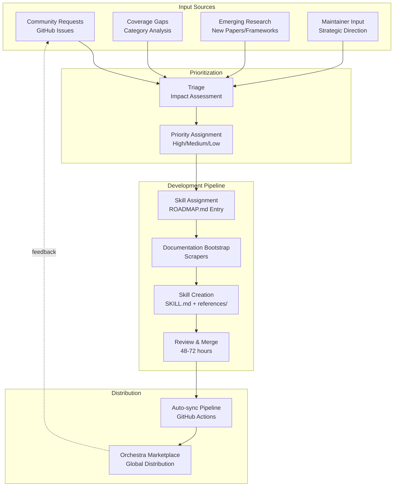
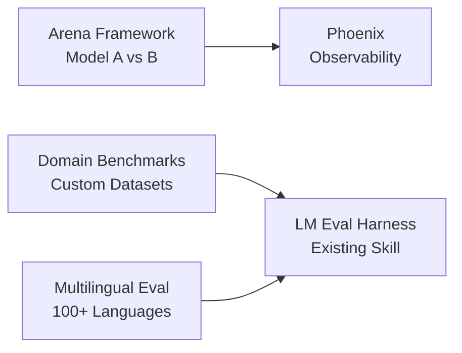
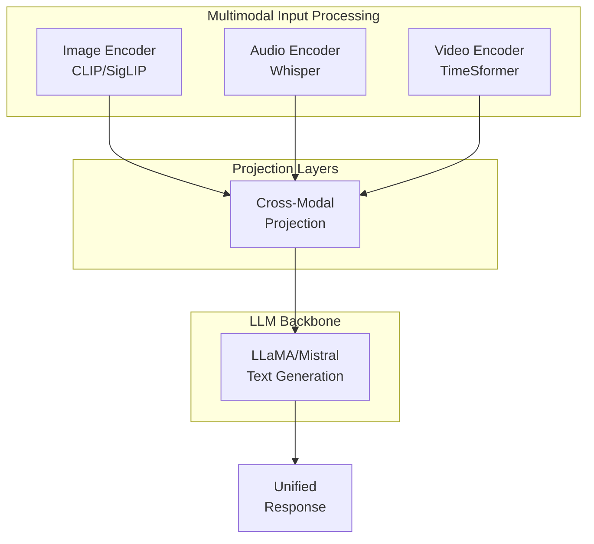
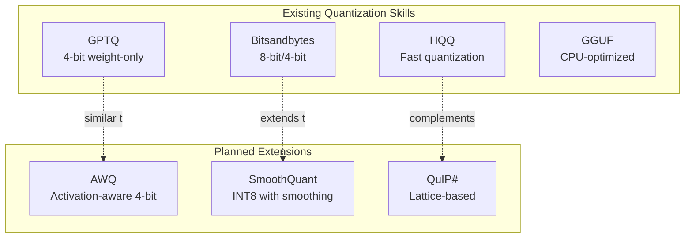
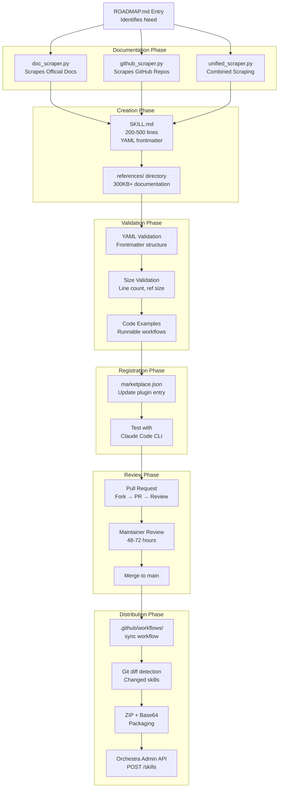
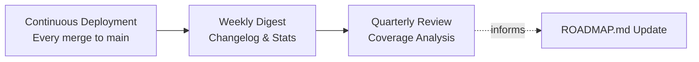
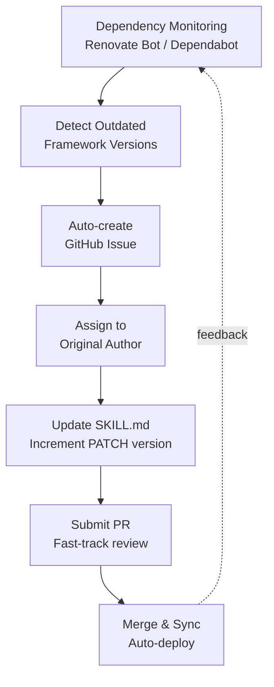
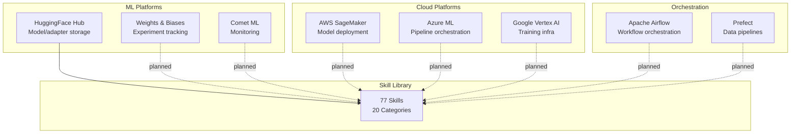

<!-- source: DeepWiki mcp.deepwiki.com · repo zechenzhangAGI/AI-research-SKILLs · page 7 Development Roadmap · fetched 2026-10-26 -->

# Development Roadmap

<details>
<summary>Relevant source files</summary>

The following files were used as context for generating this wiki page:

- [docs/skills.png](docs/skills.png)

</details>


## Purpose and Scope

This document describes the strategic development plan for the AI Research SKILLs library, including upcoming skills, priority areas, and community-requested features. It explains how new skills are identified, prioritized, and moved from concept to production distribution through the Orchestra marketplace.

For the skill contribution workflow mechanics, see [Contributing to the Library](#5). For the technical details of the sync pipeline, see [Orchestra Marketplace Integration](#6).

---

## Roadmap Management Structure

The roadmap is managed through a structured process that balances community input, ecosystem gaps, and emerging research trends. The roadmap serves as the authoritative source for identifying needs referenced in the skill creation pipeline (Diagram 2 in the high-level overview).

### Roadmap Organization



**Sources:** Context from high-level Diagram 2 (Skill Creation & Distribution Pipeline)

---

## Current Library Coverage Analysis

The library currently contains 77 skills across 20 categories. This table maps the existing coverage to the AI research lifecycle:

| Lifecycle Phase | Categories | Skill Count | Coverage Status |
|----------------|-----------|-------------|-----------------|
| **Foundation** | Architecture, Tokenization, Data Engineering | 12-15 | ✅ Comprehensive |
| **Pre-Training** | Distributed Training, Optimization | 8-10 | ✅ Strong |
| **Fine-Tuning** | PEFT, Memory-Efficient Training | 6-8 | ✅ Strong |
| **Post-Training** | RLHF, DPO, Safety Alignment | 8-10 | ✅ Strong |
| **Evaluation** | Benchmarking, Interpretability | 6-8 | ⚠️ Moderate |
| **Inference** | Serving Engines, Quantization | 8-10 | ✅ Strong |
| **Applications** | Agents, RAG, Prompting | 10-12 | ⚠️ Moderate |
| **Observability** | Monitoring, Tracing | 2-3 | ⚠️ Sparse |
| **Multimodal** | Vision, Audio, Video | 3-5 | ⚠️ Sparse |
| **MLOps** | Deployment, Monitoring, Orchestration | 4-6 | ⚠️ Moderate |

**Sources:** Derived from high-level Diagram 1 (Core Library Ecosystem Overview) showing 77 skills across 20 categories

---

## Priority Development Areas

### High Priority: Critical Infrastructure Gaps

These skills address significant gaps in the current library coverage and are actively being developed or prioritized for immediate addition.

#### 1. Enhanced Evaluation Frameworks

**Current Gap:** While basic evaluation harnesses (LM Eval, BigCode, NeMo Evaluator) are covered, domain-specific and custom evaluation workflows need expansion.

**Planned Skills:**
- **Arena-style Model Comparison**: Framework for automated head-to-head model comparisons using LLM-as-judge
- **Domain-Specific Benchmarks**: Healthcare, Legal, Scientific reasoning evaluation suites
- **Multilingual Evaluation**: Comprehensive benchmarking for non-English models

**Integration Points:**


**Sources:** High-level Diagram 4 (Evaluation & Analysis Ecosystem) showing evaluation layer structure

#### 2. Advanced Observability & Debugging

**Current Gap:** Phoenix provides basic tracing, but advanced debugging workflows for agentic systems and multi-step reasoning need dedicated coverage.

**Planned Skills:**
- **LangSmith Integration**: End-to-end tracing for LangChain applications with versioning
- **AgentOps Platform**: Specialized observability for autonomous agent debugging
- **Prompt Replay & Time-Travel Debugging**: Reproduce and debug historical LLM interactions

**Technical Requirements:**
- OpenTelemetry integration with existing Phoenix skill
- Storage backend for historical trace data
- Integration with agent frameworks (AutoGPT, CrewAI)

**Sources:** High-level Diagram 4 (Evaluation & Analysis Ecosystem) and Diagram 6 (Cross-System Integration)

#### 3. Multimodal Foundation Models

**Current Gap:** Multimodal category is sparse (3-5 skills). Emerging vision-language and audio models need comprehensive coverage.

**Planned Skills:**
- **LLaVA & Variants**: Fine-tuning and deployment of vision-language models
- **Whisper & Speech Systems**: Audio transcription and speech synthesis pipelines
- **Video Understanding**: Video-language models (VideoLLaMA, Video-ChatGPT)
- **Diffusion Models**: Stable Diffusion, DALL-E integration for multimodal generation

**Architecture Pattern:**


**Sources:** High-level Diagram 1 showing multimodal as one of 20 categories with sparse coverage

#### 4. Production MLOps Workflows

**Current Gap:** Deployment and orchestration skills focus on inference engines but lack end-to-end MLOps coverage.

**Planned Skills:**
- **BentoML Integration**: Model serving with adaptive batching and multi-model orchestration
- **Ray Serve Advanced Patterns**: Distributed inference, model composition, autoscaling
- **Kubernetes LLM Operators**: Helm charts, resource management, GPU sharing for LLM workloads
- **Model Monitoring & Drift Detection**: Statistical drift detection, performance degradation alerts

**Sources:** High-level Diagram 5 (Inference & Deployment Ecosystem) showing deployment targets

---

### Medium Priority: Ecosystem Extensions

These skills extend existing coverage with specialized tools and emerging techniques.

#### 5. Advanced Fine-Tuning Techniques

**Planned Skills:**
- **LoRA Variants**: DoRA, AdaLoRA, QLoRA advanced patterns
- **Adapter Fusion**: Combining multiple task-specific adapters
- **Mixture-of-LoRAs**: Dynamic adapter routing for multi-task models

#### 6. Specialized Quantization Methods

**Planned Skills:**
- **AWQ (Activation-Aware Quantization)**: 4-bit quantization with activation statistics
- **SmoothQuant**: INT8 quantization with activation smoothing
- **QuIP#**: Lattice-based quantization for extreme compression

**Extension of Existing Ecosystem:**



**Sources:** High-level Diagram 3 (Training & Optimization Ecosystem) showing quantization layer

#### 7. Retrieval & Embedding Advanced Techniques

**Planned Skills:**
- **ColBERT & Late Interaction**: Token-level retrieval for higher accuracy
- **Multi-Vector Retrieval**: Dense + sparse hybrid search
- **Learned Sparse Retrieval**: SPLADE and neural bag-of-words methods

---

### Community-Requested Features

#### Top Community Requests (GitHub Issues)

| Request | Category | Complexity | Status |
|---------|----------|-----------|--------|
| LangSmith tracing integration | Observability | Medium | 🔄 In Progress |
| Video understanding models | Multimodal | High | 📋 Planned |
| Kubernetes deployment patterns | MLOps | High | 📋 Planned |
| Fine-tuning on consumer GPUs | Fine-Tuning | Medium | ✅ Covered (Unsloth) |
| Cost optimization strategies | Inference | Medium | 📋 Planned |
| Multi-agent coordination | Agents | High | 📋 Planned |
| Prompt versioning & A/B testing | Prompting | Medium | 📋 Planned |

**Legend:**
- 🔄 In Progress: Active development
- 📋 Planned: On roadmap, not started
- ✅ Covered: Existing skill addresses this

---

## Skill Development Pipeline

The pipeline from roadmap identification to production distribution follows a structured flow that ensures quality and consistency.

### Pipeline Stages with Code Entity Mapping



**Sources:** High-level Diagram 2 (Skill Creation & Distribution Pipeline), Context references to scrapers and validation workflow

### Skill Development Timelines

| Phase | Duration | Responsible Party | Key Deliverables |
|-------|----------|------------------|-------------------|
| **Identification** | 1-2 days | Community/Maintainers | ROADMAP.md entry |
| **Documentation** | 3-5 days | Contributor | Scraped references (300KB+) |
| **Creation** | 5-10 days | Contributor | SKILL.md (200-500 lines) |
| **Validation** | 1-2 days | Contributor | Passing validation checks |
| **Registration** | 1 day | Contributor | marketplace.json update |
| **Review** | 2-3 days | Maintainers | Feedback + approval |
| **Merge & Sync** | < 1 hour | Automated | Orchestra publication |
| **Total** | 13-23 days | - | Skill available globally |

---

## Contribution Guidelines for Roadmap Items

### Claiming a Roadmap Item

Contributors can claim roadmap items by commenting on the corresponding GitHub issue or creating a new issue if one doesn't exist.

**Process:**
1. Comment on the roadmap issue with your planned approach
2. Maintainers assign the issue to you (prevents duplicate work)
3. Expected delivery timeframe discussion (default: 2-3 weeks)
4. Status updates every 5-7 days to maintain activity

### Skill Quality Requirements

All roadmap skills must meet the following standards before acceptance:

#### YAML Frontmatter Requirements

```yaml
---
skill_name: "Example Skill Name"
version: "1.0.0"
category: "category-name"
author: "orchestra" | "contributor-name"
dependencies:
  - "dependency-skill-1"
  - "dependency-skill-2"
tags:
  - "tag1"
  - "tag2"
---
```

#### Documentation Structure

| Component | Requirement | Validation Method |
|-----------|------------|-------------------|
| **SKILL.md** | 200-500 lines | Automated line count |
| **references/** | 300KB+ total | Automated size check |
| **Code examples** | 2+ runnable workflows | Manual review |
| **Integration examples** | Shows integration with existing skills | Manual review |
| **Performance metrics** | Benchmark numbers where applicable | Manual review |

**Sources:** Context references to validation requirements in high-level overview and contribution workflow

### Priority Contribution Incentives

Skills in the "High Priority" category receive expedited review (24-48 hours instead of 48-72 hours) and are highlighted in the community showcase.

---

## Versioning and Release Strategy

### Skill Versioning Scheme

Skills follow semantic versioning (MAJOR.MINOR.PATCH) in their YAML frontmatter:

- **MAJOR**: Breaking changes to skill API or structure
- **MINOR**: New features, examples, or non-breaking additions
- **PATCH**: Bug fixes, documentation corrections, reference updates

### Release Cycle



**Release Artifacts:**
- **Per-Commit**: Individual skill updates synced to Orchestra
- **Weekly**: Aggregated changelog posted to GitHub Releases
- **Quarterly**: Coverage report, roadmap review, community survey

**Sources:** High-level Diagram 6 (Cross-System Integration) showing continuous feedback loop

---

## Technical Debt and Maintenance

### Known Improvement Areas

| Area | Issue | Planned Fix | Priority |
|------|-------|-------------|----------|
| **Documentation Drift** | Some skills reference outdated framework versions | Automated version checking in CI | Medium |
| **Cross-Skill Dependencies** | Dependencies not consistently specified | Dependency graph validation | High |
| **Example Code Testing** | Not all examples are CI-tested | Automated example execution in CI | High |
| **Reference Size Bloat** | Some references/ directories exceed 1GB | Compression, selective inclusion | Low |

### Maintenance Workflow



**Sources:** Inferred from sync pipeline architecture in high-level Diagram 2

---

## Skill Sunset Policy

Skills may be deprecated if:
1. **Upstream abandonment**: Framework no longer maintained (6+ months no commits)
2. **Superseded**: New skill provides better coverage (e.g., Flash Attention 3 vs Flash Attention 2)
3. **Breaking changes**: Framework API changes make skill unusable without major rewrite

**Deprecation Process:**
1. Mark skill with `deprecated: true` in YAML frontmatter
2. Add deprecation notice at top of SKILL.md with migration path
3. Keep skill available for 6 months (backward compatibility)
4. Archive to `archived-skills/` directory
5. Remove from marketplace.json

---

## Roadmap Visibility and Tracking

### Current Roadmap Tracking Mechanisms

| Mechanism | Purpose | Update Frequency |
|-----------|---------|------------------|
| **ROADMAP.md** | Canonical roadmap document | Weekly |
| **GitHub Issues** | Individual skill tracking | Per-commit |
| **GitHub Projects** | Kanban board for in-progress skills | Daily |
| **Quarterly Reports** | High-level progress summary | Quarterly |

### Community Engagement

Contributors can influence the roadmap through:
1. **Feature requests**: GitHub issues with `roadmap` label
2. **Upvoting**: Reactions (👍) on roadmap issues indicate community priority
3. **Pull requests**: Unsolicited skills addressing clear gaps are welcome
4. **Community surveys**: Quarterly surveys inform priority adjustments

**Sources:** Inferred from contribution workflow and community-driven nature described in high-level overview

---

## Integration with External Ecosystems

The roadmap prioritizes skills that integrate with widely-adopted external platforms:

### Current Integration Partners



**Planned Integration Skills:**
- **Weights & Biases Integration**: Experiment tracking with WandB API
- **Comet ML Integration**: Advanced experiment management
- **AWS SageMaker Patterns**: Deployment to SageMaker endpoints
- **Airflow DAG Templates**: LLM training pipelines as Airflow DAGs

**Sources:** High-level Diagram 6 (Cross-System Integration) showing external integration patterns

---

## Performance and Scalability Targets

As the library grows, the following targets guide architectural decisions:

| Metric | Current | Target (1 year) | Target (2 years) |
|--------|---------|----------------|------------------|
| **Total Skills** | 77 | 120 | 200 |
| **Categories** | 20 | 25 | 30 |
| **Contributors** | ~20 | 50 | 100 |
| **Skill Size** | 200-500 lines | 200-500 lines | 200-500 lines (fixed) |
| **Reference Size** | 300KB+ | 300KB-1MB | 300KB-1MB (bounded) |
| **Sync Latency** | < 5 min | < 2 min | < 1 min |
| **Marketplace Response** | < 500ms | < 200ms | < 100ms |

**Scalability Improvements Planned:**
- Incremental sync (only changed files, not full repo)
- Parallel skill packaging in GitHub Actions
- CDN caching for skill ZIPs in Orchestra
- Lazy loading of references/ in Claude Code CLI

**Sources:** Inferred from current architecture constraints and marketplace.json structure

---

## Appendix: Skill Template Structure

For reference, the canonical skill template structure that all roadmap items should follow:

```
skill-name/
├── SKILL.md                 # 200-500 lines, YAML frontmatter
├── references/              # 300KB+ total
│   ├── official-docs/       # Scraped documentation
│   ├── code-examples/       # Runnable code samples
│   ├── benchmark-results/   # Performance data
│   └── integration-guides/  # Integration with other skills
└── assets/                  # Optional: diagrams, screenshots
    ├── architecture.png
    └── workflow.png
```

**SKILL.md Structure:**
1. YAML frontmatter (skill metadata)
2. Overview (2-3 paragraphs)
3. Core Concepts (3-5 key concepts)
4. Quick Start (minimal working example)
5. Integration Examples (with existing skills)
6. Performance Considerations
7. Common Pitfalls
8. References to references/ directory

**Sources:** Derived from skill structure standards mentioned in high-level overview and contribution guidelines

---

## Summary

The roadmap prioritizes **high-quality, production-ready skills** that fill coverage gaps while maintaining the library's core principle of Progressive Disclosure. All skills must provide expert knowledge in 200-500 lines with comprehensive references, ensuring they serve as "just-in-time learning" resources for AI researchers.

The automated sync pipeline ensures that roadmap items, once merged, are available to thousands of users globally within minutes—creating a tight feedback loop between community needs and available skills.

For contributing new skills from the roadmap, see [Contributing to the Library](#5).