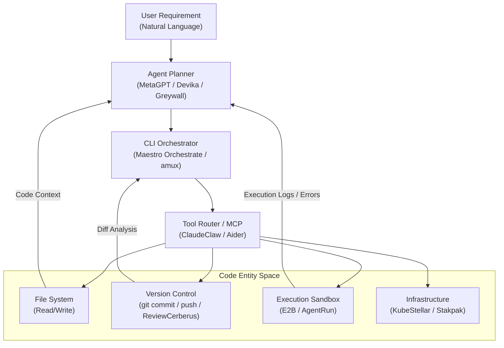
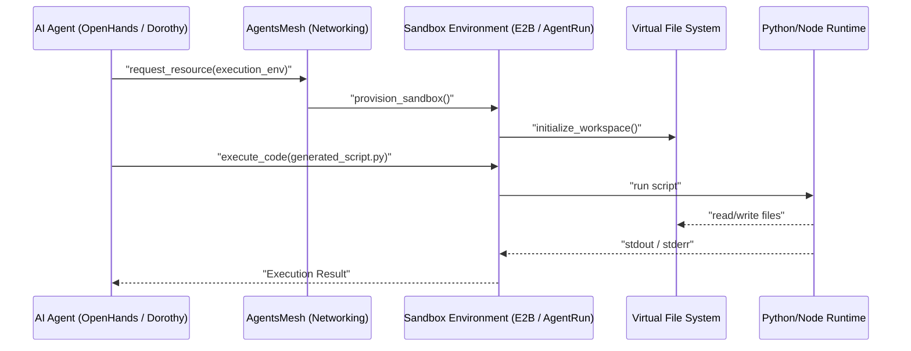

<!-- source: DeepWiki mcp.deepwiki.com · repo kyrolabs/awesome-agents · page 1.2 Software Development Agents · fetched 2026-10-26 -->

# Software Development Agents

<details>
<summary>Relevant source files</summary>

The following files were used as context for generating this wiki page:

- [README.md](README.md)

</details>


This page documents all entries listed under the **Software Development** section of the `README.md` in the `kyrolabs/awesome-agents` repository. It covers agents and tools whose primary focus is assisting with or autonomously performing software engineering tasks — including code generation, repository comprehension, autonomous bug fixing, pair programming, code review, and DevOps.

---

## What Are Software Development Agents?

Software development agents are AI systems that operate within a software engineering context. They differ from general-purpose frameworks in that they are purpose-built to interact with codebases, development tools (terminals, editors, browsers), version control systems, and issue trackers. Their outputs are typically code changes, documentation, or automated pull requests — not free-form text.

The agents listed here span a wide range of autonomy and scope:

- **Interactive pair programmers** — assist a developer in real time inside a terminal or IDE.
- **Autonomous engineers** — accept a high-level task and independently plan, write, and test code.
- **Repo-understanding tools** — analyze and document existing codebases.
- **Specialized agents** — target a specific sub-task such as code review, DevOps/infrastructure, or visual computing.
- **Sandbox isolation** — provide secure environments for executing agent-generated code.
- **Multi-agent CLI orchestration** — coordinate multiple specialized agents to complete complex engineering workflows.

Sources: [README.md:74-118]()

---

## Entries by Use Case

The following table organizes all Software Development entries from the README by their primary use case, including the latest additions.

| Tool | Primary Use Case | Interface / Environment |
|---|---|---|
| **MetaGPT** | Multi-agent software company simulation | Python API |
| **OpenHands** | Autonomous full-stack software development | Web platform |
| **GPT Pilot** | AI developer companion in VS Code | VS Code extension |
| **Aider** | AI pair programming | Terminal (CLI) |
| **Devika** | Agentic AI software engineer | Web UI |
| **RepoAgent** | Repository documentation generation | CLI / Python API |
| **DSPy** | Programmatic LLM pipeline construction | Python library |
| **ThinkGPT** | LLM augmentation techniques | Python library |
| **PyCodeAGI** | Python app generation from natural language | Python experiment |
| **SuperAGI** | Dev-first autonomous agent framework | Web platform |
| **Plandex** | AI coding engine for complex multi-file tasks | Terminal (CLI) |
| **Codel** | Fully autonomous task execution (terminal + browser + editor) | Web UI |
| **DB GPT** | Local GPT interaction with databases | Python / local deployment |
| **Agency** | Go-idiomatic LLM agent library | Go library |
| **TaskWeaver** | Data analytics agent (code-first planning) | Python API |
| **MicroAgent** | Self-editing prompt and Python code agents | Python |
| **SWE Agent** | Automated GitHub issue resolution | CLI / Python |
| **AgentRun** | Safe execution of AI-generated Python code | Python library |
| **Claude Engineer** | CLI assistant for software development tasks | Terminal (CLI) |
| **Vision Agent** | Vision task code generation | Python library |
| **Nous** | TypeScript AI agent platform (dev + review) | TypeScript |
| **Cline** | Open-source AI coding agent in IDE | IDE extension |
| **OpenCode** | Terminal-based AI coding agent | Terminal (CLI) |
| **Stakpak** | DevOps: infrastructure security and deployment | CLI |
| **ReviewCerberus** | AI code review (security, performance, quality) | CLI / git diff |
| **Hivemoot Colony** | Autonomous agent governance (voting, releasing) | Web dashboard |
| **GoatStack** | Open-source platform for building AI agents | Platform |
| **E2B Sandbox** | Secure cloud sandbox for AI agents | Cloud Infrastructure |
| **ClaudeClaw** | Persistent agent orchestrator (Claude Code plugin) | Plugin / CLI |
| **Dorothy** | AI-driven software engineering automation | Automation Platform |
| **Greywall** | Autonomous software engineering | Engineering Platform |
| **Maestro Orchestrate** | Multi-agent CLI orchestration | Terminal (CLI) |
| **amux** | Multi-agent CLI interface | Terminal (CLI) |
| **AgentsMesh** | Distributed agent networking for development | Network Protocol |
| **KubeStellar Console** | Multi-cluster Kubernetes management agent | DevOps UI |

Sources: [README.md:5-6](), [README.md:74-118]()

---

## Implementation and Data Flow

Software development agents bridge the gap between "Natural Language Space" (user requirements) and "Code Entity Space" (files, functions, and infrastructure).

**Diagram: Data Flow from Natural Language to Code Entities**



Sources: [README.md:5-6](), [README.md:74-118]()

**Diagram: Sandbox Isolation and Execution Flow**

This diagram illustrates how agents like **AgentRun** and **E2B** provide a secure boundary between generated code and the host system, now incorporating the networking layer of **AgentsMesh**.



Sources: [README.md:33](), [README.md:93](), [README.md:109](), [README.md:115]()

---

## Detailed Entry Reference

### Autonomous and Orchestrated Agents

These tools manage the full lifecycle of a software task, from planning to deployment.

| Tool | GitHub Repository | Key Characteristic |
|---|---|---|
| **ClaudeClaw** | `sbusso/claudeclaw` | Persistent orchestrator as a Claude Code plugin; features OS-level sandbox isolation and multi-channel routing. |
| **OpenHands** | `All-Hands-AI/OpenHands` | Comprehensive platform for autonomous software development. |
| **Dorothy** | `dev-dorothy/dorothy` | Focuses on software engineering automation through AI-driven task completion. |
| **Greywall** | `greywall-ai/greywall` | An autonomous software engineering platform designed for end-to-end task execution. |
| **SWE Agent** | `princeton-nlp/swe-agent` | Designed to resolve GitHub issues by browsing repositories and applying patches. |
| **MetaGPT** | `geekan/MetaGPT` | Simulates a software company roles (PM, Architect, Engineer) to produce full repositories. |

Sources: [README.md:5-6](), [README.md:76-78](), [README.md:92](), [README.md:111-112]()

### Development Environments and CLI Orchestration

Tools that integrate into the developer's workflow or coordinate multiple agents via terminal interfaces.

| Tool | GitHub Repository | Key Characteristic |
|---|---|---|
| **Aider** | `Aider-AI/aider` | CLI tool for editing code in local git repos via chat. |
| **Maestro Orchestrate** | `Doriandarko/maestro-orchestrate` | A framework for orchestrating multiple sub-agents via CLI. |
| **amux** | `merwane/amux` | A multi-agent CLI interface for managing different agent interactions. |
| **Cline** | `cline/cline` | Open-source AI coding agent running inside the IDE with file system access. |
| **Plandex** | `plandex-ai/plandex` | Terminal-based engine for complex, multi-file coding tasks. |

Sources: [README.md:79-80](), [README.md:86](), [README.md:113-114]()

### Infrastructure, DevOps, and Networking

Specialized tools for the safe execution, deployment, and interconnection of agentic systems.

| Tool | GitHub Repository | Key Characteristic |
|---|---|---|
| **E2B Sandbox** | `e2b-dev/e2b` | Secure cloud sandboxes for AI agents to run code and use tools. |
| **KubeStellar Console** | `kubestellar/console` | Agent-based interface for managing multi-cluster Kubernetes environments. |
| **AgentsMesh** | `agents-mesh/agents-mesh` | A distributed networking protocol for connecting multiple agents across environments. |
| **Stakpak** | `stakpak/agent` | Focuses on DevOps, infrastructure security, and deployment automation. |
| **ReviewCerberus** | `review-cerberus/review-cerberus` | Specialized agent for automated code review focusing on security and quality. |

Sources: [README.md:33](), [README.md:100](), [README.md:115-117]()

---

## Summary: Use Case Coverage

**Diagram: Taxonomy of Software Development Agents**

```mermaid
mindmap
  root(("Software\nDevelopment\nAgents"))
    "Autonomous Engineers"
      "OpenHands"
      "Devika"
      "SWE Agent"
      "Dorothy"
      "Greywall"
    "Pair Programming & CLI"
      "Aider"
      "Cline"
      "Maestro Orchestrate"
      "amux"
    "Multi-Agent & Orchestration"
      "MetaGPT"
      "ClaudeClaw"
      "Nous"
      "AgentsMesh"
    "Sandbox & Infrastructure"
      "E2B Sandbox"
      "AgentRun"
      "KubeStellar Console"
      "Stakpak"
    "Specialized Tasks"
      "RepoAgent (Docs)"
      "ReviewCerberus (Review)"
      "Vision Agent (CV)"
      "DB GPT (SQL)"
    "Libraries & Logic"
      "DSPy"
      "ThinkGPT"
      "TaskWeaver"
```

Sources: [README.md:5-6](), [README.md:74-118]()

---

