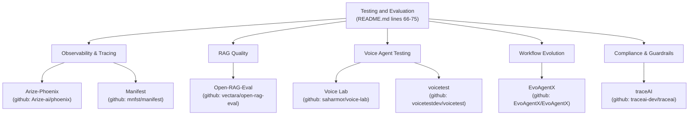
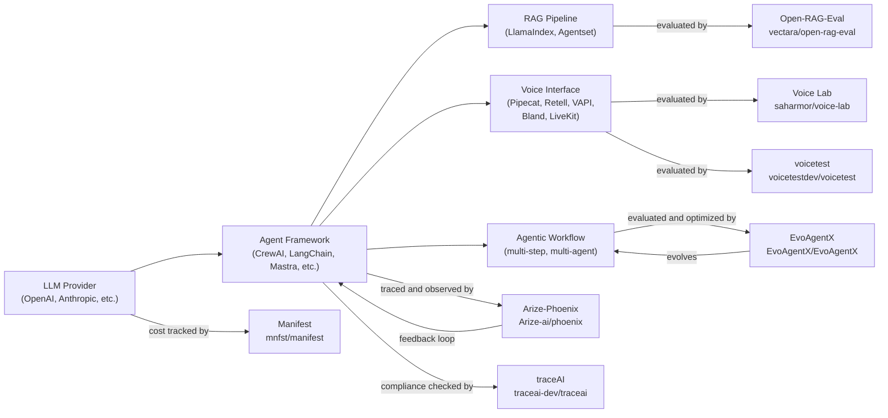
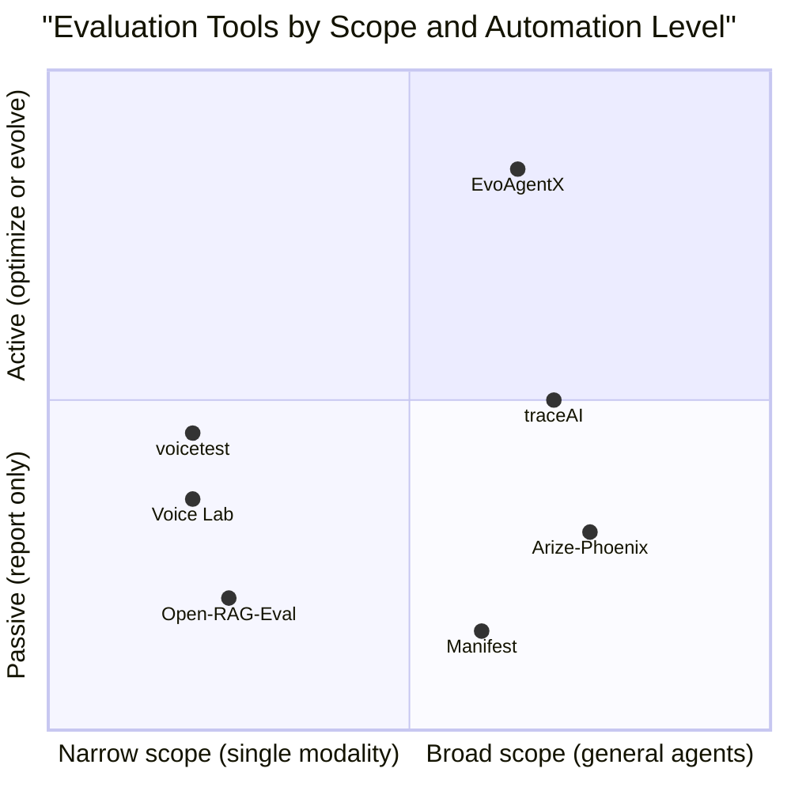

<!-- source: DeepWiki mcp.deepwiki.com · repo kyrolabs/awesome-agents · page 1.4 Testing and Evaluation · fetched 2026-10-26 -->

# Testing and Evaluation

Relevant source files

The following files were used as context for generating this wiki page:

- [README.md](README.md)

## Purpose and Scope

This page documents the tools listed under the **Testing and Evaluation** category in [README.md:66-75](). These tools are specifically concerned with measuring, observing, and improving AI agent behavior after the agent has been built — covering runtime observability, benchmark evaluation, voice interface testing, and workflow optimization.

For documentation on the frameworks used to *build* agents, see [Frameworks (1.1)](). For agents that conduct *research tasks*, see [Research Agents (1.3)]().

---

## Why Evaluation Is a Distinct Concern

Evaluation tooling occupies a separate layer from agent frameworks because the failure modes of AI agents differ from those of deterministic software. Agents may produce outputs that are syntactically correct but semantically wrong, costly, or inconsistent across runs. This creates several concerns that ordinary unit testing does not address:

- **Non-determinism**: Agent outputs vary between runs; evaluation must handle probabilistic correctness.
- **Multi-step reasoning**: Errors may compound across tool calls and LLM invocations.
- **Modality diversity**: Voice agents, RAG pipelines, and code-generating agents each require specialized evaluation methods.
- **Cost and resource tracking**: Token usage and API costs must be monitored in production.
- **Iterative improvement**: Evaluation results should feed back into prompt or workflow refinement.
- **Guardrails and Compliance**: Agents require real-time scanning to prevent harmful outputs or policy violations.

The tools in this category each address one or more of these concerns.

---

## Tool Summary

| Tool | Primary Focus | Key Differentiator |
|---|---|---|
| `Arize-Phoenix` | Observability, testing, evaluation | General-purpose; covers tracing, evals, and LLM spans |
| `Open-RAG-Eval` | RAG pipeline quality | Does not require golden/reference answers |
| `Voice Lab` | Voice agent evaluation | Tests across LLM variants, prompt sets, and agent personas |
| `voicetest` | Voice agent testing | Supports Retell, VAPI, Bland, LiveKit; uses LLM judges |
| `EvoAgentX` | Workflow evaluation and evolution | Self-evolving ecosystem; automates eval and workflow optimization |
| `Manifest` | Cost and token observability | Real-time dashboard; OTLP ingestion; 28+ LLM models; self-hosted |
| `traceAI` | Compliance and observability | Focuses on agent compliance, security, and performance tracing |

Sources: [README.md:66-75]()

---

## Tool Categorization

**Diagram: Evaluation Tools by Primary Concern**

Sources: [README.md:66-75]()

---

## How These Tools Fit Into the Agent Lifecycle

**Diagram: Evaluation Tools Mapped to Agent System Layers**

Sources: [README.md:22-75]()

---

## Tool Reference

### Arize-Phoenix

**GitHub:** `Arize-ai/phoenix`

An open-source library covering agent testing, evaluation, and observability. Arize-Phoenix is the most general-purpose tool in this category — it provides LLM tracing (spans and traces), built-in evaluators, and experiment tracking. It is suitable for monitoring production agent runs as well as running offline evaluations.

**Relevant aspects:**
- Captures LLM input/output spans across multi-step agent workflows.
- Supports evaluation of retrieval quality, hallucination, and relevance.
- Integrates with OpenTelemetry-compatible tracing pipelines.

Sources: [README.md:70]()

### Open-RAG-Eval

**GitHub:** `vectara/open-rag-eval`

An open-source RAG evaluation framework targeting the specific challenge of evaluating retrieval-augmented generation systems without needing pre-compiled golden answers. This is significant because constructing reference answer sets is expensive and often not feasible for production pipelines. Open-RAG-Eval is positioned for use with "Agentic RAG" — RAG pipelines embedded inside or orchestrated by AI agents.

**Key characteristic:** Reference-free evaluation; can assess factual grounding, answer coherence, and context relevance without a ground-truth corpus.

Sources: [README.md:68]()

### Voice Lab

**GitHub:** `saharmor/voice-lab`

A testing and evaluation framework specific to voice agents. Voice Lab allows engineers to test voice agent behavior across multiple dimensions simultaneously:
- Different underlying language models.
- Varied prompt configurations.
- Multiple agent personas.

This makes it suitable for systematic comparison experiments before deploying a voice agent to production.

Sources: [README.md:67]()

### voicetest

**GitHub:** `voicetestdev/voicetest`

An open-source test harness for voice agents with explicit support for several major voice agent platforms:

| Supported Platform | Type |
|---|---|
| Retell | Managed voice agent API |
| VAPI | Voice AI platform |
| Bland | Voice automation API |
| LiveKit | Open-source real-time communication |

`voicetest` runs **autonomous simulations** — the agent under test interacts with a simulated caller — and uses an **LLM-as-judge** pattern to score the interaction. This removes the need for human reviewers in the evaluation loop.

Sources: [README.md:71]()

### EvoAgentX

**GitHub:** `EvoAgentX/EvoAgentX`

EvoAgentX combines evaluation with workflow optimization. Rather than only measuring agent performance, it feeds evaluation results back into an automated loop that modifies the agentic workflow to improve scores — a "self-evolving ecosystem" model. This means EvoAgentX acts as both a benchmark runner and an optimizer.

**Distinction from other tools:** Most evaluation tools in this list produce reports or metrics; EvoAgentX acts on those metrics automatically to evolve the workflow.

Sources: [README.md:69]()

### Manifest

**GitHub:** `mnfst/manifest`

A real-time cost observability platform focused on tracking the operational cost and usage of AI agents. Unlike evaluation tools that assess output quality, Manifest focuses on resource consumption: tokens consumed, API costs, message counts, and model usage patterns.

**Notable characteristics:**
- Local-first dashboard (data stays on-premises).
- Supports 28+ LLM models.
- Accepts OTLP (OpenTelemetry Protocol) ingestion, making it compatible with existing observability pipelines.
- Self-hosted deployment.

Sources: [README.md:72]()

### traceAI

**GitHub:** `traceai-dev/traceai`

An open-source platform for agent compliance, observability, and performance tracing. It targets the "Guardrail Scanning" and "Compliance" aspects of agent behavior, ensuring that agent actions and outputs adhere to predefined security and performance standards.

Sources: [README.md:74]()

---

## Evaluation Concerns by Tool Matrix

Sources: [README.md:66-75]()

---

## Relationship to Frameworks

Evaluation tools in this category are consumers of agent frameworks, not alternatives to them. As illustrated in the lifecycle diagram, the output of frameworks like `CrewAI` [README.md:44](), `LangChain` [README.md:29](), `Mastra` [README.md:48](), and `Pipecat` [README.md:64]() flows into these evaluation tools. The feedback loop — where evaluation findings improve framework configuration, prompts, or workflows — is the mechanism by which the ecosystem matures iteratively.

`EvoAgentX` [README.md:69]() makes this loop explicit and automated. `Arize-Phoenix` [README.md:70]() and `Manifest` [README.md:72]() support it through persistent traces and metrics. `Voice Lab` [README.md:67](), `voicetest` [README.md:71](), and `Open-RAG-Eval` [README.md:68]() provide the domain-specific signal needed for voice and retrieval-focused agents. `traceAI` [README.md:74]() ensures these framework outputs remain compliant with safety and security policies.

Sources: [README.md:22-75]()

---

