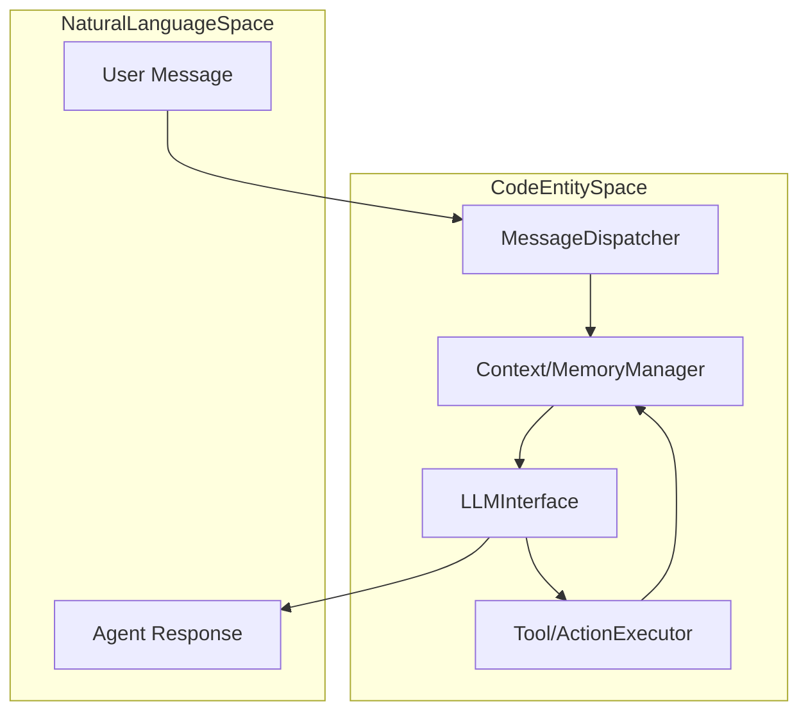
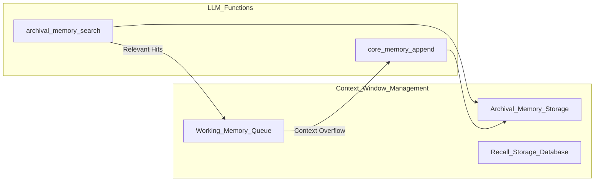
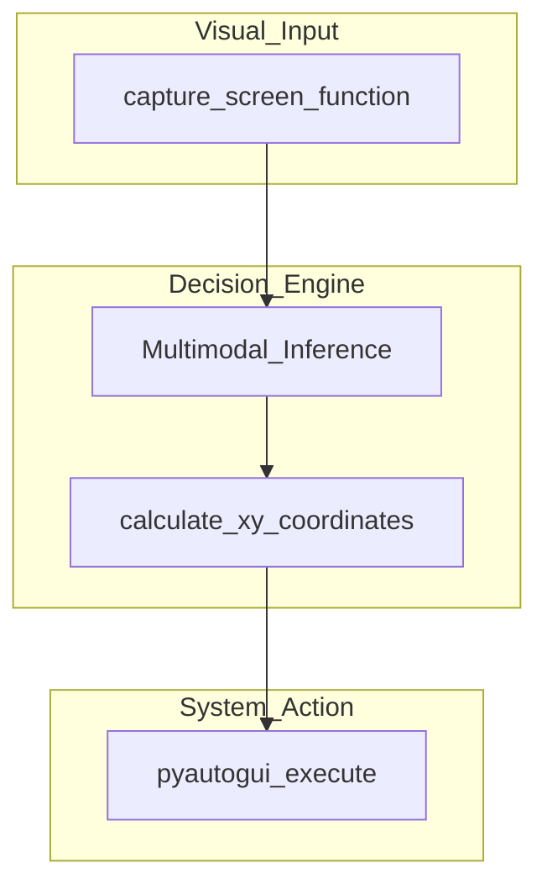

<!-- source: DeepWiki mcp.deepwiki.com · repo kyrolabs/awesome-agents · page 1.5 Conversational and General Agents · fetched 2026-10-26 -->

# Conversational and General Agents

Relevant source files

The following files were used as context for generating this wiki page:

- [README.md](README.md)

This section documents the **Conversational and General Agents** category within the `awesome-agents` repository. Unlike specialized vertical agents designed for narrow domains like software engineering or medical research, general-purpose agents focus on versatile interaction, long-term state management, and multi-modal communication across various platforms.

## Overview of General-Purpose Agents

General-purpose conversational agents are distinguished by their ability to handle diverse tasks through natural language, often serving as a unified interface for multiple tools. Key architectural patterns in this category include:

*   **Long-term Memory:** Systems that persist user preferences and past interactions across sessions (e.g., `MemGPT`).
*   **Voice-First Interaction:** Low-latency audio processing for real-time verbal communication.
*   **Multi-Channel Deployment:** The ability to route interactions through Slack, WhatsApp, Telegram, or custom web interfaces (e.g., `ClaudeClaw`, `OpenAgent`).
*   **Browser-Use Integration:** Leveraging agents to navigate the web to fulfill general user requests (e.g., `MateClaw`).

### Agent-User Interaction Flow

The following diagram illustrates the typical data flow for a conversational agent, bridging the "Natural Language Space" (User Input) to the "Code Entity Space" (Internal Logic and State).

**Conversational Agent Architecture**

Sources: [README.md:1-21]()

---

## Featured Tool: ClaudeClaw

[ClaudeClaw](https://github.com/sbusso/claudeclaw) is a featured entry that exemplifies the "General Agent" paradigm by acting as a persistent orchestrator implemented as a Claude Code plugin.

*   **Multi-channel routing:** Supports Slack, WhatsApp, and Telegram [README.md:5-5]().
*   **Isolation:** Uses OS-level sandbox isolation for safe execution [README.md:5-5]().
*   **Extensibility:** Features a composable extension system [README.md:5-5]().

Sources: [README.md:5-5]()

---

## Directory of Conversational and General Agents

The following tools are curated in the `README.md` under the Conversational / General Agents section.

| Tool | Description | Key Capability |
| :--- | :--- | :--- |
| [OpenAgent](https://github.com/OpenAgent-dev/OpenAgent) | Open-source agent for multi-channel messaging (Telegram, Slack, Discord) with long-term memory. | Multi-channel Memory |
| [MateClaw](https://github.com/V-I-R-L/MateClaw) | A browser-use deployment of the ClaudeClaw agent. | Browser-based Execution |
| [ClaudeClaw](https://github.com/sbusso/claudeclaw) | Persistent agent orchestrator as a Claude Code plugin. | OS-level Sandboxing |
| [joinly](https://github.com/joinly-ai/joinly) | Multi-channel AI agent platform for WhatsApp, Telegram, and Web. | Messaging Interoperability |
| [Gobii](https://github.com/gobii-ai/gobii) | Your open-source AI sidekick. | General Productivity |
| [MemGPT](https://github.com/cpacker/MemGPT) | Teaching LLMs memory management for unbounded context. | Virtual Context Management |
| [GPT Engineer](https://github.com/AntonOsika/gpt-engineer) | Specify what you want it to build, the AI asks for clarification, and then builds the entire codebase. | General Project Scaffolding |
| [BabyAGI](https://github.com/yoheinakajima/babyagi) | An AI-powered task management system using OpenAI and Pinecone. | Autonomous Task Planning |
| [AutoGPT](https://github.com/Significant-Gravitas/Auto-GPT) | An experimental attempt to make GPT-4 fully autonomous. | General Goal Pursuit |
| [OpenInterpreter](https://github.com/KillianLucas/open-interpreter) | A natural language interface for your computer's code interpreter. | Local OS Interaction |

Sources: [README.md:5-5](), [README.md:120-155]()

---

## Technical Implementation Patterns

### Memory and State Persistence (MemGPT & OpenAgent)

General agents often implement a `LongTermMemory` or `StateStore` to maintain context across disconnected chat sessions. **MemGPT** introduces the concept of "OS-like" memory management, where the LLM manages its own context window through explicit memory-paging functions.

**Memory Paging Logic (MemGPT Pattern)**

Sources: [README.md:130-131]()

### Multi-Channel Messaging and Routing

Agents like **OpenAgent**, **joinly**, and **ClaudeClaw** utilize a routing layer to abstract communication protocols. This allows a single agent core to interact with users on Signal, WhatsApp, or Slack.

**Multi-Channel Routing Architecture**

| Entity | Role |
| :--- | :--- |
| `MultiChannelRouter` | Maps incoming platform events (e.g., `on_message`) to internal formats. |
| `SandboxIsolation` | Used by `ClaudeClaw` to ensure conversational code execution is safe. |
| `SkillPlugin` | Composable extensions used by `OpenAgent` to add functionality like web search. |

Sources: [README.md:5-5](), [README.md:148-152]()

### Browser-Use and GUI Deployment (MateClaw & Self-operating Computer)

The transition from text-only to "General" capability often involves the agent controlling a browser or GUI. **MateClaw** serves as a specific deployment of the `ClaudeClaw` framework focused on browser-based tasks, while **Self-operating Computer** maps multimodal vision to mouse and keyboard events.

**Vision-to-Action Pipeline**

Sources: [README.md:141-142](), [README.md:154-155]()

---

