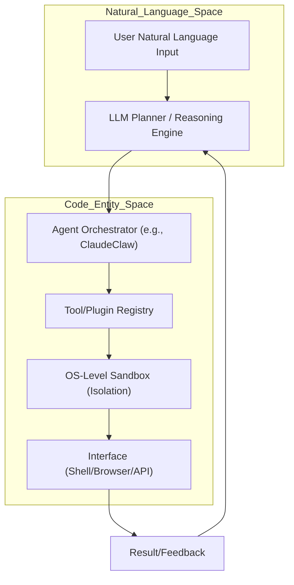
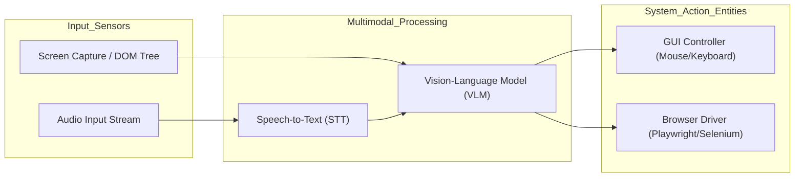

<!-- source: DeepWiki mcp.deepwiki.com · repo kyrolabs/awesome-agents · page 1.6 Automation, Browser, and Multimodal Agents · fetched 2026-10-26 -->

# Automation, Browser, and Multimodal Agents

Relevant source files

The following files were used as context for generating this wiki page:

- [README.md](README.md)

This section documents agents and tools designed to bridge the gap between Large Language Models (LLMs) and actionable interfaces. The scope of automation agents in this repository ranges from high-level workflow builders and RESTful API controllers to low-level macOS GUI automation, Telegram bridges, and browser-specific infrastructure [README.md:18-20]().

## Automation Agents and Workflow Builders

Automation agents focus on executing sequences of tasks across different platforms. This includes everything from simple API integrations to complex, long-running workflows that can control operating systems or messaging platforms.

| Tool | Description |
| :--- | :--- |
| [ClaudeClaw](https://github.com/sbusso/claudeclaw) | A featured persistent agent orchestrator acting as a Claude Code plugin. It supports multi-channel routing (Slack, WhatsApp, Telegram) and OS-level sandbox isolation [README.md:5-5](). |
| [osModa](https://github.com/moda-org/osmoda) | Open source macOS automation agent [README.md:143-143](). |
| [AppAgent](https://github.com/mnotgod96/AppAgent) | An LLM-based multimodal agent framework designed to operate smartphone applications [README.md:144-144](). |
| [Self-Operating Computer](https://github.com/OthersideAI/self-operating-computer) | A framework that enables multimodal models to operate a computer by interacting with the GUI [README.md:145-145](). |
| [AutoGPT](https://github.com/Significant-Gravitas/Auto-GPT) | An experimental open-source attempt to make GPT-4 fully autonomous [README.md:146-146](). |
| [BabyAGI](https://github.com/yoheinakajima/babyagi) | A Python script that uses OpenAI and Pinecone APIs to create, prioritize, and execute tasks [README.md:147-147](). |
| [AgentForge](https://github.com/mnotgod96/AgentForge) | A low-code framework for building and deploying AI agents [README.md:148-148](). |
| [SuperAGI](https://github.com/TransformerOptimus/SuperAGI) | A dev-first open-source autonomous AI agent framework [README.md:149-149](). |
| [Skyvern](https://github.com/skyvern-ai/skyvern) | Automates browser-based workflows using LLMs and Computer Vision [README.md:150-150](). |
| [OpenDevin](https://github.com/OpenDevin/OpenDevin) | An autonomous agent that can interact with the world via a web browser and shell [README.md:151-151](). |
| [OpenOperator](https://github.com/OpenOperator/OpenOperator) | An open-source implementation of a browser-based AI operator [README.md:152-152](). |
| [UFO](https://github.com/microsoft/UFO) | A UI-Focused agent for Windows OS interaction [README.md:153-153](). |
| [Griptape](https://github.com/griptape-ai/griptape) | Python framework for building AI agents with memory, tools, and workflows [README.md:154-154](). |
| [Open-Interpreter](https://github.com/KillianLucas/open-interpreter) | A natural language interface for your computer's shell [README.md:155-155](). |
| [Keep](https://github.com/keephq/keep) | An open-source AIOps platform that uses agents for alert management [README.md:156-156](). |
| [Task Weaver](https://github.com/microsoft/TaskWeaver) | A code-first agent framework for seamless planning and execution [README.md:157-157](). |
| [PyGPT](https://github.com/szczyglis-dev/py-gpt) | All-in-one AI desktop assistant for Windows, Linux, and Mac [README.md:158-158](). |
| [Hamilton](https://github.com/dagworks-inc/hamilton) | A micro-framework for defining dataflows [README.md:159-159](). |
| [Activepieces](https://github.com/activepieces/activepieces) | Open-source workflow automation tool with AI capabilities [README.md:160-160](). |
| [n8n](https://github.com/n8n-io/n8n) | Workflow automation tool with native AI nodes [README.md:161-161](). |
| [Bee Agent Framework](https://github.com/i-am-bee/bee-agent-framework) | Open-source framework for building and deploying resilient agents [README.md:162-162](). |
| [Plandex](https://github.com/plandex-ai/plandex) | AI coding agent that plans and executes complex tasks [README.md:163-163](). |
| [Browser-use](https://github.com/browser-use/browser-use) | Make any LLM operate a browser [README.md:164-164](). |
| [Aider](https://github.com/paul-gauthier/aider) | Command-line chat tool that allows you to write code with LLMs [README.md:165-165](). |
| [OpenManus](https://github.com/mannaandbeast/OpenManus) | An open-source alternative to Manus, designed for high-performance agentic tasks [README.md:166-166](). |
| [Hugging Face Agent](https://github.com/huggingface/huggingface-agent) | A simple and efficient agent implementation by Hugging Face [README.md:167-167](). |
| [ZerePy](https://github.com/blorm-network/ZerePy) | A framework to deploy your own agents on X (Twitter) [README.md:168-168](). |
| [Atomic Agents](https://github.com/KennyVaneetvelde/atomic-agents) | A framework for building modular and predictable AI agents [README.md:169-169](). |
| [AI-Data-Scientist](https://github.com/vllm-project/ai-data-scientist) | An AI agent for automated data science and machine learning [README.md:170-170](). |
| [Actionbook](https://github.com/shobrook/actionbook) | The easiest way to build and run AI agents that can take actions [README.md:171-171](). |
| [RestGPT](https://github.com/yuzhen-mao/RestGPT) | An LLM-based agent for controlling RESTful APIs [README.md:172-172](). |

### Automation Data Flow: From Intent to Action

The following diagram illustrates how an automation agent like `ClaudeClaw` or `Open-Interpreter` bridges the "Natural Language Space" (User Intent) to the "Code Entity Space" (System Execution).

**System Architecture: Intent to Execution Bridge**

**Sources:** [README.md:5-5](), [README.md:155-155](), [README.md:164-164](), [README.md:172-172]()

## Browser Agents

Browser agents are a specialized sub-category focused on navigating and interacting with the web. They often combine Computer Vision with DOM manipulation to mimic human browsing behavior or provide specialized infrastructure for agentic browsing.

| Tool | Description |
| :--- | :--- |
| [LaVague](https://github.com/lavague-ai/lavague) | Open-source framework to build AI Web Agents [README.md:173-173](). |
| [BrowserGym](https://github.com/ServiceNow/BrowserGym) | A gym environment for evaluating and training browser agents [README.md:174-174](). |
| [Steel Browser](https://github.com/steel-dev/steel-browser) | An open-source browser built for AI agents [README.md:175-175](). |
| [Giselle](https://github.com/Giselle-ai/Giselle) | Low-code agent workflow builder [README.md:176-176](). |
| [ADAS](https://github.com/adas-ai/adas) | Automated Design of Agentic Systems [README.md:177-177](). |

**Sources:** [README.md:150-152](), [README.md:164-164](), [README.md:173-177]()

## Multimodal Agents

Multimodal agents extend the capabilities of standard agents by processing and generating multiple types of data, such as images, video, and audio, in addition to text.

*   **[AppAgent](https://github.com/mnotgod96/AppAgent)**: Uses visual cues to operate smartphone apps, effectively "seeing" the screen [README.md:144-144]().
*   **[Self-Operating Computer](https://github.com/OthersideAI/self-operating-computer)**: Employs multimodal models (like GPT-4V) to view the desktop screen and interact with the mouse and keyboard [README.md:145-145]().
*   **[UFO](https://github.com/microsoft/UFO)**: A UI-focused agent specifically for Windows, leveraging multimodal capabilities to navigate the OS [README.md:153-153]().

### Multimodal Interaction Flow

This diagram maps the interaction between multimodal input processing and the resulting system actions.

**Multimodal Entity Mapping**

**Sources:** [README.md:144-145](), [README.md:153-153](), [README.md:173-173]()

---

