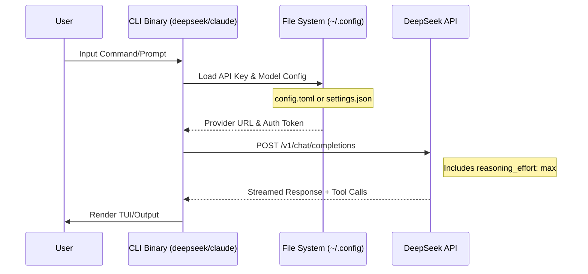

<!-- source: DeepWiki mcp.deepwiki.com · repo deepseek-ai/awesome-deepseek-agent · page 2 Terminal & CLI Coding Agents · fetched 2026-10-30 -->

# Terminal & CLI Coding Agents

<details>
<summary>Relevant source files</summary>

The following files were used as context for generating this wiki page:

- [README.md](README.md)
- [docs/assets/claude_code_vsc_ext.png](docs/assets/claude_code_vsc_ext.png)
- [docs/claude_code.md](docs/claude_code.md)
- [docs/deepseek-tui.md](docs/deepseek-tui.md)
- [docs/deepseek-tui.zh-CN.md](docs/deepseek-tui.zh-CN.md)

</details>


This section provides an overview of terminal-native AI coding assistants integrated with DeepSeek V4 models. These tools prioritize speed, keyboard-driven workflows, and direct interaction with local file systems and shell environments.

## Overview of CLI Agents

Terminal agents typically operate as standalone binaries or Node.js packages that leverage DeepSeek's 1M context window and reasoning capabilities to perform multi-step coding tasks. They often include features such as:
*   **Sandboxed Execution:** Securely running shell commands or Python REPLs.
*   **Tool Calling:** Automatically reading, writing, and searching files.
*   **Reasoning Control:** Toggling between high-speed "Flash" models and high-effort "Pro" reasoning modes.

### Agent to Code Space Mapping

The following diagram illustrates how CLI agent systems interact with specific code entities and local resources.

**System to Entity Association**
```mermaid
graph TD
    subgraph "Natural Language Space"
        "UserPrompt"["User Prompt"]
        "ReasoningLoop"["Reasoning Loop"]
    end

    subgraph "CLI Agent Space"
        "DeepSeekTUI"["DeepSeek-TUI (Rust)"]
        "ClaudeCode"["Claude Code (Node.js)"]
        "Reasonix"["Reasonix"]
    end

    subgraph "Code Entity Space"
        "ConfigTOML"["~/.deepseek/config.toml"]
        "SettingsJSON"["~/.claude/settings.json"]
        "SkillMD"["SKILL.md"]
        "MCP"["MCP Servers"]
        "REPL"["Python REPL"]
    end

    "UserPrompt" --> "DeepSeekTUI"
    "UserPrompt" --> "ClaudeCode"
    
    "DeepSeekTUI" --> "ConfigTOML"
    "DeepSeekTUI" --> "MCP"
    "DeepSeekTUI" --> "REPL"
    "DeepSeekTUI" --> "SkillMD"
    
    "ClaudeCode" --> "SettingsJSON"
    "Reasonix" --> "ReasoningLoop"
```
Sources: [docs/deepseek-tui.md:32-32](), [docs/deepseek-tui.md:78-82](), [docs/claude_code.md:41-41](), [README.md:20-36]()

---

## Tool Integration Guides

### Claude Code
Claude Code is a terminal-native assistant that can be configured to use DeepSeek via an Anthropic-compatible endpoint. Key configurations include setting the `ANTHROPIC_BASE_URL` to `https://api.deepseek.com/anthropic` and utilizing the `[1m]` context suffix for model identifiers.
*   **Key Files:** `~/.claude/settings.json` [docs/claude_code.md:41-41]()
*   **Critical Env:** `CLAUDE_CODE_EFFORT_LEVEL=max` [docs/claude_code.md:57-57]()
*   For details, see [Claude Code](#2.1).

### DeepSeek-TUI
A Rust-based assistant built as a 13-crate workspace. It supports native sandboxing on macOS, Linux, and Windows and features a TUI with three distinct modes: Plan, Agent, and YOLO.
*   **Key Command:** `deepseek auth` [docs/deepseek-tui.md:32-32]()
*   **Key Logic:** `Shift+Tab` cycles reasoning effort [docs/deepseek-tui.md:43-43]()
*   For details, see [DeepSeek-TUI](#2.2).

### Deep Code
An open-source terminal assistant specifically optimized for DeepSeek-V4. It features a discovery mechanism for "Agent Skills" stored in project-level or user-level markdown files.
*   **Key File:** `~/.deepcode/settings.json` [README.md:23-23]()
*   For details, see [Deep Code](#2.3).

### Reasonix
A DeepSeek-native agent emphasizing a "cache-first" loop and "flash-first" cost control. It is designed to be MCP-native from the ground up.
*   **Key Command:** `npx reasonix code` [README.md:36-36]()
*   For details, see [Reasonix](#2.4).

### Crush
A terminal agent from the Charm ecosystem. It supports LSP integration and uses a JSON-based provider configuration.
*   **Key File:** `~/.config/crush/crush.json` [README.md:22-22]()
*   For details, see [Crush](#2.5).

### Pi and Oh My Pi
Pi is a minimal terminal harness with tree-structured sessions. Its fork, Oh My Pi, adds specific tools, model roles, and complex agent workflows.
*   **Key File:** `~/.pi/agent/models.json` [README.md:32-35]()
*   For details, see [Pi and Oh My Pi](#2.6).

### Other Terminal Agents
This section covers lightweight or specialized tools including:
*   **Langcli:** 100% Claude Code compatible CLI [README.md:29-29]().
*   **nanobot:** Lightweight agent with MCP and memory [README.md:31-31]().
*   **OpenCode:** Multi-form assistant (Terminal/Web) [README.md:34-34]().
*   For details, see [Other Terminal Agents](#2.7).

---

## Architecture of CLI Tool Interaction

The following diagram demonstrates the data flow from the CLI entry point through the configuration layer to the DeepSeek API.

**CLI Data Flow Architecture**

Sources: [docs/deepseek-tui.md:32-43](), [docs/claude_code.md:47-60]()

---

