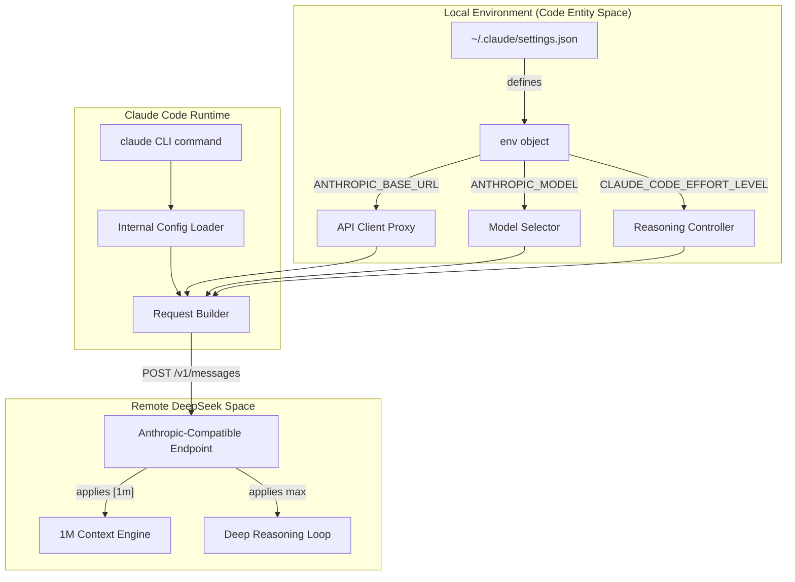
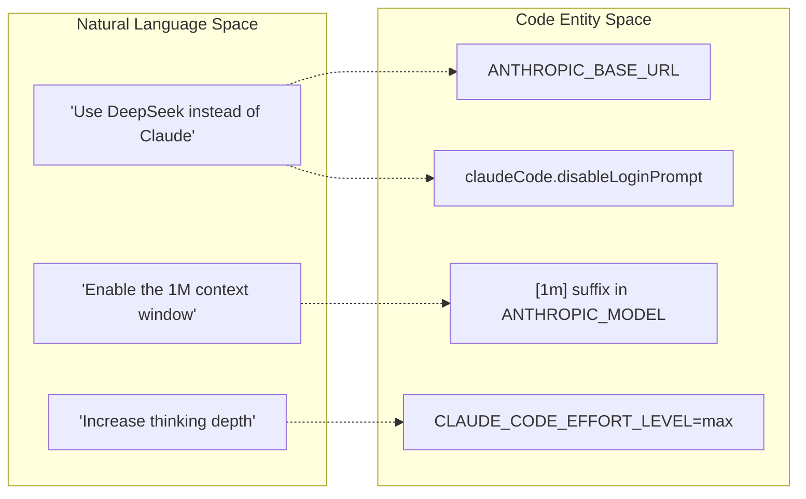

<!-- source: DeepWiki mcp.deepwiki.com · repo deepseek-ai/awesome-deepseek-agent · page 2.1 Claude Code · fetched 2026-10-30 -->

# Claude Code

<details>
<summary>Relevant source files</summary>

The following files were used as context for generating this wiki page:

- [docs/assets/claude_code_vsc_ext.png](docs/assets/claude_code_vsc_ext.png)
- [docs/claude_code.md](docs/claude_code.md)
- [docs/claude_code.zh-CN.md](docs/claude_code.zh-CN.md)

</details>


Claude Code is a high-performance AI coding assistant developed by Anthropic that operates directly within the terminal or as a VS Code extension. By leveraging the DeepSeek Anthropic-compatible endpoint, users can integrate DeepSeek V4's reasoning capabilities into the Claude Code workflow, benefiting from its 1M context window and advanced coding intelligence [docs/claude_code.md:3-5]().

## Installation

Claude Code can be deployed in two primary environments.

### 1. Claude Code CLI
The CLI version provides a terminal-native experience for interactive coding and repository management.

*   **Prerequisites**: Node.js 18+ is required [docs/claude_code.md:13-13](). Windows users must have Git for Windows installed [docs/claude_code.md:14-14]().
*   **Command**: Install the package globally via npm:
    ```bash
    npm install -g @anthropic-ai/claude-code
    ```
    [docs/claude_code.md:15-19]()
*   **Verification**: Run `claude --version` to confirm successful installation [docs/claude_code.md:21-25]().

### 2. VS Code Extension
For developers preferring an integrated IDE experience, the Claude Code extension embeds the assistant into the VS Code sidebar.

*   **Installation**: Install the [Claude Code VSCode Extension](https://marketplace.visualstudio.com/items?itemName=anthropic.claude-code) from the marketplace [docs/claude_code.md:27-30]().
*   **Bypass Login**: To use DeepSeek as the backend provider, enable the `claudeCode.disableLoginPrompt` setting in VS Code to prevent the default Anthropic login flow [docs/claude_code.md:32-32]().

---

## Configuration

Configuration is managed either via a `settings.json` file (recommended for persistence across both CLI and Extension) or via environment variables [docs/claude_code.md:34-36]().

### Option 1: settings.json (Recommended)
Create or edit the configuration file at the following location:
*   **Linux/Mac**: `~/.claude/settings.json` [docs/claude_code.md:41-41]()
*   **Windows**: `C:\Users\<username>\.claude\settings.json` [docs/claude_code.md:42-42]()

**Configuration Schema:**
```json
{
  "env": {
    "ANTHROPIC_BASE_URL": "https://api.deepseek.com/anthropic",
    "ANTHROPIC_AUTH_TOKEN": "<your DeepSeek API Key>",
    "ANTHROPIC_MODEL": "deepseek-v4-pro[1m]",
    "ANTHROPIC_DEFAULT_OPUS_MODEL": "deepseek-v4-pro[1m]",
    "ANTHROPIC_DEFAULT_SONNET_MODEL": "deepseek-v4-pro[1m]",
    "ANTHROPIC_DEFAULT_HAIKU_MODEL": "deepseek-v4-flash[1m]",
    "CLAUDE_CODE_DISABLE_NONESSENTIAL_TRAFFIC": "1",
    "CLAUDE_CODE_EFFORT_LEVEL": "max"
  }
}
```
[docs/claude_code.md:47-60]()

### Option 2: Environment Variables
For temporary sessions or CI/CD pipelines, variables can be exported directly to the shell [docs/claude_code.md:62-64]().

| Variable | Value | Description |
| :--- | :--- | :--- |
| `ANTHROPIC_BASE_URL` | `https://api.deepseek.com/anthropic` | DeepSeek's Anthropic-compatible gateway. |
| `ANTHROPIC_AUTH_TOKEN` | `<DeepSeek API Key>` | Your platform API key. |
| `ANTHROPIC_MODEL` | `deepseek-v4-pro[1m]` | Primary model with 1M context suffix. |
| `CLAUDE_CODE_EFFORT_LEVEL` | `max` | Enables maximum reasoning depth. |

[docs/claude_code.md:67-75]()

---

## Technical Implementation and Data Flow

The integration relies on the `ANTHROPIC_BASE_URL` override to redirect Claude Code's internal API client from Anthropic's servers to DeepSeek's compatible endpoint.

### Context Window and Reasoning
*   **[1m] Suffix**: DeepSeek V4 requires the `[1m]` suffix appended to the model name (e.g., `deepseek-v4-pro[1m]`) to activate the full 1-million-token context window [docs/claude_code.md:52-55]().
*   **Effort Level**: Setting `CLAUDE_CODE_EFFORT_LEVEL` to `max` ensures the model utilizes its maximum reasoning capacity for complex architectural and debugging tasks [docs/claude_code.md:57-57]().

### Data Flow Diagram
This diagram illustrates how configuration entities in `settings.json` map to the execution of the `claude` CLI and the subsequent API request to DeepSeek.

**System Architecture and Configuration Mapping**

Sources: [docs/claude_code.md:40-60](), [docs/claude_code.md:94-99]()

### Natural Language to Code Entity Mapping
This diagram bridges user intent (Natural Language) to the specific configuration keys and CLI commands (Code Entities).

**Intent to Configuration Mapping**

Sources: [docs/claude_code.md:32-32](), [docs/claude_code.md:49-57]()

---

## Usage

### Terminal (CLI)
Navigate to your project root and initialize the session:
```bash
cd /path/to/my-project
claude
```
[docs/claude_code.md:94-99]()

### VS Code
1. Open the project folder.
2. Click the **Claude Code icon** in the sidebar.
3. Select **New session** [docs/claude_code.md:106-107]().

The interface will reflect the configured DeepSeek model, allowing for natural language file editing, terminal command execution, and codebase indexing [docs/claude_code.md:109-110]().

---

