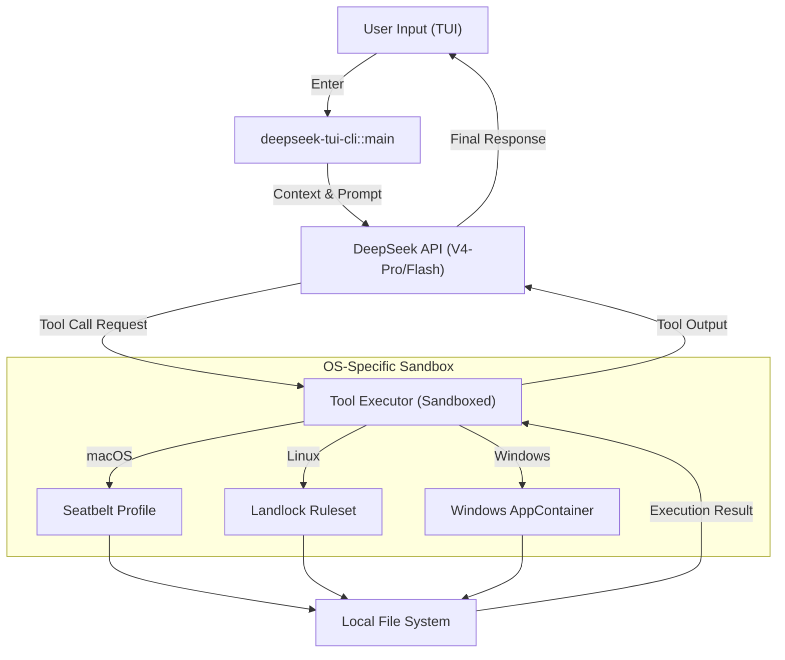

<!-- source: DeepWiki mcp.deepwiki.com · repo deepseek-ai/awesome-deepseek-agent · page 2.2 DeepSeek-TUI · fetched 2026-10-30 -->

# DeepSeek-TUI

Relevant source files

The following files were used as context for generating this wiki page:

- [docs/deepseek-tui.md](docs/deepseek-tui.md)
- [docs/deepseek-tui.zh-CN.md](docs/deepseek-tui.zh-CN.md)

DeepSeek-TUI is an open-source terminal AI coding assistant implemented in Rust using a Codex-style 13-crate workspace architecture [docs/deepseek-tui.md:5-5](). It provides a high-performance, sandboxed environment for AI-driven development, supporting both DeepSeek-V4-Pro and DeepSeek-V4-Flash models with a full 1 million token context window [docs/deepseek-tui.md:5-5]().

### Installation and Setup

DeepSeek-TUI can be installed via multiple package managers or as a standalone binary.

| Method | Command | Requirements |
| :--- | :--- | :--- |
| **npm** | `npm install -g deepseek-tui` | Node.js environment [docs/deepseek-tui.md:15-15]() |
| **Cargo** | `cargo install deepseek-tui-cli` | Rust 1.85+ [docs/deepseek-tui.md:18-18]() |
| **Binary** | Download from [GitHub Releases](https://github.com/Hmbown/DeepSeek-TUI/releases) | None [docs/deepseek-tui.md:20-22]() |

#### Authentication
The tool requires a DeepSeek API Key, which can be configured in two ways:
1.  **Interactive:** Run `deepseek auth` to save the key to `~/.deepseek/config.toml` [docs/deepseek-tui.md:32-32]().
2.  **Environment Variable:** Set `DEEPSEEK_API_KEY` in your shell [docs/deepseek-tui.md:32-32]().

### TUI Modes and Reasoning

The TUI features three distinct operational modes that control how the agent interacts with the local system, cycled via the `Tab` key [docs/deepseek-tui.md:43-43]().

| Mode | Behavior | Security Level |
| :--- | :--- | :--- |
| **Plan** | Read-only investigation. Cannot write files or execute shell commands [docs/deepseek-tui.md:47-47](). | High (Safe) |
| **Agent** | Multi-step tool use. Side-effectful tools (file writes, shell) require user approval [docs/deepseek-tui.md:48-48](). | Medium (Restricted) |
| **YOLO** | Auto-approves all tool calls and lifts workspace boundary restrictions [docs/deepseek-tui.md:49-49](). | Low (Unrestricted) |

#### Reasoning Effort
Users can cycle through reasoning intensity levels (`off` → `high` → `max`) by pressing `Shift+Tab` [docs/deepseek-tui.md:43-43](). This controls the `reasoning_effort` parameter sent to the DeepSeek API.

**Sources:** [docs/deepseek-tui.md:14-50](), [docs/deepseek-tui.zh-CN.md:13-49]()

### System Architecture and Data Flow

DeepSeek-TUI operates as a multi-crate Rust workspace. It includes a sandboxed execution layer for tools using OS-native features like Seatbelt (macOS), Landlock (Linux), and Windows sandboxing [docs/deepseek-tui.md:5-5]().

#### Data Flow Diagram: TUI to Tool Execution
The following diagram illustrates the flow from a user prompt to a sandboxed tool execution.

**Sources:** [docs/deepseek-tui.md:5-5](), [docs/deepseek-tui.md:37-43](), [docs/deepseek-tui.zh-CN.md:5-5]()

### Advanced Features

#### Model Orchestration
*   **Sub-agents:** The primary model can spawn child agents using the `agent_spawn` tool [docs/deepseek-tui.md:81-81](). These sub-agents have their own lifecycle managed via `agent_wait`, `agent_result`, and `agent_cancel` [docs/deepseek-tui.md:81-81]().
*   **RLM (Recursive LM):** A specialized tool for processing inputs that exceed typical context limits. It operates in a sandboxed Python REPL to summarize or extract data without polluting the main conversation context [docs/deepseek-tui.md:82-82]().

#### Extensibility
*   **MCP (Model Context Protocol):** DeepSeek-TUI acts as both an MCP client (connecting to external tools) and an MCP server (exposing its own capabilities via `deepseek mcp serve`) [docs/deepseek-tui.md:78-78](). Configuration is managed in `~/.deepseek/mcp.json` [docs/deepseek-tui.md:78-78]().
*   **Skills:** Markdown-based tool definitions (`SKILL.md`) can be placed in `~/.deepseek/skills/` (global) or `./.deepseek/skills/` (project-specific) to extend agent capabilities [docs/deepseek-tui.md:79-79]().
*   **Hooks:** Lifecycle hooks for `stdout`, `jsonl`, or `webhook` can be configured in the `[hooks]` section of `config.toml` [docs/deepseek-tui.md:80-80]().

#### HTTP Runtime API
By running `deepseek serve --http`, the application exposes a REST API at `/v1/*` [docs/deepseek-tui.md:86-86](). This allows external IDEs or Web UIs to interface with the DeepSeek-TUI runtime, managing sessions, threads, and tasks programmatically [docs/deepseek-tui.md:86-86]().

### Configuration Reference

The primary configuration resides in `~/.deepseek/config.toml` [docs/deepseek-tui.md:66-66]().

| Variable | Config Key | Description |
| :--- | :--- | :--- |
| `DEEPSEEK_API_KEY` | `api_key` | Authentication token [docs/deepseek-tui.md:70-70](). |
| `DEEPSEEK_BASE_URL` | `base_url` | Defaults to `https://api.deepseek.com` [docs/deepseek-tui.md:71-71](). |
| `DEEPSEEK_MODEL` | `model` | Default: `deepseek-v4-pro` [docs/deepseek-tui.md:72-72](). |
| `DEEPSEEK_PROVIDER` | `provider` | Allows switching to `nvidia-nim` or others [docs/deepseek-tui.md:73-73](). |

**Sources:** [docs/deepseek-tui.md:64-87](), [docs/deepseek-tui.zh-CN.md:64-87]()

---

