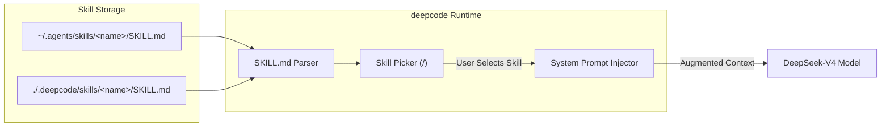

<!-- source: DeepWiki mcp.deepwiki.com · repo deepseek-ai/awesome-deepseek-agent · page 2.3 Deep Code · fetched 2026-10-30 -->

# Deep Code

<details>
<summary>Relevant source files</summary>

The following files were used as context for generating this wiki page:

- [docs/deepcode.md](docs/deepcode.md)
- [docs/deepcode.zh-CN.md](docs/deepcode.zh-CN.md)

</details>


Deep Code is an open-source terminal-native AI coding assistant optimized for the DeepSeek-V4 model series. It provides a CLI environment that supports deep thinking (reasoning) capabilities, reasoning effort control, and an extensible "Agent Skills" architecture. The assistant shares its configuration layer with the Deep Code VSCode extension, allowing for a unified developer experience across the terminal and the IDE.

## Installation and Setup

Deep Code is distributed via npm and requires Node.js version 18 or higher [docs/deepcode.md:9-11]().

### Global Installation
To install the CLI globally, execute:
```sh
npm install -g @vegamo/deepcode-cli
```
[docs/deepcode.md:14-16]()

Verification can be performed by checking the version:
```sh
deepcode --version
```
[docs/deepcode.md:18-22]()

### Configuration Structure
Deep Code utilizes a central configuration file located at `~/.deepcode/settings.json` [docs/deepcode.md:24-26](). This file manages environment variables, model behavior, and feature toggles.

| Option | Description |
| :--- | :--- |
| `MODEL` | The identifier for the model (e.g., `deepseek-v4-pro` or `deepseek-v4-flash`). |
| `BASE_URL` | The API endpoint (defaults to `https://api.deepseek.com`). |
| `thinkingEnabled` | Boolean to toggle deep thinking mode (defaults to `true` for V4). |
| `reasoningEffort` | Controls intensity: `"max"` or `"high"`. |
| `notify` | Path to a script executed after model turns. |
| `webSearchTool` | Boolean to enable/disable integrated web search. |

[docs/deepcode.md:44-54]()

**Sources:** [docs/deepcode.md:9-54](), [docs/deepcode.zh-CN.md:9-54]()

## System Architecture and Data Flow

The following diagram illustrates how the `deepcode` CLI initializes, loads configuration from the filesystem, and interacts with the DeepSeek API.

**Deep Code Initialization and API Flow**
```mermaid
graph TD
    subgraph "Local Environment"
        CLI["deepcode CLI"]
        CONFIG["~/.deepcode/settings.json"]
        PROJECT_DIR["Project Directory"]
        SKILLS_USER["~/.agents/skills/"]
        SKILLS_PROJ["./.deepcode/skills/"]
    end

    subgraph "Remote Services"
        DS_API["DeepSeek API (BASE_URL)"]
    end

    CLI -->|1. Read Env & Settings| CONFIG
    CLI -->|2. Context Discovery| PROJECT_DIR
    CLI -->|3. Load Agent Skills| SKILLS_USER
    CLI -->|3. Load Agent Skills| SKILLS_PROJ
    
    CLI -->|4. Chat Request (thinkingEnabled/reasoningEffort)| DS_API
    DS_API -->|5. Stream Response| CLI
    CLI -->|6. Optional: Execute notify script| CLI
```
**Sources:** [docs/deepcode.md:24-54](), [docs/deepcode.md:75-80]()

## Operational Interface

Deep Code is launched by navigating to a project directory and executing the `deepcode` command [docs/deepcode.md:55-60]().

### Key Shortcuts
The terminal interface supports several interactive commands and shortcuts for session management:

| Key | Action |
| :--- | :--- |
| `Enter` | Send current prompt. |
| `Shift+Enter` / `Ctrl+J` | Insert newline in multi-line prompts. |
| `Ctrl+V` | Paste image from clipboard for vision-supported tasks. |
| `Esc` | Interrupt/Abort current model generation. |
| `/` | Open the Skills and Commands menu. |

[docs/deepcode.md:62-70]()

### Slash Commands
| Command | Action |
| :--- | :--- |
| `/new` | Resets the context and starts a fresh conversation. |
| `/resume` | Opens a picker to continue a previous session. |
| `/exit` | Terminates the CLI application. |

[docs/deepcode.md:71-73]()

**Sources:** [docs/deepcode.md:55-73](), [docs/deepcode.zh-CN.md:55-73]()

## Agent Skills Discovery

Deep Code implements a "Skills" system that allows users to define custom behaviors or toolsets via `SKILL.md` files. These skills are automatically discovered by the assistant from two distinct levels: user-wide and project-specific.

**Skill Discovery and Execution Flow**


### Discovery Locations
1.  **User-level:** `~/.agents/skills/<name>/SKILL.md` [docs/deepcode.md:79]()
2.  **Project-level:** `./.deepcode/skills/<name>/SKILL.md` [docs/deepcode.md:80]()

Users can trigger these skills by pressing `/` to browse the menu or by typing the skill name directly as a command (e.g., `/skill-writer`) [docs/deepcode.md:82]().

**Sources:** [docs/deepcode.md:75-83](), [docs/deepcode.zh-CN.md:75-83]()

---

