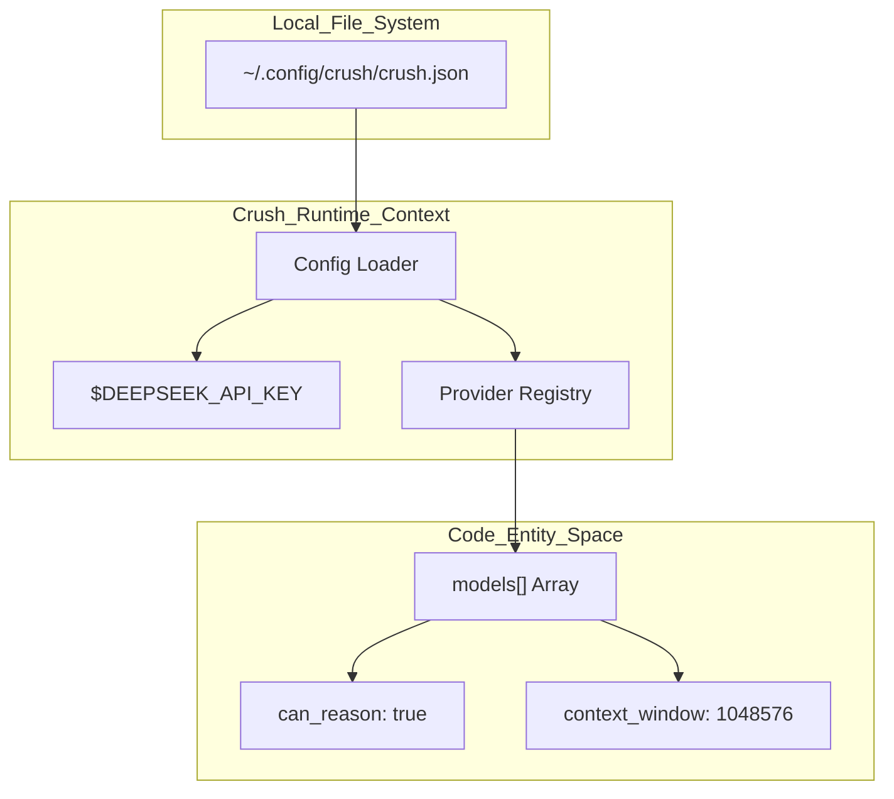
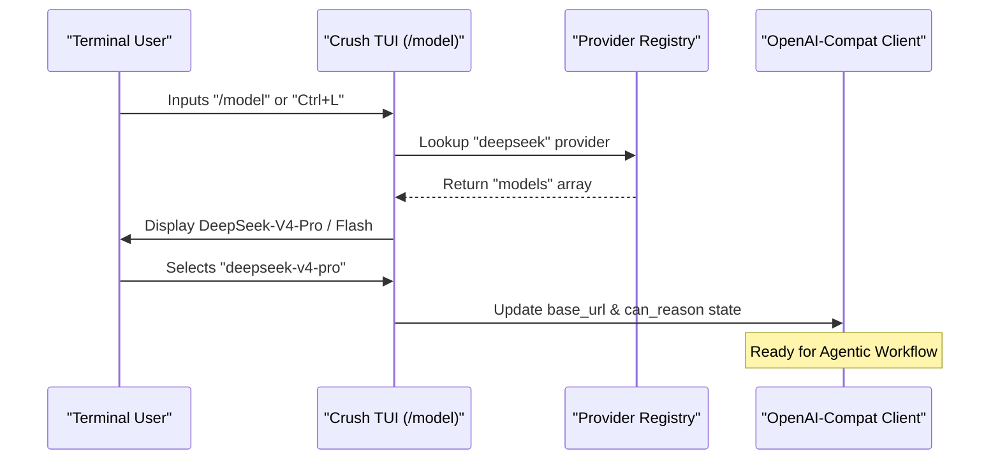

<!-- source: DeepWiki mcp.deepwiki.com · repo deepseek-ai/awesome-deepseek-agent · page 2.5 Crush · fetched 2026-10-30 -->

# Crush

Relevant source files

The following files were used as context for generating this wiki page:

- [docs/crush.md](docs/crush.md)
- [docs/crush.zh-CN.md](docs/crush.zh-CN.md)

Crush is a terminal-native, open-source AI coding agent developed by Charm. It provides a sophisticated TUI (Terminal User Interface) that integrates Language Server Protocol (LSP) support, Model Context Protocol (MCP) servers, and agentic workflows to automate coding tasks directly from the command line [docs/crush.md:5-5]().

### Installation

Crush can be installed via Node Package Manager (npm) or Homebrew for macOS users.

| Method | Command |
| :--- | :--- |
| **npm** | `npm install -g @charmland/crush` [docs/crush.md:13-13]() |
| **Homebrew** | `brew install charmbracelet/tap/crush` [docs/crush.md:22-22]() |

After installation, verify the setup by checking the version: `crush --version` [docs/crush.md:19-19]().

**Sources:** [docs/crush.md:7-22]()

---

### Configuration and Provider Setup

Crush utilizes a JSON-based configuration file located in the user's home directory. To integrate DeepSeek, users must define a custom provider using the `openai-compat` type [docs/crush.md:36-36]().

#### Configuration Path
- **Linux / macOS**: `~/.config/crush/crush.json` [docs/crush.md:28-28]()
- **Windows**: `%USERPROFILE%\.config\crush\crush.json` [docs/crush.md:29-29]()

#### Schema Implementation
The `crush.json` file requires a specific schema to map the DeepSeek API endpoints and model capabilities. Key fields include:
- `base_url`: Set to `https://api.deepseek.com` [docs/crush.md:37-37]().
- `api_key`: Reference an environment variable (e.g., `$DEEPSEEK_API_KEY`) for security [docs/crush.md:38-38]().
- `can_reason`: A boolean flag that must be set to `true` to enable reasoning capabilities for DeepSeek-V4 models [docs/crush.md:45-45]().

#### Configuration Data Flow

The following diagram illustrates how the configuration file maps to the internal provider logic.

**Crush Provider Initialization**

**Sources:** [docs/crush.md:24-58]()

---

### Model Management and Execution

Once configured, Crush allows dynamic model switching during an active session.

1.  **Launch**: Navigate to a project directory and execute `crush` [docs/crush.md:78-83]().
2.  **Model Switcher**: Use the `/model` command or the `Ctrl+L` shortcut to trigger the selection UI [docs/crush.md:85-85]().
3.  **Selection**: Select the `deepseek` provider and choose between `DeepSeek-V4-Pro` or `DeepSeek-V4-Flash` [docs/crush.md:86-86]().

#### Model Switching Sequence

This diagram tracks the transition from natural language commands to the internal model selection logic.

**Model Switcher Workflow**

**Sources:** [docs/crush.md:76-88]()

---

### Technical Specifications

The integration leverages the 1M context window and high token limits of the DeepSeek-V4 family.

| Parameter | Value | Source |
| :--- | :--- | :--- |
| **Provider Type** | `openai-compat` | [docs/crush.md:36-36]() |
| **Context Window** | `1048576` | [docs/crush.md:43-43]() |
| **Max Tokens** | `32768` | [docs/crush.md:44-44]() |
| **Reasoning Support** | `can_reason: true` | [docs/crush.md:45-45]() |

**Sources:** [docs/crush.md:31-58]()

---

