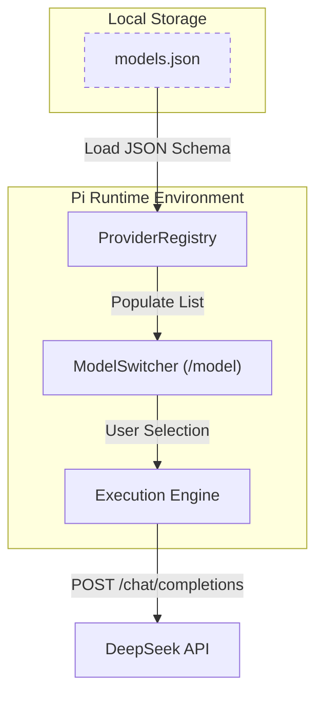
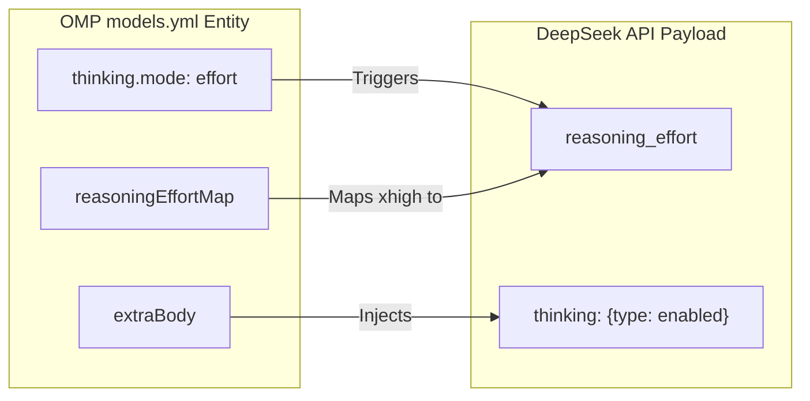

<!-- source: DeepWiki mcp.deepwiki.com · repo deepseek-ai/awesome-deepseek-agent · page 2.6 Pi and Oh My Pi · fetched 2026-10-30 -->

# Pi and Oh My Pi

<details>
<summary>Relevant source files</summary>

The following files were used as context for generating this wiki page:

- [docs/oh-my-pi.md](docs/oh-my-pi.md)
- [docs/oh-my-pi.zh-CN.md](docs/oh-my-pi.zh-CN.md)
- [docs/pi_mono.md](docs/pi_mono.md)
- [docs/pi_mono.zh-CN.md](docs/pi_mono.zh-CN.md)

</details>


Pi (pi-mono) and its fork, Oh My Pi (OMP), are minimal yet highly extensible terminal coding frameworks. They leverage a tree-structured session model and support a wide array of AI providers through TypeScript extensions, skills, and prompt templates [docs/pi_mono.md:5-5](). While both tools share a common lineage, Oh My Pi requires specific compatibility configurations to handle DeepSeek V4's reasoning content and tool-calling requirements without encountering 400 errors [docs/oh-my-pi.md:5-5]().

## Pi Terminal Framework

Pi is installed via npm or a shell script and serves as a coding harness that adapts to developer workflows [docs/pi_mono.md:5-14]().

### Installation and Setup
Pi requires Node.js and can be installed globally:
```bash
npm install -g @earendil-works/pi-coding-agent
```
[docs/pi_mono.md:9-14]()

Alternatively, Unix-like systems can use the official install script: `curl -fsSL https://pi.dev/install.sh | sh` [docs/pi_mono.md:23-25]().

### Configuration Schema
Pi uses a JSON-based provider system located at `~/.pi/agent/models.json` (Linux/macOS) or `%USERPROFILE%\.pi\agent\models.json` (Windows) [docs/pi_mono.md:31-32](). The configuration defines the `baseUrl`, `api` type, and specific model capabilities.

| Key | Value | Purpose |
| :--- | :--- | :--- |
| `baseUrl` | `https://api.deepseek.com` | Official DeepSeek API endpoint [docs/pi_mono.md:38-38]() |
| `api` | `openai-completions` | Protocol compatibility layer [docs/pi_mono.md:39-39]() |
| `reasoning` | `true` | Enables thinking capabilities [docs/pi_mono.md:48-48]() |
| `contextWindow` | `1000000` | 1M token context support [docs/pi_mono.md:45-45]() |

**Data Flow: Pi Configuration to Execution**
Title: Pi Model Resolution Flow

Sources: [docs/pi_mono.md:29-65](), [docs/pi_mono.md:123-125]()

---

## Oh My Pi (OMP)

Oh My Pi is a fork that provides enhanced terminal agent capabilities. Although it ships with built-in DeepSeek V4 entries as of v14.5, a custom `models.yml` is mandatory to avoid API errors during complex reasoning tasks [docs/oh-my-pi.md:5-5]().

### Critical Compatibility Fields
DeepSeek V4 introduces specific requirements for its thinking mode that differ from standard OpenAI implementations. Failing to include these in `~/.omp/agent/models.yml` results in 400 Bad Request errors [docs/oh-my-pi.md:98-100]().

*   **`supportsToolChoice: false`**: DeepSeek V4 reasoning mode does not support the `tool_choice` parameter [docs/oh-my-pi.md:104-104]().
*   **`requiresReasoningContentForToolCalls: true`**: The model requires `reasoning_content` to be preserved in the conversation history across tool-call turns [docs/oh-my-pi.md:105-105]().
*   **`requiresAssistantContentForToolCalls: true`**: Ensures tool-call messages contain non-null content fields [docs/oh-my-pi.md:106-106]().
*   **`extraBody.thinking.type: enabled`**: Explicitly activates the V4 thinking mode [docs/oh-my-pi.md:95-95]().

### Thinking Mode Mapping
OMP uses an internal effort scale that must be mapped to DeepSeek's supported levels (`high` and `max`) via the `reasoningEffortMap` [docs/oh-my-pi.md:94-94]().

**Entity Mapping: OMP Config to API Request**
Title: Oh My Pi Thinking Mode Protocol Mapping

Sources: [docs/oh-my-pi.md:32-51](), [docs/oh-my-pi.md:88-97]()

---

## Model Selection and Usage

Both Pi and Oh My Pi provide interactive commands to switch between the Pro and Flash models during a session.

| Feature | Pi Command | Oh My Pi Command |
| :--- | :--- | :--- |
| **Model Switcher** | `/model` [docs/pi_mono.md:123-123]() | `/model` or `Ctrl+L` [docs/oh-my-pi.md:121-121]() |
| **Direct Launch** | `pi` (then select) [docs/pi_mono.md:120-120]() | `omp --model deepseek/deepseek-v4-pro` [docs/oh-my-pi.md:112-112]() |

### Authentication
Neither tool currently supports DeepSeek OAuth login. Authentication must be handled via the `DEEPSEEK_API_KEY` environment variable or the `apiKey` field in the configuration files [docs/pi_mono.md:100-113](), [docs/oh-my-pi.md:127-127]().

**Sources:**
*   [docs/pi_mono.md:1-128]()
*   [docs/oh-my-pi.md:1-132]()

---

