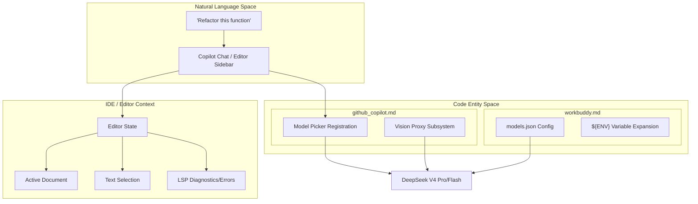
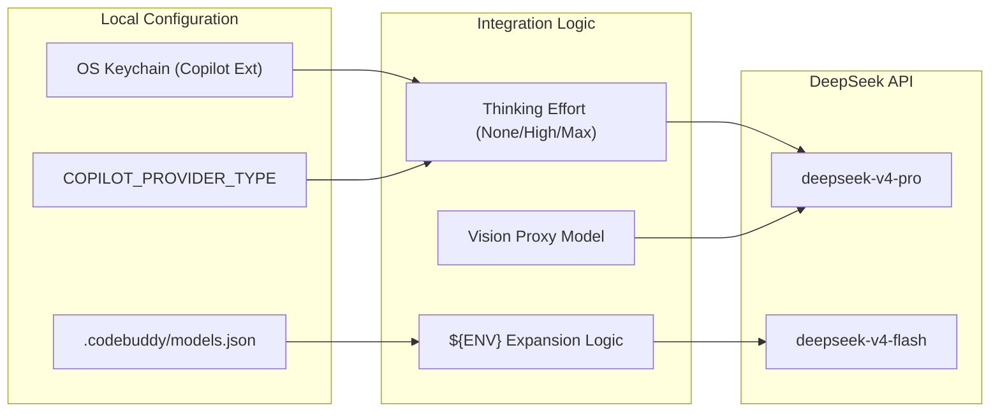

<!-- source: DeepWiki mcp.deepwiki.com · repo deepseek-ai/awesome-deepseek-agent · page 3 IDE Extensions and Editor Integrations · fetched 2026-10-30 -->

# IDE Extensions and Editor Integrations

Relevant source files

The following files were used as context for generating this wiki page:

- [README.md](README.md)
- [docs/github_copilot.md](docs/github_copilot.md)
- [docs/github_copilot.zh-CN.md](docs/github_copilot.zh-CN.md)

This section provides an overview of integrations that embed DeepSeek V4 models directly into Integrated Development Environments (IDEs) and code editors. These integrations allow developers to leverage DeepSeek's reasoning capabilities within familiar workflows, such as GitHub Copilot Chat or native editor sidebars, often supporting advanced features like tool calling, MCP (Model Context Protocol), and vision proxies.

### Integration Landscape

The following diagram illustrates how various IDE extensions bridge the gap between natural language developer intent and the underlying code entities within the editor environment.

**Editor Entity Mapping**

Sources: [docs/github_copilot.md:5-29](), [docs/workbuddy.md:1-10]()

---

### 3.1 GitHub Copilot (VS Code Extension)
The **DeepSeek V4 for Copilot Chat** extension integrates DeepSeek models directly into the official GitHub Copilot model picker in VS Code. It maintains compatibility with Copilot's agentic features, including tool calling and MCP. Key configuration involves the `DeepSeek: Set API Key` command, which stores credentials in the OS keychain rather than on disk.

It uniquely features a **Vision Proxy** subsystem. Since DeepSeek V4 is text-only, the extension can proxy image inputs through models like GPT-4o or Claude to generate descriptions before processing the request with DeepSeek.

For details, see [GitHub Copilot (VS Code Extension)](#3.1).

Sources: [docs/github_copilot.md:5-40]()

### 3.2 GitHub Copilot CLI
The GitHub Copilot CLI can be configured to use DeepSeek via a "Bring Your Own Key" (BYOK) approach. A critical requirement for this integration is setting the `COPILOT_PROVIDER_TYPE=anthropic` environment variable; using the `openai` type results in 400 errors due to protocol differences in how thinking models are handled.

For details, see [GitHub Copilot CLI](#3.2).

Sources: [README.md:26-26]()

### 3.3 Kilo Code
Kilo Code provides a unified experience across a CLI and an editor extension. Users connect the provider using the `/connect deepseek` command and can switch between specific model variants using the `/models` selector. The integration follows a structured visual setup process documented in the repository's assets.

For details, see [Kilo Code](#3.3).

Sources: [README.md:28-28]()

### 3.4 WorkBuddy / CodeBuddy
WorkBuddy (also known as CodeBuddy) utilizes a local configuration file located at `.codebuddy/models.json` to define model endpoints. This schema supports advanced features like `${ENV}` variable expansion for API keys and explicit mapping of `relatedModels`. It requires strict UTF-8 encoding (without BOM) to prevent parsing errors.

For details, see [WorkBuddy / CodeBuddy](#3.4).

Sources: [README.md:37-37]()

---

### System Architecture: Editor to Model Communication

The following diagram maps the communication flow from editor-specific configuration files to the DeepSeek API endpoints.

**Protocol and Configuration Flow**

Sources: [docs/github_copilot.md:22-40](), [docs/workbuddy.md:1-10]()

### Feature Comparison

| Feature | GitHub Copilot Ext | GitHub Copilot CLI | Kilo Code | WorkBuddy |
| :--- | :--- | :--- | :--- | :--- |
| **Storage** | OS Keychain | Env Vars | Local Config | `models.json` |
| **Reasoning Control** | UI (Gear Icon) | Env Vars | `/models` cmd | JSON Config |
| **Vision Support** | Proxy Subsystem | No | No | No |
| **Tool Calling** | Native Copilot | Supported | Supported | Supported |

Sources: [docs/github_copilot.md:31-40](), [README.md:25-37]()

---

