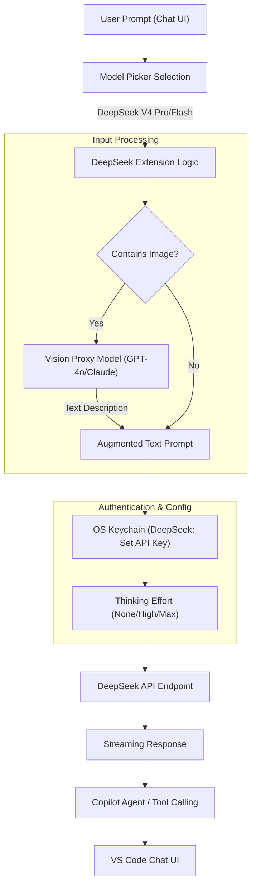

<!-- source: DeepWiki mcp.deepwiki.com · repo deepseek-ai/awesome-deepseek-agent · page 3.1 GitHub Copilot (VS Code Extension) · fetched 2026-10-30 -->

# GitHub Copilot (VS Code Extension)

<details>
<summary>Relevant source files</summary>

The following files were used as context for generating this wiki page:

- [docs/github_copilot.md](docs/github_copilot.md)
- [docs/github_copilot.zh-CN.md](docs/github_copilot.zh-CN.md)

</details>


The **DeepSeek V4 for Copilot Chat** extension integrates DeepSeek's high-performance reasoning models directly into the GitHub Copilot ecosystem within Visual Studio Code. This integration allows users to leverage DeepSeek V4 Pro and Flash while maintaining access to Copilot's native features, including Agent mode, tool calling, Skills, and Model Context Protocol (MCP) support.

### Extension Architecture and Data Flow

The extension functions by registering custom model providers within the VS Code Chat API. When a user selects a DeepSeek model, the extension intercepts the chat request, handles authentication via the OS keychain, manages reasoning effort parameters, and processes multi-modal inputs through a proxy subsystem.

#### Logic Flow: Chat Request Processing
The following diagram illustrates the flow from a user prompt in the VS Code Chat UI to the DeepSeek API.

**Diagram: Request Lifecycle and Vision Proxy**

Sources: [docs/github_copilot.md:5-5](), [docs/github_copilot.md:31-40]()

---

### Core Components and Commands

The extension exposes specific commands and configuration points to manage the integration lifecycle.

#### Authentication and Storage
The extension avoids storing sensitive credentials in plain text or VS Code settings files. Instead, it utilizes the operating system's secure keychain.
*   **Command**: `DeepSeek: Set API Key` [docs/github_copilot.md:21-21]()
*   **Implementation**: This command prompts the user for an `sk-` prefixed key and persists it using the VS Code `SecretStorage` API, which interfaces with the OS keychain (e.g., macOS Keychain Access, Windows Credential Manager) [docs/github_copilot.md:22-22]().

#### Model Registration
The extension registers two primary identifiers into the VS Code model picker [docs/github_copilot.md:27-28]():
1.  **DeepSeek V4 Pro**: Optimized for complex reasoning and deep technical tasks.
2.  **DeepSeek V4 Flash**: Optimized for speed and lower latency.

#### Thinking Effort Levels
Users can tune the reasoning intensity of the models via the gear icon in the model picker [docs/github_copilot.md:33-33](). This configuration maps to the `thinking` parameter in the API request:
| Level | Description | Use Case |
| :--- | :--- | :--- |
| **None** | Fastest response, no reasoning tokens generated. | Simple code completions or explanations. |
| **High** | Balanced reasoning (Default). | Standard debugging and architecture planning. |
| **Max** | Deepest reasoning effort. | Complex algorithmic logic and large-scale refactoring. |

Sources: [docs/github_copilot.md:31-37]()

---

### Vision Proxy Subsystem

Since DeepSeek V4 models are natively text-only, the extension implements a **Vision Proxy** to support image inputs (e.g., screenshots of UI bugs or terminal errors).

**Diagram: Vision Proxy Implementation**
```mermaid
classDiagram
    class VSCodeChatUI {
        +ImageAttachment image
        +String userText
    }
    class VisionProxySubsystem {
        +Model selectedProxyModel
        +describeImage(image) String
    }
    class DeepSeekExtension {
        +setVisionProxyModel()
        +processRequest()
    }
    class DeepSeekAPI {
        +textInput
    }

    VSCodeChatUI --> DeepSeekExtension : Sends Request
    DeepSeekExtension --> VisionProxySubsystem : Calls DeepSeek: Set Vision Proxy Model
    VisionProxySubsystem --> VSCodeChatUI : Extracts Image
    VisionProxySubsystem --> DeepSeekExtension : Returns Text Description
    DeepSeekExtension --> DeepSeekAPI : Final Text Payload
```

**Key Functionality**:
*   **Command**: `DeepSeek: Set Vision Proxy Model` [docs/github_copilot.md:40-40]()
*   **Workflow**: When an image is dropped into the chat, the extension sends the image to a secondary Copilot-supported model (such as Claude 3.5 Sonnet or GPT-4o). The resulting text description is prepended to the user's prompt before being dispatched to DeepSeek [docs/github_copilot.md:38-40]().

Sources: [docs/github_copilot.md:38-40]()

---

### Installation and Requirements

The extension requires modern VS Code infrastructure to support the Chat API and model picker registration.

| Requirement | Specification |
| :--- | :--- |
| **VS Code Version** | 1.116 or later [docs/github_copilot.md:9-9]() |
| **Subscription** | Active GitHub Copilot (Free, Pro, or Enterprise) [docs/github_copilot.md:10-10]() |
| **API Provider** | DeepSeek Platform API Key (`sk-...`) [docs/github_copilot.md:15-16]() |

Sources: [docs/github_copilot.md:7-17]()

---

