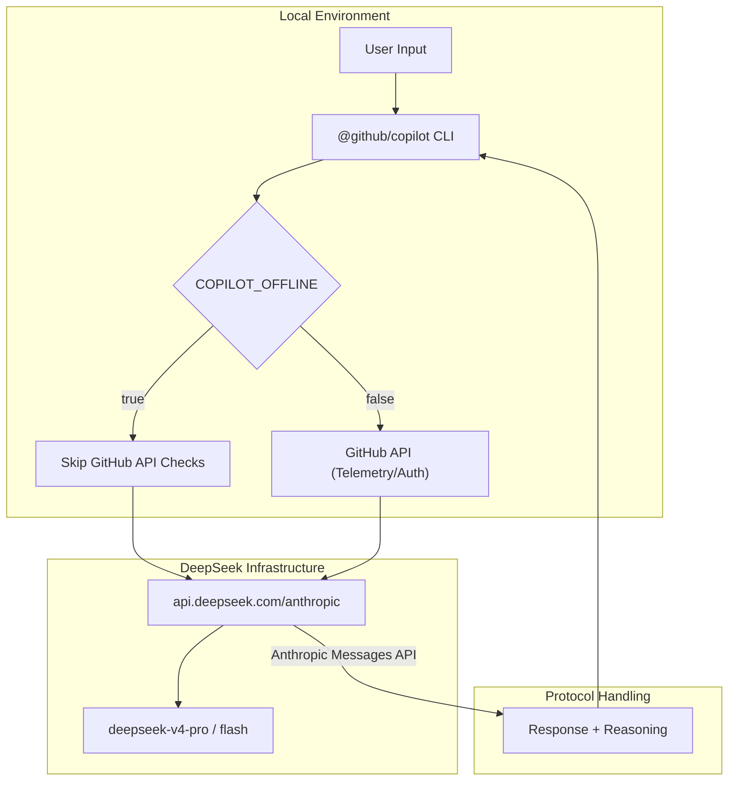
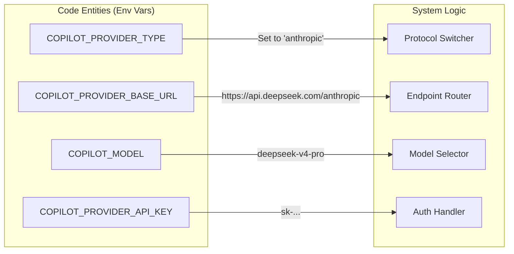

<!-- source: DeepWiki mcp.deepwiki.com · repo deepseek-ai/awesome-deepseek-agent · page 3.2 GitHub Copilot CLI · fetched 2026-10-30 -->

# GitHub Copilot CLI

Relevant source files

The following files were used as context for generating this wiki page:

- [docs/copilot_cli.md](docs/copilot_cli.md)
- [docs/copilot_cli.zh-CN.md](docs/copilot_cli.zh-CN.md)

This page provides a technical guide for integrating DeepSeek V4 models into the GitHub Copilot CLI using the Bring Your Own Key (BYOK) mechanism. It details the requirement for the Anthropic-compatible protocol to ensure stable reasoning-enabled chat sessions and provides configuration for token management and offline operations.

## Overview and Implementation

The integration leverages the `@github/copilot` CLI's ability to interface with custom model providers via environment variables [docs/copilot_cli.md:90-91](). While DeepSeek provides an OpenAI-compatible endpoint, GitHub Copilot CLI must be configured to use the `anthropic` provider type when interacting with DeepSeek V4 models [docs/copilot_cli.md:7-8]().

### Protocol Compatibility: Why Anthropic?

A critical implementation detail involves how reasoning content is handled. DeepSeek's reasoning models require that the `reasoning_content` generated by the model be echoed back to the API in subsequent turns of the conversation [docs/copilot_cli.md:7-8]().

| Provider Type | Behavior with DeepSeek | Result |
| :--- | :--- | :--- |
| `openai` | Does not echo `reasoning_content` in chat history. | `400 Bad Request` |
| `anthropic` | Uses the Messages API structure which avoids this requirement. | **Success** |

### Data Flow Diagram

The following diagram illustrates the request flow from the local CLI to the DeepSeek infrastructure, bypassing standard GitHub telemetry when configured.

**GitHub Copilot CLI to DeepSeek Data Flow**

Sources: [docs/copilot_cli.md:7-8](), [docs/copilot_cli.md:27-31](), [docs/copilot_cli.md:77-86]()

## Installation and Configuration

The CLI requires Node.js 22 or later [docs/copilot_cli.md:15](). Installation is performed via the global npm registry: `npm install -g @github/copilot` [docs/copilot_cli.md:12]().

### Environment Variables

Configuration is handled entirely through environment variables. This allows the CLI to override its internal model catalog and redirect traffic to the DeepSeek Anthropic-compatible endpoint.

**System Configuration Mapping**

Sources: [docs/copilot_cli.md:27-40]()

### Setup Reference Table

| Variable | Recommended Value | Description |
| :--- | :--- | :--- |
| `COPILOT_PROVIDER_TYPE` | `anthropic` | Mandatory for reasoning support [docs/copilot_cli.md:7](). |
| `COPILOT_PROVIDER_BASE_URL` | `https://api.deepseek.com/anthropic` | The Anthropic-compatible gateway [docs/copilot_cli.md:28](). |
| `COPILOT_MODEL` | `deepseek-v4-pro` | Supports `deepseek-v4-pro` or `deepseek-v4-flash` [docs/copilot_cli.md:42](). |
| `COPILOT_PROVIDER_API_KEY` | `sk-...` | Your DeepSeek API Key [docs/copilot_cli.md:19-20](). |

## Advanced Configuration

### Token Limit Overrides
Since DeepSeek V4 models are not natively defined in the Copilot CLI internal catalog, the CLI may default to conservative token limits. Users should manually override these to leverage the 1M context capabilities of DeepSeek V4.

*   **Prompt Tokens:** Set `COPILOT_PROVIDER_MAX_PROMPT_TOKENS` to `840000` [docs/copilot_cli.md:59]().
*   **Output Tokens:** Set `COPILOT_PROVIDER_MAX_OUTPUT_TOKENS` to `128000` [docs/copilot_cli.md:60]().

### Offline Mode
Setting `COPILOT_OFFLINE=true` restricts the CLI from communicating with GitHub's backend servers for configuration or telemetry [docs/copilot_cli.md:77-86](). 
> **Note:** This does not enable local LLM execution; prompts are still transmitted to `api.deepseek.com` [docs/copilot_cli.md:86]().

Sources: [docs/copilot_cli.md:54-86]()

---

