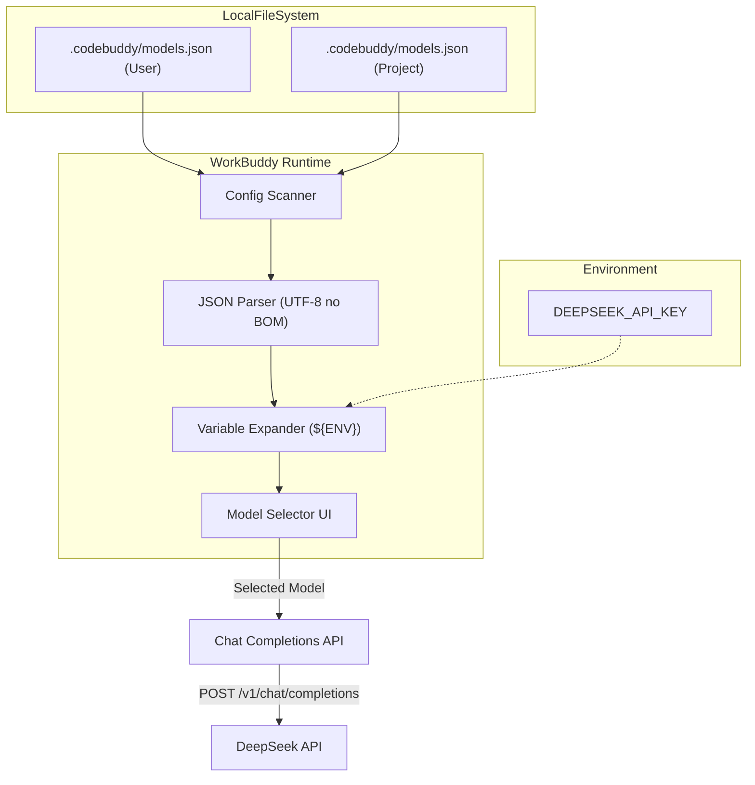
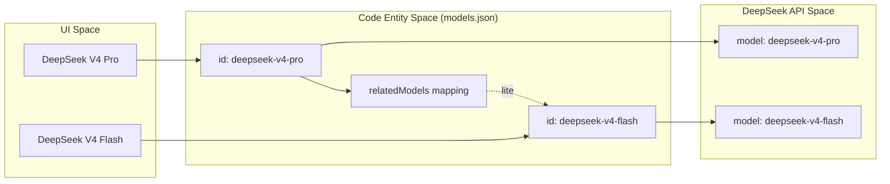

<!-- source: DeepWiki mcp.deepwiki.com · repo deepseek-ai/awesome-deepseek-agent · page 3.4 WorkBuddy / CodeBuddy · fetched 2026-10-30 -->

# WorkBuddy / CodeBuddy

Relevant source files

The following files were used as context for generating this wiki page:

- [docs/workbuddy.md](docs/workbuddy.md)
- [docs/workbuddy.zh-CN.md](docs/workbuddy.zh-CN.md)

WorkBuddy (also known as CodeBuddy) is an AI agent and coding assistant that enables deep integration with custom Large Language Models (LLMs) via local configuration files. It utilizes an OpenAI-compatible Chat Completions API to interface with DeepSeek V4 models.

### Local Configuration Mechanism

WorkBuddy identifies available models by scanning for a `models.json` file within a specific directory structure. This allows for both global (user-level) and project-specific model overrides.

#### Configuration Pathing
The application looks for configuration in two primary locations:
*   **User-level:** `C:\Users\<your-username>\.codebuddy\models.json` [docs/workbuddy.md:18-19]()
*   **Project-level:** `<your-project>\.codebuddy\models.json` [docs/workbuddy.md:23-25]()

#### The `models.json` Schema
The configuration file defines the model identity, provider details, and capability flags.

| Key | Description |
| :--- | :--- |
| `id` | The exact model identifier used in API requests (e.g., `deepseek-v4-pro`). [docs/workbuddy.md:39-39]() |
| `vendor` | Metadata label for the model provider. [docs/workbuddy.md:41-41]() |
| `url` | The full OpenAI-compatible endpoint URL. [docs/workbuddy.md:42-42]() |
| `apiKey` | The authentication token, supporting `${ENV}` expansion. [docs/workbuddy.md:43-43]() |
| `maxInputTokens` | The context window limit (recommended: `128000`). [docs/workbuddy.md:44-44]() |
| `supportsToolCall` | Boolean flag enabling agentic function calling. [docs/workbuddy.md:46-46]() |
| `relatedModels` | Mapping for specialized modes like `lite` or `reasoning`. [docs/workbuddy.md:48-51]() |

**Sources:** [docs/workbuddy.md:15-70]()

### Configuration Data Flow

The following diagram illustrates how WorkBuddy resolves model configurations and handles environment variable expansion for secure API key management.

**WorkBuddy Model Resolution and API Flow**

**Sources:** [docs/workbuddy.md:13-83](), [docs/workbuddy.md:106-106]()

### Implementation Requirements

#### Encoding Requirement
The `models.json` file **must** be saved using **UTF-8 without BOM** encoding. Files containing a UTF-8 Byte Order Mark (BOM) header may cause the application to fail while parsing the local model configuration [docs/workbuddy.md:72-72]().

#### Environment Variable Expansion
WorkBuddy supports the `${VARIABLE_NAME}` syntax within the `apiKey` field. For this to function:
1.  The variable must be set in the OS (e.g., `setx DEEPSEEK_API_KEY "..."`) [docs/workbuddy.md:29-31]().
2.  WorkBuddy must be launched from an environment where the variable is inherited. If the UI displays the literal string `${DEEPSEEK_API_KEY}`, the application was likely started without access to the environment variable [docs/workbuddy.md:106-106]().

### Integration Logic and Entity Mapping

The relationship between the UI display names and the underlying API identifiers is managed via the `models` and `availableModels` arrays.

**Code Entity to API Mapping**

**Sources:** [docs/workbuddy.md:36-70](), [docs/workbuddy.md:78-83]()

### Troubleshooting

| Error | Root Cause | Resolution |
| :--- | :--- | :--- |
| **401 (Authentication Fails)** | Invalid `apiKey` or URL in key field. | Ensure `apiKey` contains only the key, not the URL [docs/workbuddy.md:102-102](). |
| **404 (Model Not Found)** | Incorrect `id` string. | Verify `id` is exactly `deepseek-v4-pro` or `deepseek-v4-flash` [docs/workbuddy.md:103-103](). |
| **Parsing Failure** | Invalid JSON or UTF-8 BOM. | Validate JSON syntax and strip BOM header [docs/workbuddy.md:104-104](). |
| **Missing Model** | Directory or Restart issue. | Confirm file is in `.codebuddy/models.json` and fully restart the app [docs/workbuddy.md:105-105](). |

**Sources:** [docs/workbuddy.md:100-107]()

---

