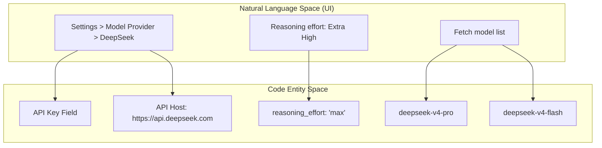
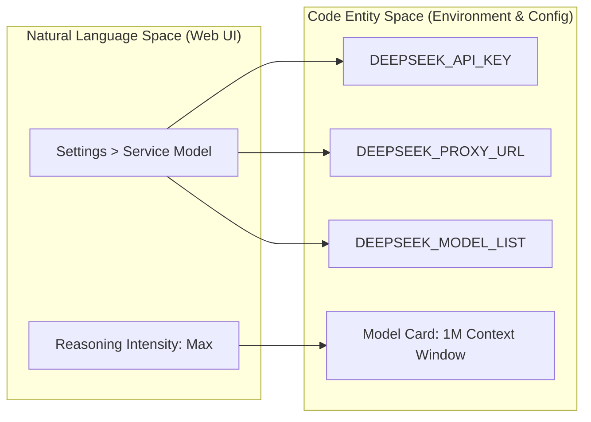

<!-- source: DeepWiki mcp.deepwiki.com · repo deepseek-ai/awesome-deepseek-agent · page 4 Desktop and Web Agent Platforms · fetched 2026-10-30 -->

# Desktop and Web Agent Platforms

Relevant source files

The following files were used as context for generating this wiki page:

- [README.md](README.md)
- [docs/cherry_studio.md](docs/cherry_studio.md)

This section provides an overview of cross-platform desktop clients and web-based agent orchestration platforms that support DeepSeek V4. These platforms typically offer graphical user interfaces (GUIs) for managing multiple AI assistants, knowledge bases (RAG), and Model Context Protocol (MCP) integrations.

The primary platforms covered in this category are **Cherry Studio**, a feature-rich desktop client, and **LobeHub**, a versatile agent operating system available via web, desktop, and self-hosted deployments [README.md:19-30]().

## Platform Overview

Desktop and web platforms serve as "Agent Operators," moving beyond simple chat interfaces to provide persistent environments for agentic workflows. They often include:
- **Provider Management:** Centralized configuration for API keys and endpoints.
- **Agent Orchestration:** Tools to create specialized agents with distinct system prompts and model parameters.
- **Extended Capabilities:** Built-in support for RAG (Retrieval-Augmented Generation), translation engines, and tool-calling via MCP.

### Comparison of Primary Platforms

| Feature | Cherry Studio | LobeHub |
| :--- | :--- | :--- |
| **Deployment** | Desktop (Win/macOS/Linux) | Web, Desktop, Self-hosted (Docker) |
| **Primary Focus** | Personal productivity & Knowledge Base | Team orchestration & Agent "hiring" |
| **DeepSeek Models** | `deepseek-v4-pro`, `deepseek-v4-flash` | `deepseek-v4-pro`, `deepseek-v4-flash` |
| **Reasoning Control**| "Extra High" (`reasoning_effort: max`) | Intensity (None/High/Max) |
| **Context Window** | 1M Tokens (Out of the box) | 1M Tokens (Model card config) |

## Bridging Natural Language to Code Entity Space

The following diagrams illustrate how these platforms map user-facing configuration to the underlying DeepSeek API and system architecture.

### Cherry Studio Integration Flow
This diagram shows how the `Model Provider` settings map to the internal `DeepSeek` provider logic and API parameters.

**Sources:** [docs/cherry_studio.md:20-47]()

### LobeHub Service Configuration
This diagram demonstrates the relationship between environment variables in self-hosted deployments and the model selection logic.

**Sources:** [README.md:30](), [Page 4.2 Description]()

## Supported Platforms

### Cherry Studio
Cherry Studio is an open-source desktop AI client supporting Windows, macOS, and Linux [docs/cherry_studio.md:5-18](). It is designed for users who need a unified interface for multiple LLM providers with advanced features like:
- **Knowledge Bases:** RAG support for PDFs, Markdown, and Office files [docs/cherry_studio.md:53]().
- **MCP Servers:** Integration of external tools into DeepSeek-driven conversations [docs/cherry_studio.md:55]().
- **OpenClaw Integration:** A bundled assistant for connecting DeepSeek to messaging platforms like Feishu and WeChat [docs/cherry_studio.md:56]().

For detailed configuration steps, see **[Cherry Studio](#4.1)**.

### LobeHub
LobeHub acts as a "Chief Agent Operator," focusing on the scheduling and reporting of AI teams [README.md:30](). It supports:
- **Flexible Deployment:** Available as a web app, desktop client, or self-hosted Docker container.
- **Reasoning Control:** Fine-grained control over reasoning intensity (None, High, or Max).
- **Model Cards:** Pre-configured cards for DeepSeek V4 that respect the 1M token context window.

For detailed configuration steps, see **[LobeHub](#4.2)**.

---
**Sources:**
- [README.md:19-30]()
- [docs/cherry_studio.md:1-57]()

---

