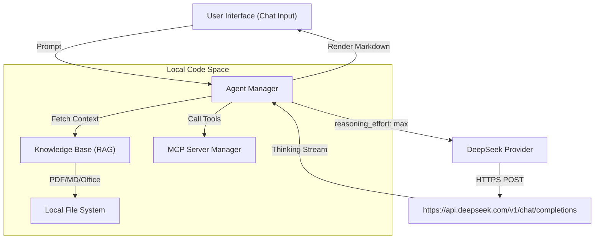
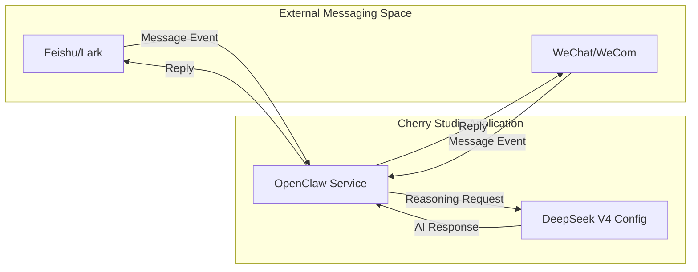

<!-- source: DeepWiki mcp.deepwiki.com · repo deepseek-ai/awesome-deepseek-agent · page 4.1 Cherry Studio · fetched 2026-10-30 -->

# Cherry Studio

Relevant source files

The following files were used as context for generating this wiki page:

- [docs/assets/cherry_studio_add_agent.png](docs/assets/cherry_studio_add_agent.png)
- [docs/assets/cherry_studio_add_agent.zh-CN.png](docs/assets/cherry_studio_add_agent.zh-CN.png)
- [docs/assets/cherry_studio_provider.png](docs/assets/cherry_studio_provider.png)
- [docs/assets/cherry_studio_provider.zh-CN.png](docs/assets/cherry_studio_provider.zh-CN.png)
- [docs/assets/cherry_studio_reasoning_effort.png](docs/assets/cherry_studio_reasoning_effort.png)
- [docs/assets/cherry_studio_reasoning_effort.zh-CN.png](docs/assets/cherry_studio_reasoning_effort.zh-CN.png)
- [docs/cherry_studio.md](docs/cherry_studio.md)
- [docs/cherry_studio.zh-CN.md](docs/cherry_studio.zh-CN.md)

Cherry Studio is an open-source desktop AI client designed for Windows, macOS, and Linux that unifies access to multiple Large Language Model (LLM) providers [docs/cherry_studio.md:5-5](). It serves as a comprehensive orchestration platform, supporting over 300 pre-configured assistants, knowledge base RAG (Retrieval-Augmented Generation), Model Context Protocol (MCP) servers, and multi-channel messaging integration [docs/cherry_studio.md:5-5]().

## Platform Availability and Installation

The client is distributed as a native application across all major desktop operating systems [docs/cherry_studio.md:10-18]().

| Platform | Installer Formats |
| :--- | :--- |
| **Windows** | `.exe` |
| **macOS** | `.dmg` (Intel and Apple Silicon) |
| **Linux** | `.AppImage`, `.deb`, `.rpm` |

**Sources:** [docs/cherry_studio.md:14-18](), [docs/cherry_studio.zh-CN.md:14-16]()

## DeepSeek Provider Configuration

Integration with DeepSeek V4 requires configuring the built-in model provider within the application settings [docs/cherry_studio.md:20-22]().

### Configuration Workflow
1. **Access Settings:** Navigate to the gear icon in the lower-left corner [docs/cherry_studio.md:22-22]().
2. **Provider Selection:** Under **Model Provider**, select **DeepSeek** [docs/cherry_studio.md:24-24]().
3. **Authentication:** Input the `API Key` obtained from the DeepSeek Platform. The default `API Host` is set to `https://api.deepseek.com` [docs/cherry_studio.md:25-25]().
4. **Model Discovery:** Use the **Fetch model list** function to populate available models, specifically adding `deepseek-v4-pro` and `deepseek-v4-flash` [docs/cherry_studio.md:26-26]().
5. **Activation:** Toggle the provider switch to the "enabled" state [docs/cherry_studio.md:27-27]().

### Reasoning Effort and Context Window
Cherry Studio natively supports the DeepSeek V4 **1 million token** context window without additional manual configuration [docs/cherry_studio.md:41-41](). To optimize performance for complex logic or coding tasks, users can adjust the `reasoning_effort` [docs/cherry_studio.md:43-43]().

| UI Setting | API Implementation | Use Case |
| :--- | :--- | :--- |
| **Extra High** (穷究) | `reasoning_effort: "max"` | Complex coding, mathematical proofs, deep logic. |

**Sources:** [docs/cherry_studio.md:20-47](), [docs/cherry_studio.zh-CN.md:18-45]()

## System Architecture and Data Flow

The following diagram illustrates how Cherry Studio bridges user intent (Natural Language Space) with the underlying DeepSeek API and local services (Code Entity Space).

### Request and Tool Execution Flow
Title: Cherry Studio Request Lifecycle

**Sources:** [docs/cherry_studio.md:33-56](), [docs/cherry_studio_reasoning_effort.png:1-32]()

## Advanced Features

### Agent Creation
Agents are created via the **Agents** tab [docs/cherry_studio.md:35-35](). When adding a new agent, users must specify the `Model` (e.g., `deepseek-v4-pro`) and set the permission mode to define the agent's capabilities [docs/cherry_studio.md:35-35]().

### Knowledge Base (RAG)
Users can perform Retrieval-Augmented Generation by dropping local files (PDF, Markdown, Office) into the **Knowledge Base** tab [docs/cherry_studio.md:53-53](). The DeepSeek V4 model then acts as the reasoning engine over this ingested data [docs/cherry_studio.zh-CN.md:51-51]().

### MCP Server Integration
Cherry Studio supports the **Model Context Protocol (MCP)** [docs/cherry_studio.md:55-55](). Servers are configured under **Settings → MCP**, allowing DeepSeek-driven agents to execute external tools defined by those servers [docs/cherry_studio.zh-CN.md:53-53]().

### OpenClaw Messaging Bridge
Cherry Studio bundles **OpenClaw**, a messaging bridge that connects DeepSeek V4 to chat platforms like Feishu and WeChat [docs/cherry_studio.md:56-56]().

Title: OpenClaw Messaging Integration

**Sources:** [docs/cherry_studio.md:56-56](), [docs/cherry_studio.zh-CN.md:54-54]()

## Visual References

| Feature | English Interface | Chinese Interface |
| :--- | :--- | :--- |
| **Provider Setup** |  |  |
| **Agent Creation** |  |  |
| **Reasoning Effort** |  |  |

**Sources:** [docs/assets/cherry_studio_provider.png:1-15](), [docs/assets/cherry_studio_add_agent.png:1-18](), [docs/assets/cherry_studio_reasoning_effort.png:1-32]()

---

