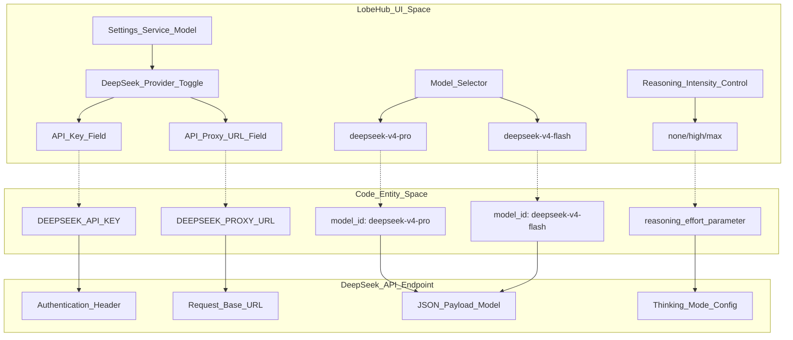
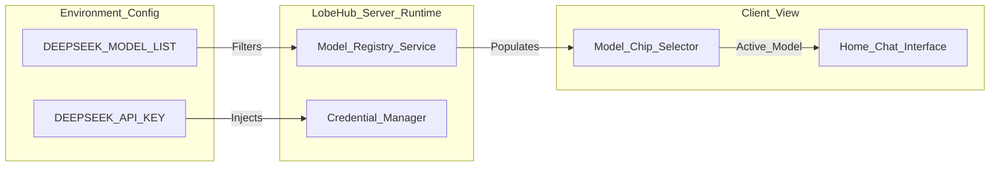

<!-- source: DeepWiki mcp.deepwiki.com · repo deepseek-ai/awesome-deepseek-agent · page 4.2 LobeHub · fetched 2026-10-30 -->

# LobeHub

Relevant source files

The following files were used as context for generating this wiki page:

- [docs/assets/lobehub_chrome_provider_settings.en-US.jpg](docs/assets/lobehub_chrome_provider_settings.en-US.jpg)
- [docs/assets/lobehub_chrome_provider_settings.zh-CN.jpg](docs/assets/lobehub_chrome_provider_settings.zh-CN.jpg)
- [docs/assets/lobehub_desktop_model_selector.en-US.jpg](docs/assets/lobehub_desktop_model_selector.en-US.jpg)
- [docs/assets/lobehub_desktop_model_selector.zh-CN.jpg](docs/assets/lobehub_desktop_model_selector.zh-CN.jpg)
- [docs/lobehub.md](docs/lobehub.md)
- [docs/lobehub.zh-CN.md](docs/lobehub.zh-CN.md)

LobeHub serves as a comprehensive "Chief Agent Operator" platform, providing a multi-client ecosystem (Web, Desktop, and Self-hosted) for managing AI agents. It integrates DeepSeek V4 models with specialized support for high-context workflows and granular reasoning controls.

### 1. Provider Configuration

To integrate DeepSeek, users navigate to the Service Model settings where the DeepSeek provider can be toggled and authenticated. The platform supports both direct API connections and custom proxy routing.

#### Configuration Interface
| Field | Description | Default / Recommended |
| :--- | :--- | :--- |
| **Provider Switch** | Enables or disables the DeepSeek integration. | Enabled |
| **API Key** | Authentication credential from DeepSeek Platform. | `sk-xxxxxx` |
| **API Proxy URL** | Custom endpoint for routing requests. | `https://api.deepseek.com` |
| **Connectivity Check** | Validates the API key and endpoint. | Uses `deepseek-v4-flash` |
| **Model List** | Toggle for specific model identifiers. | `deepseek-v4-pro`, `deepseek-v4-flash` |

**Sources:** [docs/lobehub.md:22-35](), [docs/lobehub.zh-CN.md:22-35]()

### 2. Model Selection and Capabilities

LobeHub provides native support for the DeepSeek V4 family, including pre-configured model cards that handle the 1M context window metadata automatically.

*   **DeepSeek V4 Pro:** Optimized for complex coding, long-horizon planning, and autonomous agent workflows.
*   **DeepSeek V4 Flash:** Optimized for low-latency, everyday conversational tasks.
*   **Context Window:** Both models expose a 1,000,000 token context window within the LobeHub UI without requiring manual overrides.

**Sources:** [docs/lobehub.md:43-58](), [docs/lobehub.zh-CN.md:43-58]()

### 3. Reasoning Intensity Implementation

LobeHub exposes the `reasoning_effort` (or thinking mode) parameter through its model parameter controls. This allows users to adjust the computational depth of the DeepSeek V4 reasoning engine.

#### Reasoning Levels
*   `none`: Standard response without extended reasoning.
*   `high`: Balanced reasoning for general logic tasks (Default).
*   `max`: Maximum reasoning depth for complex architectural planning and multi-step debugging.

**Sources:** [docs/lobehub.md:60-68](), [docs/lobehub.zh-CN.md:60-68]()

### 4. Self-Hosted Environment Setup

For self-hosted instances (Docker/Node.js), LobeHub supports global credential injection via environment variables. This ensures all users on the instance have immediate access to DeepSeek models without individual configuration.

#### Environment Variables
| Variable | Purpose | Example Value |
| :--- | :--- | :--- |
| `DEEPSEEK_API_KEY` | Global API Key for the instance. | `sk-xxxxxx` |
| `DEEPSEEK_PROXY_URL` | Global proxy or base URL. | `https://api.deepseek.com` |
| `DEEPSEEK_MODEL_LIST` | Controls model visibility and selection. | `-all,+deepseek-v4-pro,+deepseek-v4-flash` |

**Sources:** [docs/lobehub.md:70-83](), [docs/lobehub.zh-CN.md:70-83]()

### 5. Technical Architecture and Data Flow

The following diagrams illustrate the relationship between the LobeHub configuration layer and the underlying DeepSeek API integration.

#### Configuration to API Mapping
This diagram bridges the LobeHub UI settings to the environment variables and the final API request structure.

**Sources:** [docs/lobehub.md:22-35](), [docs/lobehub.md:60-83]()

#### Self-Hosted Deployment Flow
This diagram details how environment variables propagate through a self-hosted LobeHub instance to configure the model list.

**Sources:** [docs/lobehub.md:70-83](), [docs/lobehub.zh-CN.md:70-83]()

### 6. Troubleshooting

| Error Code / Issue | Root Cause | Resolution |
| :--- | :--- | :--- |
| `401 Unauthorized` | Incorrect API Key placement. | Verify key is in **API Key** field, not **Proxy URL**. |
| Model Not Found | Stale model list. | Click **Fetch models** in Service Model settings. |
| Connectivity Failure | Proxy URL format. | Ensure URL includes `http://` or `https://`. |
| Missing Reasoning | Wrong model selected. | Ensure active model is `deepseek-v4-pro` or `deepseek-v4-flash`. |

**Sources:** [docs/lobehub.md:87-93](), [docs/lobehub.zh-CN.md:87-93]()

---

