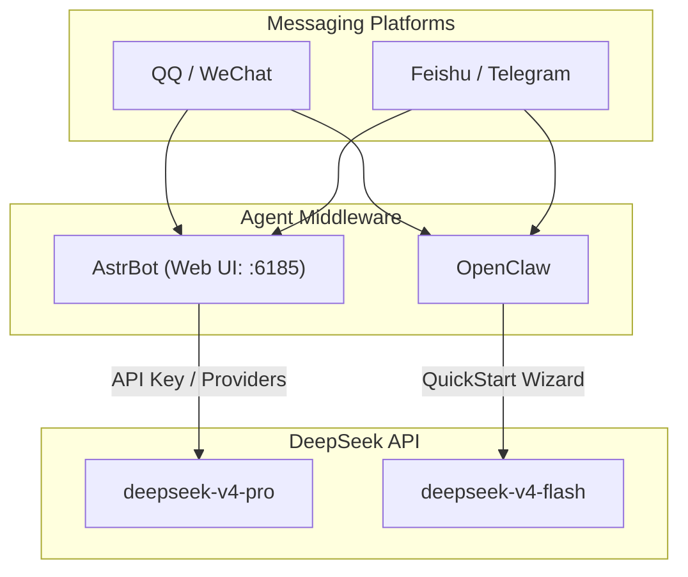
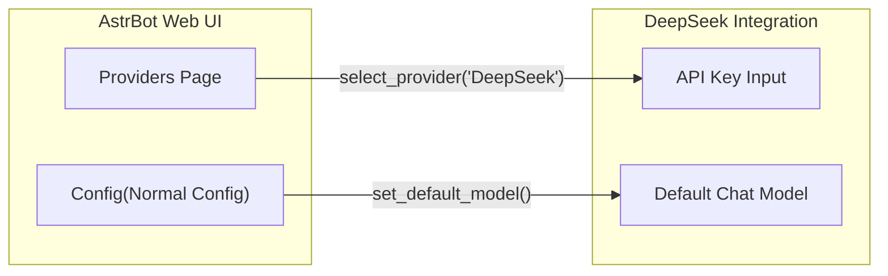

<!-- source: DeepWiki mcp.deepwiki.com · repo deepseek-ai/awesome-deepseek-agent · page 5 Messaging Platform and Multi-Channel Agents · fetched 2026-10-30 -->

# Messaging Platform and Multi-Channel Agents

Relevant source files

The following files were used as context for generating this wiki page:

- [README.md](README.md)
- [docs/astrbot.md](docs/astrbot.md)
- [docs/astrbot.zh-CN.md](docs/astrbot.zh-CN.md)

This section provides an overview of AI agents designed to bridge DeepSeek V4 models with popular messaging platforms and enterprise communication tools. These agents allow users to interact with DeepSeek's reasoning and coding capabilities through familiar interfaces like QQ, WeChat, Feishu (Lark), and Telegram.

The agents in this category typically operate as middleware, managing the connection between the DeepSeek API and the specific protocols required by various chat applications. They often include "Skills" or "Plugins" systems to extend the model's utility beyond simple chat into task automation and information retrieval.

### Multi-Channel Architecture

The following diagram illustrates how these agents act as a translation layer between the Natural Language Space of messaging apps and the DeepSeek API.

**Messaging Agent Communication Flow**

Sources: [README.md:18-18](), [README.md:33-33](), [docs/astrbot.md:5-5](), [docs/astrbot.md:50-53]()

---

### AstrBot

AstrBot is an open-source, all-in-one agent assistant. It is characterized by its broad support for messaging platforms and its extensibility through Model Context Protocol (MCP) and custom skills.

*   **Deployment**: Supports installation via `uv` (using `astrbot init` and `astrbot run`) or via Docker using `docker compose up -d`.
*   **Configuration**: Features a Web UI (defaulting to port `6185`) where users add DeepSeek as a provider by entering an API Key in the `Providers` page.
*   **Platform Support**: Bridges DeepSeek to QQ, WeChat, Feishu, and Telegram.

For detailed setup instructions, see [AstrBot](#5.1).

Sources: [docs/astrbot.md:5-5](), [docs/astrbot.md:9-28](), [docs/astrbot.md:42-43](), [docs/astrbot.md:50-55]()

---

### OpenClaw

OpenClaw is a personal AI assistant focused on simplicity and integration with chat tools like Feishu and WeChat. It is highly extensible via a specialized "Skills" system.

*   **Installation**: Uses a one-line install script (`curl` for Linux/macOS or `iwr` for Windows).
*   **Onboarding**: Includes an interactive wizard (QuickStart mode) to configure the DeepSeek provider and select specific models.
*   **Interface**: Provides a Web UI dashboard, a Terminal User Interface (TUI), and standard terminal chat modes.
*   **Version Note**: Requires version `v2026.4.24` or higher for full support of thinking/reasoning modes.

For detailed setup instructions, see [OpenClaw](#5.2).

Sources: [README.md:33-33]()

---

### Comparison of Multi-Channel Agents

The following table summarizes the primary integration methods and features for the agents in this category.

| Agent | Installation Method | Primary Platforms | Key Features |
| :--- | :--- | :--- | :--- |
| **AstrBot** | `uv`, Docker | QQ, WeChat, Feishu, Telegram | MCP support, Web UI, Plugin system |
| **OpenClaw** | Shell Script | WeChat, Feishu | TUI/Web/CLI modes, QuickStart wizard |

**Entity Mapping: Web UI to Configuration**

Sources: [docs/astrbot.md:53-55]()

---

