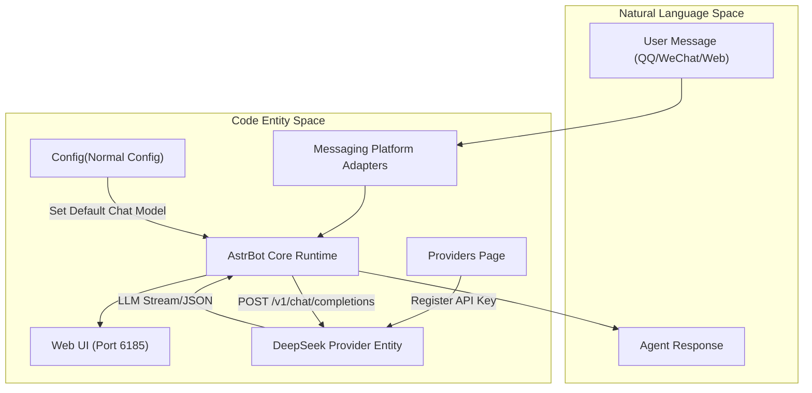
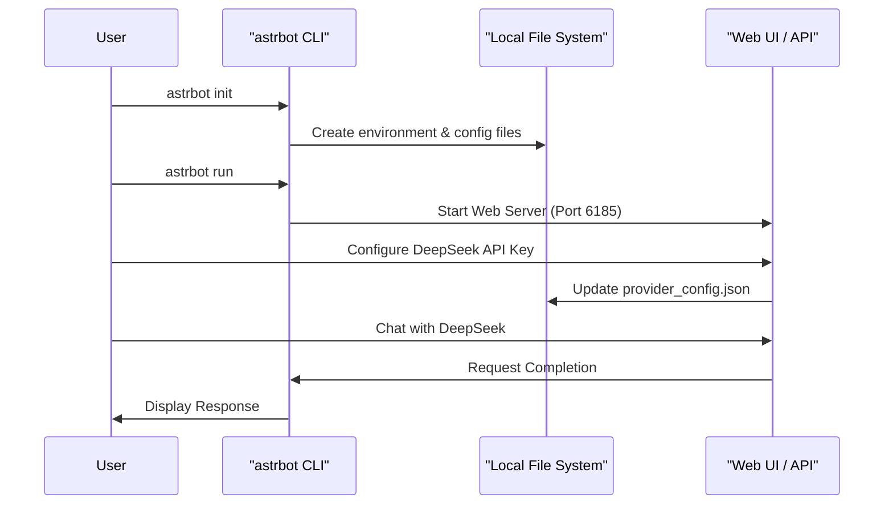

<!-- source: DeepWiki mcp.deepwiki.com · repo deepseek-ai/awesome-deepseek-agent · page 5.1 AstrBot · fetched 2026-10-30 -->

# AstrBot

Relevant source files

The following files were used as context for generating this wiki page:

- [docs/astrbot.md](docs/astrbot.md)
- [docs/astrbot.zh-CN.md](docs/astrbot.zh-CN.md)

AstrBot is an open-source, all-in-one agent assistant designed to bridge Large Language Models (LLMs) with mainstream messaging platforms and extensible toolsets. It supports integration with QQ, WeChat, Feishu, and Telegram, and allows for functional expansion through a plugin system, custom skills, and the Model Context Protocol (MCP) [docs/astrbot.md:5-5]().

## Installation

AstrBot can be deployed using the `uv` package manager for local environments or via `Docker` for containerized environments.

### Method 1: Installation via uv
The `uv`-based installation provides a streamlined CLI experience for macOS, Linux, and Windows users.

1.  **Download and Install**:
    *   **macOS/Linux**: `curl -LsSf https://docs.astrbot.app/install.sh | bash` [docs/astrbot.md:14-14]()
    *   **Windows**: `iwr -useb https://docs.astrbot.app/install.ps1 | iex` [docs/astrbot.md:20-20]()
2.  **Initialize Environment**: Run `astrbot init` in your desired directory to set up the local environment [docs/astrbot.md:26-26]().
3.  **Launch**: Run `astrbot run` to start the application [docs/astrbot.md:27-27]().

### Method 2: Installation via Docker
For users preferring containerization, AstrBot provides a `docker-compose` configuration.

1.  **Clone Repository**: `git clone https://github.com/AstrBotDevs/AstrBot --depth 1` [docs/astrbot.md:35-35]()
2.  **Start Service**: `sudo docker compose up -d` [docs/astrbot.md:42-42]()

**Sources:** [docs/astrbot.md:7-43](), [docs/astrbot.zh-CN.md:7-43]()

## Configuration and Data Flow

Once the service is running, configuration is managed through a Web UI accessible at `http://localhost:6185` [docs/astrbot.md:50-50](). The configuration process involves registering a Model Provider and then assigning that provider as the system default.

### Provider and Model Setup
1.  **DeepSeek Provider**: Navigate to the `Providers` page, add a new `DeepSeek` entry, and input the `API Key` [docs/astrbot.md:53-53]().
2.  **Global Defaults**: In the `Config(Normal Config)` page, the `Default Chat Model` must be mapped to the newly created DeepSeek provider [docs/astrbot.md:55-55]().

### Logic and Data Flow Diagram
The following diagram illustrates the flow from user input through the AstrBot core to the DeepSeek API and out to various messaging platforms.

**AstrBot Communication Architecture**

**Sources:** [docs/astrbot.md:45-57](), [docs/astrbot.zh-CN.md:45-57]()

## Capabilities and Extensions

AstrBot functions as a central hub for agentic behavior, moving beyond simple chat into automated workflows.

### System Components
| Component | Description | Reference |
| :--- | :--- | :--- |
| **Messaging Platforms** | Bridges to QQ, WeChat, Feishu, and Telegram. | [docs/astrbot.md:5-5]() |
| **Skills & Plugins** | Internal modules to extend agent capabilities. | [docs/astrbot.md:5-5]() |
| **MCP Support** | Integration with Model Context Protocol servers. | [docs/astrbot.md:5-5]() |
| **Chat UI** | Built-in web interface for direct interaction. | [docs/astrbot.md:61-61]() |

### Integration Lifecycle
The diagram below maps the initialization and execution commands to the internal system state.

**System Initialization Lifecycle**

**Sources:** [docs/astrbot.md:26-28](), [docs/astrbot.md:45-63](), [docs/astrbot.zh-CN.md:26-28](), [docs/astrbot.zh-CN.md:45-63]()

---

