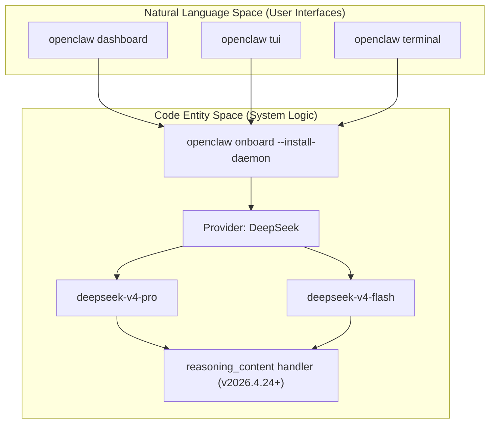
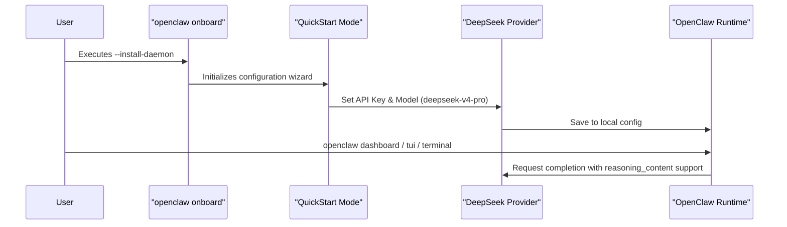

<!-- source: DeepWiki mcp.deepwiki.com · repo deepseek-ai/awesome-deepseek-agent · page 5.2 OpenClaw · fetched 2026-10-30 -->

# OpenClaw

Relevant source files

The following files were used as context for generating this wiki page:

- [docs/openclaw.md](docs/openclaw.md)
- [docs/openclaw.zh-CN.md](docs/openclaw.zh-CN.md)

OpenClaw is an open-source personal AI assistant designed to bridge high-performance language models with daily productivity tools. It supports multi-channel integration (such as Feishu and WeChat) and features an extensible "Skill" architecture to enhance its functional capabilities [docs/openclaw.md:5-5]().

### 1. Installation

OpenClaw provides platform-specific installation scripts to streamline the setup of the assistant environment.

| Platform | Command |
| :--- | :--- |
| **Linux / macOS** | `curl -fsSL https://openclaw.ai/install.sh \| bash` |
| **Windows** | `iwr -useb https://openclaw.ai/install.ps1 \| iex` |

Sources: [docs/openclaw.md:9-19]()

### 2. Configuration and Onboarding

After installation, OpenClaw initiates an onboard wizard to configure the core provider and model settings. This process can be manually triggered using the `openclaw onboard --install-daemon` command [docs/openclaw.md:23-23]().

#### Configuration Workflow
1.  **Safety Acknowledgment**: Confirm the personal-by-default nature of the tool by selecting **Yes** [docs/openclaw.md:25-25]().
2.  **Setup Mode**: Select **QuickStart** for an optimized configuration path [docs/openclaw.md:26-26]().
3.  **Provider Selection**: Choose **DeepSeek** as the `Model/auth provider` [docs/openclaw.md:27-27]().
4.  **Authentication**: Input the [DeepSeek API Key](https://platform.deepseek.com/api_keys) [docs/openclaw.md:28-28]().
5.  **Model Selection**: Navigate to **Enter model** and specify either `deepseek-v4-pro` or `deepseek-v4-flash` [docs/openclaw.md:29-29]().

#### DeepSeek V4 Thinking Mode Support
To ensure compatibility with DeepSeek V4's reasoning features, users must use **OpenClaw v2026.4.24** or higher. This version specifically addresses the handling of `reasoning_content` to prevent `400` errors during API calls [docs/openclaw.md:32-32]().

### 3. System Architecture and Interaction Modes

OpenClaw offers three primary interfaces for interacting with the AI agent. The following diagram illustrates the data flow from the CLI commands to the underlying configuration and provider logic.

**Diagram: OpenClaw Interface to Provider Logic**

Sources: [docs/openclaw.md:23-32](), [docs/openclaw.md:36-52]()

### 4. Operational Modes

OpenClaw can be launched in different modes depending on the user's workflow requirements:

*   **Web Dashboard**: Provides a graphical chat interface and management console.
    *   Command: `openclaw dashboard` [docs/openclaw.md:39-39]()
*   **Terminal User Interface (TUI)**: An interactive, terminal-based dashboard.
    *   Command: `openclaw tui` [docs/openclaw.md:45-45]()
*   **Terminal Chat**: A direct command-line interface for rapid AI interaction.
    *   Command: `openclaw terminal` [docs/openclaw.md:51-51]()

**Diagram: Configuration and Runtime Initialization**

Sources: [docs/openclaw.md:23-32](), [docs/openclaw.md:36-52]()

---

