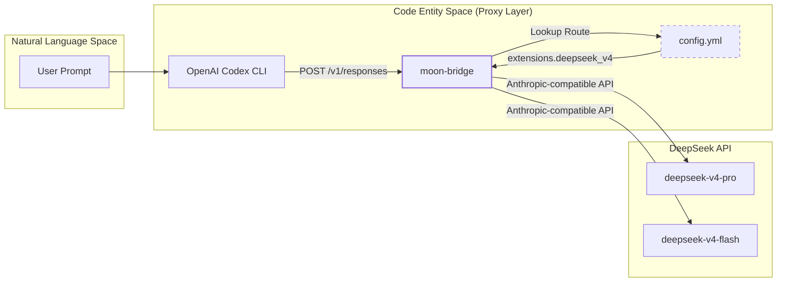
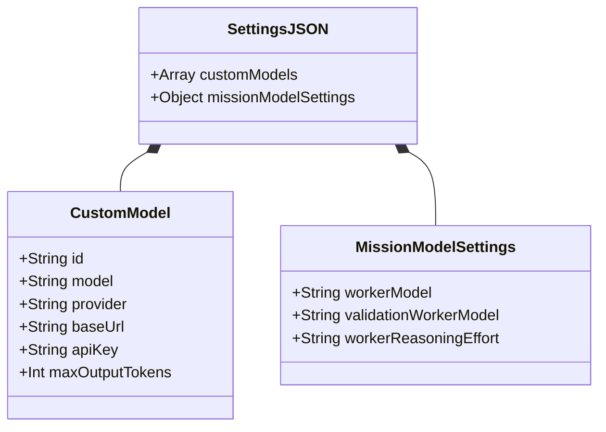

<!-- source: DeepWiki mcp.deepwiki.com · repo deepseek-ai/awesome-deepseek-agent · page 6 Proxy and Protocol Bridge Tools · fetched 2026-10-30 -->

# Proxy and Protocol Bridge Tools

Relevant source files

The following files were used as context for generating this wiki page:

- [docs/codex.md](docs/codex.md)
- [docs/codex.zh-CN.md](docs/codex.zh-CN.md)
- [docs/deepseek-droid-guide.md](docs/deepseek-droid-guide.md)

Proxy and protocol bridge tools act as translation layers between agent frameworks and the DeepSeek API. These tools are essential when an agent (such as OpenAI Codex) uses a specific protocol (like the OpenAI Responses API) that differs from DeepSeek's native endpoints. By transforming requests and managing model metadata, these bridges allow users to leverage DeepSeek V4 Pro and Flash models within ecosystems that do not natively support them.

### Protocol Translation Architecture

The following diagram illustrates how a proxy like `moon-bridge` translates specific agent protocols into DeepSeek-compatible requests.

**Agent-to-DeepSeek Protocol Mapping**

**Sources:** [docs/codex.md:5-5](), [docs/codex.md:39-91](), [docs/codex.md:101-105]()

---

## OpenAI Codex via Moon Bridge

[OpenAI Codex](https://github.com/openai/codex) is a coding agent that communicates exclusively through the OpenAI Responses API [docs/codex.md:5-5](). Because DeepSeek's native reasoning features require specific handling, **Moon Bridge** is used as a forwarding layer [docs/codex.md:5-5]().

Moon Bridge is configured via a `config.yml` file that defines models, providers, and routes [docs/codex.md:39-91](). It specifically supports a `deepseek_v4` extension to ensure compatibility [docs/codex.md:58-59](). To integrate with Codex, Moon Bridge provides a utility to generate the necessary `models_catalog.json` and `config.toml` files required by the Codex environment [docs/codex.md:107-156]().

Key configuration components include:
*   **Model Identifiers:** `deepseek-v4-pro` and `deepseek-v4-flash` [docs/codex.md:46-60]().
*   **Context Window:** Set to `1000000` tokens [docs/codex.md:47-61]().
*   **Reasoning Levels:** Support for `high` and `xhigh` effort [docs/codex.md:49-68]().

For details on installation, configuration, and the one-command launcher, see [OpenAI Codex via Moon Bridge](#6.1).

**Sources:** [docs/codex.md:5-105](), [docs/codex.md:123-130](), [docs/codex.md:180-184]()

---

## Factory AI Droid

Factory AI Droid is a platform that allows for highly customizable agent configurations through a `settings.json` file located in `~/.factory/` [docs/deepseek-droid-guide.md:18-18](). It supports multiple provider types, including `anthropic` and `openai`, both of which are compatible with DeepSeek V4 models [docs/deepseek-droid-guide.md:94-101]().

Users can register DeepSeek models within the `customModels` array, specifying parameters such as `maxOutputTokens` (384,000) and `baseUrl` [docs/deepseek-droid-guide.md:22-72](). Additionally, the `missionModelSettings` object allows users to designate DeepSeek as the primary `workerModel` or `validationWorkerModel` for autonomous tasks [docs/deepseek-droid-guide.md:78-87]().

**Droid Configuration Structure**

**Sources:** [docs/deepseek-droid-guide.md:18-87]()

For details on the `customModels` schema and troubleshooting model visibility, see [Factory AI Droid](#6.2).

**Sources:** [docs/deepseek-droid-guide.md:1-101]()

---

