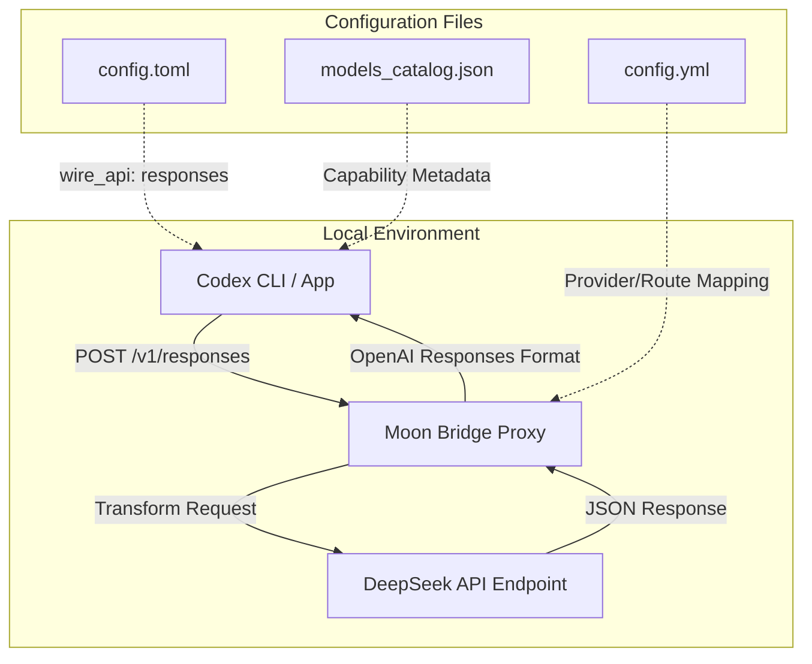
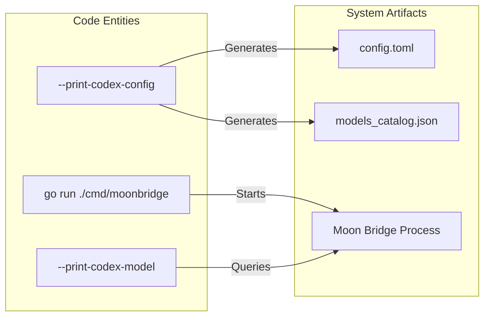

<!-- source: DeepWiki mcp.deepwiki.com · repo deepseek-ai/awesome-deepseek-agent · page 6.1 OpenAI Codex via Moon Bridge · fetched 2026-10-30 -->

# OpenAI Codex via Moon Bridge

Relevant source files

The following files were used as context for generating this wiki page:

- [docs/codex.md](docs/codex.md)
- [docs/codex.zh-CN.md](docs/codex.zh-CN.md)

OpenAI Codex is a coding agent (CLI and App) that communicates via the OpenAI Responses API [docs/codex.md:3-5](). Because Codex requires this specific protocol, Moon Bridge acts as a transformation proxy that forwards Codex requests to DeepSeek V4 models [docs/codex.md:5-6]().

### Data Flow Architecture

The following diagram illustrates the request lifecycle from the Codex CLI through the Moon Bridge proxy to the DeepSeek API.

**Codex to DeepSeek Request Flow**

**Sources:** [docs/codex.md:3-6](), [docs/codex.md:101-105](), [docs/codex.md:153-156]()

---

### Configuration and Implementation

#### 1. Moon Bridge `config.yml`
Moon Bridge uses a top-level configuration structure to define models, providers, and routing logic [docs/codex.md:37-40]().

| Key | Description |
| :--- | :--- |
| `mode` | Set to `"Transform"` for proxy operations [docs/codex.md:40](). |
| `server.addr` | The local address Moon Bridge listens on (default: `127.0.0.1:38440`) [docs/codex.md:42-43](). |
| `models` | Defines capabilities like `context_window` (1,000,000) and `supported_reasoning_levels` [docs/codex.md:45-74](). |
| `extensions.deepseek_v4` | Enables specific compatibility flags for DeepSeek V4 [docs/codex.md:57-59](). |
| `providers` | Contains the DeepSeek `api_key` and `base_url` (`https://api.deepseek.com/anthropic`) [docs/codex.md:75-82](). |

#### 2. Codex Sidecar Files
Codex requires two specific files in its home directory (`$HOME/.codex`) to recognize the proxy [docs/codex.md:109-112]().

*   **`config.toml`**: Configures the provider to use `wire_api = "responses"` and points to the Moon Bridge URL [docs/codex.md:155]().
*   **`models_catalog.json`**: Contains model metadata including context windows and tool support [docs/codex.md:156]().

**Entity Mapping: Code to System**

**Sources:** [docs/codex.md:123-130](), [docs/codex.md:160-163]()

---

### Deployment Scripts

Moon Bridge provides automated scripts to handle the configuration and launch process in a single step [docs/codex.md:178-180]().

*   **Bash (Linux/macOS)**: Uses `CODEX_HOME_DIR` and `go run` to pipe the generated config [docs/codex.md:115-130]().
    *   Command: `./scripts/start_codex_with_moonbridge.sh --project-directory /path/to/project` [docs/codex.md:182-183]().
*   **PowerShell (Windows)**: Uses `Set-Content` and `$env:CODEX_HOME` [docs/codex.md:134-151]().
    *   Command: `.\scripts\start_codex_with_moonbridge.ps1 -ProjectDirectory C:\path\to\project` [docs/codex.md:188-189]().

---

### Troubleshooting

| Error | Root Cause | Resolution |
| :--- | :--- | :--- |
| `connection refused` | Proxy not running or port mismatch [docs/codex.md:229](). | Ensure `go run ./cmd/moonbridge` is active and `server.addr` matches [docs/codex.md:98, 229](). |
| Model not visible | Missing metadata in Codex home [docs/codex.md:230](). | Rerun the `--print-codex-config` command to regenerate `models_catalog.json` [docs/codex.md:124-130, 230](). |
| `field provider not found` | Deprecated YAML schema [docs/codex.md:231](). | Update `config.yml` to use top-level `providers` and `routes` keys [docs/codex.md:231](). |
| `401` / `402` | Auth or Billing issues [docs/codex.md:232-233](). | Verify `api_key` in `config.yml` and check DeepSeek platform balance [docs/codex.md:232-233](). |

**Sources:** [docs/codex.md:227-234]()

---

