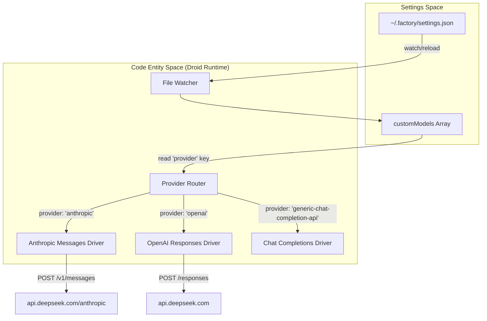
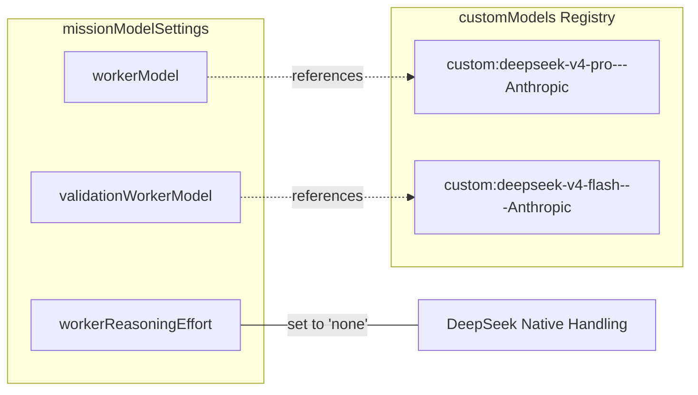

<!-- source: DeepWiki mcp.deepwiki.com · repo deepseek-ai/awesome-deepseek-agent · page 6.2 Factory AI Droid · fetched 2026-10-30 -->

# Factory AI Droid

<details>
<summary>Relevant source files</summary>

The following files were used as context for generating this wiki page:

- [docs/deepseek-droid-guide-zh.md](docs/deepseek-droid-guide-zh.md)
- [docs/deepseek-droid-guide.md](docs/deepseek-droid-guide.md)

</details>


This page provides a technical guide for integrating DeepSeek V4 models into Factory AI Droid. It covers the configuration of the `customModels` array and the `missionModelSettings` within the application's settings schema, supporting both Anthropic-compatible and OpenAI-compatible API protocols.

## Configuration Overview

Factory AI Droid utilizes a central configuration file located at `~/.factory/settings.json` [docs/deepseek-droid-guide.md:18-18](). The application employs a file-watching mechanism to automatically detect and apply changes to this file [docs/deepseek-droid-guide.md:115-115]().

### Custom Model Schema

To integrate DeepSeek, models must be defined within the `customModels` array. Each entry requires specific metadata to ensure the Droid can route requests correctly.

| Field | Description |
| :--- | :--- |
| `model` | The upstream model identifier (e.g., `deepseek-v4-pro`). |
| `id` | A unique identifier, typically prefixed with `custom:`. |
| `index` | A unique integer used for ordering in the UI. |
| `baseUrl` | The API endpoint (provider-specific). |
| `apiKey` | The authentication token or environment variable reference `${DEEPSEEK_API_KEY}`. |
| `provider` | The protocol driver: `anthropic`, `openai`, or `generic-chat-completion-api`. |
| `maxOutputTokens` | Set to `384000` for DeepSeek V4 models. |

**Sources:** [docs/deepseek-droid-guide.md:23-45](), [docs/deepseek-droid-guide.md:50-72](), [docs/deepseek-droid-guide.md:105-107]()

### Data Flow and Provider Mapping

The `provider` field determines which internal driver Factory AI Droid uses to format the request payload.

**Provider Implementation Logic**

**Sources:** [docs/deepseek-droid-guide.md:89-101](), [docs/deepseek-droid-guide.md:115-115]()

## Implementation: Custom Models

### Anthropic-Compatible Integration
This configuration uses the Anthropic Messages API format (`v1/messages`).

```json
{
  "model": "deepseek-v4-pro",
  "id": "custom:deepseek-v4-pro---Anthropic",
  "index": 1,
  "baseUrl": "https://api.deepseek.com/anthropic",
  "apiKey": "${DEEPSEEK_API_KEY}",
  "displayName": "DeepSeek V4 Pro",
  "maxOutputTokens": 384000,
  "noImageSupport": false,
  "provider": "anthropic"
}
```
**Sources:** [docs/deepseek-droid-guide.md:22-33](), [docs/deepseek-droid-guide.md:96-96]()

### OpenAI-Compatible Integration
This configuration uses the OpenAI Responses API format.

```json
{
  "model": "deepseek-v4-flash",
  "id": "custom:deepseek-v4-flash---OpenAI",
  "index": 2,
  "baseUrl": "https://api.deepseek.com",
  "apiKey": "${DEEPSEEK_API_KEY}",
  "displayName": "DeepSeek V4 Flash (OpenAI)",
  "maxOutputTokens": 384000,
  "noImageSupport": false,
  "provider": "openai"
}
```
**Sources:** [docs/deepseek-droid-guide.md:61-71](), [docs/deepseek-droid-guide.md:97-97]()

## Mission Model Assignment

The `missionModelSettings` object defines the specific models used for autonomous tasks (workers) and quality assurance (validation). Assigning the `id` from the `customModels` array to these fields enables DeepSeek as the engine for agentic workflows.

**Mission Configuration Structure**


**Configuration Example:**
```json
"missionModelSettings": {
  "workerModel": "custom:deepseek-v4-pro---Anthropic",
  "workerReasoningEffort": "none",
  "validationWorkerModel": "custom:deepseek-v4-flash---Anthropic",
  "validationWorkerReasoningEffort": "none",
  "skipUserTesting": true,
  "skipScrutiny": true
}
```
**Sources:** [docs/deepseek-droid-guide.md:74-87]()

## Troubleshooting

### Model Visibility
If a model does not appear in the Droid selector:
1. **JSON Validation**: Ensure `~/.factory/settings.json` (or the legacy `config.json`) is syntactically valid [docs/deepseek-droid-guide.md:114-114]().
2. **Field Completion**: Verify all mandatory fields (`id`, `model`, `provider`, `baseUrl`) are present [docs/deepseek-droid-guide.md:116-116]().
3. **Index Uniqueness**: Ensure the `index` value does not conflict with other custom models [docs/deepseek-droid-guide.md:107-107]().

### Authentication and Connectivity
* **Invalid Provider**: The `provider` key is case-sensitive and must be one of the three supported strings: `anthropic`, `openai`, or `generic-chat-completion-api` [docs/deepseek-droid-guide.md:120-120]().
* **401 Unauthorized**: If using environment variables, ensure the variable is exported in the shell before launching the Droid: `export DEEPSEEK_API_KEY=your_key_here` [docs/deepseek-droid-guide.md:108-108]().
* **Endpoint Mismatch**: Ensure the `baseUrl` corresponds to the selected `provider`. Using the OpenAI base URL with the `anthropic` provider will result in 404 or 400 errors [docs/deepseek-droid-guide.md:127-127]().

**Sources:** [docs/deepseek-droid-guide.md:110-132]()

---

