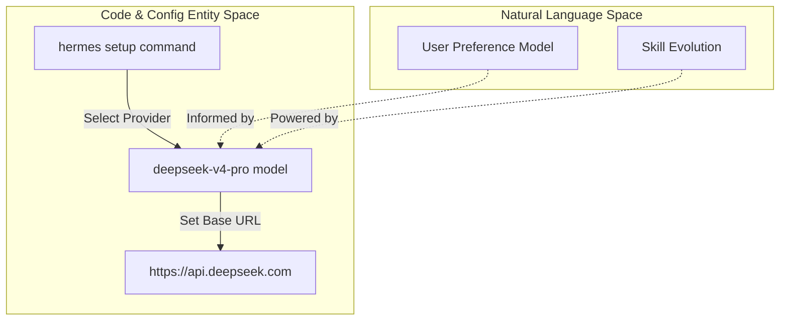
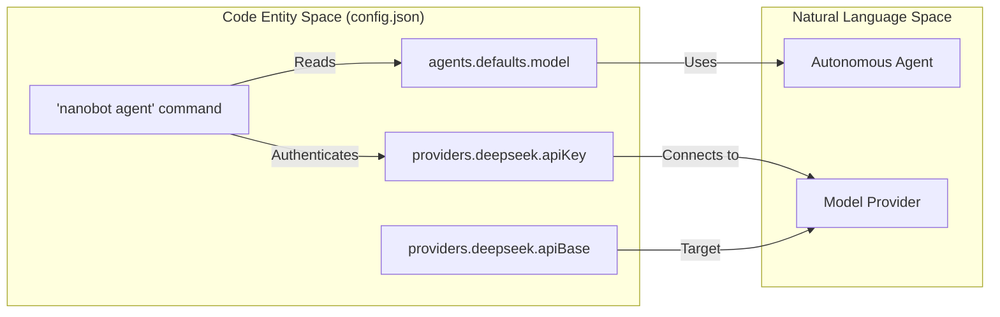

<!-- source: DeepWiki mcp.deepwiki.com · repo deepseek-ai/awesome-deepseek-agent · page 7 Self-Improving and Autonomous Agents · fetched 2026-10-30 -->

# Self-Improving and Autonomous Agents

Relevant source files

The following files were used as context for generating this wiki page:

- [docs/hermes.md](docs/hermes.md)
- [docs/hermes.zh-CN.md](docs/hermes.zh-CN.md)
- [docs/nanobot.md](docs/nanobot.md)
- [docs/nanobot.zh-CN.md](docs/nanobot.zh-CN.md)

This section provides an overview of agents within the DeepSeek ecosystem that possess autonomous or self-evolving capabilities. Unlike standard chat interfaces, these agents are designed to manage long-term state, refine their own internal logic (skills), and operate with a higher degree of independence across sessions.

The two primary implementations covered here are **Hermes Agent**, which focuses on a recursive learning loop for skill evolution, and **nanobot**, a lightweight autonomous agent designed for seamless integration into existing chat platforms.

## Hermes Agent

Hermes, developed by Nous Research, is a self-improving AI agent that implements a built-in learning loop. It is designed to move beyond static instruction following by evolving its capabilities based on user interaction and task outcomes.

### Core Evolution Mechanisms
Hermes utilizes DeepSeek V4 models to drive several autonomous cycles:
*   **Skill Creation**: Automatically derives new reusable skills from successful task executions [docs/hermes.md:5-6]().
*   **Preference Modeling**: Builds a dynamic model of user preferences that persists across different sessions [docs/hermes.md:5-6]().
*   **Knowledge Persistence**: Saves and improves knowledge over time to optimize future reasoning paths [docs/hermes.md:5-6]().

### Configuration Overview
Users can initialize Hermes using a one-line installer and a dedicated setup wizard.
*   **Command**: `hermes setup` [docs/hermes.md:27]().
*   **Provider**: DeepSeek [docs/hermes.md:29]().
*   **Model**: `deepseek-v4-pro` [docs/hermes.md:32]().

For detailed installation and setup instructions, see [Hermes Agent](#7.1).

---

## nanobot

nanobot is a lightweight autonomous agent focused on portability and integration. It leverages the `uv` toolchain for rapid deployment and uses a structured configuration schema to interface with DeepSeek.

### Operational Architecture
nanobot operates as a standalone agent that can be launched directly from the terminal to handle tasks autonomously. It relies on a `config.json` file to define provider behaviors and agent defaults.

### Key Configuration Symbols
*   **Initialization**: `nanobot onboard` [docs/nanobot.md:39]().
*   **Launch Command**: `nanobot agent` [docs/nanobot.md:71]().
*   **Config Path**: `~/.nanobot/config.json` [docs/nanobot.md:45]().

For details on the JSON schema and environment setup, see [nanobot](#7.2).

---

## Technical Mapping: Agent to Code Space

The following diagrams illustrate how natural language concepts for these autonomous agents map to specific code entities and configuration keys within the repository.

### Hermes Configuration Flow
This diagram maps the `hermes setup` wizard choices to the underlying configuration requirements for DeepSeek integration.

**Sources:** [docs/hermes.md:25-33](), [docs/hermes.md:5-6]()

### nanobot Runtime Structure
This diagram bridges the `nanobot` CLI commands to the specific JSON configuration fields required for the agent to function.

**Sources:** [docs/nanobot.md:47-64](), [docs/nanobot.md:68-72]()

## Summary Table

| Agent | Core Philosophy | Primary Model | Configuration File |
| :--- | :--- | :--- | :--- |
| **Hermes** | Self-improving, skill-based evolution | `deepseek-v4-pro` | Internal state / wizard-driven |
| **nanobot** | Lightweight, modular autonomy | `deepseek-v4-pro` | `config.json` |

**Sources:** [docs/hermes.md:3-6](), [docs/nanobot.md:50-64]()

---

