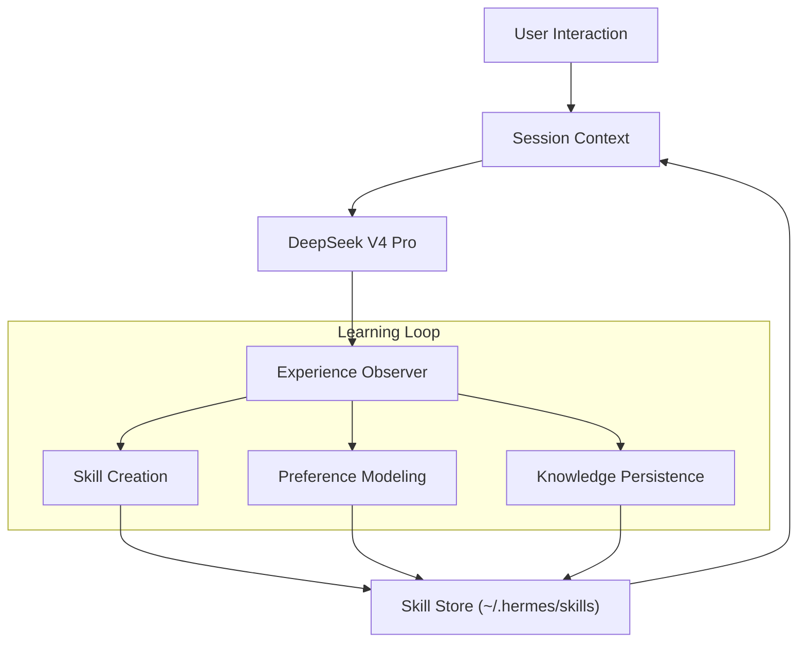
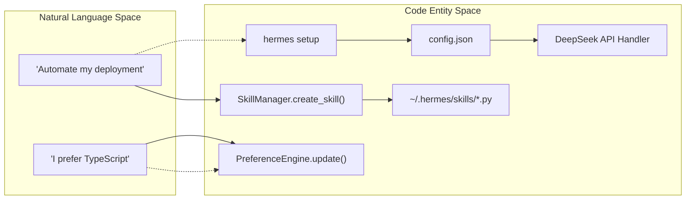

<!-- source: DeepWiki mcp.deepwiki.com · repo deepseek-ai/awesome-deepseek-agent · page 7.1 Hermes Agent · fetched 2026-10-30 -->

# Hermes Agent

<details>
<summary>Relevant source files</summary>

The following files were used as context for generating this wiki page:

- [docs/hermes.md](docs/hermes.md)
- [docs/hermes.zh-CN.md](docs/hermes.zh-CN.md)

</details>


Hermes is a self-improving autonomous AI agent developed by Nous Research, designed to evolve through interaction. Unlike static agents, Hermes implements a continuous learning loop that allows it to capture user preferences, formalize repetitive tasks into reusable skills, and persist domain knowledge across different chat sessions.

### 1. Installation

Hermes provides a streamlined installation process via a shell script that manages dependencies automatically. The primary prerequisite for the environment is `Git`.

#### One-Line Installer
For Linux, macOS, and WSL2 environments, use the following command to download and execute the installation script:

```bash
curl -fsSL https://raw.githubusercontent.com/NousResearch/hermes-agent/main/scripts/install.sh | bash
```

**Sources:** [docs/hermes.md:13-17](), [docs/hermes.md:19-19]()

---

### 2. Configuration Wizard

After installation and shell reloading, the agent is configured using the `hermes setup` command. This interactive wizard populates the local configuration required to communicate with the DeepSeek API.

| Step | Action | Selection / Value |
| :--- | :--- | :--- |
| 1 | Launch Wizard | `hermes setup` |
| 2 | Setup Type | `Quick Setup` |
| 3 | Model Provider | `DeepSeek` |
| 4 | Authentication | `[Your DeepSeek API Key]` |
| 5 | Endpoint URL | `https://api.deepseek.com` |
| 6 | Model Selection | `deepseek-v4-pro` |

**Sources:** [docs/hermes.md:25-33]()

---

### 3. Self-Improving Learning Loop

The core architecture of Hermes revolves around a "Learning Loop" that bridges the gap between raw LLM outputs and structured agentic behavior. This system allows the agent to modify its own capabilities over time.

#### Learning Loop Architecture
The diagram below illustrates the flow from a user interaction to the persistence of new agent capabilities.

**Data Flow: Interaction to Skill Persistence**

**Sources:** [docs/hermes.md:5-5]()

#### Key Functional Components

1.  **Skill Creation**: Hermes identifies successful multi-step patterns in its reasoning and formalizes them into "skills." These act as specialized tool definitions that the agent can invoke in future sessions to solve similar problems more efficiently.
2.  **Preference Modeling**: The agent tracks user feedback and stylistic choices to build an evolving model of user preferences. This reduces the need for repetitive prompting regarding output format or coding style.
3.  **Knowledge Persistence**: Facts, project structures, and technical decisions are stored in a persistent memory layer, allowing the agent to maintain context even after a session is closed and a new one is initialized.

**Sources:** [docs/hermes.md:5-5]()

---

### 4. Implementation Logic

Hermes bridges "Natural Language Space" (user requirements) to "Code Entity Space" (executable skills and configurations) by mapping intent to its internal registry.

**Mapping Logic: Natural Language to Code Entities**

**Sources:** [docs/hermes.md:5-5](), [docs/hermes.md:27-32]()

---

