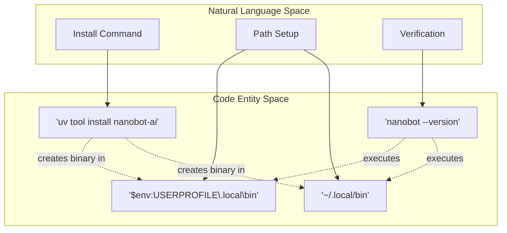
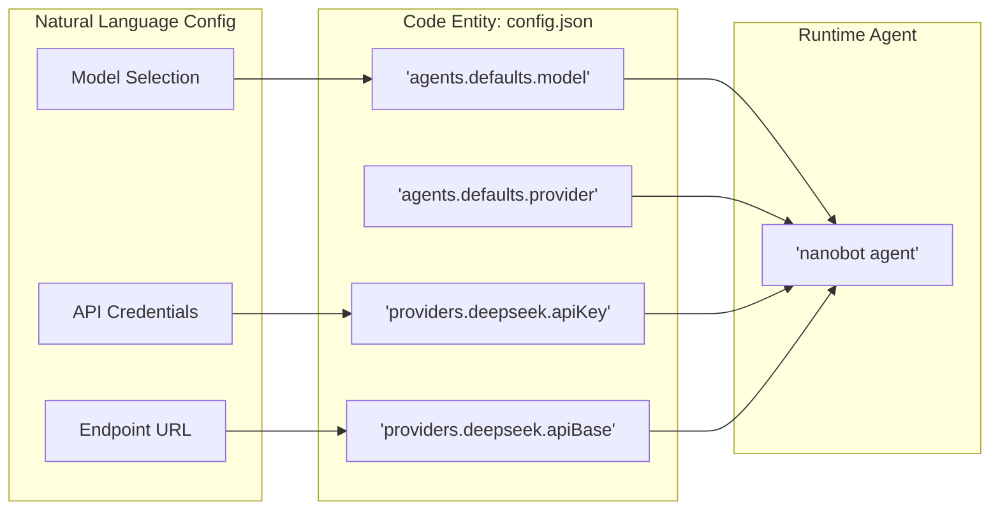

<!-- source: DeepWiki mcp.deepwiki.com · repo deepseek-ai/awesome-deepseek-agent · page 7.2 nanobot · fetched 2026-10-30 -->

# nanobot

<details>
<summary>Relevant source files</summary>

The following files were used as context for generating this wiki page:

- [docs/nanobot.md](docs/nanobot.md)
- [docs/nanobot.zh-CN.md](docs/nanobot.zh-CN.md)

</details>


`nanobot` is a lightweight AI agent designed for seamless integration with popular chat platforms and terminal environments. It leverages a modular configuration system to interface with various LLM providers, specifically optimized for DeepSeek V4 models [docs/nanobot.md:3-5]().

## Installation and Environment Setup

The installation of `nanobot` is managed via `uv`, a high-performance Python package and tool installer.

1.  **Tool Installation**: Use `uv` to globally install the `nanobot-ai` package [docs/nanobot.md:9-14]().
    ```bash
    uv tool install nanobot-ai
    ```
2.  **Path Configuration (Windows)**: On Windows systems, the `.local/bin` directory within the user profile must be added to the system `PATH` to execute the binary [docs/nanobot.md:16-20]().
    ```powershell
    $env:PATH = "$env:USERPROFILE\.local\bin;$env:PATH"
    ```
    Alternatively, use the built-in `uv` command to refresh shell environment variables [docs/nanobot.md:22-26]().
    ```powershell
    uv tool update-shell
    ```
3.  **Verification**: Confirm the installation by checking the version [docs/nanobot.md:28-32]().
    ```bash
    nanobot --version
    ```

### Installation Logic Flow
The following diagram illustrates the transition from the natural language installation steps to the filesystem entities created during the process.

**Diagram: nanobot Installation and Path Resolution**

Sources: [docs/nanobot.md:7-32]()

## Configuration Initialization

The initialization process creates the necessary directory structure and a default configuration schema.

### The Onboard Command
Executing `nanobot onboard` generates the `config.json` file in the user's home directory [docs/nanobot.md:36-40]().
- **Windows Path**: `%USERPROFILE%\.nanobot\config.json` [docs/nanobot.md:44]()
- **Linux/macOS Path**: `~/.nanobot/config.json` [docs/nanobot.md:45]()

### config.json Schema
The configuration file is divided into `agents` (defining behavior and default models) and `providers` (defining API credentials and endpoints) [docs/nanobot.md:50-64]().

| Key | Description | Recommended Value |
| :--- | :--- | :--- |
| `agents.defaults.model` | The primary model identifier used by the agent | `deepseek-v4-pro` |
| `agents.defaults.provider` | References the key in the providers object | `deepseek` |
| `providers.deepseek.apiKey` | Authentication token for DeepSeek API | `<your API Key>` |
| `providers.deepseek.apiBase` | The base URL for the OpenAI-compatible endpoint | `https://api.deepseek.com/v1` |

**Diagram: Configuration Data Flow**
This diagram bridges the `config.json` structure to the runtime execution of the agent.

**Diagram: nanobot Configuration Mapping**

Sources: [docs/nanobot.md:34-64]()

## Execution: The nanobot Agent

Once configured, the agent is launched via the CLI.

### Launch Command
The command `nanobot agent` starts the agentic loop, utilizing the settings defined in `config.json` to initialize the session [docs/nanobot.md:68-72]().

1.  **Initialization**: The tool reads the `agents.defaults` to determine which provider to invoke.
2.  **Authentication**: It retrieves the `apiKey` and `apiBase` from the corresponding provider block.
3.  **Session Start**: The agent becomes active, ready to process tasks or integrate with external chat tools as specified in the broader environment [docs/nanobot.md:5]().

Sources: [docs/nanobot.md:66-73]()

---

