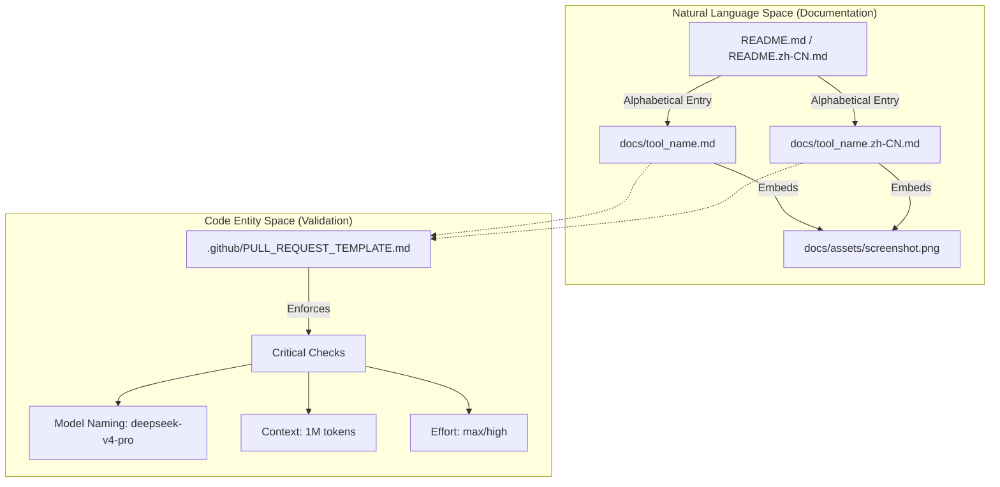
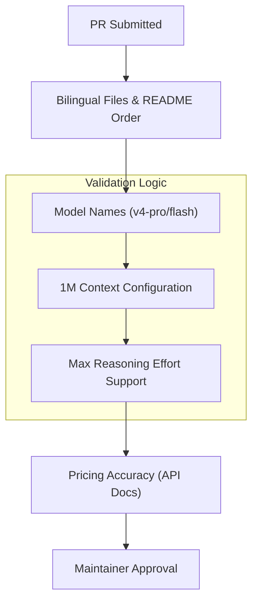

<!-- source: DeepWiki mcp.deepwiki.com · repo deepseek-ai/awesome-deepseek-agent · page 8 Contributing a New Integration Guide · fetched 2026-10-30 -->

# Contributing a New Integration Guide

Relevant source files

The following files were used as context for generating this wiki page:

- [.github/PULL_REQUEST_TEMPLATE.md](.github/PULL_REQUEST_TEMPLATE.md)
- [CONTRIBUTING.md](CONTRIBUTING.md)

This page provides a high-level overview of the process for contributing new tool integration guides to the `awesome-deepseek-agent` repository. The goal is to maintain a high-quality, bilingual community knowledge base that reflects the latest capabilities of DeepSeek V4 models.

The contribution workflow is designed to ensure that every guide is technically accurate, supports advanced features like 1M context and reasoning effort, and is accessible to both English and Chinese-speaking developers.

### Contribution Workflow Overview

The lifecycle of a contribution begins with verifying the current state of the repository and the DeepSeek API, followed by document creation and a structured review process.

1.  **Preparation**: Check [open PRs](https://github.com/deepseek-ai/awesome-deepseek-agent/pulls) to avoid duplication and consult the [DeepSeek API docs](https://api-docs.deepseek.com/) to ensure your guide uses current model specifications [CONTRIBUTING.md:5-9]().
2.  **Creation**: Author the guide following the **installation → configuration → first run** structure [CONTRIBUTING.md:11-13]().
3.  **Bilingual Support**: Create both English and Simplified Chinese versions of the documentation [CONTRIBUTING.md:15-17]().
4.  **Submission**: Open a single Pull Request (PR) containing the documentation, assets, and README updates [CONTRIBUTING.md:75-78]().

#### Documentation Architecture
The diagram below illustrates how a new contribution integrates into the existing codebase structure.

**Contribution Structure Map**

**Sources:** [CONTRIBUTING.md:15-22](), [CONTRIBUTING.md:79-81](), [.github/PULL_REQUEST_TEMPLATE.md:1-20]()

---

### Guide Format and Requirements

Every contribution must adhere to specific formatting and bilingual standards to be accepted. This includes a mandatory file structure and the placement of assets.

*   **Bilingual Requirement**: Every guide requires an English version (`docs/tool_name.md`) and a Simplified Chinese version (`docs/tool_name.zh-CN.md`) [CONTRIBUTING.md:15-17]().
*   **README Indexing**: The tool must be added to the tables in both `README.md` and `README.zh-CN.md` in **alphabetical order** [CONTRIBUTING.md:19-21]().
*   **Assets**: Screenshots and diagrams must be placed in `docs/assets/` with descriptive filenames [CONTRIBUTING.md:79-81]().

For detailed instructions on the required document structure and bilingual standards, see [Guide Format and Bilingual Requirements](#8.1).

**Sources:** [CONTRIBUTING.md:11-22](), [CONTRIBUTING.md:79-81]()

---

### Technical Checklist and Critical Checks

To maintain technical excellence, all PRs are evaluated against a set of critical checks centered on the DeepSeek V4 model capabilities.

*   **Model Naming**: Use `deepseek-v4-pro` and `deepseek-v4-flash`. Legacy names like `deepseek-chat` or `deepseek-reasoner` are deprecated [CONTRIBUTING.md:27-34]().
*   **1M Context Window**: Configurations must support or mention the 1,000,000 token context window [CONTRIBUTING.md:36-44]().
*   **Reasoning Effort**: Guides must configure the highest available reasoning effort (e.g., `CLAUDE_CODE_EFFORT_LEVEL=max`) [CONTRIBUTING.md:46-54]().
*   **Pricing**: If pricing is mentioned, it must be verified against the official API pricing page [CONTRIBUTING.md:56-63]().

For a full breakdown of the technical requirements and common pitfalls to avoid, see [Technical Checklist and Critical Checks](#8.2).

**Sources:** [CONTRIBUTING.md:23-63](), [.github/PULL_REQUEST_TEMPLATE.md:5-12]()

---

### The Review Process

Once a PR is submitted, maintainers use a standardized checklist to verify both the documentation quality and the agent configuration.

**PR Review Workflow**

**Sources:** [CONTRIBUTING.md:83-102](), [.github/PULL_REQUEST_TEMPLATE.md:3-20]()

---

