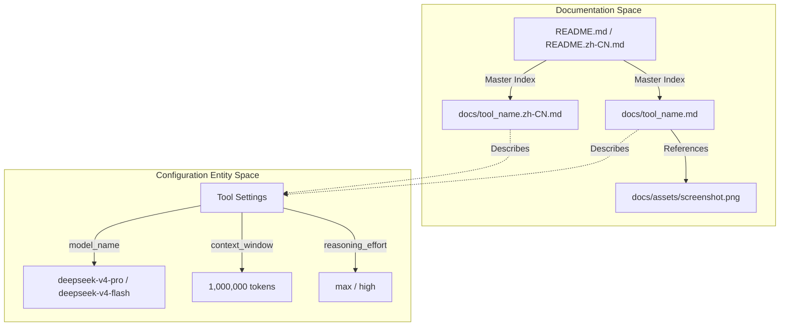
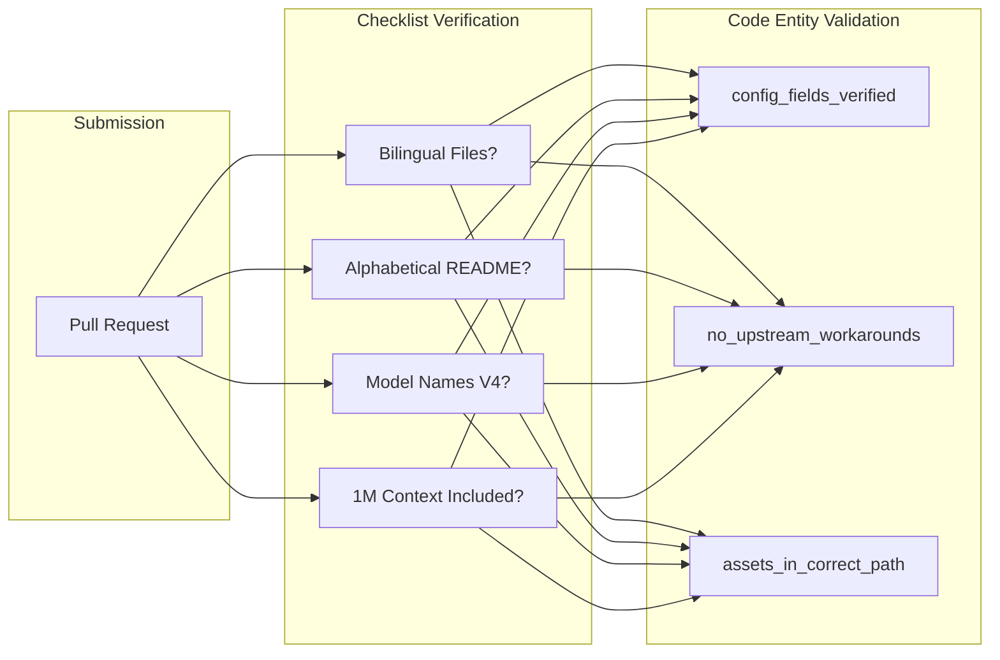

<!-- source: DeepWiki mcp.deepwiki.com · repo deepseek-ai/awesome-deepseek-agent · page 8.1 Guide Format and Bilingual Requirements · fetched 2026-10-30 -->

# Guide Format and Bilingual Requirements

Relevant source files

The following files were used as context for generating this wiki page:

- [.github/PULL_REQUEST_TEMPLATE.md](.github/PULL_REQUEST_TEMPLATE.md)
- [CONTRIBUTING.md](CONTRIBUTING.md)

This section defines the mandatory structure, linguistic requirements, and repository conventions for contributing new integration guides to the `awesome-deepseek-agent` knowledge base. Adherence to these standards ensures consistency across the documentation and facilitates a streamlined review process.

## 1. Mandatory File Structure and Bilingualism

Every contribution for a new tool must include two versions of the documentation within a single Pull Request (PR). Splitting these into multiple PRs is not permitted [CONTRIBUTING.md:15-17]().

### File Naming Convention
Guides are stored in the `docs/` directory using the following naming pattern:
*   **English Version**: `docs/tool_name.md` [CONTRIBUTING.md:17-17]()
*   **Simplified Chinese Version**: `docs/tool_name.zh-CN.md` [CONTRIBUTING.md:17-17]()

### Asset Management
All visual aids, such as screenshots or diagrams, must be stored in a centralized asset directory:
*   **Path**: `docs/assets/` [CONTRIBUTING.md:79-81]()
*   **Requirements**: Use descriptive filenames and ensure file sizes are optimized for web viewing [CONTRIBUTING.md:81-81]().

### The Lifecycle Structure
Each guide is required to follow a logical progression to assist users in the setup process [CONTRIBUTING.md:11-13]():
1.  **Installation**: Steps to acquire and install the tool.
2.  **Configuration**: Detailed setup of API keys, endpoints, and model parameters.
3.  **First Run**: The initial execution flow to verify the integration.

**Sources:** [CONTRIBUTING.md:11-17](), [CONTRIBUTING.md:79-81]()

## 2. Integration Workflow and Data Flow

The integration process involves bridging the tool's internal configuration logic with the DeepSeek V4 API specifications. The following diagram illustrates the data flow from the documentation requirements to the actual configuration entities within a PR.

**Title: Integration Guide Data Flow**

**Sources:** [CONTRIBUTING.md:19-21](), [CONTRIBUTING.md:27-32](), [CONTRIBUTING.md:36-42](), [CONTRIBUTING.md:46-52]()

## 3. README Registration

To ensure discoverability, every new guide must be registered in the master index tables located in the root directory.

*   **Files to Update**: Both `README.md` and `README.zh-CN.md` [CONTRIBUTING.md:19-21]().
*   **Ordering**: Entries must be inserted in **alphabetical order** based on the tool name. This convention is strictly enforced to minimize merge conflicts during concurrent PR submissions [CONTRIBUTING.md:21-21]().

**Sources:** [CONTRIBUTING.md:19-22]()

## 4. Technical Content Requirements

The following technical specifications are mandatory for all guides. Failure to include these will result in the PR being flagged during the review process [CONTRIBUTING.md:23-25]().

### Model and Context Configuration
| Requirement | Specification | Implementation Detail |
| :--- | :--- | :--- |
| **Model Names** | Must use V4 identifiers | `deepseek-v4-pro` or `deepseek-v4-flash` [CONTRIBUTING.md:27-32]() |
| **Context Window** | 1M Token Support | Append `[1m]` for Anthropic-compat or set `context_window: 1000000` [CONTRIBUTING.md:36-42]() |
| **Reasoning Effort** | Maximize logic | Set `reasoning_effort: max` or `CLAUDE_CODE_EFFORT_LEVEL=max` [CONTRIBUTING.md:46-52]() |

### Pricing Accuracy
If pricing is mentioned, it must be verified against the official DeepSeek API documentation. The repository maintains a snapshot of current rates for reference:
*   **V4 Pro**: Input $0.435/M, Output $0.87/M [CONTRIBUTING.md:60-63]()
*   **V4 Flash**: Input $0.14/M, Output $0.28/M [CONTRIBUTING.md:60-63]()

**Sources:** [CONTRIBUTING.md:23-63]()

## 5. Validation and PR Checklist

The repository utilizes a standard PR template to verify compliance before a maintainer reviews the code. This ensures that the "Natural Language" instructions in the guide correctly map to the "Code Execution" behavior of the agent.

**Title: PR Validation Logic**

**Sources:** [.github/PULL_REQUEST_TEMPLATE.md:3-20](), [CONTRIBUTING.md:83-101]()

---

