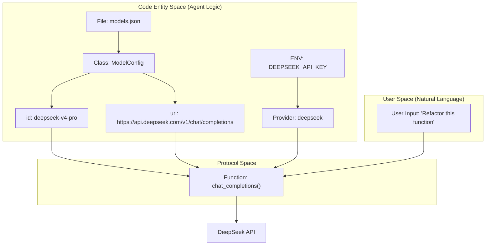
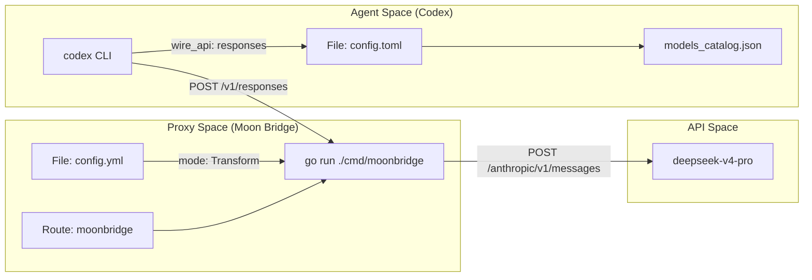

<!-- source: DeepWiki mcp.deepwiki.com · repo deepseek-ai/awesome-deepseek-agent · page 9 Glossary · fetched 2026-10-30 -->

# Glossary

Relevant source files

The following files were used as context for generating this wiki page:

- [.github/PULL_REQUEST_TEMPLATE.md](.github/PULL_REQUEST_TEMPLATE.md)
- [CONTRIBUTING.md](CONTRIBUTING.md)
- [README.md](README.md)
- [README.zh-CN.md](README.zh-CN.md)
- [docs/codex.md](docs/codex.md)
- [docs/codex.zh-CN.md](docs/codex.zh-CN.md)
- [docs/copilot_cli.md](docs/copilot_cli.md)
- [docs/copilot_cli.zh-CN.md](docs/copilot_cli.zh-CN.md)
- [docs/crush.md](docs/crush.md)
- [docs/crush.zh-CN.md](docs/crush.zh-CN.md)
- [docs/deepseek-tui.md](docs/deepseek-tui.md)
- [docs/deepseek-tui.zh-CN.md](docs/deepseek-tui.zh-CN.md)
- [docs/github_copilot.md](docs/github_copilot.md)
- [docs/github_copilot.zh-CN.md](docs/github_copilot.zh-CN.md)
- [docs/lobehub.md](docs/lobehub.md)
- [docs/pi_mono.md](docs/pi_mono.md)
- [docs/pi_mono.zh-CN.md](docs/pi_mono.zh-CN.md)
- [docs/workbuddy.md](docs/workbuddy.md)
- [docs/workbuddy.zh-CN.md](docs/workbuddy.zh-CN.md)

This page provides definitions for technical terms, domain-specific jargon, and configuration keys used throughout the **Awesome DeepSeek Agent** repository.

## Purpose and Scope

The glossary serves as a centralized reference for developers and users to understand the underlying architecture of DeepSeek V4 integrations. It covers model identifiers, protocol-specific configuration keys, and agentic concepts like "Thinking Mode" and "MCP".

---

## 1. Core Model Terms

### DeepSeek V4 Pro / Flash
The current generation of DeepSeek models. 
*   **Pro**: Optimized for complex reasoning, coding, and long-horizon planning [README.md:16-37]().
*   **Flash**: Optimized for low latency and everyday chat tasks [docs/lobehub.md:49-49]().
*   **Note**: These replace the deprecated V3 names (`deepseek-chat`, `deepseek-reasoner`, `deepseek-coder`) [CONTRIBUTING.md:29-32]().

### Thinking Mode (Reasoning)
A feature where the model generates an internal chain-of-thought before producing the final response.
*   **Implementation**: Controlled via `reasoning_effort` (OpenAI-compatible) or `thinking: { type: "enabled" }` (Anthropic-compatible) [CONTRIBUTING.md:50-52]().
*   **Levels**: Typical levels include `none`, `high`, and `max` [docs/lobehub.md:64-69]().
*   **Sources**: [docs/github_copilot.md:31-37](), [docs/lobehub.md:60-69]().

### 1M Context Window
DeepSeek V4 supports a context window of up to 1,000,000 tokens.
*   **Configuration**: Set via `context_window: 1000000` in OpenAI-compatible tools or by appending the `[1m]` suffix to model names in Anthropic-compatible tools [CONTRIBUTING.md:38-42]().
*   **Sources**: [docs/pi_mono.md:45-45](), [docs/crush.md:43-43]().

---

## 2. Protocol & Integration Concepts

### OpenAI-Compatible Endpoint
Standard API format supported by most agents.
*   **Base URL**: `https://api.deepseek.com` [docs/lobehub.md:33-33]().
*   **Key Files**: `models.json` (Pi/WorkBuddy), `crush.json` (Crush).
*   **Sources**: [docs/pi_mono.md:29-30](), [docs/workbuddy.md:5-5]().

### Anthropic-Compatible Endpoint
A translation layer provided by DeepSeek to support tools designed for Claude (e.g., Claude Code).
*   **Base URL**: `https://api.deepseek.com/anthropic` [docs/codex.md:77-77]().
*   **Sources**: [docs/codex.md:75-81](), [CONTRIBUTING.md:40-40]().

### Model Context Protocol (MCP)
An open standard that enables AI models to connect to external data sources and tools (databases, file systems, etc.).
*   **Usage**: Supported by AstrBot, Cherry Studio, DeepSeek-TUI, and Crush [README.md:18-24]().
*   **Sources**: [README.md:18-36]().

---

## 3. Configuration Schema Reference

| Key | Context | Description |
| :--- | :--- | :--- |
| `reasoning_effort` | OpenAI API / Moon Bridge | Controls the depth of the model's chain-of-thought (`high`, `max`) [docs/codex.md:49-54](). |
| `wire_api` | Codex `config.toml` | Defines the communication protocol; set to `"responses"` for DeepSeek via Moon Bridge [docs/codex.md:155-155](). |
| `thinkingFormat` | Pi `models.json` | Specifies how the agent parses reasoning blocks; set to `"deepseek"` [docs/pi_mono.md:57-57](). |
| `supportsToolCall` | WorkBuddy `models.json` | Boolean flag indicating if the model can execute function calls [docs/workbuddy.md:46-46](). |
| `can_reason` | Crush `crush.json` | Boolean flag to enable reasoning capabilities in the TUI [docs/crush.zh-CN.md:45-45](). |

**Sources**: [docs/codex.md:45-55](), [docs/pi_mono.md:55-65](), [docs/workbuddy.md:37-52]().

---

## 4. System Architecture Diagrams

### From Natural Language to Code Entity: OpenAI-Compatible Setup
This diagram shows how a user's request flows through configuration files and environment variables into the specific code entities used by agents like Pi or WorkBuddy.

**Data Flow: Configuration to API**

**Sources**: [docs/pi_mono.md:35-43](), [docs/workbuddy.md:37-43]().

### From Natural Language to Code Entity: Proxy-Based Setup (Codex)
This diagram illustrates the bridge between the OpenAI Codex agent and the DeepSeek API via the Moon Bridge proxy.

**Data Flow: Proxy Translation**

**Sources**: [docs/codex.md:39-91](), [docs/codex.md:103-105](), [docs/codex.md:153-157]().