# Page: Overview

# Overview

<details>
<summary>Relevant source files</summary>

The following files were used as context for generating this wiki page:

- [README.md](README.md)
- [README.zh-CN.md](README.zh-CN.md)

</details>


The **Awesome DeepSeek Agent** repository is a curated collection of technical integration guides designed to help developers and AI enthusiasts connect **DeepSeek-V4** models to a wide array of AI agents, terminal assistants, and IDE extensions. 

The project focuses on the latest generation of DeepSeek models, specifically `deepseek-v4-pro` and `deepseek-v4-flash`, providing step-by-step instructions for configuring 1M context windows, reasoning effort levels, and specialized API endpoints.

### Project Mission and Scope
The repository serves as a bridge between the [DeepSeek Platform](https://platform.deepseek.com/) and the rapidly evolving ecosystem of "agentic" tools. Each guide is structured to move from installation to first-run in minutes, ensuring that complex configurations (like Anthropic-compatible headers or MCP server setups) are standardized across different tools.

For a detailed look at the underlying models and their technical specifications, see [DeepSeek Models Reference](#1.2).

### Repository Organization
The repository is organized to be accessible to both English and Chinese-speaking audiences. It follows a flat file structure for documentation, using a strict naming convention to keep translations and assets synchronized.

- **Master Index**: The [README.md:16-37]() and [README.zh-CN.md:16-37]() serve as the central entry points, categorizing tools alphabetically.
- **Bilingual Documentation**: Every integration guide exists as a pair of files in the `docs/` directory (e.g., `tool.md` and `tool.zh-CN.md`).
- **Assets**: Screenshots and diagrams are centralized in the `docs/assets/` directory to ensure visual consistency across guides.

For more details on the file layout and how to find specific tool documentation, see [Repository Structure and Navigation](#1.1).

### Core Categories
The integrations are broadly categorized based on their execution environment and primary use case:

| Category | Description | Key Examples |
| :--- | :--- | :--- |
| **Terminal & CLI Agents** | Native command-line assistants focused on coding and system tasks. | `Claude Code`, `DeepSeek-TUI`, `Reasonix` |
| **IDE & Editor Extensions** | Integrations directly within development environments. | `GitHub Copilot`, `Kilo Code`, `WorkBuddy` |
| **Desktop & Web Platforms** | GUI-based orchestration layers for managing multiple agents. | `Cherry Studio`, `LobeHub` |
| **Messaging & Multi-Channel** | Bridges to platforms like WeChat, Feishu, or Telegram. | `AstrBot`, `OpenClaw` |
| **Proxy & Protocol Bridges** | Translation layers for cross-provider compatibility. | `Moon Bridge`, `Factory AI Droid` |

### System Relationship Diagram
This diagram illustrates how the documentation maps "Natural Language Space" (the tool names) to "Code Entity Space" (the documentation files and configuration targets).

**Documentation Mapping**
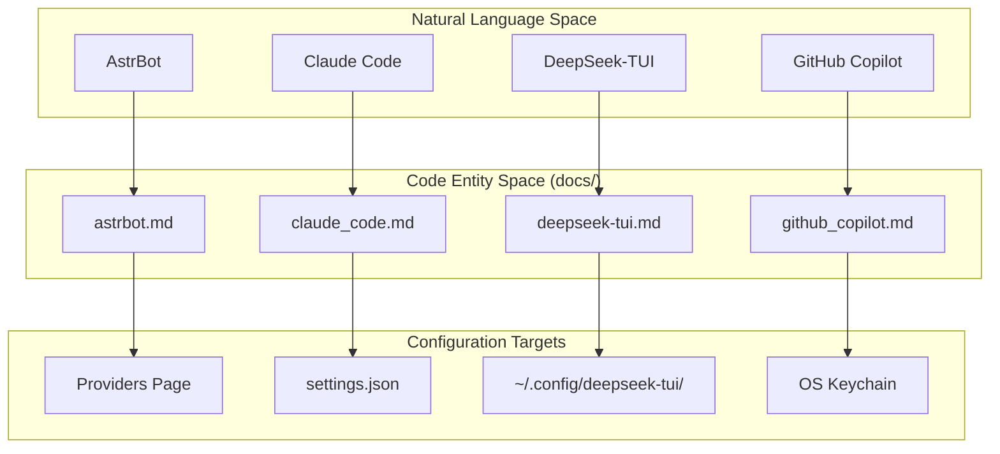
**Sources:** [README.md:18-25](), [README.zh-CN.md:18-25]()

### Integration Flow
The following diagram demonstrates the typical lifecycle of an integration as described in the repository's guides, showing the flow from the user's environment to the DeepSeek API.

**DeepSeek Integration Lifecycle**
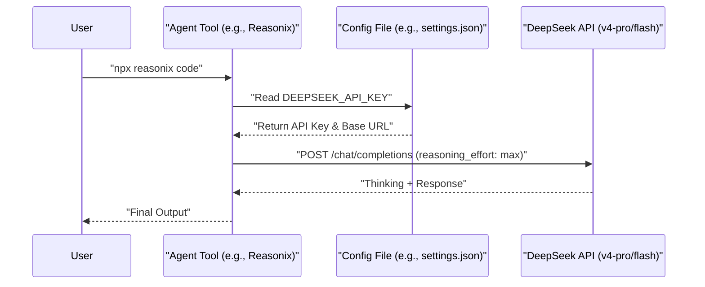
**Sources:** [README.md:36](), [README.zh-CN.md:36]()

### Contribution and Evolution
This repository is community-driven. Developers are encouraged to submit new guides following the technical checklist and bilingual requirements.

- To contribute a new tool, see [Contributing a New Integration Guide](#8).
- For a deep dive into specific terminology like "Reasoning Effort" or "MCP," see the [Glossary](#9).

**Sources:** [README.md:44-46](), [README.zh-CN.md:44-46]()

---

# Page: Repository Structure and Navigation

# Repository Structure and Navigation

<details>
<summary>Relevant source files</summary>

The following files were used as context for generating this wiki page:

- [.github/PULL_REQUEST_TEMPLATE.md](.github/PULL_REQUEST_TEMPLATE.md)
- [CONTRIBUTING.md](CONTRIBUTING.md)
- [README.md](README.md)
- [README.zh-CN.md](README.zh-CN.md)

</details>


This page provides a technical overview of the `awesome-deepseek-agent` repository's organization. It details how the documentation is structured, the bilingual file conventions, and the mechanism by which the master index links disparate integration guides into a cohesive knowledge base.

## Directory Layout and File Conventions

The repository utilizes a flat directory structure for documentation to minimize nesting and simplify path referencing. The core logic of the repository is contained within the `docs/` directory and the root `README` files.

### The `docs/` Directory
All integration guides are stored in the `docs/` folder. The repository enforces a strict naming and pairing convention for these files to ensure accessibility for both English and Simplified Chinese speakers [CONTRIBUTING.md:15-17]().

*   **Bilingual Pairing**: Every tool documented must have two corresponding files:
    *   `docs/<tool_name>.md`: The English version of the guide.
    *   `docs/<tool_name>.zh-CN.md`: The Simplified Chinese version of the guide.
*   **Assets**: Visual aids, such as screenshots or diagrams, are stored in `docs/assets/` [CONTRIBUTING.md:79-81](). Guides reference these assets using relative paths to ensure they render correctly on GitHub and other Markdown viewers.

### Root Index Files
The repository's entry points are the two README files in the root directory:
*   `README.md`: The primary English landing page [README.md:1-11]().
*   `README.zh-CN.md`: The primary Simplified Chinese landing page [README.zh-CN.md:1-11]().

### Repository Structure Diagram
The following diagram illustrates the relationship between the root index, the bilingual documentation files, and the shared assets.

**Documentation Hierarchy and Asset Mapping**
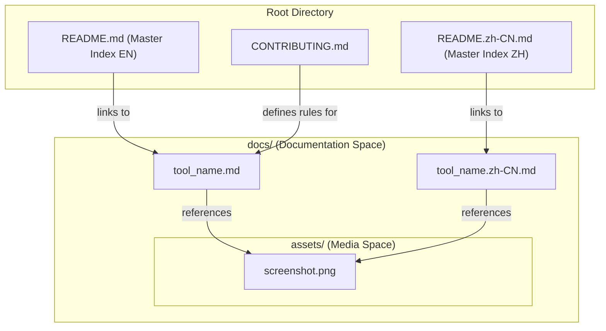
**Sources:** [README.md:16-37](), [README.zh-CN.md:16-37](), [CONTRIBUTING.md:15-21](), [CONTRIBUTING.md:79-82]()

---

## The Master Index Mechanism

The README files serve as more than just a welcome page; they act as a functional "Master Index" for the repository. This index is implemented as a Markdown table that categorizes tools and provides direct links to their respective guides.

### Table Structure
The table contains three primary columns:
1.  **Tool**: The name of the AI agent or coding assistant.
2.  **Description**: A brief technical summary of the tool's capabilities.
3.  **Guide**: A relative link to the specific `.md` or `.zh-CN.md` file in the `docs/` directory.

### Alphabetical Enforcement
To maintain order and prevent merge conflicts during concurrent pull requests, all entries in the `Contents` table must be inserted in **alphabetical order** [CONTRIBUTING.md:19-21]().

**Data Flow: From README to Specific Integration Guide**
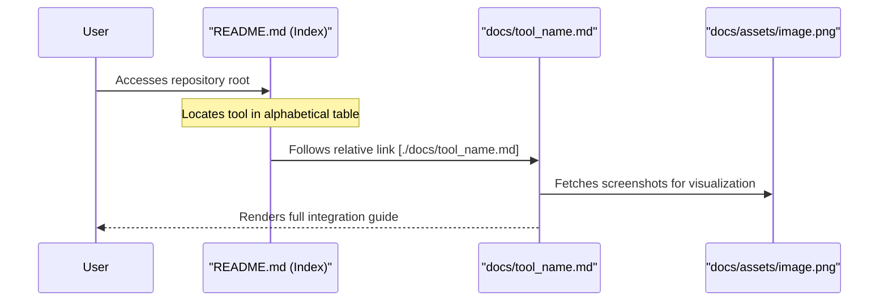
**Sources:** [README.md:14-37](), [CONTRIBUTING.md:19-21](), [CONTRIBUTING.md:79-82]()

---

## Technical Standards for Guides

Every file within the `docs/` directory must adhere to specific technical requirements defined in the contribution guidelines. These standards ensure that "Natural Language" instructions correctly map to "Code Entity" configurations required by the agents.

### Key Configuration Requirements
| Requirement | Implementation Detail | Source |
| :--- | :--- | :--- |
| **Model Naming** | Must use `deepseek-v4-pro` or `deepseek-v4-flash`. | [CONTRIBUTING.md:27-32]() |
| **Context Window** | Configured for 1,000,000 tokens (e.g., `[1m]` suffix). | [CONTRIBUTING.md:36-44]() |
| **Reasoning Effort** | Must target `max` effort levels in config files. | [CONTRIBUTING.md:46-54]() |

### Integration Mapping Diagram
This diagram shows how a guide in `docs/` maps abstract concepts to specific code entities found in agent configuration files.

**Conceptual to Code Entity Mapping**
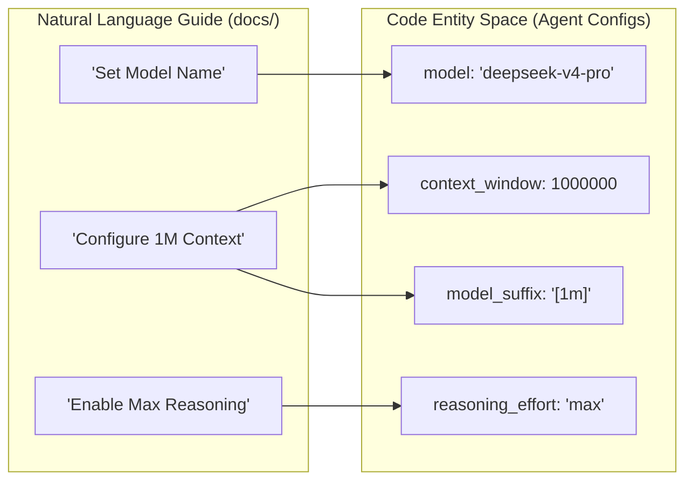
**Sources:** [CONTRIBUTING.md:23-54](), [.github/PULL_REQUEST_TEMPLATE.md:5-12]()

---

## Navigation Summary

To navigate the codebase effectively:
1.  **Start at the Root**: Use `README.md` (EN) or `README.zh-CN.md` (ZH) to find the tool of interest.
2.  **Locate the Guide**: Follow the link to the `docs/` folder.
3.  **Verify Configuration**: Ensure the guide mentions the mandatory V4 model identifiers and 1M context settings as required by the `CONTRIBUTING.md` specification [CONTRIBUTING.md:23-54]().
4.  **Check Assets**: If images are broken, verify their existence in `docs/assets/` [CONTRIBUTING.md:79-82]().

**Sources:** [README.md:1-47](), [README.zh-CN.md:1-47](), [CONTRIBUTING.md:1-104]()

---

# Page: DeepSeek Models Reference

# DeepSeek Models Reference

<details>
<summary>Relevant source files</summary>

The following files were used as context for generating this wiki page:

- [.github/PULL_REQUEST_TEMPLATE.md](.github/PULL_REQUEST_TEMPLATE.md)
- [CONTRIBUTING.md](CONTRIBUTING.md)
- [README.md](README.md)

</details>


This page provides the technical specifications and integration standards for the DeepSeek V4 model family. It serves as the foundational reference for all tool-specific integration guides in this repository, ensuring consistent configuration of model identifiers, context windows, and reasoning capabilities.

## Model Identifiers and Capabilities

DeepSeek currently maintains two primary model identifiers. As of April 2026, all legacy identifiers (e.g., `deepseek-chat`, `deepseek-reasoner`) are deprecated and must not be used in configurations [CONTRIBUTING.md:27-35]().

| Model ID | Primary Use Case | Key Capabilities |
| :--- | :--- | :--- |
| `deepseek-v4-pro` | Complex reasoning, architecture design, and advanced coding. | Supports multi-level reasoning effort (`high`, `max`), deep thinking mode, and 1M context. |
| `deepseek-v4-flash` | Rapid iteration, simple debugging, and cost-sensitive tasks. | Low latency, 1M context, optimized for speed. |

### 1M Context Window
Both V4 models support a context window of up to **1,000,000 tokens** [CONTRIBUTING.md:36-38]().
*   **OpenAI-compatible:** Tools should be configured with `context_window: 1000000` or `max_tokens: 384000` where supported [CONTRIBUTING.md:41-41]().
*   **Anthropic-compatible:** Use the `[1m]` suffix convention (e.g., `deepseek-v4-pro[1m]`) to signal high-context support to the agent [CONTRIBUTING.md:40-40]().

### Reasoning Effort Levels
`deepseek-v4-pro` supports adjustable reasoning intensity. For coding agents, it is mandatory to configure the **max** effort level to ensure the highest quality of logic synthesis [CONTRIBUTING.md:46-49]().

**Sources:** [CONTRIBUTING.md:27-55](), [README.md:9-11]()

---

## API Architecture and Endpoints

DeepSeek provides two protocol families to ensure compatibility with various agent frameworks. The choice of endpoint often dictates how thinking/reasoning content is handled.

### Protocol Comparison

| Protocol | Implementation Detail | Configuration Key |
| :--- | :--- | :--- |
| **OpenAI-Compatible** | Standard `v1/chat/completions` endpoint. | `reasoning_effort` in request body [CONTRIBUTING.md:52-52]() |
| **Anthropic-Compatible** | Used for tools like Claude Code. | `thinking: { type: "enabled" }` [CONTRIBUTING.md:51-51]() |

### Data Flow: Reasoning and Thinking Mode
The following diagram illustrates how an agent request flows through the DeepSeek API, specifically highlighting the injection of reasoning effort parameters.

**Model Request Logic Flow**
```mermaid
graph TD
    subgraph "Agent Application Space"
        A["Agent_Core"] -- "Configures" --> B["Model_Settings"]
        B -- "Sets Effort" --> C["CLAUDE_CODE_EFFORT_LEVEL=max"]
        B -- "Sets Context" --> D["context_window: 1000000"]
    end

    subgraph "DeepSeek API Gateway"
        E{{"Protocol Router"}}
        F["OpenAI_Endpoint"]
        G["Anthropic_Endpoint"]
    end

    A --> E
    E -->| "openai-compat" | F
    E -->| "anthropic-compat" | G

    F --> H["deepseek-v4-pro"]
    G --> H

    subgraph "Model Execution"
        H --> I["Reasoning Loop"]
        I --> J["Final Response"]
    end

    J --> A
```
**Sources:** [CONTRIBUTING.md:36-55](), [README.md:41-42]()

---

## Pricing Snapshot

Pricing is calculated based on token usage across three categories: Input, Output, and Cache Hits. The following table represents the snapshot verified for the current V4 release.

| Model | Input (per M tokens) | Output (per M tokens) | Cache Hit (per M tokens) |
| :--- | :--- | :--- | :--- |
| `deepseek-v4-pro` | $0.435 | $0.87 | $0.003625 |
| `deepseek-v4-flash` | $0.14 | $0.28 | $0.0028 |

*Note: Always verify current rates at the [DeepSeek Official Pricing Page](https://api-docs.deepseek.com/quick_start/pricing) before deployment.*

**Sources:** [CONTRIBUTING.md:56-63](), [.github/PULL_REQUEST_TEMPLATE.md:10-10]()

---

## Integration Standards for Developers

To maintain consistency across the `awesome-deepseek-agent` repository, all integration guides must map tool-specific configuration files to DeepSeek's technical requirements.

**Configuration Mapping: Code Entity Space**
```mermaid
graph LR
    subgraph "DeepSeek Technical Requirements"
        REQ_ID["Model ID: deepseek-v4-pro"]
        REQ_CTX["Context: 1,000,000"]
        REQ_THK["Thinking: max"]
    end

    subgraph "Tool Configuration Entities"
        JSON_FILE["settings.json / config.json"]
        ENV_VAR["Environment Variables"]
        CLI_FLAG["CLI Arguments"]
    end

    REQ_ID -.->| "mapped to" | JSON_FILE
    REQ_CTX -.->| "mapped to" | JSON_FILE
    REQ_THK -.->| "mapped to" | ENV_VAR

    subgraph "Implementation Examples"
        EX_1["'model': 'deepseek-v4-pro'"]
        EX_2["'context_window': 1000000"]
        EX_3["CLAUDE_CODE_EFFORT_LEVEL=max"]
    end

    JSON_FILE --> EX_1
    JSON_FILE --> EX_2
    ENV_VAR --> EX_3
```

### Critical Implementation Checklist
1.  **Model Names:** Verify that `deepseek-chat` or `deepseek-coder` is not used in any `config.json` or `settings.yaml` [CONTRIBUTING.md:27-32]().
2.  **Context Suffix:** For Anthropic-compatible agents, ensure the `[1m]` suffix is present in the model string [CONTRIBUTING.md:40-40]().
3.  **Reasoning Passback:** Do not document workarounds that disable thinking mode. If a tool fails to parse reasoning blocks, the guide must link to the upstream bug report or fix rather than degrading model performance [CONTRIBUTING.md:54-55, 67-70]().

**Sources:** [CONTRIBUTING.md:23-55](), [CONTRIBUTING.md:67-70](), [.github/PULL_REQUEST_TEMPLATE.md:7-12]()

---

# Page: Terminal & CLI Coding Agents

# Terminal & CLI Coding Agents

<details>
<summary>Relevant source files</summary>

The following files were used as context for generating this wiki page:

- [README.md](README.md)
- [docs/assets/claude_code_vsc_ext.png](docs/assets/claude_code_vsc_ext.png)
- [docs/claude_code.md](docs/claude_code.md)
- [docs/deepseek-tui.md](docs/deepseek-tui.md)
- [docs/deepseek-tui.zh-CN.md](docs/deepseek-tui.zh-CN.md)

</details>


This section provides an overview of terminal-native AI coding assistants integrated with DeepSeek V4 models. These tools prioritize speed, keyboard-driven workflows, and direct interaction with local file systems and shell environments.

## Overview of CLI Agents

Terminal agents typically operate as standalone binaries or Node.js packages that leverage DeepSeek's 1M context window and reasoning capabilities to perform multi-step coding tasks. They often include features such as:
*   **Sandboxed Execution:** Securely running shell commands or Python REPLs.
*   **Tool Calling:** Automatically reading, writing, and searching files.
*   **Reasoning Control:** Toggling between high-speed "Flash" models and high-effort "Pro" reasoning modes.

### Agent to Code Space Mapping

The following diagram illustrates how CLI agent systems interact with specific code entities and local resources.

**System to Entity Association**
```mermaid
graph TD
    subgraph "Natural Language Space"
        "UserPrompt"["User Prompt"]
        "ReasoningLoop"["Reasoning Loop"]
    end

    subgraph "CLI Agent Space"
        "DeepSeekTUI"["DeepSeek-TUI (Rust)"]
        "ClaudeCode"["Claude Code (Node.js)"]
        "Reasonix"["Reasonix"]
    end

    subgraph "Code Entity Space"
        "ConfigTOML"["~/.deepseek/config.toml"]
        "SettingsJSON"["~/.claude/settings.json"]
        "SkillMD"["SKILL.md"]
        "MCP"["MCP Servers"]
        "REPL"["Python REPL"]
    end

    "UserPrompt" --> "DeepSeekTUI"
    "UserPrompt" --> "ClaudeCode"
    
    "DeepSeekTUI" --> "ConfigTOML"
    "DeepSeekTUI" --> "MCP"
    "DeepSeekTUI" --> "REPL"
    "DeepSeekTUI" --> "SkillMD"
    
    "ClaudeCode" --> "SettingsJSON"
    "Reasonix" --> "ReasoningLoop"
```
Sources: [docs/deepseek-tui.md:32-32](), [docs/deepseek-tui.md:78-82](), [docs/claude_code.md:41-41](), [README.md:20-36]()

---

## Tool Integration Guides

### Claude Code
Claude Code is a terminal-native assistant that can be configured to use DeepSeek via an Anthropic-compatible endpoint. Key configurations include setting the `ANTHROPIC_BASE_URL` to `https://api.deepseek.com/anthropic` and utilizing the `[1m]` context suffix for model identifiers.
*   **Key Files:** `~/.claude/settings.json` [docs/claude_code.md:41-41]()
*   **Critical Env:** `CLAUDE_CODE_EFFORT_LEVEL=max` [docs/claude_code.md:57-57]()
*   For details, see [Claude Code](#2.1).

### DeepSeek-TUI
A Rust-based assistant built as a 13-crate workspace. It supports native sandboxing on macOS, Linux, and Windows and features a TUI with three distinct modes: Plan, Agent, and YOLO.
*   **Key Command:** `deepseek auth` [docs/deepseek-tui.md:32-32]()
*   **Key Logic:** `Shift+Tab` cycles reasoning effort [docs/deepseek-tui.md:43-43]()
*   For details, see [DeepSeek-TUI](#2.2).

### Deep Code
An open-source terminal assistant specifically optimized for DeepSeek-V4. It features a discovery mechanism for "Agent Skills" stored in project-level or user-level markdown files.
*   **Key File:** `~/.deepcode/settings.json` [README.md:23-23]()
*   For details, see [Deep Code](#2.3).

### Reasonix
A DeepSeek-native agent emphasizing a "cache-first" loop and "flash-first" cost control. It is designed to be MCP-native from the ground up.
*   **Key Command:** `npx reasonix code` [README.md:36-36]()
*   For details, see [Reasonix](#2.4).

### Crush
A terminal agent from the Charm ecosystem. It supports LSP integration and uses a JSON-based provider configuration.
*   **Key File:** `~/.config/crush/crush.json` [README.md:22-22]()
*   For details, see [Crush](#2.5).

### Pi and Oh My Pi
Pi is a minimal terminal harness with tree-structured sessions. Its fork, Oh My Pi, adds specific tools, model roles, and complex agent workflows.
*   **Key File:** `~/.pi/agent/models.json` [README.md:32-35]()
*   For details, see [Pi and Oh My Pi](#2.6).

### Other Terminal Agents
This section covers lightweight or specialized tools including:
*   **Langcli:** 100% Claude Code compatible CLI [README.md:29-29]().
*   **nanobot:** Lightweight agent with MCP and memory [README.md:31-31]().
*   **OpenCode:** Multi-form assistant (Terminal/Web) [README.md:34-34]().
*   For details, see [Other Terminal Agents](#2.7).

---

## Architecture of CLI Tool Interaction

The following diagram demonstrates the data flow from the CLI entry point through the configuration layer to the DeepSeek API.

**CLI Data Flow Architecture**
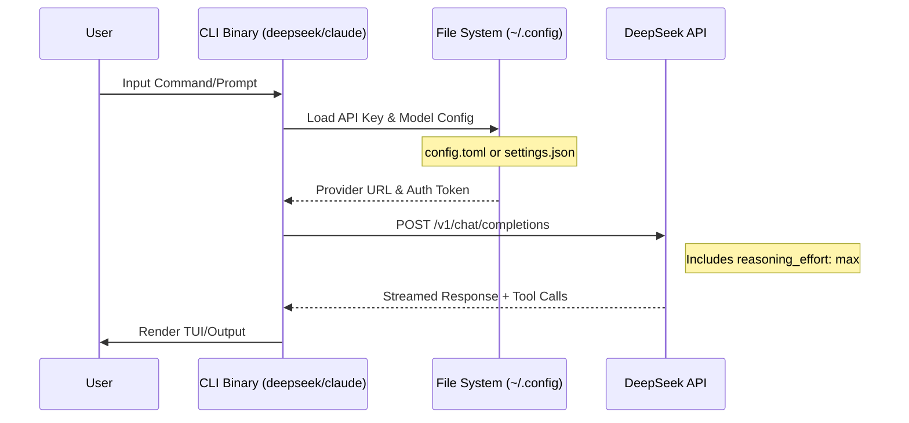
Sources: [docs/deepseek-tui.md:32-43](), [docs/claude_code.md:47-60]()

---

# Page: Claude Code

# Claude Code

<details>
<summary>Relevant source files</summary>

The following files were used as context for generating this wiki page:

- [docs/assets/claude_code_vsc_ext.png](docs/assets/claude_code_vsc_ext.png)
- [docs/claude_code.md](docs/claude_code.md)
- [docs/claude_code.zh-CN.md](docs/claude_code.zh-CN.md)

</details>


Claude Code is a high-performance AI coding assistant developed by Anthropic that operates directly within the terminal or as a VS Code extension. By leveraging the DeepSeek Anthropic-compatible endpoint, users can integrate DeepSeek V4's reasoning capabilities into the Claude Code workflow, benefiting from its 1M context window and advanced coding intelligence [docs/claude_code.md:3-5]().

## Installation

Claude Code can be deployed in two primary environments.

### 1. Claude Code CLI
The CLI version provides a terminal-native experience for interactive coding and repository management.

*   **Prerequisites**: Node.js 18+ is required [docs/claude_code.md:13-13](). Windows users must have Git for Windows installed [docs/claude_code.md:14-14]().
*   **Command**: Install the package globally via npm:
    ```bash
    npm install -g @anthropic-ai/claude-code
    ```
    [docs/claude_code.md:15-19]()
*   **Verification**: Run `claude --version` to confirm successful installation [docs/claude_code.md:21-25]().

### 2. VS Code Extension
For developers preferring an integrated IDE experience, the Claude Code extension embeds the assistant into the VS Code sidebar.

*   **Installation**: Install the [Claude Code VSCode Extension](https://marketplace.visualstudio.com/items?itemName=anthropic.claude-code) from the marketplace [docs/claude_code.md:27-30]().
*   **Bypass Login**: To use DeepSeek as the backend provider, enable the `claudeCode.disableLoginPrompt` setting in VS Code to prevent the default Anthropic login flow [docs/claude_code.md:32-32]().

---

## Configuration

Configuration is managed either via a `settings.json` file (recommended for persistence across both CLI and Extension) or via environment variables [docs/claude_code.md:34-36]().

### Option 1: settings.json (Recommended)
Create or edit the configuration file at the following location:
*   **Linux/Mac**: `~/.claude/settings.json` [docs/claude_code.md:41-41]()
*   **Windows**: `C:\Users\<username>\.claude\settings.json` [docs/claude_code.md:42-42]()

**Configuration Schema:**
```json
{
  "env": {
    "ANTHROPIC_BASE_URL": "https://api.deepseek.com/anthropic",
    "ANTHROPIC_AUTH_TOKEN": "<your DeepSeek API Key>",
    "ANTHROPIC_MODEL": "deepseek-v4-pro[1m]",
    "ANTHROPIC_DEFAULT_OPUS_MODEL": "deepseek-v4-pro[1m]",
    "ANTHROPIC_DEFAULT_SONNET_MODEL": "deepseek-v4-pro[1m]",
    "ANTHROPIC_DEFAULT_HAIKU_MODEL": "deepseek-v4-flash[1m]",
    "CLAUDE_CODE_DISABLE_NONESSENTIAL_TRAFFIC": "1",
    "CLAUDE_CODE_EFFORT_LEVEL": "max"
  }
}
```
[docs/claude_code.md:47-60]()

### Option 2: Environment Variables
For temporary sessions or CI/CD pipelines, variables can be exported directly to the shell [docs/claude_code.md:62-64]().

| Variable | Value | Description |
| :--- | :--- | :--- |
| `ANTHROPIC_BASE_URL` | `https://api.deepseek.com/anthropic` | DeepSeek's Anthropic-compatible gateway. |
| `ANTHROPIC_AUTH_TOKEN` | `<DeepSeek API Key>` | Your platform API key. |
| `ANTHROPIC_MODEL` | `deepseek-v4-pro[1m]` | Primary model with 1M context suffix. |
| `CLAUDE_CODE_EFFORT_LEVEL` | `max` | Enables maximum reasoning depth. |

[docs/claude_code.md:67-75]()

---

## Technical Implementation and Data Flow

The integration relies on the `ANTHROPIC_BASE_URL` override to redirect Claude Code's internal API client from Anthropic's servers to DeepSeek's compatible endpoint.

### Context Window and Reasoning
*   **[1m] Suffix**: DeepSeek V4 requires the `[1m]` suffix appended to the model name (e.g., `deepseek-v4-pro[1m]`) to activate the full 1-million-token context window [docs/claude_code.md:52-55]().
*   **Effort Level**: Setting `CLAUDE_CODE_EFFORT_LEVEL` to `max` ensures the model utilizes its maximum reasoning capacity for complex architectural and debugging tasks [docs/claude_code.md:57-57]().

### Data Flow Diagram
This diagram illustrates how configuration entities in `settings.json` map to the execution of the `claude` CLI and the subsequent API request to DeepSeek.

**System Architecture and Configuration Mapping**
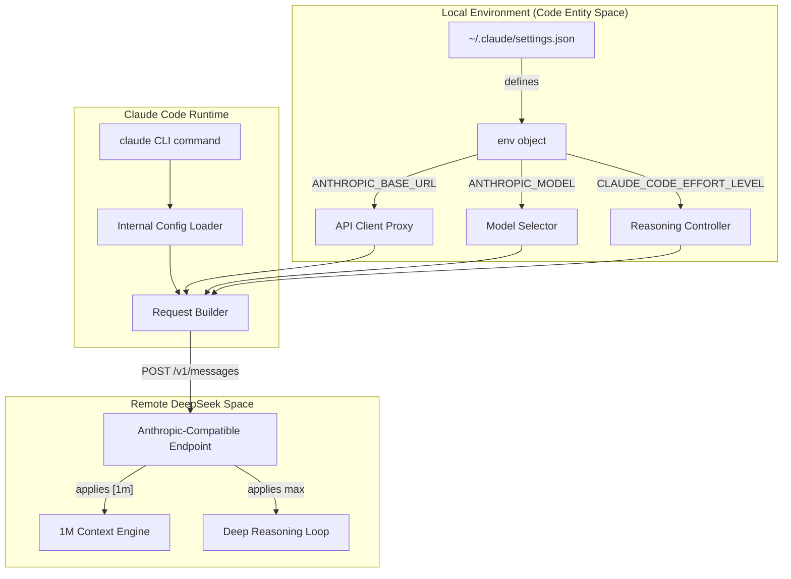
Sources: [docs/claude_code.md:40-60](), [docs/claude_code.md:94-99]()

### Natural Language to Code Entity Mapping
This diagram bridges user intent (Natural Language) to the specific configuration keys and CLI commands (Code Entities).

**Intent to Configuration Mapping**
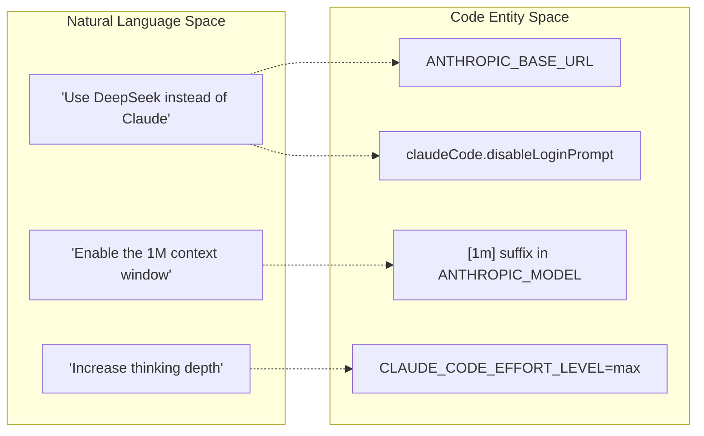
Sources: [docs/claude_code.md:32-32](), [docs/claude_code.md:49-57]()

---

## Usage

### Terminal (CLI)
Navigate to your project root and initialize the session:
```bash
cd /path/to/my-project
claude
```
[docs/claude_code.md:94-99]()

### VS Code
1. Open the project folder.
2. Click the **Claude Code icon** in the sidebar.
3. Select **New session** [docs/claude_code.md:106-107]().

The interface will reflect the configured DeepSeek model, allowing for natural language file editing, terminal command execution, and codebase indexing [docs/claude_code.md:109-110]().

---

# Page: DeepSeek-TUI

# DeepSeek-TUI

<details>
<summary>Relevant source files</summary>

The following files were used as context for generating this wiki page:

- [docs/deepseek-tui.md](docs/deepseek-tui.md)
- [docs/deepseek-tui.zh-CN.md](docs/deepseek-tui.zh-CN.md)

</details>


DeepSeek-TUI is an open-source terminal AI coding assistant implemented in Rust using a Codex-style 13-crate workspace architecture [docs/deepseek-tui.md:5-5](). It provides a high-performance, sandboxed environment for AI-driven development, supporting both DeepSeek-V4-Pro and DeepSeek-V4-Flash models with a full 1 million token context window [docs/deepseek-tui.md:5-5]().

### Installation and Setup

DeepSeek-TUI can be installed via multiple package managers or as a standalone binary.

| Method | Command | Requirements |
| :--- | :--- | :--- |
| **npm** | `npm install -g deepseek-tui` | Node.js environment [docs/deepseek-tui.md:15-15]() |
| **Cargo** | `cargo install deepseek-tui-cli` | Rust 1.85+ [docs/deepseek-tui.md:18-18]() |
| **Binary** | Download from [GitHub Releases](https://github.com/Hmbown/DeepSeek-TUI/releases) | None [docs/deepseek-tui.md:20-22]() |

#### Authentication
The tool requires a DeepSeek API Key, which can be configured in two ways:
1.  **Interactive:** Run `deepseek auth` to save the key to `~/.deepseek/config.toml` [docs/deepseek-tui.md:32-32]().
2.  **Environment Variable:** Set `DEEPSEEK_API_KEY` in your shell [docs/deepseek-tui.md:32-32]().

### TUI Modes and Reasoning

The TUI features three distinct operational modes that control how the agent interacts with the local system, cycled via the `Tab` key [docs/deepseek-tui.md:43-43]().

| Mode | Behavior | Security Level |
| :--- | :--- | :--- |
| **Plan** | Read-only investigation. Cannot write files or execute shell commands [docs/deepseek-tui.md:47-47](). | High (Safe) |
| **Agent** | Multi-step tool use. Side-effectful tools (file writes, shell) require user approval [docs/deepseek-tui.md:48-48](). | Medium (Restricted) |
| **YOLO** | Auto-approves all tool calls and lifts workspace boundary restrictions [docs/deepseek-tui.md:49-49](). | Low (Unrestricted) |

#### Reasoning Effort
Users can cycle through reasoning intensity levels (`off` → `high` → `max`) by pressing `Shift+Tab` [docs/deepseek-tui.md:43-43](). This controls the `reasoning_effort` parameter sent to the DeepSeek API.

**Sources:** [docs/deepseek-tui.md:14-50](), [docs/deepseek-tui.zh-CN.md:13-49]()

### System Architecture and Data Flow

DeepSeek-TUI operates as a multi-crate Rust workspace. It includes a sandboxed execution layer for tools using OS-native features like Seatbelt (macOS), Landlock (Linux), and Windows sandboxing [docs/deepseek-tui.md:5-5]().

#### Data Flow Diagram: TUI to Tool Execution
The following diagram illustrates the flow from a user prompt to a sandboxed tool execution.

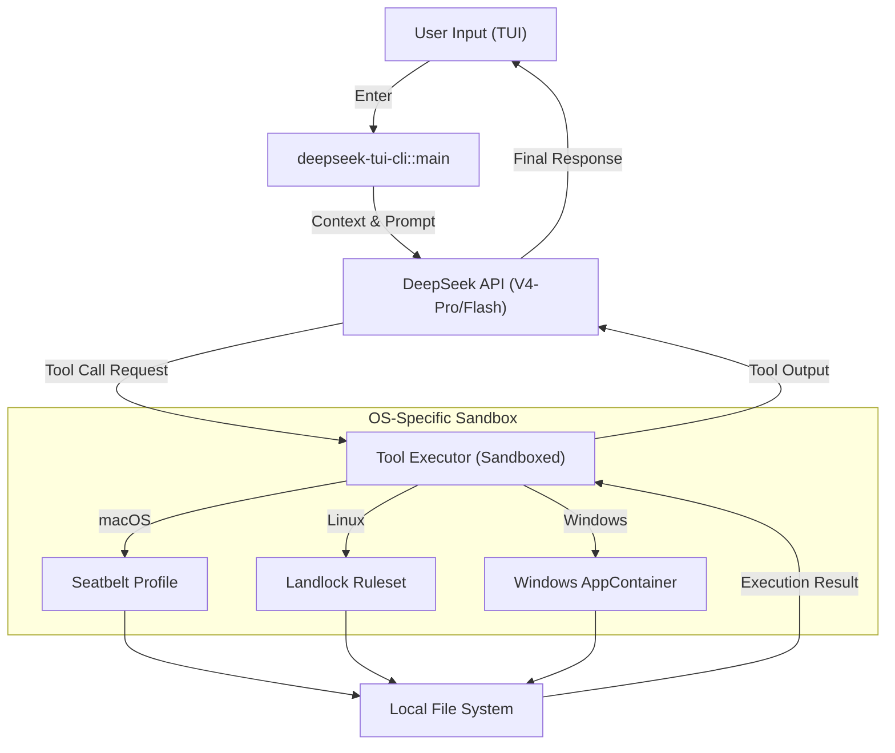
**Sources:** [docs/deepseek-tui.md:5-5](), [docs/deepseek-tui.md:37-43](), [docs/deepseek-tui.zh-CN.md:5-5]()

### Advanced Features

#### Model Orchestration
*   **Sub-agents:** The primary model can spawn child agents using the `agent_spawn` tool [docs/deepseek-tui.md:81-81](). These sub-agents have their own lifecycle managed via `agent_wait`, `agent_result`, and `agent_cancel` [docs/deepseek-tui.md:81-81]().
*   **RLM (Recursive LM):** A specialized tool for processing inputs that exceed typical context limits. It operates in a sandboxed Python REPL to summarize or extract data without polluting the main conversation context [docs/deepseek-tui.md:82-82]().

#### Extensibility
*   **MCP (Model Context Protocol):** DeepSeek-TUI acts as both an MCP client (connecting to external tools) and an MCP server (exposing its own capabilities via `deepseek mcp serve`) [docs/deepseek-tui.md:78-78](). Configuration is managed in `~/.deepseek/mcp.json` [docs/deepseek-tui.md:78-78]().
*   **Skills:** Markdown-based tool definitions (`SKILL.md`) can be placed in `~/.deepseek/skills/` (global) or `./.deepseek/skills/` (project-specific) to extend agent capabilities [docs/deepseek-tui.md:79-79]().
*   **Hooks:** Lifecycle hooks for `stdout`, `jsonl`, or `webhook` can be configured in the `[hooks]` section of `config.toml` [docs/deepseek-tui.md:80-80]().

#### HTTP Runtime API
By running `deepseek serve --http`, the application exposes a REST API at `/v1/*` [docs/deepseek-tui.md:86-86](). This allows external IDEs or Web UIs to interface with the DeepSeek-TUI runtime, managing sessions, threads, and tasks programmatically [docs/deepseek-tui.md:86-86]().

### Configuration Reference

The primary configuration resides in `~/.deepseek/config.toml` [docs/deepseek-tui.md:66-66]().

| Variable | Config Key | Description |
| :--- | :--- | :--- |
| `DEEPSEEK_API_KEY` | `api_key` | Authentication token [docs/deepseek-tui.md:70-70](). |
| `DEEPSEEK_BASE_URL` | `base_url` | Defaults to `https://api.deepseek.com` [docs/deepseek-tui.md:71-71](). |
| `DEEPSEEK_MODEL` | `model` | Default: `deepseek-v4-pro` [docs/deepseek-tui.md:72-72](). |
| `DEEPSEEK_PROVIDER` | `provider` | Allows switching to `nvidia-nim` or others [docs/deepseek-tui.md:73-73](). |

**Sources:** [docs/deepseek-tui.md:64-87](), [docs/deepseek-tui.zh-CN.md:64-87]()

---

# Page: Deep Code

# Deep Code

<details>
<summary>Relevant source files</summary>

The following files were used as context for generating this wiki page:

- [docs/deepcode.md](docs/deepcode.md)
- [docs/deepcode.zh-CN.md](docs/deepcode.zh-CN.md)

</details>


Deep Code is an open-source terminal-native AI coding assistant optimized for the DeepSeek-V4 model series. It provides a CLI environment that supports deep thinking (reasoning) capabilities, reasoning effort control, and an extensible "Agent Skills" architecture. The assistant shares its configuration layer with the Deep Code VSCode extension, allowing for a unified developer experience across the terminal and the IDE.

## Installation and Setup

Deep Code is distributed via npm and requires Node.js version 18 or higher [docs/deepcode.md:9-11]().

### Global Installation
To install the CLI globally, execute:
```sh
npm install -g @vegamo/deepcode-cli
```
[docs/deepcode.md:14-16]()

Verification can be performed by checking the version:
```sh
deepcode --version
```
[docs/deepcode.md:18-22]()

### Configuration Structure
Deep Code utilizes a central configuration file located at `~/.deepcode/settings.json` [docs/deepcode.md:24-26](). This file manages environment variables, model behavior, and feature toggles.

| Option | Description |
| :--- | :--- |
| `MODEL` | The identifier for the model (e.g., `deepseek-v4-pro` or `deepseek-v4-flash`). |
| `BASE_URL` | The API endpoint (defaults to `https://api.deepseek.com`). |
| `thinkingEnabled` | Boolean to toggle deep thinking mode (defaults to `true` for V4). |
| `reasoningEffort` | Controls intensity: `"max"` or `"high"`. |
| `notify` | Path to a script executed after model turns. |
| `webSearchTool` | Boolean to enable/disable integrated web search. |

[docs/deepcode.md:44-54]()

**Sources:** [docs/deepcode.md:9-54](), [docs/deepcode.zh-CN.md:9-54]()

## System Architecture and Data Flow

The following diagram illustrates how the `deepcode` CLI initializes, loads configuration from the filesystem, and interacts with the DeepSeek API.

**Deep Code Initialization and API Flow**
```mermaid
graph TD
    subgraph "Local Environment"
        CLI["deepcode CLI"]
        CONFIG["~/.deepcode/settings.json"]
        PROJECT_DIR["Project Directory"]
        SKILLS_USER["~/.agents/skills/"]
        SKILLS_PROJ["./.deepcode/skills/"]
    end

    subgraph "Remote Services"
        DS_API["DeepSeek API (BASE_URL)"]
    end

    CLI -->|1. Read Env & Settings| CONFIG
    CLI -->|2. Context Discovery| PROJECT_DIR
    CLI -->|3. Load Agent Skills| SKILLS_USER
    CLI -->|3. Load Agent Skills| SKILLS_PROJ
    
    CLI -->|4. Chat Request (thinkingEnabled/reasoningEffort)| DS_API
    DS_API -->|5. Stream Response| CLI
    CLI -->|6. Optional: Execute notify script| CLI
```
**Sources:** [docs/deepcode.md:24-54](), [docs/deepcode.md:75-80]()

## Operational Interface

Deep Code is launched by navigating to a project directory and executing the `deepcode` command [docs/deepcode.md:55-60]().

### Key Shortcuts
The terminal interface supports several interactive commands and shortcuts for session management:

| Key | Action |
| :--- | :--- |
| `Enter` | Send current prompt. |
| `Shift+Enter` / `Ctrl+J` | Insert newline in multi-line prompts. |
| `Ctrl+V` | Paste image from clipboard for vision-supported tasks. |
| `Esc` | Interrupt/Abort current model generation. |
| `/` | Open the Skills and Commands menu. |

[docs/deepcode.md:62-70]()

### Slash Commands
| Command | Action |
| :--- | :--- |
| `/new` | Resets the context and starts a fresh conversation. |
| `/resume` | Opens a picker to continue a previous session. |
| `/exit` | Terminates the CLI application. |

[docs/deepcode.md:71-73]()

**Sources:** [docs/deepcode.md:55-73](), [docs/deepcode.zh-CN.md:55-73]()

## Agent Skills Discovery

Deep Code implements a "Skills" system that allows users to define custom behaviors or toolsets via `SKILL.md` files. These skills are automatically discovered by the assistant from two distinct levels: user-wide and project-specific.

**Skill Discovery and Execution Flow**
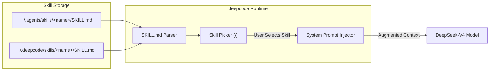

### Discovery Locations
1.  **User-level:** `~/.agents/skills/<name>/SKILL.md` [docs/deepcode.md:79]()
2.  **Project-level:** `./.deepcode/skills/<name>/SKILL.md` [docs/deepcode.md:80]()

Users can trigger these skills by pressing `/` to browse the menu or by typing the skill name directly as a command (e.g., `/skill-writer`) [docs/deepcode.md:82]().

**Sources:** [docs/deepcode.md:75-83](), [docs/deepcode.zh-CN.md:75-83]()

---

# Page: Reasonix

# Reasonix

<details>
<summary>Relevant source files</summary>

The following files were used as context for generating this wiki page:

- [docs/reasonix.md](docs/reasonix.md)
- [docs/reasonix.zh-CN.md](docs/reasonix.zh-CN.md)

</details>


Reasonix is a terminal-native AI coding assistant built specifically for the DeepSeek ecosystem. Unlike generic agents that use protocol translation shims, Reasonix is DeepSeek-native, meaning it is designed to leverage specific features of the DeepSeek API such as Context Caching, the `deepseek-v4-flash` model for cost-efficient loops, and automatic tool-call repair [docs/reasonix.md:3-5]().

## System Overview and Architecture

Reasonix operates as a Node.js-based terminal application that manages a project-specific coding loop. It utilizes a "Flash-First" design philosophy, prioritizing `deepseek-v4-flash` for rapid, low-cost iterations while allowing on-demand escalation to `deepseek-v4-pro` for complex reasoning tasks [docs/reasonix.md:23-23]().

### Data Flow and Lifecycle
The following diagram illustrates the interaction between the user's terminal, the Reasonix configuration layer, and the DeepSeek API.

**Reasonix Operational Flow**
```mermaid
graph TD
    subgraph "User Environment"
        "Terminal" -- "npx reasonix code" --> "CLI_Entry"["CLI Entry Point"]
        "CLI_Entry" -- "Check Config" --> "Config_File"["~/.reasonix/config.json"]
    end

    subgraph "Reasonix Core Logic"
        "Config_File" -- "API Key / Model Settings" --> "Agent_Loop"["Agent Execution Loop"]
        "Agent_Loop" -- "Cache-First Strategy" --> "Context_Manager"["Context Manager"]
        "Agent_Loop" -- "/pro or /preset max" --> "Model_Selector"["Model Selector"]
    end

    subgraph "DeepSeek API Space"
        "Model_Selector" -- "Default: deepseek-v4-flash" --> "DS_Flash"["api.deepseek.com (Flash)"]
        "Model_Selector" -- "Escalated: deepseek-v4-pro" --> "DS_Pro"["api.deepseek.com (Pro)"]
    end

    "DS_Flash" -- "Tool Calls / Response" --> "Agent_Loop"
    "DS_Pro" -- "Reasoning / Response" --> "Agent_Loop"
```
Sources: [docs/reasonix.md:5-23](), [docs/reasonix.zh-CN.md:5-23]()

## Installation and Prerequisites

Reasonix requires a modern Node.js environment and leverages `npx` to ensure users always run the latest version without needing a global installation [docs/reasonix.md:16-23]().

*   **Node.js**: Version 20.10 or higher is mandatory [docs/reasonix.md:9-9]().
*   **Operating System Support**: 
    *   **macOS/Linux**: Standard terminal.
    *   **Windows**: Requires [Git for Windows](https://git-scm.com/download/win) to provide a compatible shell environment [docs/reasonix.md:10-10]().

Sources: [docs/reasonix.md:7-10](), [docs/reasonix.zh-CN.md:7-10]()

## Configuration and API Management

Reasonix simplifies the onboarding process through a built-in API key wizard. Unlike other agents that require manual environment variable exports, Reasonix persists credentials locally [docs/reasonix.md:14-14]().

### The API Key Wizard
Upon the first execution of `npx reasonix code`, the system detects the absence of a configuration file and prompts the user for their DeepSeek API Key [docs/reasonix.md:14-14]().

*   **Configuration Path**: `~/.reasonix/config.json` [docs/reasonix.md:14-14]().
*   **Endpoint**: Directly connects to `api.deepseek.com` [docs/reasonix.md:5-5]().

**Natural Language to Configuration Mapping**
```mermaid
graph LR
    subgraph "Natural Language Concepts"
        "User_Prompt"["'Enter your API Key'"]
        "Model_Choice"["'Use the Pro model'"]
    end

    subgraph "Code Entity Space (config.json)"
        "User_Prompt" --> "api_key"["apiKey in config.json"]
        "Model_Choice" --> "slash_pro"["/pro command"]
        "slash_pro" --> "pro_model_id"["deepseek-v4-pro"]
    end
```
Sources: [docs/reasonix.md:14-23](), [docs/reasonix.zh-CN.md:14-23]()

## Execution and Slash Commands

The agent is launched within a project directory using the command `npx reasonix code` [docs/reasonix.md:20-21](). Once active, users interact with the agent via a Terminal User Interface (TUI) that supports slash commands for real-time model steering.

### Cost Control and Model Switching
Reasonix implements a tiered model strategy to balance performance and cost:

| Command | Effect | Model Target |
| :--- | :--- | :--- |
| **Default** | Standard iteration and tool use | `deepseek-v4-flash` |
| `/pro` | Switches the **next turn** to the Pro model | `deepseek-v4-pro` |
| `/preset max` | Sets the **entire session** to use the Pro model | `deepseek-v4-pro` |
| `/help` | Displays the full reference of slash commands | N/A |

### Key Features
*   **Cache-First Loop**: Optimizes context window usage by prioritizing cached prefixes in the DeepSeek API, reducing latency and cost for long-running sessions [docs/reasonix.md:5-5]().
*   **Automatic Tool-Call Repair**: If the model generates a malformed tool call, Reasonix attempts to fix the syntax before execution to prevent loop breakage [docs/reasonix.md:5-5]().

Sources: [docs/reasonix.md:5-23](), [docs/reasonix.zh-CN.md:5-23]()

---

# Page: Crush

# Crush

<details>
<summary>Relevant source files</summary>

The following files were used as context for generating this wiki page:

- [docs/crush.md](docs/crush.md)
- [docs/crush.zh-CN.md](docs/crush.zh-CN.md)

</details>


Crush is a terminal-native, open-source AI coding agent developed by Charm. It provides a sophisticated TUI (Terminal User Interface) that integrates Language Server Protocol (LSP) support, Model Context Protocol (MCP) servers, and agentic workflows to automate coding tasks directly from the command line [docs/crush.md:5-5]().

### Installation

Crush can be installed via Node Package Manager (npm) or Homebrew for macOS users.

| Method | Command |
| :--- | :--- |
| **npm** | `npm install -g @charmland/crush` [docs/crush.md:13-13]() |
| **Homebrew** | `brew install charmbracelet/tap/crush` [docs/crush.md:22-22]() |

After installation, verify the setup by checking the version: `crush --version` [docs/crush.md:19-19]().

**Sources:** [docs/crush.md:7-22]()

---

### Configuration and Provider Setup

Crush utilizes a JSON-based configuration file located in the user's home directory. To integrate DeepSeek, users must define a custom provider using the `openai-compat` type [docs/crush.md:36-36]().

#### Configuration Path
- **Linux / macOS**: `~/.config/crush/crush.json` [docs/crush.md:28-28]()
- **Windows**: `%USERPROFILE%\.config\crush\crush.json` [docs/crush.md:29-29]()

#### Schema Implementation
The `crush.json` file requires a specific schema to map the DeepSeek API endpoints and model capabilities. Key fields include:
- `base_url`: Set to `https://api.deepseek.com` [docs/crush.md:37-37]().
- `api_key`: Reference an environment variable (e.g., `$DEEPSEEK_API_KEY`) for security [docs/crush.md:38-38]().
- `can_reason`: A boolean flag that must be set to `true` to enable reasoning capabilities for DeepSeek-V4 models [docs/crush.md:45-45]().

#### Configuration Data Flow

The following diagram illustrates how the configuration file maps to the internal provider logic.

**Crush Provider Initialization**
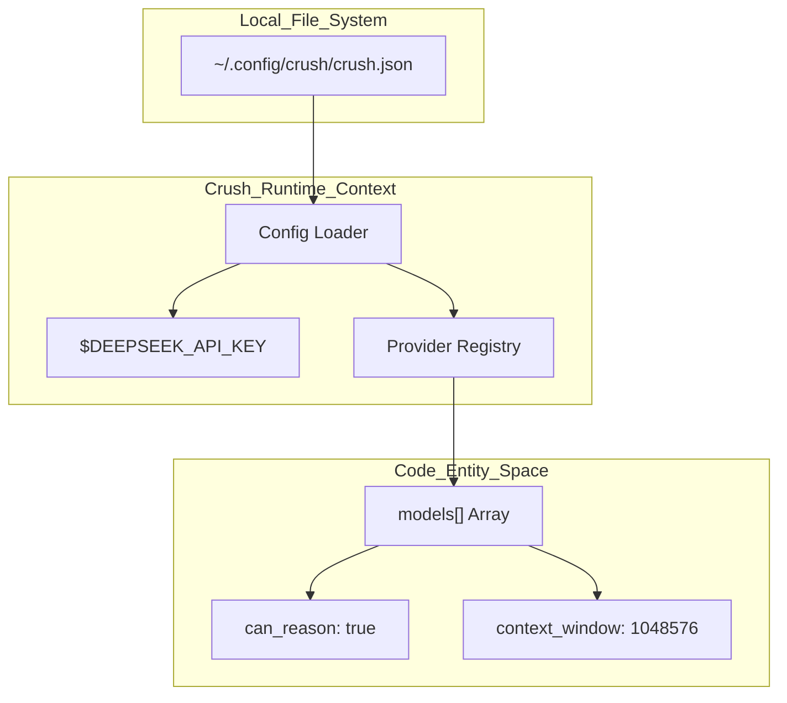
**Sources:** [docs/crush.md:24-58]()

---

### Model Management and Execution

Once configured, Crush allows dynamic model switching during an active session.

1.  **Launch**: Navigate to a project directory and execute `crush` [docs/crush.md:78-83]().
2.  **Model Switcher**: Use the `/model` command or the `Ctrl+L` shortcut to trigger the selection UI [docs/crush.md:85-85]().
3.  **Selection**: Select the `deepseek` provider and choose between `DeepSeek-V4-Pro` or `DeepSeek-V4-Flash` [docs/crush.md:86-86]().

#### Model Switching Sequence

This diagram tracks the transition from natural language commands to the internal model selection logic.

**Model Switcher Workflow**
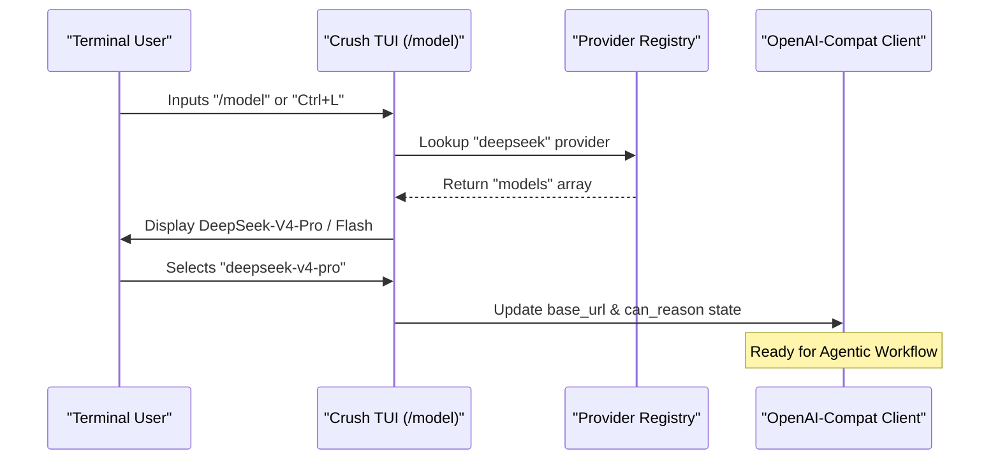
**Sources:** [docs/crush.md:76-88]()

---

### Technical Specifications

The integration leverages the 1M context window and high token limits of the DeepSeek-V4 family.

| Parameter | Value | Source |
| :--- | :--- | :--- |
| **Provider Type** | `openai-compat` | [docs/crush.md:36-36]() |
| **Context Window** | `1048576` | [docs/crush.md:43-43]() |
| **Max Tokens** | `32768` | [docs/crush.md:44-44]() |
| **Reasoning Support** | `can_reason: true` | [docs/crush.md:45-45]() |

**Sources:** [docs/crush.md:31-58]()

---

# Page: Pi and Oh My Pi

# Pi and Oh My Pi

<details>
<summary>Relevant source files</summary>

The following files were used as context for generating this wiki page:

- [docs/oh-my-pi.md](docs/oh-my-pi.md)
- [docs/oh-my-pi.zh-CN.md](docs/oh-my-pi.zh-CN.md)
- [docs/pi_mono.md](docs/pi_mono.md)
- [docs/pi_mono.zh-CN.md](docs/pi_mono.zh-CN.md)

</details>


Pi (pi-mono) and its fork, Oh My Pi (OMP), are minimal yet highly extensible terminal coding frameworks. They leverage a tree-structured session model and support a wide array of AI providers through TypeScript extensions, skills, and prompt templates [docs/pi_mono.md:5-5](). While both tools share a common lineage, Oh My Pi requires specific compatibility configurations to handle DeepSeek V4's reasoning content and tool-calling requirements without encountering 400 errors [docs/oh-my-pi.md:5-5]().

## Pi Terminal Framework

Pi is installed via npm or a shell script and serves as a coding harness that adapts to developer workflows [docs/pi_mono.md:5-14]().

### Installation and Setup
Pi requires Node.js and can be installed globally:
```bash
npm install -g @earendil-works/pi-coding-agent
```
[docs/pi_mono.md:9-14]()

Alternatively, Unix-like systems can use the official install script: `curl -fsSL https://pi.dev/install.sh | sh` [docs/pi_mono.md:23-25]().

### Configuration Schema
Pi uses a JSON-based provider system located at `~/.pi/agent/models.json` (Linux/macOS) or `%USERPROFILE%\.pi\agent\models.json` (Windows) [docs/pi_mono.md:31-32](). The configuration defines the `baseUrl`, `api` type, and specific model capabilities.

| Key | Value | Purpose |
| :--- | :--- | :--- |
| `baseUrl` | `https://api.deepseek.com` | Official DeepSeek API endpoint [docs/pi_mono.md:38-38]() |
| `api` | `openai-completions` | Protocol compatibility layer [docs/pi_mono.md:39-39]() |
| `reasoning` | `true` | Enables thinking capabilities [docs/pi_mono.md:48-48]() |
| `contextWindow` | `1000000` | 1M token context support [docs/pi_mono.md:45-45]() |

**Data Flow: Pi Configuration to Execution**
Title: Pi Model Resolution Flow
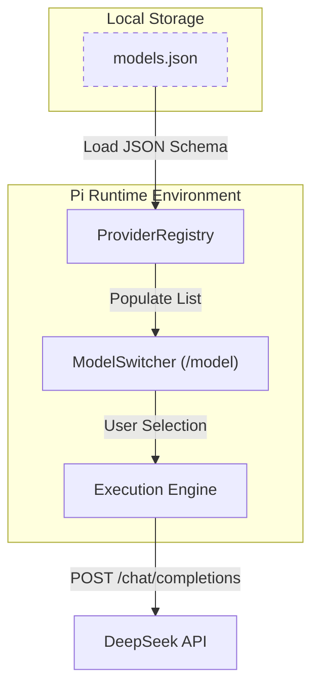
Sources: [docs/pi_mono.md:29-65](), [docs/pi_mono.md:123-125]()

---

## Oh My Pi (OMP)

Oh My Pi is a fork that provides enhanced terminal agent capabilities. Although it ships with built-in DeepSeek V4 entries as of v14.5, a custom `models.yml` is mandatory to avoid API errors during complex reasoning tasks [docs/oh-my-pi.md:5-5]().

### Critical Compatibility Fields
DeepSeek V4 introduces specific requirements for its thinking mode that differ from standard OpenAI implementations. Failing to include these in `~/.omp/agent/models.yml` results in 400 Bad Request errors [docs/oh-my-pi.md:98-100]().

*   **`supportsToolChoice: false`**: DeepSeek V4 reasoning mode does not support the `tool_choice` parameter [docs/oh-my-pi.md:104-104]().
*   **`requiresReasoningContentForToolCalls: true`**: The model requires `reasoning_content` to be preserved in the conversation history across tool-call turns [docs/oh-my-pi.md:105-105]().
*   **`requiresAssistantContentForToolCalls: true`**: Ensures tool-call messages contain non-null content fields [docs/oh-my-pi.md:106-106]().
*   **`extraBody.thinking.type: enabled`**: Explicitly activates the V4 thinking mode [docs/oh-my-pi.md:95-95]().

### Thinking Mode Mapping
OMP uses an internal effort scale that must be mapped to DeepSeek's supported levels (`high` and `max`) via the `reasoningEffortMap` [docs/oh-my-pi.md:94-94]().

**Entity Mapping: OMP Config to API Request**
Title: Oh My Pi Thinking Mode Protocol Mapping
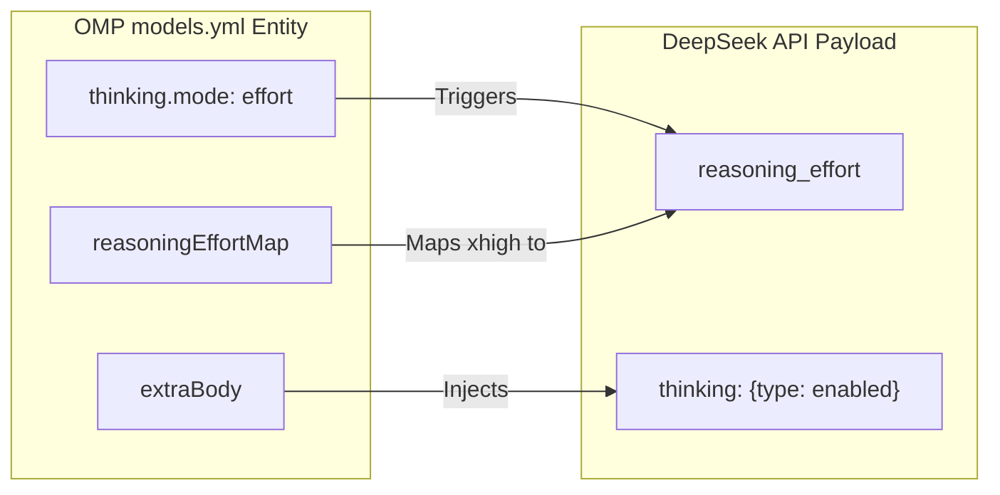
Sources: [docs/oh-my-pi.md:32-51](), [docs/oh-my-pi.md:88-97]()

---

## Model Selection and Usage

Both Pi and Oh My Pi provide interactive commands to switch between the Pro and Flash models during a session.

| Feature | Pi Command | Oh My Pi Command |
| :--- | :--- | :--- |
| **Model Switcher** | `/model` [docs/pi_mono.md:123-123]() | `/model` or `Ctrl+L` [docs/oh-my-pi.md:121-121]() |
| **Direct Launch** | `pi` (then select) [docs/pi_mono.md:120-120]() | `omp --model deepseek/deepseek-v4-pro` [docs/oh-my-pi.md:112-112]() |

### Authentication
Neither tool currently supports DeepSeek OAuth login. Authentication must be handled via the `DEEPSEEK_API_KEY` environment variable or the `apiKey` field in the configuration files [docs/pi_mono.md:100-113](), [docs/oh-my-pi.md:127-127]().

**Sources:**
*   [docs/pi_mono.md:1-128]()
*   [docs/oh-my-pi.md:1-132]()

---

# Page: Other Terminal Agents

# Other Terminal Agents

<details>
<summary>Relevant source files</summary>

The following files were used as context for generating this wiki page:

- [docs/langcli.md](docs/langcli.md)
- [docs/langcli.zh-CN.md](docs/langcli.zh-CN.md)
- [docs/nanobot.md](docs/nanobot.md)
- [docs/nanobot.zh-CN.md](docs/nanobot.zh-CN.md)
- [docs/opencode.md](docs/opencode.md)
- [docs/opencode.zh-CN.md](docs/opencode.zh-CN.md)

</details>


This section provides concise integration guides for additional terminal-based AI agents supported by the Awesome DeepSeek Agent repository. These tools include **Langcli**, **nanobot**, and **OpenCode**, each offering unique terminal-native workflows for interacting with DeepSeek V4 models.

## 1. Langcli

Langcli is an AI coding assistant that supports both a Command Line Interface (CLI) and integration as a Zed ACP Agent [docs/langcli.md:5-5](). It utilizes **LangRouter** as its primary gateway for model access.

### Installation and Setup
Langcli can be installed via automated scripts or manually using Node.js (version 20+) [docs/langcli.md:9-29]().

| Method | Command | Platform |
| :--- | :--- | :--- |
| **Quick Install** | `bash -c "$(curl -fsSL https://assets.langcli.com/installation/install-langcli.sh)"` | macOS, Linux, WSL |
| **Quick Install** | `cmd /c "curl -fsSL -o %TEMP%\install-langcli.bat ..."` | Windows (Admin) |
| **Manual** | `npm i -g langcli-com` | All (Requires Node 20+) |

### Configuration Flow
To use Langcli with DeepSeek, users must obtain an API key from the [LangRouter](https://langrouter.ai/) platform [docs/langcli.md:34-34](). Once the key is prepared, the agent is launched using the `langcli` command [docs/langcli.md:39-39]().

**Data Flow: Langcli to LangRouter**
```mermaid
graph TD
    subgraph "Natural Language Space"
        UserPrompt["User Prompt (Terminal)"]
    end

    subgraph "Code Entity Space"
        LangCLI["langcli (CLI Process)"]
        LangRouterAPI["LangRouter Gateway"]
        DS_V4["DeepSeek V4 Model"]
    end

    UserPrompt --> LangCLI
    LangCLI -- "API Key Auth" --> LangRouterAPI
    LangRouterAPI -- "Route Request" --> DS_V4
```
**Sources:** [docs/langcli.md:5-43](), [docs/langcli.zh-CN.md:5-43]()

---

## 2. nanobot

nanobot is a lightweight AI agent designed for terminal use and integration with chat platforms [docs/nanobot.md:5-5](). It is managed via the `uv` tool and utilizes a centralized `config.json` for provider settings.

### Installation
The tool is installed using the `uv` tool manager [docs/nanobot.md:9-14](). On Windows, users must ensure the `.local/bin` directory is added to the system `PATH` [docs/nanobot.md:16-20]().

```bash
uv tool install nanobot-ai
nanobot --version
```

### Configuration
Initialization is performed via the `onboard` command, which generates a platform-specific configuration file [docs/nanobot.md:36-45]():
*   **Windows**: `$env:USERPROFILE\.nanobot\config.json`
*   **Linux/macOS**: `~/.nanobot/config.json`

The `config.json` must be modified to define the `deepseek` provider and set the default agent model to `deepseek-v4-pro` [docs/nanobot.md:49-64]().

**Entity Mapping: nanobot Configuration**
```mermaid
graph LR
    subgraph "Natural Language Space"
        UserAgent["Agent Persona"]
    end

    subgraph "Code Entity Space"
        Config["config.json"]
        AgentDefaults["agents.defaults.model: 'deepseek-v4-pro'"]
        ProviderConfig["providers.deepseek.apiBase: 'https://api.deepseek.com/v1'"]
        NanobotBin["nanobot agent (command)"]
    end

    UserAgent -.-> AgentDefaults
    Config --> AgentDefaults
    Config --> ProviderConfig
    NanobotBin -- "Reads" --> Config
```

**Sources:** [docs/nanobot.md:7-73](), [docs/nanobot.zh-CN.md:7-73]()

---

## 3. OpenCode

OpenCode is an open-source assistant providing both terminal and web interfaces [docs/opencode.md:5-5](). It requires version **v1.14.24** or higher for optimal compatibility with DeepSeek V4 [docs/opencode.md:11-11]().

### Integration Steps
Integration is handled through interactive terminal commands rather than manual file editing [docs/opencode.md:15-18]():

1.  **Launch**: Execute `opencode` in the terminal.
2.  **Connect**: Type `/connect` in the interface input.
3.  **Provider**: Search and select `deepseek`.
4.  **Credentials**: Input the API Key from the DeepSeek Platform.
5.  **Model**: Select `DeepSeek-V4-Pro`.

**Sources:** [docs/opencode.md:5-19](), [docs/opencode.zh-CN.md:5-19]()

---

# Page: IDE Extensions and Editor Integrations

# IDE Extensions and Editor Integrations

<details>
<summary>Relevant source files</summary>

The following files were used as context for generating this wiki page:

- [README.md](README.md)
- [docs/github_copilot.md](docs/github_copilot.md)
- [docs/github_copilot.zh-CN.md](docs/github_copilot.zh-CN.md)

</details>


This section provides an overview of integrations that embed DeepSeek V4 models directly into Integrated Development Environments (IDEs) and code editors. These integrations allow developers to leverage DeepSeek's reasoning capabilities within familiar workflows, such as GitHub Copilot Chat or native editor sidebars, often supporting advanced features like tool calling, MCP (Model Context Protocol), and vision proxies.

### Integration Landscape

The following diagram illustrates how various IDE extensions bridge the gap between natural language developer intent and the underlying code entities within the editor environment.

**Editor Entity Mapping**
```mermaid
graph TD
    subgraph "Natural Language Space"
        UserIntent["'Refactor this function'"]
        ChatPanel["Copilot Chat / Editor Sidebar"]
    end

    subgraph "IDE / Editor Context"
        EditorState["Editor State"]
        ActiveFile["Active Document"]
        Selection["Text Selection"]
        Diagnostic["LSP Diagnostics/Errors"]
    end

    subgraph "Code Entity Space"
        subgraph "github_copilot.md"
            ModelPicker["Model Picker Registration"]
            VisionProxy["Vision Proxy Subsystem"]
        end
        subgraph "workbuddy.md"
            ModelSchema["models.json Config"]
            EnvExpansion["${ENV} Variable Expansion"]
        end
    end

    UserIntent --> ChatPanel
    ChatPanel --> ModelPicker
    ChatPanel --> EditorState
    EditorState --> ActiveFile
    EditorState --> Selection
    EditorState --> Diagnostic
    ModelPicker --> DeepSeekV4["DeepSeek V4 Pro/Flash"]
    VisionProxy --> DeepSeekV4
    ModelSchema --> DeepSeekV4
```
Sources: [docs/github_copilot.md:5-29](), [docs/workbuddy.md:1-10]()

---

### 3.1 GitHub Copilot (VS Code Extension)
The **DeepSeek V4 for Copilot Chat** extension integrates DeepSeek models directly into the official GitHub Copilot model picker in VS Code. It maintains compatibility with Copilot's agentic features, including tool calling and MCP. Key configuration involves the `DeepSeek: Set API Key` command, which stores credentials in the OS keychain rather than on disk.

It uniquely features a **Vision Proxy** subsystem. Since DeepSeek V4 is text-only, the extension can proxy image inputs through models like GPT-4o or Claude to generate descriptions before processing the request with DeepSeek.

For details, see [GitHub Copilot (VS Code Extension)](#3.1).

Sources: [docs/github_copilot.md:5-40]()

### 3.2 GitHub Copilot CLI
The GitHub Copilot CLI can be configured to use DeepSeek via a "Bring Your Own Key" (BYOK) approach. A critical requirement for this integration is setting the `COPILOT_PROVIDER_TYPE=anthropic` environment variable; using the `openai` type results in 400 errors due to protocol differences in how thinking models are handled.

For details, see [GitHub Copilot CLI](#3.2).

Sources: [README.md:26-26]()

### 3.3 Kilo Code
Kilo Code provides a unified experience across a CLI and an editor extension. Users connect the provider using the `/connect deepseek` command and can switch between specific model variants using the `/models` selector. The integration follows a structured visual setup process documented in the repository's assets.

For details, see [Kilo Code](#3.3).

Sources: [README.md:28-28]()

### 3.4 WorkBuddy / CodeBuddy
WorkBuddy (also known as CodeBuddy) utilizes a local configuration file located at `.codebuddy/models.json` to define model endpoints. This schema supports advanced features like `${ENV}` variable expansion for API keys and explicit mapping of `relatedModels`. It requires strict UTF-8 encoding (without BOM) to prevent parsing errors.

For details, see [WorkBuddy / CodeBuddy](#3.4).

Sources: [README.md:37-37]()

---

### System Architecture: Editor to Model Communication

The following diagram maps the communication flow from editor-specific configuration files to the DeepSeek API endpoints.

**Protocol and Configuration Flow**
```mermaid
graph LR
    subgraph "Local Configuration"
        KeyChain["OS Keychain (Copilot Ext)"]
        ModelsJSON[".codebuddy/models.json"]
        EnvVars["COPILOT_PROVIDER_TYPE"]
    end

    subgraph "Integration Logic"
        ThinkingEffort["Thinking Effort (None/High/Max)"]
        VisionProxy["Vision Proxy Model"]
        AuthLogic["${ENV} Expansion Logic"]
    end

    subgraph "DeepSeek API"
        V4Pro["deepseek-v4-pro"]
        V4Flash["deepseek-v4-flash"]
    end

    KeyChain --> ThinkingEffort
    ModelsJSON --> AuthLogic
    EnvVars --> ThinkingEffort
    ThinkingEffort --> V4Pro
    VisionProxy --> V4Pro
    AuthLogic --> V4Flash
```
Sources: [docs/github_copilot.md:22-40](), [docs/workbuddy.md:1-10]()

### Feature Comparison

| Feature | GitHub Copilot Ext | GitHub Copilot CLI | Kilo Code | WorkBuddy |
| :--- | :--- | :--- | :--- | :--- |
| **Storage** | OS Keychain | Env Vars | Local Config | `models.json` |
| **Reasoning Control** | UI (Gear Icon) | Env Vars | `/models` cmd | JSON Config |
| **Vision Support** | Proxy Subsystem | No | No | No |
| **Tool Calling** | Native Copilot | Supported | Supported | Supported |

Sources: [docs/github_copilot.md:31-40](), [README.md:25-37]()

---

# Page: GitHub Copilot (VS Code Extension)

# GitHub Copilot (VS Code Extension)

<details>
<summary>Relevant source files</summary>

The following files were used as context for generating this wiki page:

- [docs/github_copilot.md](docs/github_copilot.md)
- [docs/github_copilot.zh-CN.md](docs/github_copilot.zh-CN.md)

</details>


The **DeepSeek V4 for Copilot Chat** extension integrates DeepSeek's high-performance reasoning models directly into the GitHub Copilot ecosystem within Visual Studio Code. This integration allows users to leverage DeepSeek V4 Pro and Flash while maintaining access to Copilot's native features, including Agent mode, tool calling, Skills, and Model Context Protocol (MCP) support.

### Extension Architecture and Data Flow

The extension functions by registering custom model providers within the VS Code Chat API. When a user selects a DeepSeek model, the extension intercepts the chat request, handles authentication via the OS keychain, manages reasoning effort parameters, and processes multi-modal inputs through a proxy subsystem.

#### Logic Flow: Chat Request Processing
The following diagram illustrates the flow from a user prompt in the VS Code Chat UI to the DeepSeek API.

**Diagram: Request Lifecycle and Vision Proxy**
```mermaid
graph TD
    User["User Prompt (Chat UI)"] --> Picker["Model Picker Selection"]
    Picker -->|DeepSeek V4 Pro/Flash| Extension["DeepSeek Extension Logic"]
    
    subgraph "Input Processing"
        Extension --> VisionCheck{"Contains Image?"}
        VisionCheck -->|Yes| VisionProxy["Vision Proxy Model (GPT-4o/Claude)"]
        VisionProxy -->|Text Description| PromptAugment["Augmented Text Prompt"]
        VisionCheck -->|No| PromptAugment
    end

    subgraph "Authentication & Config"
        PromptAugment --> KeyFetch["OS Keychain (DeepSeek: Set API Key)"]
        KeyFetch --> EffortConfig["Thinking Effort (None/High/Max)"]
    end

    EffortConfig --> DeepSeekAPI["DeepSeek API Endpoint"]
    DeepSeekAPI --> Response["Streaming Response"]
    Response --> CopilotAgent["Copilot Agent / Tool Calling"]
    CopilotAgent --> UI["VS Code Chat UI"]
```
Sources: [docs/github_copilot.md:5-5](), [docs/github_copilot.md:31-40]()

---

### Core Components and Commands

The extension exposes specific commands and configuration points to manage the integration lifecycle.

#### Authentication and Storage
The extension avoids storing sensitive credentials in plain text or VS Code settings files. Instead, it utilizes the operating system's secure keychain.
*   **Command**: `DeepSeek: Set API Key` [docs/github_copilot.md:21-21]()
*   **Implementation**: This command prompts the user for an `sk-` prefixed key and persists it using the VS Code `SecretStorage` API, which interfaces with the OS keychain (e.g., macOS Keychain Access, Windows Credential Manager) [docs/github_copilot.md:22-22]().

#### Model Registration
The extension registers two primary identifiers into the VS Code model picker [docs/github_copilot.md:27-28]():
1.  **DeepSeek V4 Pro**: Optimized for complex reasoning and deep technical tasks.
2.  **DeepSeek V4 Flash**: Optimized for speed and lower latency.

#### Thinking Effort Levels
Users can tune the reasoning intensity of the models via the gear icon in the model picker [docs/github_copilot.md:33-33](). This configuration maps to the `thinking` parameter in the API request:
| Level | Description | Use Case |
| :--- | :--- | :--- |
| **None** | Fastest response, no reasoning tokens generated. | Simple code completions or explanations. |
| **High** | Balanced reasoning (Default). | Standard debugging and architecture planning. |
| **Max** | Deepest reasoning effort. | Complex algorithmic logic and large-scale refactoring. |

Sources: [docs/github_copilot.md:31-37]()

---

### Vision Proxy Subsystem

Since DeepSeek V4 models are natively text-only, the extension implements a **Vision Proxy** to support image inputs (e.g., screenshots of UI bugs or terminal errors).

**Diagram: Vision Proxy Implementation**
```mermaid
classDiagram
    class VSCodeChatUI {
        +ImageAttachment image
        +String userText
    }
    class VisionProxySubsystem {
        +Model selectedProxyModel
        +describeImage(image) String
    }
    class DeepSeekExtension {
        +setVisionProxyModel()
        +processRequest()
    }
    class DeepSeekAPI {
        +textInput
    }

    VSCodeChatUI --> DeepSeekExtension : Sends Request
    DeepSeekExtension --> VisionProxySubsystem : Calls DeepSeek: Set Vision Proxy Model
    VisionProxySubsystem --> VSCodeChatUI : Extracts Image
    VisionProxySubsystem --> DeepSeekExtension : Returns Text Description
    DeepSeekExtension --> DeepSeekAPI : Final Text Payload
```

**Key Functionality**:
*   **Command**: `DeepSeek: Set Vision Proxy Model` [docs/github_copilot.md:40-40]()
*   **Workflow**: When an image is dropped into the chat, the extension sends the image to a secondary Copilot-supported model (such as Claude 3.5 Sonnet or GPT-4o). The resulting text description is prepended to the user's prompt before being dispatched to DeepSeek [docs/github_copilot.md:38-40]().

Sources: [docs/github_copilot.md:38-40]()

---

### Installation and Requirements

The extension requires modern VS Code infrastructure to support the Chat API and model picker registration.

| Requirement | Specification |
| :--- | :--- |
| **VS Code Version** | 1.116 or later [docs/github_copilot.md:9-9]() |
| **Subscription** | Active GitHub Copilot (Free, Pro, or Enterprise) [docs/github_copilot.md:10-10]() |
| **API Provider** | DeepSeek Platform API Key (`sk-...`) [docs/github_copilot.md:15-16]() |

Sources: [docs/github_copilot.md:7-17]()

---

# Page: GitHub Copilot CLI

# GitHub Copilot CLI

<details>
<summary>Relevant source files</summary>

The following files were used as context for generating this wiki page:

- [docs/copilot_cli.md](docs/copilot_cli.md)
- [docs/copilot_cli.zh-CN.md](docs/copilot_cli.zh-CN.md)

</details>


This page provides a technical guide for integrating DeepSeek V4 models into the GitHub Copilot CLI using the Bring Your Own Key (BYOK) mechanism. It details the requirement for the Anthropic-compatible protocol to ensure stable reasoning-enabled chat sessions and provides configuration for token management and offline operations.

## Overview and Implementation

The integration leverages the `@github/copilot` CLI's ability to interface with custom model providers via environment variables [docs/copilot_cli.md:90-91](). While DeepSeek provides an OpenAI-compatible endpoint, GitHub Copilot CLI must be configured to use the `anthropic` provider type when interacting with DeepSeek V4 models [docs/copilot_cli.md:7-8]().

### Protocol Compatibility: Why Anthropic?

A critical implementation detail involves how reasoning content is handled. DeepSeek's reasoning models require that the `reasoning_content` generated by the model be echoed back to the API in subsequent turns of the conversation [docs/copilot_cli.md:7-8]().

| Provider Type | Behavior with DeepSeek | Result |
| :--- | :--- | :--- |
| `openai` | Does not echo `reasoning_content` in chat history. | `400 Bad Request` |
| `anthropic` | Uses the Messages API structure which avoids this requirement. | **Success** |

### Data Flow Diagram

The following diagram illustrates the request flow from the local CLI to the DeepSeek infrastructure, bypassing standard GitHub telemetry when configured.

**GitHub Copilot CLI to DeepSeek Data Flow**
```mermaid
graph TD
  subgraph "Local Environment"
    A["User Input"] --> B["@github/copilot CLI"]
    B --> C{"COPILOT_OFFLINE"}
    C -- "true" --> D["Skip GitHub API Checks"]
    C -- "false" --> E["GitHub API (Telemetry/Auth)"]
  end

  subgraph "DeepSeek Infrastructure"
    D --> F["api.deepseek.com/anthropic"]
    E --> F
    F --> G["deepseek-v4-pro / flash"]
  end

  subgraph "Protocol Handling"
    F -- "Anthropic Messages API" --> H["Response + Reasoning"]
    H --> B
  end
```
Sources: [docs/copilot_cli.md:7-8](), [docs/copilot_cli.md:27-31](), [docs/copilot_cli.md:77-86]()

## Installation and Configuration

The CLI requires Node.js 22 or later [docs/copilot_cli.md:15](). Installation is performed via the global npm registry: `npm install -g @github/copilot` [docs/copilot_cli.md:12]().

### Environment Variables

Configuration is handled entirely through environment variables. This allows the CLI to override its internal model catalog and redirect traffic to the DeepSeek Anthropic-compatible endpoint.

**System Configuration Mapping**
```mermaid
graph LR
  subgraph "Code Entities (Env Vars)"
    VAR1["COPILOT_PROVIDER_TYPE"]
    VAR2["COPILOT_PROVIDER_BASE_URL"]
    VAR3["COPILOT_MODEL"]
    VAR4["COPILOT_PROVIDER_API_KEY"]
  end

  subgraph "System Logic"
    VAR1 --> |"Set to 'anthropic'"| LOGIC["Protocol Switcher"]
    VAR2 --> |"https://api.deepseek.com/anthropic"| ROUTE["Endpoint Router"]
    VAR3 --> |"deepseek-v4-pro"| MODEL["Model Selector"]
    VAR4 --> |"sk-..."| AUTH["Auth Handler"]
  end
```
Sources: [docs/copilot_cli.md:27-40]()

### Setup Reference Table

| Variable | Recommended Value | Description |
| :--- | :--- | :--- |
| `COPILOT_PROVIDER_TYPE` | `anthropic` | Mandatory for reasoning support [docs/copilot_cli.md:7](). |
| `COPILOT_PROVIDER_BASE_URL` | `https://api.deepseek.com/anthropic` | The Anthropic-compatible gateway [docs/copilot_cli.md:28](). |
| `COPILOT_MODEL` | `deepseek-v4-pro` | Supports `deepseek-v4-pro` or `deepseek-v4-flash` [docs/copilot_cli.md:42](). |
| `COPILOT_PROVIDER_API_KEY` | `sk-...` | Your DeepSeek API Key [docs/copilot_cli.md:19-20](). |

## Advanced Configuration

### Token Limit Overrides
Since DeepSeek V4 models are not natively defined in the Copilot CLI internal catalog, the CLI may default to conservative token limits. Users should manually override these to leverage the 1M context capabilities of DeepSeek V4.

*   **Prompt Tokens:** Set `COPILOT_PROVIDER_MAX_PROMPT_TOKENS` to `840000` [docs/copilot_cli.md:59]().
*   **Output Tokens:** Set `COPILOT_PROVIDER_MAX_OUTPUT_TOKENS` to `128000` [docs/copilot_cli.md:60]().

### Offline Mode
Setting `COPILOT_OFFLINE=true` restricts the CLI from communicating with GitHub's backend servers for configuration or telemetry [docs/copilot_cli.md:77-86](). 
> **Note:** This does not enable local LLM execution; prompts are still transmitted to `api.deepseek.com` [docs/copilot_cli.md:86]().

Sources: [docs/copilot_cli.md:54-86]()

---

# Page: Kilo Code

# Kilo Code

<details>
<summary>Relevant source files</summary>

The following files were used as context for generating this wiki page:

- [docs/assets/kilo_code_step_1.png](docs/assets/kilo_code_step_1.png)
- [docs/assets/kilo_code_step_2.png](docs/assets/kilo_code_step_2.png)
- [docs/assets/kilo_code_step_3.png](docs/assets/kilo_code_step_3.png)
- [docs/assets/kilo_code_step_4.png](docs/assets/kilo_code_step_4.png)
- [docs/kilo_code.md](docs/kilo_code.md)
- [docs/kilo_code.zh-CN.md](docs/kilo_code.zh-CN.md)

</details>


Kilo Code is an AI-powered coding assistant that operates through both a Command Line Interface (CLI) and editor extensions. It provides a structured workflow for connecting to AI providers like DeepSeek and managing model selection directly from the terminal or editor environment.

### Installation and Initialization

The Kilo Code lifecycle begins with the installation of the `@kilocode/cli` package via `npm`. This provides the `kilo` binary used to launch the assistant within a project context.

| Step | Action | Command / Detail |
| :--- | :--- | :--- |
| 1 | Install Node.js | Required runtime environment [docs/kilo_code.md:9-9]() |
| 2 | Install CLI | `npm install -g @kilocode/cli` [docs/kilo_code.md:13-13]() |
| 3 | Verify | `kilo --version` [docs/kilo_code.md:19-19]() |
| 4 | Launch | Navigate to project and run `kilo` [docs/kilo_code.md:27-29]() |

**Sources:** [docs/kilo_code.md:7-29]()

---

### Configuration and Provider Setup

Kilo Code uses a slash-command system to manage configurations. The `/connect` command triggers the provider setup interface, where users can authenticate with the DeepSeek platform.

#### Provider Connection Flow
The connection process transitions the user from the terminal prompt to a specialized **Connect Provider** panel.

**Kilo Code Connection Logic**
```mermaid
graph TD
    subgraph "Natural Language Space"
        "UserPrompt"["User enters /connect"]
    end

    subgraph "Code Entity Space"
        "SlashCommand"["/connect command handler"]
        "ProviderPanel"["Connect Provider Panel"]
        "DeepSeekEntry"["deepseek provider search result"]
        "APIKeyStore"["DeepSeek API Key input"]
    end

    "UserPrompt" --> "SlashCommand"
    "SlashCommand" --> "ProviderPanel"
    "ProviderPanel" --> "DeepSeekEntry"
    "DeepSeekEntry" --> "APIKeyStore"
```
**Sources:** [docs/kilo_code.md:37-43](), [docs/assets/kilo_code_step_2.png:1-1](), [docs/assets/kilo_code_step_3.png:1-1]()

---

### Model Management

Once the provider is authenticated, the `/models` command allows users to select specific DeepSeek model variants. This ensures the agent uses the appropriate reasoning capabilities for the task at hand.

#### Supported DeepSeek Models
Kilo Code identifies and supports the following specific model identifiers:
*   `DeepSeek Chat`
*   `DeepSeek Reasoner`
*   `DeepSeek V4 Flash`
*   `DeepSeek V4 Pro`

**Model Selection Data Flow**
```mermaid
graph LR
    subgraph "Natural Language Space"
        "ModelSelection"["User chooses model via UI"]
    end

    subgraph "Code Entity Space"
        "ModelsCommand"["/models selector"]
        "V4Flash"["deepseek-v4-flash"]
        "V4Pro"["deepseek-v4-pro"]
        "Reasoner"["deepseek-reasoner"]
    end

    "ModelsCommand" --> "V4Flash"
    "ModelsCommand" --> "V4Pro"
    "ModelsCommand" --> "Reasoner"
    "V4Flash" -.-> "ModelSelection"
    "V4Pro" -.-> "ModelSelection"
```
**Sources:** [docs/kilo_code.md:51-56](), [docs/assets/kilo_code_step_4.png:1-1]()

---

### Visual Walkthrough

The setup process is categorized into four primary visual stages within the CLI/Extension environment.

| Stage | Visual Reference | Description |
| :--- | :--- | :--- |
| **1. Initialization** | `kilo_code_step_1.png` | Launching the `kilo` agent in the project directory. [docs/kilo_code.md:32-32]() |
| **2. Provider Discovery** | `kilo_code_step_2.png` | Opening the `/connect` panel to view available AI vendors. [docs/kilo_code.md:40-40]() |
| **3. Authentication** | `kilo_code_step_3.png` | Searching for `deepseek` and entering the API Key. [docs/kilo_code.md:46-46]() |
| **4. Model Activation** | `kilo_code_step_4.png` | Using `/models` to toggle between V4 Pro and V4 Flash. [docs/kilo_code.md:59-59]() |

**Sources:** [docs/kilo_code.md:31-61](), [docs/assets/kilo_code_step_1.png:1-1](), [docs/assets/kilo_code_step_2.png:1-1](), [docs/assets/kilo_code_step_3.png:1-1](), [docs/assets/kilo_code_step_4.png:1-1]()

---

# Page: WorkBuddy / CodeBuddy

# WorkBuddy / CodeBuddy

<details>
<summary>Relevant source files</summary>

The following files were used as context for generating this wiki page:

- [docs/workbuddy.md](docs/workbuddy.md)
- [docs/workbuddy.zh-CN.md](docs/workbuddy.zh-CN.md)

</details>


WorkBuddy (also known as CodeBuddy) is an AI agent and coding assistant that enables deep integration with custom Large Language Models (LLMs) via local configuration files. It utilizes an OpenAI-compatible Chat Completions API to interface with DeepSeek V4 models.

### Local Configuration Mechanism

WorkBuddy identifies available models by scanning for a `models.json` file within a specific directory structure. This allows for both global (user-level) and project-specific model overrides.

#### Configuration Pathing
The application looks for configuration in two primary locations:
*   **User-level:** `C:\Users\<your-username>\.codebuddy\models.json` [docs/workbuddy.md:18-19]()
*   **Project-level:** `<your-project>\.codebuddy\models.json` [docs/workbuddy.md:23-25]()

#### The `models.json` Schema
The configuration file defines the model identity, provider details, and capability flags.

| Key | Description |
| :--- | :--- |
| `id` | The exact model identifier used in API requests (e.g., `deepseek-v4-pro`). [docs/workbuddy.md:39-39]() |
| `vendor` | Metadata label for the model provider. [docs/workbuddy.md:41-41]() |
| `url` | The full OpenAI-compatible endpoint URL. [docs/workbuddy.md:42-42]() |
| `apiKey` | The authentication token, supporting `${ENV}` expansion. [docs/workbuddy.md:43-43]() |
| `maxInputTokens` | The context window limit (recommended: `128000`). [docs/workbuddy.md:44-44]() |
| `supportsToolCall` | Boolean flag enabling agentic function calling. [docs/workbuddy.md:46-46]() |
| `relatedModels` | Mapping for specialized modes like `lite` or `reasoning`. [docs/workbuddy.md:48-51]() |

**Sources:** [docs/workbuddy.md:15-70]()

### Configuration Data Flow

The following diagram illustrates how WorkBuddy resolves model configurations and handles environment variable expansion for secure API key management.

**WorkBuddy Model Resolution and API Flow**
```mermaid
graph TD
    subgraph "LocalFileSystem"
        USER_CFG[".codebuddy/models.json (User)"]
        PROJ_CFG[".codebuddy/models.json (Project)"]
    end

    subgraph "Environment"
        ENV_VAR["DEEPSEEK_API_KEY"]
    end

    subgraph "WorkBuddy Runtime"
        SCANNER["Config Scanner"]
        PARSER["JSON Parser (UTF-8 no BOM)"]
        EXPANDER["Variable Expander (${ENV})"]
        SELECTOR["Model Selector UI"]
    end

    USER_CFG --> SCANNER
    PROJ_CFG --> SCANNER
    SCANNER --> PARSER
    PARSER --> EXPANDER
    ENV_VAR -.-> EXPANDER
    EXPANDER --> SELECTOR
    
    SELECTOR -->|Selected Model| API_REQ["Chat Completions API"]
    API_REQ -->|POST /v1/chat/completions| DS_API["DeepSeek API"]
```
**Sources:** [docs/workbuddy.md:13-83](), [docs/workbuddy.md:106-106]()

### Implementation Requirements

#### Encoding Requirement
The `models.json` file **must** be saved using **UTF-8 without BOM** encoding. Files containing a UTF-8 Byte Order Mark (BOM) header may cause the application to fail while parsing the local model configuration [docs/workbuddy.md:72-72]().

#### Environment Variable Expansion
WorkBuddy supports the `${VARIABLE_NAME}` syntax within the `apiKey` field. For this to function:
1.  The variable must be set in the OS (e.g., `setx DEEPSEEK_API_KEY "..."`) [docs/workbuddy.md:29-31]().
2.  WorkBuddy must be launched from an environment where the variable is inherited. If the UI displays the literal string `${DEEPSEEK_API_KEY}`, the application was likely started without access to the environment variable [docs/workbuddy.md:106-106]().

### Integration Logic and Entity Mapping

The relationship between the UI display names and the underlying API identifiers is managed via the `models` and `availableModels` arrays.

**Code Entity to API Mapping**
```mermaid
graph LR
    subgraph "UI Space"
        UI_PRO["DeepSeek V4 Pro"]
        UI_FLASH["DeepSeek V4 Flash"]
    end

    subgraph "Code Entity Space (models.json)"
        direction TB
        M_ID_PRO["id: deepseek-v4-pro"]
        M_ID_FLASH["id: deepseek-v4-flash"]
        REL_MAP["relatedModels mapping"]
    end

    subgraph "DeepSeek API Space"
        API_PRO["model: deepseek-v4-pro"]
        API_FLASH["model: deepseek-v4-flash"]
    end

    UI_PRO --> M_ID_PRO
    UI_FLASH --> M_ID_FLASH
    M_ID_PRO --> REL_MAP
    REL_MAP -.->|lite| M_ID_FLASH
    M_ID_PRO --> API_PRO
    M_ID_FLASH --> API_FLASH
```
**Sources:** [docs/workbuddy.md:36-70](), [docs/workbuddy.md:78-83]()

### Troubleshooting

| Error | Root Cause | Resolution |
| :--- | :--- | :--- |
| **401 (Authentication Fails)** | Invalid `apiKey` or URL in key field. | Ensure `apiKey` contains only the key, not the URL [docs/workbuddy.md:102-102](). |
| **404 (Model Not Found)** | Incorrect `id` string. | Verify `id` is exactly `deepseek-v4-pro` or `deepseek-v4-flash` [docs/workbuddy.md:103-103](). |
| **Parsing Failure** | Invalid JSON or UTF-8 BOM. | Validate JSON syntax and strip BOM header [docs/workbuddy.md:104-104](). |
| **Missing Model** | Directory or Restart issue. | Confirm file is in `.codebuddy/models.json` and fully restart the app [docs/workbuddy.md:105-105](). |

**Sources:** [docs/workbuddy.md:100-107]()

---

# Page: Desktop and Web Agent Platforms

# Desktop and Web Agent Platforms

<details>
<summary>Relevant source files</summary>

The following files were used as context for generating this wiki page:

- [README.md](README.md)
- [docs/cherry_studio.md](docs/cherry_studio.md)

</details>


This section provides an overview of cross-platform desktop clients and web-based agent orchestration platforms that support DeepSeek V4. These platforms typically offer graphical user interfaces (GUIs) for managing multiple AI assistants, knowledge bases (RAG), and Model Context Protocol (MCP) integrations.

The primary platforms covered in this category are **Cherry Studio**, a feature-rich desktop client, and **LobeHub**, a versatile agent operating system available via web, desktop, and self-hosted deployments [README.md:19-30]().

## Platform Overview

Desktop and web platforms serve as "Agent Operators," moving beyond simple chat interfaces to provide persistent environments for agentic workflows. They often include:
- **Provider Management:** Centralized configuration for API keys and endpoints.
- **Agent Orchestration:** Tools to create specialized agents with distinct system prompts and model parameters.
- **Extended Capabilities:** Built-in support for RAG (Retrieval-Augmented Generation), translation engines, and tool-calling via MCP.

### Comparison of Primary Platforms

| Feature | Cherry Studio | LobeHub |
| :--- | :--- | :--- |
| **Deployment** | Desktop (Win/macOS/Linux) | Web, Desktop, Self-hosted (Docker) |
| **Primary Focus** | Personal productivity & Knowledge Base | Team orchestration & Agent "hiring" |
| **DeepSeek Models** | `deepseek-v4-pro`, `deepseek-v4-flash` | `deepseek-v4-pro`, `deepseek-v4-flash` |
| **Reasoning Control**| "Extra High" (`reasoning_effort: max`) | Intensity (None/High/Max) |
| **Context Window** | 1M Tokens (Out of the box) | 1M Tokens (Model card config) |

## Bridging Natural Language to Code Entity Space

The following diagrams illustrate how these platforms map user-facing configuration to the underlying DeepSeek API and system architecture.

### Cherry Studio Integration Flow
This diagram shows how the `Model Provider` settings map to the internal `DeepSeek` provider logic and API parameters.

```mermaid
graph TD
    subgraph "Natural Language Space (UI)"
        UI_Provider["Settings > Model Provider > DeepSeek"]
        UI_Effort["Reasoning effort: Extra High"]
        UI_Fetch["Fetch model list"]
    end

    subgraph "Code Entity Space"
        API_Key["API Key Field"]
        API_Host["API Host: https://api.deepseek.com"]
        Reasoning_Param["reasoning_effort: 'max'"]
        Model_Pro["deepseek-v4-pro"]
        Model_Flash["deepseek-v4-flash"]
    end

    UI_Provider --> API_Key
    UI_Provider --> API_Host
    UI_Fetch --> Model_Pro
    UI_Fetch --> Model_Flash
    UI_Effort --> Reasoning_Param
```
**Sources:** [docs/cherry_studio.md:20-47]()

### LobeHub Service Configuration
This diagram demonstrates the relationship between environment variables in self-hosted deployments and the model selection logic.

```mermaid
graph LR
    subgraph "Natural Language Space (Web UI)"
        L_Settings["Settings > Service Model"]
        L_Intensity["Reasoning Intensity: Max"]
    end

    subgraph "Code Entity Space (Environment & Config)"
        ENV_KEY["DEEPSEEK_API_KEY"]
        ENV_PROXY["DEEPSEEK_PROXY_URL"]
        ENV_LIST["DEEPSEEK_MODEL_LIST"]
        M_CARD["Model Card: 1M Context Window"]
    end

    L_Settings --> ENV_KEY
    L_Settings --> ENV_PROXY
    L_Settings --> ENV_LIST
    L_Intensity --> M_CARD
```
**Sources:** [README.md:30](), [Page 4.2 Description]()

## Supported Platforms

### Cherry Studio
Cherry Studio is an open-source desktop AI client supporting Windows, macOS, and Linux [docs/cherry_studio.md:5-18](). It is designed for users who need a unified interface for multiple LLM providers with advanced features like:
- **Knowledge Bases:** RAG support for PDFs, Markdown, and Office files [docs/cherry_studio.md:53]().
- **MCP Servers:** Integration of external tools into DeepSeek-driven conversations [docs/cherry_studio.md:55]().
- **OpenClaw Integration:** A bundled assistant for connecting DeepSeek to messaging platforms like Feishu and WeChat [docs/cherry_studio.md:56]().

For detailed configuration steps, see **[Cherry Studio](#4.1)**.

### LobeHub
LobeHub acts as a "Chief Agent Operator," focusing on the scheduling and reporting of AI teams [README.md:30](). It supports:
- **Flexible Deployment:** Available as a web app, desktop client, or self-hosted Docker container.
- **Reasoning Control:** Fine-grained control over reasoning intensity (None, High, or Max).
- **Model Cards:** Pre-configured cards for DeepSeek V4 that respect the 1M token context window.

For detailed configuration steps, see **[LobeHub](#4.2)**.

---
**Sources:**
- [README.md:19-30]()
- [docs/cherry_studio.md:1-57]()

---

# Page: Cherry Studio

# Cherry Studio

<details>
<summary>Relevant source files</summary>

The following files were used as context for generating this wiki page:

- [docs/assets/cherry_studio_add_agent.png](docs/assets/cherry_studio_add_agent.png)
- [docs/assets/cherry_studio_add_agent.zh-CN.png](docs/assets/cherry_studio_add_agent.zh-CN.png)
- [docs/assets/cherry_studio_provider.png](docs/assets/cherry_studio_provider.png)
- [docs/assets/cherry_studio_provider.zh-CN.png](docs/assets/cherry_studio_provider.zh-CN.png)
- [docs/assets/cherry_studio_reasoning_effort.png](docs/assets/cherry_studio_reasoning_effort.png)
- [docs/assets/cherry_studio_reasoning_effort.zh-CN.png](docs/assets/cherry_studio_reasoning_effort.zh-CN.png)
- [docs/cherry_studio.md](docs/cherry_studio.md)
- [docs/cherry_studio.zh-CN.md](docs/cherry_studio.zh-CN.md)

</details>


Cherry Studio is an open-source desktop AI client designed for Windows, macOS, and Linux that unifies access to multiple Large Language Model (LLM) providers [docs/cherry_studio.md:5-5](). It serves as a comprehensive orchestration platform, supporting over 300 pre-configured assistants, knowledge base RAG (Retrieval-Augmented Generation), Model Context Protocol (MCP) servers, and multi-channel messaging integration [docs/cherry_studio.md:5-5]().

## Platform Availability and Installation

The client is distributed as a native application across all major desktop operating systems [docs/cherry_studio.md:10-18]().

| Platform | Installer Formats |
| :--- | :--- |
| **Windows** | `.exe` |
| **macOS** | `.dmg` (Intel and Apple Silicon) |
| **Linux** | `.AppImage`, `.deb`, `.rpm` |

**Sources:** [docs/cherry_studio.md:14-18](), [docs/cherry_studio.zh-CN.md:14-16]()

## DeepSeek Provider Configuration

Integration with DeepSeek V4 requires configuring the built-in model provider within the application settings [docs/cherry_studio.md:20-22]().

### Configuration Workflow
1. **Access Settings:** Navigate to the gear icon in the lower-left corner [docs/cherry_studio.md:22-22]().
2. **Provider Selection:** Under **Model Provider**, select **DeepSeek** [docs/cherry_studio.md:24-24]().
3. **Authentication:** Input the `API Key` obtained from the DeepSeek Platform. The default `API Host` is set to `https://api.deepseek.com` [docs/cherry_studio.md:25-25]().
4. **Model Discovery:** Use the **Fetch model list** function to populate available models, specifically adding `deepseek-v4-pro` and `deepseek-v4-flash` [docs/cherry_studio.md:26-26]().
5. **Activation:** Toggle the provider switch to the "enabled" state [docs/cherry_studio.md:27-27]().

### Reasoning Effort and Context Window
Cherry Studio natively supports the DeepSeek V4 **1 million token** context window without additional manual configuration [docs/cherry_studio.md:41-41](). To optimize performance for complex logic or coding tasks, users can adjust the `reasoning_effort` [docs/cherry_studio.md:43-43]().

| UI Setting | API Implementation | Use Case |
| :--- | :--- | :--- |
| **Extra High** (穷究) | `reasoning_effort: "max"` | Complex coding, mathematical proofs, deep logic. |

**Sources:** [docs/cherry_studio.md:20-47](), [docs/cherry_studio.zh-CN.md:18-45]()

## System Architecture and Data Flow

The following diagram illustrates how Cherry Studio bridges user intent (Natural Language Space) with the underlying DeepSeek API and local services (Code Entity Space).

### Request and Tool Execution Flow
Title: Cherry Studio Request Lifecycle
```mermaid
graph TD
    User["User Interface (Chat Input)"] -- "Prompt" --> Agent["Agent Manager"]
    Agent -- "reasoning_effort: max" --> Provider["DeepSeek Provider"]
    Provider -- "HTTPS POST" --> API["https://api.deepseek.com/v1/chat/completions"]
    
    subgraph "Local Code Space"
        Agent -- "Fetch Context" --> KB["Knowledge Base (RAG)"]
        Agent -- "Call Tools" --> MCP["MCP Server Manager"]
        KB -- "PDF/MD/Office" --> Storage["Local File System"]
    end
    
    API -- "Thinking Stream" --> Agent
    Agent -- "Render Markdown" --> User
```
**Sources:** [docs/cherry_studio.md:33-56](), [docs/cherry_studio_reasoning_effort.png:1-32]()

## Advanced Features

### Agent Creation
Agents are created via the **Agents** tab [docs/cherry_studio.md:35-35](). When adding a new agent, users must specify the `Model` (e.g., `deepseek-v4-pro`) and set the permission mode to define the agent's capabilities [docs/cherry_studio.md:35-35]().

### Knowledge Base (RAG)
Users can perform Retrieval-Augmented Generation by dropping local files (PDF, Markdown, Office) into the **Knowledge Base** tab [docs/cherry_studio.md:53-53](). The DeepSeek V4 model then acts as the reasoning engine over this ingested data [docs/cherry_studio.zh-CN.md:51-51]().

### MCP Server Integration
Cherry Studio supports the **Model Context Protocol (MCP)** [docs/cherry_studio.md:55-55](). Servers are configured under **Settings → MCP**, allowing DeepSeek-driven agents to execute external tools defined by those servers [docs/cherry_studio.zh-CN.md:53-53]().

### OpenClaw Messaging Bridge
Cherry Studio bundles **OpenClaw**, a messaging bridge that connects DeepSeek V4 to chat platforms like Feishu and WeChat [docs/cherry_studio.md:56-56]().

Title: OpenClaw Messaging Integration
```mermaid
graph LR
    subgraph "External Messaging Space"
        Feishu["Feishu/Lark"]
        WeChat["WeChat/WeCom"]
    end

    subgraph "Cherry Studio Application"
        OpenClaw["OpenClaw Service"]
        DS_Config["DeepSeek V4 Config"]
    end

    Feishu -- "Message Event" --> OpenClaw
    WeChat -- "Message Event" --> OpenClaw
    OpenClaw -- "Reasoning Request" --> DS_Config
    DS_Config -- "AI Response" --> OpenClaw
    OpenClaw -- "Reply" --> Feishu
    OpenClaw -- "Reply" --> WeChat
```
**Sources:** [docs/cherry_studio.md:56-56](), [docs/cherry_studio.zh-CN.md:54-54]()

## Visual References

| Feature | English Interface | Chinese Interface |
| :--- | :--- | :--- |
| **Provider Setup** |  |  |
| **Agent Creation** |  |  |
| **Reasoning Effort** |  |  |

**Sources:** [docs/assets/cherry_studio_provider.png:1-15](), [docs/assets/cherry_studio_add_agent.png:1-18](), [docs/assets/cherry_studio_reasoning_effort.png:1-32]()

---

# Page: LobeHub

# LobeHub

<details>
<summary>Relevant source files</summary>

The following files were used as context for generating this wiki page:

- [docs/assets/lobehub_chrome_provider_settings.en-US.jpg](docs/assets/lobehub_chrome_provider_settings.en-US.jpg)
- [docs/assets/lobehub_chrome_provider_settings.zh-CN.jpg](docs/assets/lobehub_chrome_provider_settings.zh-CN.jpg)
- [docs/assets/lobehub_desktop_model_selector.en-US.jpg](docs/assets/lobehub_desktop_model_selector.en-US.jpg)
- [docs/assets/lobehub_desktop_model_selector.zh-CN.jpg](docs/assets/lobehub_desktop_model_selector.zh-CN.jpg)
- [docs/lobehub.md](docs/lobehub.md)
- [docs/lobehub.zh-CN.md](docs/lobehub.zh-CN.md)

</details>


LobeHub serves as a comprehensive "Chief Agent Operator" platform, providing a multi-client ecosystem (Web, Desktop, and Self-hosted) for managing AI agents. It integrates DeepSeek V4 models with specialized support for high-context workflows and granular reasoning controls.

### 1. Provider Configuration

To integrate DeepSeek, users navigate to the Service Model settings where the DeepSeek provider can be toggled and authenticated. The platform supports both direct API connections and custom proxy routing.

#### Configuration Interface
| Field | Description | Default / Recommended |
| :--- | :--- | :--- |
| **Provider Switch** | Enables or disables the DeepSeek integration. | Enabled |
| **API Key** | Authentication credential from DeepSeek Platform. | `sk-xxxxxx` |
| **API Proxy URL** | Custom endpoint for routing requests. | `https://api.deepseek.com` |
| **Connectivity Check** | Validates the API key and endpoint. | Uses `deepseek-v4-flash` |
| **Model List** | Toggle for specific model identifiers. | `deepseek-v4-pro`, `deepseek-v4-flash` |

**Sources:** [docs/lobehub.md:22-35](), [docs/lobehub.zh-CN.md:22-35]()

### 2. Model Selection and Capabilities

LobeHub provides native support for the DeepSeek V4 family, including pre-configured model cards that handle the 1M context window metadata automatically.

*   **DeepSeek V4 Pro:** Optimized for complex coding, long-horizon planning, and autonomous agent workflows.
*   **DeepSeek V4 Flash:** Optimized for low-latency, everyday conversational tasks.
*   **Context Window:** Both models expose a 1,000,000 token context window within the LobeHub UI without requiring manual overrides.

**Sources:** [docs/lobehub.md:43-58](), [docs/lobehub.zh-CN.md:43-58]()

### 3. Reasoning Intensity Implementation

LobeHub exposes the `reasoning_effort` (or thinking mode) parameter through its model parameter controls. This allows users to adjust the computational depth of the DeepSeek V4 reasoning engine.

#### Reasoning Levels
*   `none`: Standard response without extended reasoning.
*   `high`: Balanced reasoning for general logic tasks (Default).
*   `max`: Maximum reasoning depth for complex architectural planning and multi-step debugging.

**Sources:** [docs/lobehub.md:60-68](), [docs/lobehub.zh-CN.md:60-68]()

### 4. Self-Hosted Environment Setup

For self-hosted instances (Docker/Node.js), LobeHub supports global credential injection via environment variables. This ensures all users on the instance have immediate access to DeepSeek models without individual configuration.

#### Environment Variables
| Variable | Purpose | Example Value |
| :--- | :--- | :--- |
| `DEEPSEEK_API_KEY` | Global API Key for the instance. | `sk-xxxxxx` |
| `DEEPSEEK_PROXY_URL` | Global proxy or base URL. | `https://api.deepseek.com` |
| `DEEPSEEK_MODEL_LIST` | Controls model visibility and selection. | `-all,+deepseek-v4-pro,+deepseek-v4-flash` |

**Sources:** [docs/lobehub.md:70-83](), [docs/lobehub.zh-CN.md:70-83]()

### 5. Technical Architecture and Data Flow

The following diagrams illustrate the relationship between the LobeHub configuration layer and the underlying DeepSeek API integration.

#### Configuration to API Mapping
This diagram bridges the LobeHub UI settings to the environment variables and the final API request structure.

```mermaid
graph TD
    subgraph "LobeHub_UI_Space"
        A["Settings_Service_Model"] --> B["DeepSeek_Provider_Toggle"]
        B --> C["API_Key_Field"]
        B --> D["API_Proxy_URL_Field"]
        E["Model_Selector"] --> F["deepseek-v4-pro"]
        E --> G["deepseek-v4-flash"]
        H["Reasoning_Intensity_Control"] --> I["none/high/max"]
    end

    subgraph "Code_Entity_Space"
        C -.-> J["DEEPSEEK_API_KEY"]
        D -.-> K["DEEPSEEK_PROXY_URL"]
        F -.-> L["model_id: deepseek-v4-pro"]
        G -.-> M["model_id: deepseek-v4-flash"]
        I -.-> N["reasoning_effort_parameter"]
    end

    subgraph "DeepSeek_API_Endpoint"
        J --> O["Authentication_Header"]
        K --> P["Request_Base_URL"]
        L --> Q["JSON_Payload_Model"]
        M --> Q
        N --> R["Thinking_Mode_Config"]
    end
```
**Sources:** [docs/lobehub.md:22-35](), [docs/lobehub.md:60-83]()

#### Self-Hosted Deployment Flow
This diagram details how environment variables propagate through a self-hosted LobeHub instance to configure the model list.

```mermaid
graph LR
    subgraph "Environment_Config"
        ENV1["DEEPSEEK_MODEL_LIST"]
        ENV2["DEEPSEEK_API_KEY"]
    end

    subgraph "LobeHub_Server_Runtime"
        SR1["Model_Registry_Service"]
        SR2["Credential_Manager"]
    end

    subgraph "Client_View"
        CV1["Home_Chat_Interface"]
        CV2["Model_Chip_Selector"]
    end

    ENV1 -->|"Filters"| SR1
    ENV2 -->|"Injects"| SR2
    SR1 -->|"Populates"| CV2
    CV2 -->|"Active_Model"| CV1
```
**Sources:** [docs/lobehub.md:70-83](), [docs/lobehub.zh-CN.md:70-83]()

### 6. Troubleshooting

| Error Code / Issue | Root Cause | Resolution |
| :--- | :--- | :--- |
| `401 Unauthorized` | Incorrect API Key placement. | Verify key is in **API Key** field, not **Proxy URL**. |
| Model Not Found | Stale model list. | Click **Fetch models** in Service Model settings. |
| Connectivity Failure | Proxy URL format. | Ensure URL includes `http://` or `https://`. |
| Missing Reasoning | Wrong model selected. | Ensure active model is `deepseek-v4-pro` or `deepseek-v4-flash`. |

**Sources:** [docs/lobehub.md:87-93](), [docs/lobehub.zh-CN.md:87-93]()

---

# Page: Messaging Platform and Multi-Channel Agents

# Messaging Platform and Multi-Channel Agents

<details>
<summary>Relevant source files</summary>

The following files were used as context for generating this wiki page:

- [README.md](README.md)
- [docs/astrbot.md](docs/astrbot.md)
- [docs/astrbot.zh-CN.md](docs/astrbot.zh-CN.md)

</details>


This section provides an overview of AI agents designed to bridge DeepSeek V4 models with popular messaging platforms and enterprise communication tools. These agents allow users to interact with DeepSeek's reasoning and coding capabilities through familiar interfaces like QQ, WeChat, Feishu (Lark), and Telegram.

The agents in this category typically operate as middleware, managing the connection between the DeepSeek API and the specific protocols required by various chat applications. They often include "Skills" or "Plugins" systems to extend the model's utility beyond simple chat into task automation and information retrieval.

### Multi-Channel Architecture

The following diagram illustrates how these agents act as a translation layer between the Natural Language Space of messaging apps and the DeepSeek API.

**Messaging Agent Communication Flow**
```mermaid
graph TD
    subgraph "Messaging Platforms"
        A["QQ / WeChat"]
        B["Feishu / Telegram"]
    end

    subgraph "Agent Middleware"
        C["AstrBot (Web UI: :6185)"]
        D["OpenClaw"]
    end

    subgraph "DeepSeek API"
        E["deepseek-v4-pro"]
        F["deepseek-v4-flash"]
    end

    A --> C
    B --> C
    A --> D
    B --> D
    
    C -- "API Key / Providers" --> E
    D -- "QuickStart Wizard" --> F
```
Sources: [README.md:18-18](), [README.md:33-33](), [docs/astrbot.md:5-5](), [docs/astrbot.md:50-53]()

---

### AstrBot

AstrBot is an open-source, all-in-one agent assistant. It is characterized by its broad support for messaging platforms and its extensibility through Model Context Protocol (MCP) and custom skills.

*   **Deployment**: Supports installation via `uv` (using `astrbot init` and `astrbot run`) or via Docker using `docker compose up -d`.
*   **Configuration**: Features a Web UI (defaulting to port `6185`) where users add DeepSeek as a provider by entering an API Key in the `Providers` page.
*   **Platform Support**: Bridges DeepSeek to QQ, WeChat, Feishu, and Telegram.

For detailed setup instructions, see [AstrBot](#5.1).

Sources: [docs/astrbot.md:5-5](), [docs/astrbot.md:9-28](), [docs/astrbot.md:42-43](), [docs/astrbot.md:50-55]()

---

### OpenClaw

OpenClaw is a personal AI assistant focused on simplicity and integration with chat tools like Feishu and WeChat. It is highly extensible via a specialized "Skills" system.

*   **Installation**: Uses a one-line install script (`curl` for Linux/macOS or `iwr` for Windows).
*   **Onboarding**: Includes an interactive wizard (QuickStart mode) to configure the DeepSeek provider and select specific models.
*   **Interface**: Provides a Web UI dashboard, a Terminal User Interface (TUI), and standard terminal chat modes.
*   **Version Note**: Requires version `v2026.4.24` or higher for full support of thinking/reasoning modes.

For detailed setup instructions, see [OpenClaw](#5.2).

Sources: [README.md:33-33]()

---

### Comparison of Multi-Channel Agents

The following table summarizes the primary integration methods and features for the agents in this category.

| Agent | Installation Method | Primary Platforms | Key Features |
| :--- | :--- | :--- | :--- |
| **AstrBot** | `uv`, Docker | QQ, WeChat, Feishu, Telegram | MCP support, Web UI, Plugin system |
| **OpenClaw** | Shell Script | WeChat, Feishu | TUI/Web/CLI modes, QuickStart wizard |

**Entity Mapping: Web UI to Configuration**
```mermaid
graph LR
    subgraph "AstrBot Web UI"
        P["Providers Page"]
        C["Config(Normal Config)"]
    end

    subgraph "DeepSeek Integration"
        K["API Key Input"]
        M["Default Chat Model"]
    end

    P -- "select_provider('DeepSeek')" --> K
    C -- "set_default_model()" --> M
```
Sources: [docs/astrbot.md:53-55]()

---

# Page: AstrBot

# AstrBot

<details>
<summary>Relevant source files</summary>

The following files were used as context for generating this wiki page:

- [docs/astrbot.md](docs/astrbot.md)
- [docs/astrbot.zh-CN.md](docs/astrbot.zh-CN.md)

</details>


AstrBot is an open-source, all-in-one agent assistant designed to bridge Large Language Models (LLMs) with mainstream messaging platforms and extensible toolsets. It supports integration with QQ, WeChat, Feishu, and Telegram, and allows for functional expansion through a plugin system, custom skills, and the Model Context Protocol (MCP) [docs/astrbot.md:5-5]().

## Installation

AstrBot can be deployed using the `uv` package manager for local environments or via `Docker` for containerized environments.

### Method 1: Installation via uv
The `uv`-based installation provides a streamlined CLI experience for macOS, Linux, and Windows users.

1.  **Download and Install**:
    *   **macOS/Linux**: `curl -LsSf https://docs.astrbot.app/install.sh | bash` [docs/astrbot.md:14-14]()
    *   **Windows**: `iwr -useb https://docs.astrbot.app/install.ps1 | iex` [docs/astrbot.md:20-20]()
2.  **Initialize Environment**: Run `astrbot init` in your desired directory to set up the local environment [docs/astrbot.md:26-26]().
3.  **Launch**: Run `astrbot run` to start the application [docs/astrbot.md:27-27]().

### Method 2: Installation via Docker
For users preferring containerization, AstrBot provides a `docker-compose` configuration.

1.  **Clone Repository**: `git clone https://github.com/AstrBotDevs/AstrBot --depth 1` [docs/astrbot.md:35-35]()
2.  **Start Service**: `sudo docker compose up -d` [docs/astrbot.md:42-42]()

**Sources:** [docs/astrbot.md:7-43](), [docs/astrbot.zh-CN.md:7-43]()

## Configuration and Data Flow

Once the service is running, configuration is managed through a Web UI accessible at `http://localhost:6185` [docs/astrbot.md:50-50](). The configuration process involves registering a Model Provider and then assigning that provider as the system default.

### Provider and Model Setup
1.  **DeepSeek Provider**: Navigate to the `Providers` page, add a new `DeepSeek` entry, and input the `API Key` [docs/astrbot.md:53-53]().
2.  **Global Defaults**: In the `Config(Normal Config)` page, the `Default Chat Model` must be mapped to the newly created DeepSeek provider [docs/astrbot.md:55-55]().

### Logic and Data Flow Diagram
The following diagram illustrates the flow from user input through the AstrBot core to the DeepSeek API and out to various messaging platforms.

**AstrBot Communication Architecture**
```mermaid
graph TD
    subgraph "Natural Language Space"
        User["User Message (QQ/WeChat/Web)"]
        Response["Agent Response"]
    end

    subgraph "Code Entity Space"
        WebUI["Web UI (Port 6185)"]
        ConfigPage["Config(Normal Config)"]
        ProvidersPage["Providers Page"]
        
        AstrBotCore["AstrBot Core Runtime"]
        DeepSeekProvider["DeepSeek Provider Entity"]
        
        PlatformAdapter["Messaging Platform Adapters"]
    end

    User --> PlatformAdapter
    PlatformAdapter --> AstrBotCore
    
    ProvidersPage -- "Register API Key" --> DeepSeekProvider
    ConfigPage -- "Set Default Chat Model" --> AstrBotCore
    
    AstrBotCore -- "POST /v1/chat/completions" --> DeepSeekProvider
    DeepSeekProvider -- "LLM Stream/JSON" --> AstrBotCore
    
    AstrBotCore --> Response
    AstrBotCore --> WebUI
```
**Sources:** [docs/astrbot.md:45-57](), [docs/astrbot.zh-CN.md:45-57]()

## Capabilities and Extensions

AstrBot functions as a central hub for agentic behavior, moving beyond simple chat into automated workflows.

### System Components
| Component | Description | Reference |
| :--- | :--- | :--- |
| **Messaging Platforms** | Bridges to QQ, WeChat, Feishu, and Telegram. | [docs/astrbot.md:5-5]() |
| **Skills & Plugins** | Internal modules to extend agent capabilities. | [docs/astrbot.md:5-5]() |
| **MCP Support** | Integration with Model Context Protocol servers. | [docs/astrbot.md:5-5]() |
| **Chat UI** | Built-in web interface for direct interaction. | [docs/astrbot.md:61-61]() |

### Integration Lifecycle
The diagram below maps the initialization and execution commands to the internal system state.

**System Initialization Lifecycle**
```mermaid
sequenceDiagram
    participant User
    participant CLI as "astrbot CLI"
    participant FS as "Local File System"
    participant Web as "Web UI / API"

    User->>CLI: astrbot init
    CLI->>FS: Create environment & config files
    User->>CLI: astrbot run
    CLI->>Web: Start Web Server (Port 6185)
    User->>Web: Configure DeepSeek API Key
    Web->>FS: Update provider_config.json
    User->>Web: Chat with DeepSeek
    Web->>CLI: Request Completion
    CLI->>User: Display Response
```
**Sources:** [docs/astrbot.md:26-28](), [docs/astrbot.md:45-63](), [docs/astrbot.zh-CN.md:26-28](), [docs/astrbot.zh-CN.md:45-63]()

---

# Page: OpenClaw

# OpenClaw

<details>
<summary>Relevant source files</summary>

The following files were used as context for generating this wiki page:

- [docs/openclaw.md](docs/openclaw.md)
- [docs/openclaw.zh-CN.md](docs/openclaw.zh-CN.md)

</details>


OpenClaw is an open-source personal AI assistant designed to bridge high-performance language models with daily productivity tools. It supports multi-channel integration (such as Feishu and WeChat) and features an extensible "Skill" architecture to enhance its functional capabilities [docs/openclaw.md:5-5]().

### 1. Installation

OpenClaw provides platform-specific installation scripts to streamline the setup of the assistant environment.

| Platform | Command |
| :--- | :--- |
| **Linux / macOS** | `curl -fsSL https://openclaw.ai/install.sh \| bash` |
| **Windows** | `iwr -useb https://openclaw.ai/install.ps1 \| iex` |

Sources: [docs/openclaw.md:9-19]()

### 2. Configuration and Onboarding

After installation, OpenClaw initiates an onboard wizard to configure the core provider and model settings. This process can be manually triggered using the `openclaw onboard --install-daemon` command [docs/openclaw.md:23-23]().

#### Configuration Workflow
1.  **Safety Acknowledgment**: Confirm the personal-by-default nature of the tool by selecting **Yes** [docs/openclaw.md:25-25]().
2.  **Setup Mode**: Select **QuickStart** for an optimized configuration path [docs/openclaw.md:26-26]().
3.  **Provider Selection**: Choose **DeepSeek** as the `Model/auth provider` [docs/openclaw.md:27-27]().
4.  **Authentication**: Input the [DeepSeek API Key](https://platform.deepseek.com/api_keys) [docs/openclaw.md:28-28]().
5.  **Model Selection**: Navigate to **Enter model** and specify either `deepseek-v4-pro` or `deepseek-v4-flash` [docs/openclaw.md:29-29]().

#### DeepSeek V4 Thinking Mode Support
To ensure compatibility with DeepSeek V4's reasoning features, users must use **OpenClaw v2026.4.24** or higher. This version specifically addresses the handling of `reasoning_content` to prevent `400` errors during API calls [docs/openclaw.md:32-32]().

### 3. System Architecture and Interaction Modes

OpenClaw offers three primary interfaces for interacting with the AI agent. The following diagram illustrates the data flow from the CLI commands to the underlying configuration and provider logic.

**Diagram: OpenClaw Interface to Provider Logic**
```mermaid
graph TD
    subgraph "Natural Language Space (User Interfaces)"
        UI_DASH["openclaw dashboard"]
        UI_TUI["openclaw tui"]
        UI_TERM["openclaw terminal"]
    end

    subgraph "Code Entity Space (System Logic)"
        ONBOARD["openclaw onboard --install-daemon"]
        CONFIG["Provider: DeepSeek"]
        MODEL_PRO["deepseek-v4-pro"]
        MODEL_FLASH["deepseek-v4-flash"]
        THINK_MODE["reasoning_content handler (v2026.4.24+)"]
    end

    UI_DASH --> ONBOARD
    UI_TUI --> ONBOARD
    UI_TERM --> ONBOARD
    ONBOARD --> CONFIG
    CONFIG --> MODEL_PRO
    CONFIG --> MODEL_FLASH
    MODEL_PRO --> THINK_MODE
    MODEL_FLASH --> THINK_MODE
```
Sources: [docs/openclaw.md:23-32](), [docs/openclaw.md:36-52]()

### 4. Operational Modes

OpenClaw can be launched in different modes depending on the user's workflow requirements:

*   **Web Dashboard**: Provides a graphical chat interface and management console.
    *   Command: `openclaw dashboard` [docs/openclaw.md:39-39]()
*   **Terminal User Interface (TUI)**: An interactive, terminal-based dashboard.
    *   Command: `openclaw tui` [docs/openclaw.md:45-45]()
*   **Terminal Chat**: A direct command-line interface for rapid AI interaction.
    *   Command: `openclaw terminal` [docs/openclaw.md:51-51]()

**Diagram: Configuration and Runtime Initialization**
```mermaid
sequenceDiagram
    participant User
    participant CLI as "openclaw onboard"
    participant Setup as "QuickStart Mode"
    participant Provider as "DeepSeek Provider"
    participant Runtime as "OpenClaw Runtime"

    User->>CLI: Executes --install-daemon
    CLI->>Setup: Initializes configuration wizard
    Setup->>Provider: Set API Key & Model (deepseek-v4-pro)
    Provider->>Runtime: Save to local config
    User->>Runtime: openclaw dashboard / tui / terminal
    Runtime->>Provider: Request completion with reasoning_content support
```
Sources: [docs/openclaw.md:23-32](), [docs/openclaw.md:36-52]()

---

# Page: Proxy and Protocol Bridge Tools

# Proxy and Protocol Bridge Tools

<details>
<summary>Relevant source files</summary>

The following files were used as context for generating this wiki page:

- [docs/codex.md](docs/codex.md)
- [docs/codex.zh-CN.md](docs/codex.zh-CN.md)
- [docs/deepseek-droid-guide.md](docs/deepseek-droid-guide.md)

</details>


Proxy and protocol bridge tools act as translation layers between agent frameworks and the DeepSeek API. These tools are essential when an agent (such as OpenAI Codex) uses a specific protocol (like the OpenAI Responses API) that differs from DeepSeek's native endpoints. By transforming requests and managing model metadata, these bridges allow users to leverage DeepSeek V4 Pro and Flash models within ecosystems that do not natively support them.

### Protocol Translation Architecture

The following diagram illustrates how a proxy like `moon-bridge` translates specific agent protocols into DeepSeek-compatible requests.

**Agent-to-DeepSeek Protocol Mapping**

```mermaid
graph LR
    subgraph "Natural Language Space"
        User["User Prompt"]
    end

    subgraph "Code Entity Space (Proxy Layer)"
        Agent["OpenAI Codex CLI"]
        Proxy["moon-bridge"]
        Config["config.yml"]
    end

    subgraph "DeepSeek API"
        V4Pro["deepseek-v4-pro"]
        V4Flash["deepseek-v4-flash"]
    end

    User --> Agent
    Agent -- "POST /v1/responses" --> Proxy
    Proxy -- "Lookup Route" --> Config
    Config -- "extensions.deepseek_v4" --> Proxy
    Proxy -- "Anthropic-compatible API" --> V4Pro
    Proxy -- "Anthropic-compatible API" --> V4Flash

    style Proxy stroke-width:2px
    style Config stroke-dasharray: 5 5
```
**Sources:** [docs/codex.md:5-5](), [docs/codex.md:39-91](), [docs/codex.md:101-105]()

---

## OpenAI Codex via Moon Bridge

[OpenAI Codex](https://github.com/openai/codex) is a coding agent that communicates exclusively through the OpenAI Responses API [docs/codex.md:5-5](). Because DeepSeek's native reasoning features require specific handling, **Moon Bridge** is used as a forwarding layer [docs/codex.md:5-5]().

Moon Bridge is configured via a `config.yml` file that defines models, providers, and routes [docs/codex.md:39-91](). It specifically supports a `deepseek_v4` extension to ensure compatibility [docs/codex.md:58-59](). To integrate with Codex, Moon Bridge provides a utility to generate the necessary `models_catalog.json` and `config.toml` files required by the Codex environment [docs/codex.md:107-156]().

Key configuration components include:
*   **Model Identifiers:** `deepseek-v4-pro` and `deepseek-v4-flash` [docs/codex.md:46-60]().
*   **Context Window:** Set to `1000000` tokens [docs/codex.md:47-61]().
*   **Reasoning Levels:** Support for `high` and `xhigh` effort [docs/codex.md:49-68]().

For details on installation, configuration, and the one-command launcher, see [OpenAI Codex via Moon Bridge](#6.1).

**Sources:** [docs/codex.md:5-105](), [docs/codex.md:123-130](), [docs/codex.md:180-184]()

---

## Factory AI Droid

Factory AI Droid is a platform that allows for highly customizable agent configurations through a `settings.json` file located in `~/.factory/` [docs/deepseek-droid-guide.md:18-18](). It supports multiple provider types, including `anthropic` and `openai`, both of which are compatible with DeepSeek V4 models [docs/deepseek-droid-guide.md:94-101]().

Users can register DeepSeek models within the `customModels` array, specifying parameters such as `maxOutputTokens` (384,000) and `baseUrl` [docs/deepseek-droid-guide.md:22-72](). Additionally, the `missionModelSettings` object allows users to designate DeepSeek as the primary `workerModel` or `validationWorkerModel` for autonomous tasks [docs/deepseek-droid-guide.md:78-87]().

**Droid Configuration Structure**

```mermaid
classDiagram
    class SettingsJSON {
        +Array customModels
        +Object missionModelSettings
    }
    class CustomModel {
        +String id
        +String model
        +String provider
        +String baseUrl
        +String apiKey
        +Int maxOutputTokens
    }
    class MissionModelSettings {
        +String workerModel
        +String validationWorkerModel
        +String workerReasoningEffort
    }
    SettingsJSON *-- CustomModel
    SettingsJSON *-- MissionModelSettings
```
**Sources:** [docs/deepseek-droid-guide.md:18-87]()

For details on the `customModels` schema and troubleshooting model visibility, see [Factory AI Droid](#6.2).

**Sources:** [docs/deepseek-droid-guide.md:1-101]()

---

# Page: OpenAI Codex via Moon Bridge

# OpenAI Codex via Moon Bridge

<details>
<summary>Relevant source files</summary>

The following files were used as context for generating this wiki page:

- [docs/codex.md](docs/codex.md)
- [docs/codex.zh-CN.md](docs/codex.zh-CN.md)

</details>


OpenAI Codex is a coding agent (CLI and App) that communicates via the OpenAI Responses API [docs/codex.md:3-5](). Because Codex requires this specific protocol, Moon Bridge acts as a transformation proxy that forwards Codex requests to DeepSeek V4 models [docs/codex.md:5-6]().

### Data Flow Architecture

The following diagram illustrates the request lifecycle from the Codex CLI through the Moon Bridge proxy to the DeepSeek API.

**Codex to DeepSeek Request Flow**
```mermaid
graph TD
    subgraph "Local Environment"
        A["Codex CLI / App"] -- "POST /v1/responses" --> B["Moon Bridge Proxy"]
        B -- "Transform Request" --> C["DeepSeek API Endpoint"]
    end
    
    subgraph "Configuration Files"
        D["config.toml"] -. "wire_api: responses" .-> A
        E["models_catalog.json"] -. "Capability Metadata" .-> A
        F["config.yml"] -. "Provider/Route Mapping" .-> B
    end

    C -- "JSON Response" --> B
    B -- "OpenAI Responses Format" --> A
```
**Sources:** [docs/codex.md:3-6](), [docs/codex.md:101-105](), [docs/codex.md:153-156]()

---

### Configuration and Implementation

#### 1. Moon Bridge `config.yml`
Moon Bridge uses a top-level configuration structure to define models, providers, and routing logic [docs/codex.md:37-40]().

| Key | Description |
| :--- | :--- |
| `mode` | Set to `"Transform"` for proxy operations [docs/codex.md:40](). |
| `server.addr` | The local address Moon Bridge listens on (default: `127.0.0.1:38440`) [docs/codex.md:42-43](). |
| `models` | Defines capabilities like `context_window` (1,000,000) and `supported_reasoning_levels` [docs/codex.md:45-74](). |
| `extensions.deepseek_v4` | Enables specific compatibility flags for DeepSeek V4 [docs/codex.md:57-59](). |
| `providers` | Contains the DeepSeek `api_key` and `base_url` (`https://api.deepseek.com/anthropic`) [docs/codex.md:75-82](). |

#### 2. Codex Sidecar Files
Codex requires two specific files in its home directory (`$HOME/.codex`) to recognize the proxy [docs/codex.md:109-112]().

*   **`config.toml`**: Configures the provider to use `wire_api = "responses"` and points to the Moon Bridge URL [docs/codex.md:155]().
*   **`models_catalog.json`**: Contains model metadata including context windows and tool support [docs/codex.md:156]().

**Entity Mapping: Code to System**
```mermaid
graph LR
    subgraph "Code Entities"
        G["go run ./cmd/moonbridge"]
        H["--print-codex-config"]
        I["--print-codex-model"]
    end

    subgraph "System Artifacts"
        J["config.toml"]
        K["models_catalog.json"]
        L["Moon Bridge Process"]
    end

    G -- "Starts" --> L
    H -- "Generates" --> J
    H -- "Generates" --> K
    I -- "Queries" --> L
```
**Sources:** [docs/codex.md:123-130](), [docs/codex.md:160-163]()

---

### Deployment Scripts

Moon Bridge provides automated scripts to handle the configuration and launch process in a single step [docs/codex.md:178-180]().

*   **Bash (Linux/macOS)**: Uses `CODEX_HOME_DIR` and `go run` to pipe the generated config [docs/codex.md:115-130]().
    *   Command: `./scripts/start_codex_with_moonbridge.sh --project-directory /path/to/project` [docs/codex.md:182-183]().
*   **PowerShell (Windows)**: Uses `Set-Content` and `$env:CODEX_HOME` [docs/codex.md:134-151]().
    *   Command: `.\scripts\start_codex_with_moonbridge.ps1 -ProjectDirectory C:\path\to\project` [docs/codex.md:188-189]().

---

### Troubleshooting

| Error | Root Cause | Resolution |
| :--- | :--- | :--- |
| `connection refused` | Proxy not running or port mismatch [docs/codex.md:229](). | Ensure `go run ./cmd/moonbridge` is active and `server.addr` matches [docs/codex.md:98, 229](). |
| Model not visible | Missing metadata in Codex home [docs/codex.md:230](). | Rerun the `--print-codex-config` command to regenerate `models_catalog.json` [docs/codex.md:124-130, 230](). |
| `field provider not found` | Deprecated YAML schema [docs/codex.md:231](). | Update `config.yml` to use top-level `providers` and `routes` keys [docs/codex.md:231](). |
| `401` / `402` | Auth or Billing issues [docs/codex.md:232-233](). | Verify `api_key` in `config.yml` and check DeepSeek platform balance [docs/codex.md:232-233](). |

**Sources:** [docs/codex.md:227-234]()

---

# Page: Factory AI Droid

# Factory AI Droid

<details>
<summary>Relevant source files</summary>

The following files were used as context for generating this wiki page:

- [docs/deepseek-droid-guide-zh.md](docs/deepseek-droid-guide-zh.md)
- [docs/deepseek-droid-guide.md](docs/deepseek-droid-guide.md)

</details>


This page provides a technical guide for integrating DeepSeek V4 models into Factory AI Droid. It covers the configuration of the `customModels` array and the `missionModelSettings` within the application's settings schema, supporting both Anthropic-compatible and OpenAI-compatible API protocols.

## Configuration Overview

Factory AI Droid utilizes a central configuration file located at `~/.factory/settings.json` [docs/deepseek-droid-guide.md:18-18](). The application employs a file-watching mechanism to automatically detect and apply changes to this file [docs/deepseek-droid-guide.md:115-115]().

### Custom Model Schema

To integrate DeepSeek, models must be defined within the `customModels` array. Each entry requires specific metadata to ensure the Droid can route requests correctly.

| Field | Description |
| :--- | :--- |
| `model` | The upstream model identifier (e.g., `deepseek-v4-pro`). |
| `id` | A unique identifier, typically prefixed with `custom:`. |
| `index` | A unique integer used for ordering in the UI. |
| `baseUrl` | The API endpoint (provider-specific). |
| `apiKey` | The authentication token or environment variable reference `${DEEPSEEK_API_KEY}`. |
| `provider` | The protocol driver: `anthropic`, `openai`, or `generic-chat-completion-api`. |
| `maxOutputTokens` | Set to `384000` for DeepSeek V4 models. |

**Sources:** [docs/deepseek-droid-guide.md:23-45](), [docs/deepseek-droid-guide.md:50-72](), [docs/deepseek-droid-guide.md:105-107]()

### Data Flow and Provider Mapping

The `provider` field determines which internal driver Factory AI Droid uses to format the request payload.

**Provider Implementation Logic**
```mermaid
graph TD
    subgraph "Settings Space"
        CONFIG["~/.factory/settings.json"]
        CM["customModels Array"]
    end

    subgraph "Code Entity Space (Droid Runtime)"
        WATCHER["File Watcher"]
        ROUTER["Provider Router"]
        ANTHRO_DRV["Anthropic Messages Driver"]
        OPENAI_DRV["OpenAI Responses Driver"]
        GENERIC_DRV["Chat Completions Driver"]
    end

    CONFIG -->|"watch/reload"| WATCHER
    WATCHER --> CM
    CM -->|"read 'provider' key"| ROUTER

    ROUTER -->|"provider: 'anthropic'"| ANTHRO_DRV
    ROUTER -->|"provider: 'openai'"| OPENAI_DRV
    ROUTER -->|"provider: 'generic-chat-completion-api'"| GENERIC_DRV

    ANTHRO_DRV -->|"POST /v1/messages"| DS_ANTHRO["api.deepseek.com/anthropic"]
    OPENAI_DRV -->|"POST /responses"| DS_OAI["api.deepseek.com"]
```
**Sources:** [docs/deepseek-droid-guide.md:89-101](), [docs/deepseek-droid-guide.md:115-115]()

## Implementation: Custom Models

### Anthropic-Compatible Integration
This configuration uses the Anthropic Messages API format (`v1/messages`).

```json
{
  "model": "deepseek-v4-pro",
  "id": "custom:deepseek-v4-pro---Anthropic",
  "index": 1,
  "baseUrl": "https://api.deepseek.com/anthropic",
  "apiKey": "${DEEPSEEK_API_KEY}",
  "displayName": "DeepSeek V4 Pro",
  "maxOutputTokens": 384000,
  "noImageSupport": false,
  "provider": "anthropic"
}
```
**Sources:** [docs/deepseek-droid-guide.md:22-33](), [docs/deepseek-droid-guide.md:96-96]()

### OpenAI-Compatible Integration
This configuration uses the OpenAI Responses API format.

```json
{
  "model": "deepseek-v4-flash",
  "id": "custom:deepseek-v4-flash---OpenAI",
  "index": 2,
  "baseUrl": "https://api.deepseek.com",
  "apiKey": "${DEEPSEEK_API_KEY}",
  "displayName": "DeepSeek V4 Flash (OpenAI)",
  "maxOutputTokens": 384000,
  "noImageSupport": false,
  "provider": "openai"
}
```
**Sources:** [docs/deepseek-droid-guide.md:61-71](), [docs/deepseek-droid-guide.md:97-97]()

## Mission Model Assignment

The `missionModelSettings` object defines the specific models used for autonomous tasks (workers) and quality assurance (validation). Assigning the `id` from the `customModels` array to these fields enables DeepSeek as the engine for agentic workflows.

**Mission Configuration Structure**
```mermaid
graph LR
    subgraph "missionModelSettings"
        WORKER["workerModel"]
        VALIDATOR["validationWorkerModel"]
        REASONING["workerReasoningEffort"]
    end

    subgraph "customModels Registry"
        PRO_ID["custom:deepseek-v4-pro---Anthropic"]
        FLASH_ID["custom:deepseek-v4-flash---Anthropic"]
    end

    WORKER -.->|"references"| PRO_ID
    VALIDATOR -.->|"references"| FLASH_ID
    REASONING ---|"set to 'none'"| DS_REASONING["DeepSeek Native Handling"]
```

**Configuration Example:**
```json
"missionModelSettings": {
  "workerModel": "custom:deepseek-v4-pro---Anthropic",
  "workerReasoningEffort": "none",
  "validationWorkerModel": "custom:deepseek-v4-flash---Anthropic",
  "validationWorkerReasoningEffort": "none",
  "skipUserTesting": true,
  "skipScrutiny": true
}
```
**Sources:** [docs/deepseek-droid-guide.md:74-87]()

## Troubleshooting

### Model Visibility
If a model does not appear in the Droid selector:
1. **JSON Validation**: Ensure `~/.factory/settings.json` (or the legacy `config.json`) is syntactically valid [docs/deepseek-droid-guide.md:114-114]().
2. **Field Completion**: Verify all mandatory fields (`id`, `model`, `provider`, `baseUrl`) are present [docs/deepseek-droid-guide.md:116-116]().
3. **Index Uniqueness**: Ensure the `index` value does not conflict with other custom models [docs/deepseek-droid-guide.md:107-107]().

### Authentication and Connectivity
* **Invalid Provider**: The `provider` key is case-sensitive and must be one of the three supported strings: `anthropic`, `openai`, or `generic-chat-completion-api` [docs/deepseek-droid-guide.md:120-120]().
* **401 Unauthorized**: If using environment variables, ensure the variable is exported in the shell before launching the Droid: `export DEEPSEEK_API_KEY=your_key_here` [docs/deepseek-droid-guide.md:108-108]().
* **Endpoint Mismatch**: Ensure the `baseUrl` corresponds to the selected `provider`. Using the OpenAI base URL with the `anthropic` provider will result in 404 or 400 errors [docs/deepseek-droid-guide.md:127-127]().

**Sources:** [docs/deepseek-droid-guide.md:110-132]()

---

# Page: Self-Improving and Autonomous Agents

# Self-Improving and Autonomous Agents

<details>
<summary>Relevant source files</summary>

The following files were used as context for generating this wiki page:

- [docs/hermes.md](docs/hermes.md)
- [docs/hermes.zh-CN.md](docs/hermes.zh-CN.md)
- [docs/nanobot.md](docs/nanobot.md)
- [docs/nanobot.zh-CN.md](docs/nanobot.zh-CN.md)

</details>


This section provides an overview of agents within the DeepSeek ecosystem that possess autonomous or self-evolving capabilities. Unlike standard chat interfaces, these agents are designed to manage long-term state, refine their own internal logic (skills), and operate with a higher degree of independence across sessions.

The two primary implementations covered here are **Hermes Agent**, which focuses on a recursive learning loop for skill evolution, and **nanobot**, a lightweight autonomous agent designed for seamless integration into existing chat platforms.

## Hermes Agent

Hermes, developed by Nous Research, is a self-improving AI agent that implements a built-in learning loop. It is designed to move beyond static instruction following by evolving its capabilities based on user interaction and task outcomes.

### Core Evolution Mechanisms
Hermes utilizes DeepSeek V4 models to drive several autonomous cycles:
*   **Skill Creation**: Automatically derives new reusable skills from successful task executions [docs/hermes.md:5-6]().
*   **Preference Modeling**: Builds a dynamic model of user preferences that persists across different sessions [docs/hermes.md:5-6]().
*   **Knowledge Persistence**: Saves and improves knowledge over time to optimize future reasoning paths [docs/hermes.md:5-6]().

### Configuration Overview
Users can initialize Hermes using a one-line installer and a dedicated setup wizard.
*   **Command**: `hermes setup` [docs/hermes.md:27]().
*   **Provider**: DeepSeek [docs/hermes.md:29]().
*   **Model**: `deepseek-v4-pro` [docs/hermes.md:32]().

For detailed installation and setup instructions, see [Hermes Agent](#7.1).

---

## nanobot

nanobot is a lightweight autonomous agent focused on portability and integration. It leverages the `uv` toolchain for rapid deployment and uses a structured configuration schema to interface with DeepSeek.

### Operational Architecture
nanobot operates as a standalone agent that can be launched directly from the terminal to handle tasks autonomously. It relies on a `config.json` file to define provider behaviors and agent defaults.

### Key Configuration Symbols
*   **Initialization**: `nanobot onboard` [docs/nanobot.md:39]().
*   **Launch Command**: `nanobot agent` [docs/nanobot.md:71]().
*   **Config Path**: `~/.nanobot/config.json` [docs/nanobot.md:45]().

For details on the JSON schema and environment setup, see [nanobot](#7.2).

---

## Technical Mapping: Agent to Code Space

The following diagrams illustrate how natural language concepts for these autonomous agents map to specific code entities and configuration keys within the repository.

### Hermes Configuration Flow
This diagram maps the `hermes setup` wizard choices to the underlying configuration requirements for DeepSeek integration.

```mermaid
graph TD
    subgraph "Natural Language Space"
        A["User Preference Model"]
        B["Skill Evolution"]
    end

    subgraph "Code & Config Entity Space"
        C["hermes setup command"]
        D["deepseek-v4-pro model"]
        E["https://api.deepseek.com"]
    end

    C -->|"Select Provider"| D
    D -->|"Set Base URL"| E
    A -.->|"Informed by"| D
    B -.->|"Powered by"| D
```
**Sources:** [docs/hermes.md:25-33](), [docs/hermes.md:5-6]()

### nanobot Runtime Structure
This diagram bridges the `nanobot` CLI commands to the specific JSON configuration fields required for the agent to function.

```mermaid
graph LR
    subgraph "Natural Language Space"
        Agent["Autonomous Agent"]
        Provider["Model Provider"]
    end

    subgraph "Code Entity Space (config.json)"
        Launch["'nanobot agent' command"]
        M["agents.defaults.model"]
        P["providers.deepseek.apiKey"]
        B["providers.deepseek.apiBase"]
    end

    Launch -->|"Reads"| M
    Launch -->|"Authenticates"| P
    M -->|"Uses"| Agent
    P -->|"Connects to"| Provider
    B -->|"Target"| Provider
```
**Sources:** [docs/nanobot.md:47-64](), [docs/nanobot.md:68-72]()

## Summary Table

| Agent | Core Philosophy | Primary Model | Configuration File |
| :--- | :--- | :--- | :--- |
| **Hermes** | Self-improving, skill-based evolution | `deepseek-v4-pro` | Internal state / wizard-driven |
| **nanobot** | Lightweight, modular autonomy | `deepseek-v4-pro` | `config.json` |

**Sources:** [docs/hermes.md:3-6](), [docs/nanobot.md:50-64]()

---

# Page: Hermes Agent

# Hermes Agent

<details>
<summary>Relevant source files</summary>

The following files were used as context for generating this wiki page:

- [docs/hermes.md](docs/hermes.md)
- [docs/hermes.zh-CN.md](docs/hermes.zh-CN.md)

</details>


Hermes is a self-improving autonomous AI agent developed by Nous Research, designed to evolve through interaction. Unlike static agents, Hermes implements a continuous learning loop that allows it to capture user preferences, formalize repetitive tasks into reusable skills, and persist domain knowledge across different chat sessions.

### 1. Installation

Hermes provides a streamlined installation process via a shell script that manages dependencies automatically. The primary prerequisite for the environment is `Git`.

#### One-Line Installer
For Linux, macOS, and WSL2 environments, use the following command to download and execute the installation script:

```bash
curl -fsSL https://raw.githubusercontent.com/NousResearch/hermes-agent/main/scripts/install.sh | bash
```

**Sources:** [docs/hermes.md:13-17](), [docs/hermes.md:19-19]()

---

### 2. Configuration Wizard

After installation and shell reloading, the agent is configured using the `hermes setup` command. This interactive wizard populates the local configuration required to communicate with the DeepSeek API.

| Step | Action | Selection / Value |
| :--- | :--- | :--- |
| 1 | Launch Wizard | `hermes setup` |
| 2 | Setup Type | `Quick Setup` |
| 3 | Model Provider | `DeepSeek` |
| 4 | Authentication | `[Your DeepSeek API Key]` |
| 5 | Endpoint URL | `https://api.deepseek.com` |
| 6 | Model Selection | `deepseek-v4-pro` |

**Sources:** [docs/hermes.md:25-33]()

---

### 3. Self-Improving Learning Loop

The core architecture of Hermes revolves around a "Learning Loop" that bridges the gap between raw LLM outputs and structured agentic behavior. This system allows the agent to modify its own capabilities over time.

#### Learning Loop Architecture
The diagram below illustrates the flow from a user interaction to the persistence of new agent capabilities.

**Data Flow: Interaction to Skill Persistence**
```mermaid
graph TD
    User["User Interaction"] --> Session["Session Context"]
    Session --> LLM["DeepSeek V4 Pro"]
    LLM --> Observer["Experience Observer"]
    
    subgraph "Learning Loop"
        Observer --> SkillGen["Skill Creation"]
        Observer --> PrefMod["Preference Modeling"]
        Observer --> KnowPersist["Knowledge Persistence"]
    end
    
    SkillGen --> Disk["Skill Store (~/.hermes/skills)"]
    PrefMod --> Disk
    KnowPersist --> Disk
    
    Disk --> Session
```
**Sources:** [docs/hermes.md:5-5]()

#### Key Functional Components

1.  **Skill Creation**: Hermes identifies successful multi-step patterns in its reasoning and formalizes them into "skills." These act as specialized tool definitions that the agent can invoke in future sessions to solve similar problems more efficiently.
2.  **Preference Modeling**: The agent tracks user feedback and stylistic choices to build an evolving model of user preferences. This reduces the need for repetitive prompting regarding output format or coding style.
3.  **Knowledge Persistence**: Facts, project structures, and technical decisions are stored in a persistent memory layer, allowing the agent to maintain context even after a session is closed and a new one is initialized.

**Sources:** [docs/hermes.md:5-5]()

---

### 4. Implementation Logic

Hermes bridges "Natural Language Space" (user requirements) to "Code Entity Space" (executable skills and configurations) by mapping intent to its internal registry.

**Mapping Logic: Natural Language to Code Entities**
```mermaid
graph LR
    subgraph "Natural Language Space"
        NL_Prompt["'Automate my deployment'"]
        NL_Pref["'I prefer TypeScript'"]
    end

    subgraph "Code Entity Space"
        Direction["hermes setup"] --> Config["config.json"]
        NL_Prompt --> Skill_Registry["SkillManager.create_skill()"]
        NL_Pref --> Pref_Registry["PreferenceEngine.update()"]
        
        Skill_Registry --> File_System["~/.hermes/skills/*.py"]
        Config --> Provider_Logic["DeepSeek API Handler"]
    end

    NL_Prompt -.-> Direction
    NL_Pref -.-> Pref_Registry
```
**Sources:** [docs/hermes.md:5-5](), [docs/hermes.md:27-32]()

---

# Page: nanobot

# nanobot

<details>
<summary>Relevant source files</summary>

The following files were used as context for generating this wiki page:

- [docs/nanobot.md](docs/nanobot.md)
- [docs/nanobot.zh-CN.md](docs/nanobot.zh-CN.md)

</details>


`nanobot` is a lightweight AI agent designed for seamless integration with popular chat platforms and terminal environments. It leverages a modular configuration system to interface with various LLM providers, specifically optimized for DeepSeek V4 models [docs/nanobot.md:3-5]().

## Installation and Environment Setup

The installation of `nanobot` is managed via `uv`, a high-performance Python package and tool installer.

1.  **Tool Installation**: Use `uv` to globally install the `nanobot-ai` package [docs/nanobot.md:9-14]().
    ```bash
    uv tool install nanobot-ai
    ```
2.  **Path Configuration (Windows)**: On Windows systems, the `.local/bin` directory within the user profile must be added to the system `PATH` to execute the binary [docs/nanobot.md:16-20]().
    ```powershell
    $env:PATH = "$env:USERPROFILE\.local\bin;$env:PATH"
    ```
    Alternatively, use the built-in `uv` command to refresh shell environment variables [docs/nanobot.md:22-26]().
    ```powershell
    uv tool update-shell
    ```
3.  **Verification**: Confirm the installation by checking the version [docs/nanobot.md:28-32]().
    ```bash
    nanobot --version
    ```

### Installation Logic Flow
The following diagram illustrates the transition from the natural language installation steps to the filesystem entities created during the process.

**Diagram: nanobot Installation and Path Resolution**
```mermaid
graph TD
    subgraph "Natural Language Space"
        A["Install Command"]
        B["Path Setup"]
        C["Verification"]
    end

    subgraph "Code Entity Space"
        A1["'uv tool install nanobot-ai'"]
        B1["'$env:USERPROFILE\.local\bin'"]
        B2["'~/.local/bin'"]
        C1["'nanobot --version'"]
    end

    A --> A1
    B --> B1
    B --> B2
    C --> C1
    A1 -.->|creates binary in| B1
    A1 -.->|creates binary in| B2
    C1 -.->|executes| B1
    C1 -.->|executes| B2
```
Sources: [docs/nanobot.md:7-32]()

## Configuration Initialization

The initialization process creates the necessary directory structure and a default configuration schema.

### The Onboard Command
Executing `nanobot onboard` generates the `config.json` file in the user's home directory [docs/nanobot.md:36-40]().
- **Windows Path**: `%USERPROFILE%\.nanobot\config.json` [docs/nanobot.md:44]()
- **Linux/macOS Path**: `~/.nanobot/config.json` [docs/nanobot.md:45]()

### config.json Schema
The configuration file is divided into `agents` (defining behavior and default models) and `providers` (defining API credentials and endpoints) [docs/nanobot.md:50-64]().

| Key | Description | Recommended Value |
| :--- | :--- | :--- |
| `agents.defaults.model` | The primary model identifier used by the agent | `deepseek-v4-pro` |
| `agents.defaults.provider` | References the key in the providers object | `deepseek` |
| `providers.deepseek.apiKey` | Authentication token for DeepSeek API | `<your API Key>` |
| `providers.deepseek.apiBase` | The base URL for the OpenAI-compatible endpoint | `https://api.deepseek.com/v1` |

**Diagram: Configuration Data Flow**
This diagram bridges the `config.json` structure to the runtime execution of the agent.

**Diagram: nanobot Configuration Mapping**
```mermaid
graph LR
    subgraph "Natural Language Config"
        Model["Model Selection"]
        Auth["API Credentials"]
        Base["Endpoint URL"]
    end

    subgraph "Code Entity: config.json"
        M_Key["'agents.defaults.model'"]
        P_Key["'agents.defaults.provider'"]
        K_Key["'providers.deepseek.apiKey'"]
        B_Key["'providers.deepseek.apiBase'"]
    end

    subgraph "Runtime Agent"
        CMD["'nanobot agent'"]
    end

    Model --> M_Key
    Auth --> K_Key
    Base --> B_Key
    M_Key --> CMD
    P_Key --> CMD
    K_Key --> CMD
    B_Key --> CMD
```
Sources: [docs/nanobot.md:34-64]()

## Execution: The nanobot Agent

Once configured, the agent is launched via the CLI.

### Launch Command
The command `nanobot agent` starts the agentic loop, utilizing the settings defined in `config.json` to initialize the session [docs/nanobot.md:68-72]().

1.  **Initialization**: The tool reads the `agents.defaults` to determine which provider to invoke.
2.  **Authentication**: It retrieves the `apiKey` and `apiBase` from the corresponding provider block.
3.  **Session Start**: The agent becomes active, ready to process tasks or integrate with external chat tools as specified in the broader environment [docs/nanobot.md:5]().

Sources: [docs/nanobot.md:66-73]()

---

# Page: Contributing a New Integration Guide

# Contributing a New Integration Guide

<details>
<summary>Relevant source files</summary>

The following files were used as context for generating this wiki page:

- [.github/PULL_REQUEST_TEMPLATE.md](.github/PULL_REQUEST_TEMPLATE.md)
- [CONTRIBUTING.md](CONTRIBUTING.md)

</details>


This page provides a high-level overview of the process for contributing new tool integration guides to the `awesome-deepseek-agent` repository. The goal is to maintain a high-quality, bilingual community knowledge base that reflects the latest capabilities of DeepSeek V4 models.

The contribution workflow is designed to ensure that every guide is technically accurate, supports advanced features like 1M context and reasoning effort, and is accessible to both English and Chinese-speaking developers.

### Contribution Workflow Overview

The lifecycle of a contribution begins with verifying the current state of the repository and the DeepSeek API, followed by document creation and a structured review process.

1.  **Preparation**: Check [open PRs](https://github.com/deepseek-ai/awesome-deepseek-agent/pulls) to avoid duplication and consult the [DeepSeek API docs](https://api-docs.deepseek.com/) to ensure your guide uses current model specifications [CONTRIBUTING.md:5-9]().
2.  **Creation**: Author the guide following the **installation → configuration → first run** structure [CONTRIBUTING.md:11-13]().
3.  **Bilingual Support**: Create both English and Simplified Chinese versions of the documentation [CONTRIBUTING.md:15-17]().
4.  **Submission**: Open a single Pull Request (PR) containing the documentation, assets, and README updates [CONTRIBUTING.md:75-78]().

#### Documentation Architecture
The diagram below illustrates how a new contribution integrates into the existing codebase structure.

**Contribution Structure Map**
```mermaid
graph TD
    subgraph "Natural Language Space (Documentation)"
        A["README.md / README.zh-CN.md"] -- "Alphabetical Entry" --> B["docs/tool_name.md"]
        A -- "Alphabetical Entry" --> C["docs/tool_name.zh-CN.md"]
        B -- "Embeds" --> D["docs/assets/screenshot.png"]
        C -- "Embeds" --> D
    end

    subgraph "Code Entity Space (Validation)"
        E[".github/PULL_REQUEST_TEMPLATE.md"] -- "Enforces" --> F["Critical Checks"]
        F --> G["Model Naming: deepseek-v4-pro"]
        F --> H["Context: 1M tokens"]
        F --> I["Effort: max/high"]
    end

    B -.-> E
    C -.-> E
```
**Sources:** [CONTRIBUTING.md:15-22](), [CONTRIBUTING.md:79-81](), [.github/PULL_REQUEST_TEMPLATE.md:1-20]()

---

### Guide Format and Requirements

Every contribution must adhere to specific formatting and bilingual standards to be accepted. This includes a mandatory file structure and the placement of assets.

*   **Bilingual Requirement**: Every guide requires an English version (`docs/tool_name.md`) and a Simplified Chinese version (`docs/tool_name.zh-CN.md`) [CONTRIBUTING.md:15-17]().
*   **README Indexing**: The tool must be added to the tables in both `README.md` and `README.zh-CN.md` in **alphabetical order** [CONTRIBUTING.md:19-21]().
*   **Assets**: Screenshots and diagrams must be placed in `docs/assets/` with descriptive filenames [CONTRIBUTING.md:79-81]().

For detailed instructions on the required document structure and bilingual standards, see [Guide Format and Bilingual Requirements](#8.1).

**Sources:** [CONTRIBUTING.md:11-22](), [CONTRIBUTING.md:79-81]()

---

### Technical Checklist and Critical Checks

To maintain technical excellence, all PRs are evaluated against a set of critical checks centered on the DeepSeek V4 model capabilities.

*   **Model Naming**: Use `deepseek-v4-pro` and `deepseek-v4-flash`. Legacy names like `deepseek-chat` or `deepseek-reasoner` are deprecated [CONTRIBUTING.md:27-34]().
*   **1M Context Window**: Configurations must support or mention the 1,000,000 token context window [CONTRIBUTING.md:36-44]().
*   **Reasoning Effort**: Guides must configure the highest available reasoning effort (e.g., `CLAUDE_CODE_EFFORT_LEVEL=max`) [CONTRIBUTING.md:46-54]().
*   **Pricing**: If pricing is mentioned, it must be verified against the official API pricing page [CONTRIBUTING.md:56-63]().

For a full breakdown of the technical requirements and common pitfalls to avoid, see [Technical Checklist and Critical Checks](#8.2).

**Sources:** [CONTRIBUTING.md:23-63](), [.github/PULL_REQUEST_TEMPLATE.md:5-12]()

---

### The Review Process

Once a PR is submitted, maintainers use a standardized checklist to verify both the documentation quality and the agent configuration.

**PR Review Workflow**
```mermaid
flowchart TD
    Start["PR Submitted"] --> CheckFiles["Bilingual Files & README Order"]
    CheckFiles --> CheckModels["Model Names (v4-pro/flash)"]
    CheckModels --> CheckContext["1M Context Configuration"]
    CheckContext --> CheckEffort["Max Reasoning Effort Support"]
    CheckEffort --> CheckPricing["Pricing Accuracy (API Docs)"]
    CheckPricing --> Final["Maintainer Approval"]

    subgraph "Validation Logic"
        CheckModels
        CheckContext
        CheckEffort
    end
```
**Sources:** [CONTRIBUTING.md:83-102](), [.github/PULL_REQUEST_TEMPLATE.md:3-20]()

---

# Page: Guide Format and Bilingual Requirements

# Guide Format and Bilingual Requirements

<details>
<summary>Relevant source files</summary>

The following files were used as context for generating this wiki page:

- [.github/PULL_REQUEST_TEMPLATE.md](.github/PULL_REQUEST_TEMPLATE.md)
- [CONTRIBUTING.md](CONTRIBUTING.md)

</details>


This section defines the mandatory structure, linguistic requirements, and repository conventions for contributing new integration guides to the `awesome-deepseek-agent` knowledge base. Adherence to these standards ensures consistency across the documentation and facilitates a streamlined review process.

## 1. Mandatory File Structure and Bilingualism

Every contribution for a new tool must include two versions of the documentation within a single Pull Request (PR). Splitting these into multiple PRs is not permitted [CONTRIBUTING.md:15-17]().

### File Naming Convention
Guides are stored in the `docs/` directory using the following naming pattern:
*   **English Version**: `docs/tool_name.md` [CONTRIBUTING.md:17-17]()
*   **Simplified Chinese Version**: `docs/tool_name.zh-CN.md` [CONTRIBUTING.md:17-17]()

### Asset Management
All visual aids, such as screenshots or diagrams, must be stored in a centralized asset directory:
*   **Path**: `docs/assets/` [CONTRIBUTING.md:79-81]()
*   **Requirements**: Use descriptive filenames and ensure file sizes are optimized for web viewing [CONTRIBUTING.md:81-81]().

### The Lifecycle Structure
Each guide is required to follow a logical progression to assist users in the setup process [CONTRIBUTING.md:11-13]():
1.  **Installation**: Steps to acquire and install the tool.
2.  **Configuration**: Detailed setup of API keys, endpoints, and model parameters.
3.  **First Run**: The initial execution flow to verify the integration.

**Sources:** [CONTRIBUTING.md:11-17](), [CONTRIBUTING.md:79-81]()

## 2. Integration Workflow and Data Flow

The integration process involves bridging the tool's internal configuration logic with the DeepSeek V4 API specifications. The following diagram illustrates the data flow from the documentation requirements to the actual configuration entities within a PR.

**Title: Integration Guide Data Flow**
```mermaid
graph TD
    subgraph "Documentation Space"
        A["README.md / README.zh-CN.md"] -- "Master Index" --> B["docs/tool_name.md"]
        A -- "Master Index" --> C["docs/tool_name.zh-CN.md"]
        B -- "References" --> D["docs/assets/screenshot.png"]
    end

    subgraph "Configuration Entity Space"
        E["Tool Settings"] -- "model_name" --> F["deepseek-v4-pro / deepseek-v4-flash"]
        E -- "context_window" --> G["1,000,000 tokens"]
        E -- "reasoning_effort" --> H["max / high"]
    end

    B -. "Describes" .-> E
    C -. "Describes" .-> E
```
**Sources:** [CONTRIBUTING.md:19-21](), [CONTRIBUTING.md:27-32](), [CONTRIBUTING.md:36-42](), [CONTRIBUTING.md:46-52]()

## 3. README Registration

To ensure discoverability, every new guide must be registered in the master index tables located in the root directory.

*   **Files to Update**: Both `README.md` and `README.zh-CN.md` [CONTRIBUTING.md:19-21]().
*   **Ordering**: Entries must be inserted in **alphabetical order** based on the tool name. This convention is strictly enforced to minimize merge conflicts during concurrent PR submissions [CONTRIBUTING.md:21-21]().

**Sources:** [CONTRIBUTING.md:19-22]()

## 4. Technical Content Requirements

The following technical specifications are mandatory for all guides. Failure to include these will result in the PR being flagged during the review process [CONTRIBUTING.md:23-25]().

### Model and Context Configuration
| Requirement | Specification | Implementation Detail |
| :--- | :--- | :--- |
| **Model Names** | Must use V4 identifiers | `deepseek-v4-pro` or `deepseek-v4-flash` [CONTRIBUTING.md:27-32]() |
| **Context Window** | 1M Token Support | Append `[1m]` for Anthropic-compat or set `context_window: 1000000` [CONTRIBUTING.md:36-42]() |
| **Reasoning Effort** | Maximize logic | Set `reasoning_effort: max` or `CLAUDE_CODE_EFFORT_LEVEL=max` [CONTRIBUTING.md:46-52]() |

### Pricing Accuracy
If pricing is mentioned, it must be verified against the official DeepSeek API documentation. The repository maintains a snapshot of current rates for reference:
*   **V4 Pro**: Input $0.435/M, Output $0.87/M [CONTRIBUTING.md:60-63]()
*   **V4 Flash**: Input $0.14/M, Output $0.28/M [CONTRIBUTING.md:60-63]()

**Sources:** [CONTRIBUTING.md:23-63]()

## 5. Validation and PR Checklist

The repository utilizes a standard PR template to verify compliance before a maintainer reviews the code. This ensures that the "Natural Language" instructions in the guide correctly map to the "Code Execution" behavior of the agent.

**Title: PR Validation Logic**
```mermaid
flowchart LR
    subgraph "Submission"
        PR["Pull Request"]
    end

    subgraph "Checklist Verification"
        direction TB
        C1["Bilingual Files?"]
        C2["Alphabetical README?"]
        C3["Model Names V4?"]
        C4["1M Context Included?"]
    end

    subgraph "Code Entity Validation"
        direction TB
        V1["config_fields_verified"]
        V2["no_upstream_workarounds"]
        V3["assets_in_correct_path"]
    end

    PR --> C1 & C2 & C3 & C4
    C1 & C2 & C3 & C4 --> V1 & V2 & V3
```
**Sources:** [.github/PULL_REQUEST_TEMPLATE.md:3-20](), [CONTRIBUTING.md:83-101]()

---

# Page: Technical Checklist and Critical Checks

# Technical Checklist and Critical Checks

<details>
<summary>Relevant source files</summary>

The following files were used as context for generating this wiki page:

- [.github/PULL_REQUEST_TEMPLATE.md](.github/PULL_REQUEST_TEMPLATE.md)
- [CONTRIBUTING.md](CONTRIBUTING.md)

</details>


This page defines the mandatory technical standards and verification steps required for all DeepSeek V4 agent integrations. These checks are strictly enforced during the Pull Request (PR) review process to ensure that the community knowledge base remains accurate, high-performance, and aligned with the latest DeepSeek API capabilities.

The scope of these checks covers model naming conventions, context window optimization, reasoning engine configuration, and pricing accuracy.

## 1. Core Model Naming Conventions

All integrations must use the current DeepSeek V4 model identifiers. Following the April 2026 model rebranding, legacy V3 names are deprecated and should not appear in configuration snippets or prose.

| Category | Deprecated Names (V3) | Current Names (V4) |
| :--- | :--- | :--- |
| **Pro Tier** | `deepseek-chat`, `deepseek-reasoner` | `deepseek-v4-pro` |
| **Flash Tier** | `deepseek-coder` | `deepseek-v4-flash` |

Contributors must search their diffs for legacy strings like `deepseek-chat` and replace them with the appropriate V4 identifier [CONTRIBUTING.md:27-35]().

### Model Naming Logic Flow

The following diagram illustrates the decision logic for selecting and naming models within an agent configuration.

"Model Naming Logic"
```mermaid
graph TD
    "Start" --> "Identify_Target_Model"
    "Identify_Target_Model" --> "Check_Legacy_Status"
    "Check_Legacy_Status" -- "Is_V3_Name?" --> "Apply_V4_Mapping"
    "Check_Legacy_Status" -- "Is_V4_Name?" --> "Validate_Endpoint_Type"
    
    subgraph "Mapping_Logic" [Mapping Logic]
        "Apply_V4_Mapping" -- "deepseek-chat" --> "deepseek-v4-pro"
        "Apply_V4_Mapping" -- "deepseek-reasoner" --> "deepseek-v4-pro"
        "Apply_V4_Mapping" -- "deepseek-coder" --> "deepseek-v4-flash"
    end
    
    "Validate_Endpoint_Type" -- "Anthropic-Compatible" --> "Append_Suffix"["Append [1m] suffix"]
    "Validate_Endpoint_Type" -- "OpenAI-Compatible" --> "Use_Standard_ID"["Use standard ID"]
```
Sources: [CONTRIBUTING.md:27-42]()

## 2. 1M Context Window Configuration

DeepSeek V4 models support a context window of up to **1,000,000 tokens**. Documentation must explicitly configure this window to prevent agents from prematurely truncating long codebases or conversation histories [CONTRIBUTING.md:36-38]().

*   **Anthropic-compatible endpoints**: Use the `[1m]` suffix directly in the model name (e.g., `deepseek-v4-pro[1m]`) [CONTRIBUTING.md:40]().
*   **OpenAI-compatible endpoints**: Set the `context_window` parameter to `1000000`. If the tool uses `max_tokens` to define the total window, use `384000` or the tool's maximum supported value [CONTRIBUTING.md:41]().
*   **Prose Requirement**: If a tool does not expose context window settings, the guide must include a note stating that DeepSeek V4 supports 1M context [CONTRIBUTING.md:42-44]().

Sources: [CONTRIBUTING.md:36-44]()

## 3. Reasoning and Thinking Mode Setup

DeepSeek V4 Pro introduces multiple reasoning effort levels. Integrations should default to or provide instructions for the `max` effort level to ensure the highest quality coding output [CONTRIBUTING.md:46-49]().

### Configuration Parameters by Protocol

| Protocol | Configuration Key | Recommended Value |
| :--- | :--- | :--- |
| **Claude Code** | `CLAUDE_CODE_EFFORT_LEVEL` | `max` |
| **Anthropic-compat** | `thinking: { type: "enabled" }` | Include max budget |
| **OpenAI-compat** | `reasoning_effort` | `max` |

### Critical Restriction: No Performance Degradation
Do not recommend disabling "thinking mode" or "reasoning" as a primary workaround for API errors or upstream bugs. If an agent has a bug handling reasoning content (e.g., failing to parse `<thought>` tags), the guide must point users to the upstream fix rather than advising them to degrade the model's performance [CONTRIBUTING.md:54-55](), [CONTRIBUTING.md:67-70]().

Sources: [CONTRIBUTING.md:46-55](), [CONTRIBUTING.md:67-70]()

## 4. Pricing Accuracy and Snapshots

If a guide includes a pricing table, it must be verified against the [Official DeepSeek Pricing](https://api-docs.deepseek.com/quick_start/pricing). The following snapshot represents the baseline for V4 models as of the current documentation version [CONTRIBUTING.md:56-59]().

| Model | Input (per 1M) | Output (per 1M) | Cache Hit (per 1M) |
| :--- | :--- | :--- | :--- |
| `deepseek-v4-pro` | $0.435 | $0.87 | $0.003625 |
| `deepseek-v4-flash` | $0.14 | $0.28 | $0.0028 |

Sources: [CONTRIBUTING.md:60-64]()

## 5. Implementation Checklist for PR Reviews

The following checks are derived from the `.github/PULL_REQUEST_TEMPLATE.md` and `CONTRIBUTING.md` and are used by maintainers to validate submissions.

"PR Review Data Flow"
```mermaid
graph LR
    "PR_Submission" --> "Technical_Validation"
    "PR_Submission" --> "Doc_Validation"
    
    subgraph "Technical_Validation" [Technical Validation]
        "Check_Model_Names"["Verify v4-pro/flash"]
        "Check_Context"["Verify 1M config"]
        "Check_Thinking"["Verify max effort"]
        "Check_Pricing"["Verify against API docs"]
    end
    
    subgraph "Doc_Validation" [Documentation Validation]
        "Check_Bilingual"["EN + ZH-CN included"]
        "Check_Alphabetical"["README order"]
        "Check_Atomic"["One tool per PR"]
        "Check_Assets"["Images in docs/assets/"]
    end
    
    "Technical_Validation" --> "Approval_Decision"
    "Doc_Validation" --> "Approval_Decision"
```

### Common Pitfalls to Avoid
1.  **Unverified Config Fields**: Only document configuration options that have been tested and verified to work within the specific agent [CONTRIBUTING.md:71-74]().
2.  **Split PRs**: The English (`docs/tool.md`) and Simplified Chinese (`docs/tool.zh-CN.md`) versions must be submitted in the same PR [CONTRIBUTING.md:15-18]().
3.  **Non-Alphabetical Ordering**: Entries in the `README.md` and `README.zh-CN.md` tables must be inserted in alphabetical order to minimize merge conflicts [CONTRIBUTING.md:19-22]().

Sources: [CONTRIBUTING.md:15-22](), [CONTRIBUTING.md:71-82](), [.github/PULL_REQUEST_TEMPLATE.md:3-20]()

---

# Page: Glossary

# Glossary

<details>
<summary>Relevant source files</summary>

The following files were used as context for generating this wiki page:

- [.github/PULL_REQUEST_TEMPLATE.md](.github/PULL_REQUEST_TEMPLATE.md)
- [CONTRIBUTING.md](CONTRIBUTING.md)
- [README.md](README.md)
- [README.zh-CN.md](README.zh-CN.md)
- [docs/codex.md](docs/codex.md)
- [docs/codex.zh-CN.md](docs/codex.zh-CN.md)
- [docs/copilot_cli.md](docs/copilot_cli.md)
- [docs/copilot_cli.zh-CN.md](docs/copilot_cli.zh-CN.md)
- [docs/crush.md](docs/crush.md)
- [docs/crush.zh-CN.md](docs/crush.zh-CN.md)
- [docs/deepseek-tui.md](docs/deepseek-tui.md)
- [docs/deepseek-tui.zh-CN.md](docs/deepseek-tui.zh-CN.md)
- [docs/github_copilot.md](docs/github_copilot.md)
- [docs/github_copilot.zh-CN.md](docs/github_copilot.zh-CN.md)
- [docs/lobehub.md](docs/lobehub.md)
- [docs/pi_mono.md](docs/pi_mono.md)
- [docs/pi_mono.zh-CN.md](docs/pi_mono.zh-CN.md)
- [docs/workbuddy.md](docs/workbuddy.md)
- [docs/workbuddy.zh-CN.md](docs/workbuddy.zh-CN.md)

</details>


This page provides definitions for technical terms, domain-specific jargon, and configuration keys used throughout the **Awesome DeepSeek Agent** repository.

## Purpose and Scope

The glossary serves as a centralized reference for developers and users to understand the underlying architecture of DeepSeek V4 integrations. It covers model identifiers, protocol-specific configuration keys, and agentic concepts like "Thinking Mode" and "MCP".

---

## 1. Core Model Terms

### DeepSeek V4 Pro / Flash
The current generation of DeepSeek models. 
*   **Pro**: Optimized for complex reasoning, coding, and long-horizon planning [README.md:16-37]().
*   **Flash**: Optimized for low latency and everyday chat tasks [docs/lobehub.md:49-49]().
*   **Note**: These replace the deprecated V3 names (`deepseek-chat`, `deepseek-reasoner`, `deepseek-coder`) [CONTRIBUTING.md:29-32]().

### Thinking Mode (Reasoning)
A feature where the model generates an internal chain-of-thought before producing the final response.
*   **Implementation**: Controlled via `reasoning_effort` (OpenAI-compatible) or `thinking: { type: "enabled" }` (Anthropic-compatible) [CONTRIBUTING.md:50-52]().
*   **Levels**: Typical levels include `none`, `high`, and `max` [docs/lobehub.md:64-69]().
*   **Sources**: [docs/github_copilot.md:31-37](), [docs/lobehub.md:60-69]().

### 1M Context Window
DeepSeek V4 supports a context window of up to 1,000,000 tokens.
*   **Configuration**: Set via `context_window: 1000000` in OpenAI-compatible tools or by appending the `[1m]` suffix to model names in Anthropic-compatible tools [CONTRIBUTING.md:38-42]().
*   **Sources**: [docs/pi_mono.md:45-45](), [docs/crush.md:43-43]().

---

## 2. Protocol & Integration Concepts

### OpenAI-Compatible Endpoint
Standard API format supported by most agents.
*   **Base URL**: `https://api.deepseek.com` [docs/lobehub.md:33-33]().
*   **Key Files**: `models.json` (Pi/WorkBuddy), `crush.json` (Crush).
*   **Sources**: [docs/pi_mono.md:29-30](), [docs/workbuddy.md:5-5]().

### Anthropic-Compatible Endpoint
A translation layer provided by DeepSeek to support tools designed for Claude (e.g., Claude Code).
*   **Base URL**: `https://api.deepseek.com/anthropic` [docs/codex.md:77-77]().
*   **Sources**: [docs/codex.md:75-81](), [CONTRIBUTING.md:40-40]().

### Model Context Protocol (MCP)
An open standard that enables AI models to connect to external data sources and tools (databases, file systems, etc.).
*   **Usage**: Supported by AstrBot, Cherry Studio, DeepSeek-TUI, and Crush [README.md:18-24]().
*   **Sources**: [README.md:18-36]().

---

## 3. Configuration Schema Reference

| Key | Context | Description |
| :--- | :--- | :--- |
| `reasoning_effort` | OpenAI API / Moon Bridge | Controls the depth of the model's chain-of-thought (`high`, `max`) [docs/codex.md:49-54](). |
| `wire_api` | Codex `config.toml` | Defines the communication protocol; set to `"responses"` for DeepSeek via Moon Bridge [docs/codex.md:155-155](). |
| `thinkingFormat` | Pi `models.json` | Specifies how the agent parses reasoning blocks; set to `"deepseek"` [docs/pi_mono.md:57-57](). |
| `supportsToolCall` | WorkBuddy `models.json` | Boolean flag indicating if the model can execute function calls [docs/workbuddy.md:46-46](). |
| `can_reason` | Crush `crush.json` | Boolean flag to enable reasoning capabilities in the TUI [docs/crush.zh-CN.md:45-45](). |

**Sources**: [docs/codex.md:45-55](), [docs/pi_mono.md:55-65](), [docs/workbuddy.md:37-52]().

---

## 4. System Architecture Diagrams

### From Natural Language to Code Entity: OpenAI-Compatible Setup
This diagram shows how a user's request flows through configuration files and environment variables into the specific code entities used by agents like Pi or WorkBuddy.

**Data Flow: Configuration to API**
```mermaid
graph TD
    subgraph "User Space (Natural Language)"
        A["User Input: 'Refactor this function'"]
    end

    subgraph "Code Entity Space (Agent Logic)"
        B["ENV: DEEPSEEK_API_KEY"] --> C["Provider: deepseek"]
        D["File: models.json"] --> E["Class: ModelConfig"]
        E --> F["id: deepseek-v4-pro"]
        E --> G["url: https://api.deepseek.com/v1/chat/completions"]
    end

    subgraph "Protocol Space"
        H["Function: chat_completions()"]
        F --> H
        G --> H
        C --> H
    end

    A --> H
    H --> I["DeepSeek API"]
```
**Sources**: [docs/pi_mono.md:35-43](), [docs/workbuddy.md:37-43]().

### From Natural Language to Code Entity: Proxy-Based Setup (Codex)
This diagram illustrates the bridge between the OpenAI Codex agent and the DeepSeek API via the Moon Bridge proxy.

**Data Flow: Proxy Translation**
```mermaid
graph LR
    subgraph "Agent Space (Codex)"
        A["codex CLI"] -- "wire_api: responses" --> B["File: config.toml"]
        B --> C["models_catalog.json"]
    end

    subgraph "Proxy Space (Moon Bridge)"
        D["go run ./cmd/moonbridge"]
        E["File: config.yml"] -- "mode: Transform" --> D
        F["Route: moonbridge"] --> D
    end

    subgraph "API Space"
        G["deepseek-v4-pro"]
    end

    A -- "POST /v1/responses" --> D
    D -- "POST /anthropic/v1/messages" --> G
```
**Sources**: [docs/codex.md:39-91](), [docs/codex.md:103-105](), [docs/codex.md:153-157]().