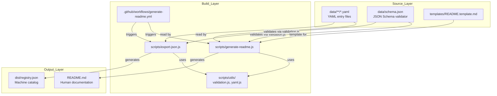
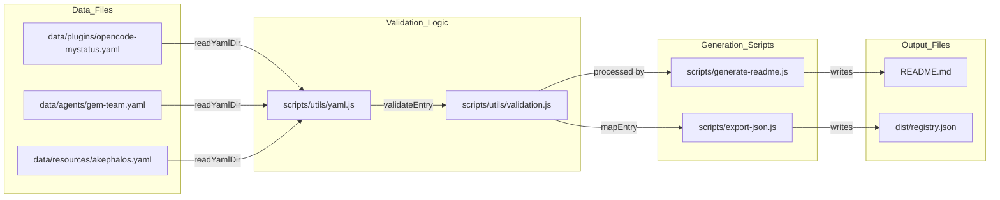

<!-- source: DeepWiki mcp.deepwiki.com · repo awesome-opencode/awesome-opencode · page 1 Overview · fetched 2026-10-30 -->

# Overview

Relevant source files

The following files were used as context for generating this wiki page:

- [README.md](README.md)
- [data/agents/gem-team.yaml](data/agents/gem-team.yaml)
- [data/plugins/opencode-mystatus.yaml](data/plugins/opencode-mystatus.yaml)
- [data/resources/akephalos.yaml](data/resources/akephalos.yaml)
- [dist/registry.json](dist/registry.json)
- [scripts/export-json.js](scripts/export-json.js)

The awesome-opencode repository is a curated, community-maintained registry of extensions, tools, and resources for the [OpenCode AI coding agent](https://opencode.ai/). It functions as both a human-readable catalog and a machine-consumable data source, serving as the definitive directory of the OpenCode ecosystem.

This page provides a high-level introduction to the repository's architecture and operational model. For details on specific subsystems, see:
- Architecture and data flow: [Architecture](#2)
- Entry schema and validation: [Data Model](#3)
- Contribution workflow: [Contributing](#6)

## Purpose and Scope

The repository serves three primary functions:

1. **Discovery Platform**: Provides a browsable catalog of 100+ plugins, themes, agents, projects, and resources through [README.md:1-962]().
2. **Data Registry**: Offers structured, validated data via `dist/registry.json` [dist/registry.json:1-217]() for downstream tools and platforms.
3. **Community Hub**: Enables open contribution through standardized YAML entry submission.

**Key Principle**: All documentation artifacts are generated from source data. Contributors modify YAML files in `data/`, never the generated outputs.

Sources: [README.md:1-962](), [dist/registry.json:1-217]()

## Entry Categories

The registry catalogs six distinct types of OpenCode ecosystem entries. The category is derived from the file's directory location rather than a field within the YAML itself, as implemented in the `CATEGORIES` array and the `loadEntries` function [scripts/export-json.js:14-14](), [scripts/export-json.js:79-104]().

| Category | Directory | Count | Purpose |
|----------|-----------|-------|---------|
| **Plugins** | `data/plugins/` | 60+ | JavaScript/TypeScript modules extending OpenCode functionality |
| **Themes** | `data/themes/` | 4+ | JSON configurations for visual customization |
| **Agents** | `data/agents/` | 4+ | AI agent configurations and SKILL.md files |
| **Projects** | `data/projects/` | 30+ | Standalone applications and tools |
| **Resources** | `data/resources/` | 3+ | Guides, MCP servers, configuration templates |
| **Forks** | `data/forks/` | 0+ | Modified OpenCode builds with custom features |

Sources: [README.md:49-952](), [scripts/export-json.js:14-14](), [scripts/export-json.js:79-81]()

## Repository Architecture

### Data Flow Model

The repository uses a build pipeline to transform raw YAML data into human and machine-readable formats.

**Key Characteristics**:
- **Single Source of Truth**: YAML files in `data/` are the only manually edited files.
- **Automated Generation**: The `Auto-Generate README` workflow [ .github/workflows/generate-readme.yml:1-46]() triggers a rebuild on any push to `main` affecting the `data/` path.
- **Dual Output**: Human-optimized markdown and machine-optimized JSON.
- **Schema Validation**: All entries are validated using `validateEntry` [scripts/export-json.js:93-97]() before inclusion in artifacts.

Sources: [.github/workflows/generate-readme.yml:1-46](), [scripts/export-json.js:1-159]()

### Component Mapping

This diagram maps natural language concepts to actual code entities, highlighting how specific scripts interact with data.

- **Data Files**: Individual YAML entries like [data/plugins/opencode-mystatus.yaml:1-5](), [data/agents/gem-team.yaml:1-5](), and [data/resources/akephalos.yaml:1-16]().
- **Validation Logic**: `scripts/utils/validation.js` ensures data integrity using the `validateEntry` function [scripts/export-json.js:93-93]().
- **Generation Scripts**: `scripts/export-json.js` creates the machine-readable registry by iterating through `CATEGORIES` [scripts/export-json.js:14-14]() and writing to `outputPath` [scripts/export-json.js:139-148]().

Sources: [scripts/export-json.js:11-14](), [scripts/export-json.js:93-99](), [data/plugins/opencode-mystatus.yaml:1-5](), [data/agents/gem-team.yaml:1-5](), [data/resources/akephalos.yaml:1-16]()

## Consumer Model

### Human Consumers
**Primary Interface**: [README.md:1-962]()
- Developers browsing for tools via the categorized sections (Plugins, Themes, Agents, etc.) [README.md:27-27]().
- Uses GitHub-flavored markdown with collapsible `
` tags to manage the high volume of entries [README.md:51-62]().

### Machine Consumers
**Primary Interface**: `dist/registry.json` [dist/registry.json:1-217]()
- **Format**: A flat JSON array of objects generated by `export-json.js` [scripts/export-json.js:137-137]().
- **Derived Fields**: Includes `productId` (derived from filename via `buildProductId`) and `type` (derived from the directory name) [scripts/export-json.js:25-63]().
- **Automation**: Used by external sites like `opencode.cafe` to provide a searchable UI.

Sources: [README.md:27-62](), [scripts/export-json.js:25-63](), [dist/registry.json:1-217]()

## Operational Model

### Entry Lifecycle

The workflow ensures that only valid data enters the registry:

1. **Submission**: A contributor creates a new YAML file in a `data/` subdirectory.
2. **CI Validation**: GitHub Actions run validation scripts to check schema compliance.
3. **Merge**: Once approved and merged to `main`, the `Auto-Generate README` workflow triggers [.github/workflows/generate-readme.yml:3-8]().
4. **Artifact Update**: `scripts/generate-readme.js` and `scripts/export-json.js` run, updating the `README.md` and `dist/registry.json` [.github/workflows/generate-readme.yml:33-37]().
5. **Auto-Commit**: The workflow commits the updated artifacts back to the repo [.github/workflows/generate-readme.yml:39-45]().

Sources: [.github/workflows/generate-readme.yml:1-46](), [scripts/export-json.js:109-154]()

### Convention Over Configuration

The repository minimizes manual configuration through smart defaults:
- **Type Derivation**: The `type` field in the final registry is taken from the directory name (`plugins`, `themes`, etc.) [scripts/export-json.js:79-99]().
- **Product Identification**: The `productId` is generated from the `_fileName` property assigned during the YAML read process, or slugified from the name [scripts/export-json.js:25-33]().
- **Sanitization**: The `sanitizeArray` function ensures fields like `scope` default to `['global']` and `tags` default to `[]` if not provided in the source YAML [scripts/export-json.js:35-56]().

Sources: [scripts/export-json.js:25-63](), [scripts/export-json.js:79-104]()

---

