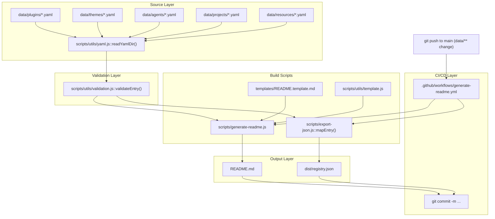
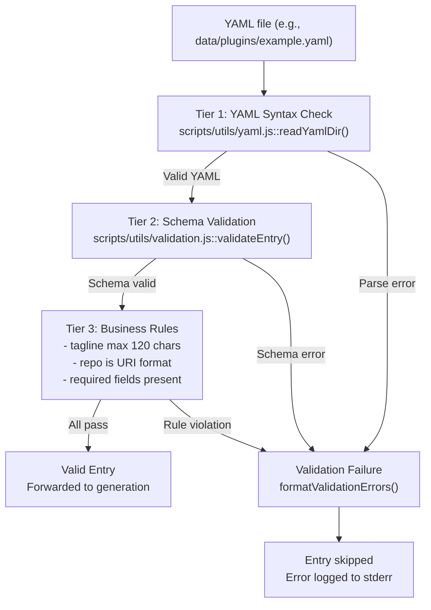
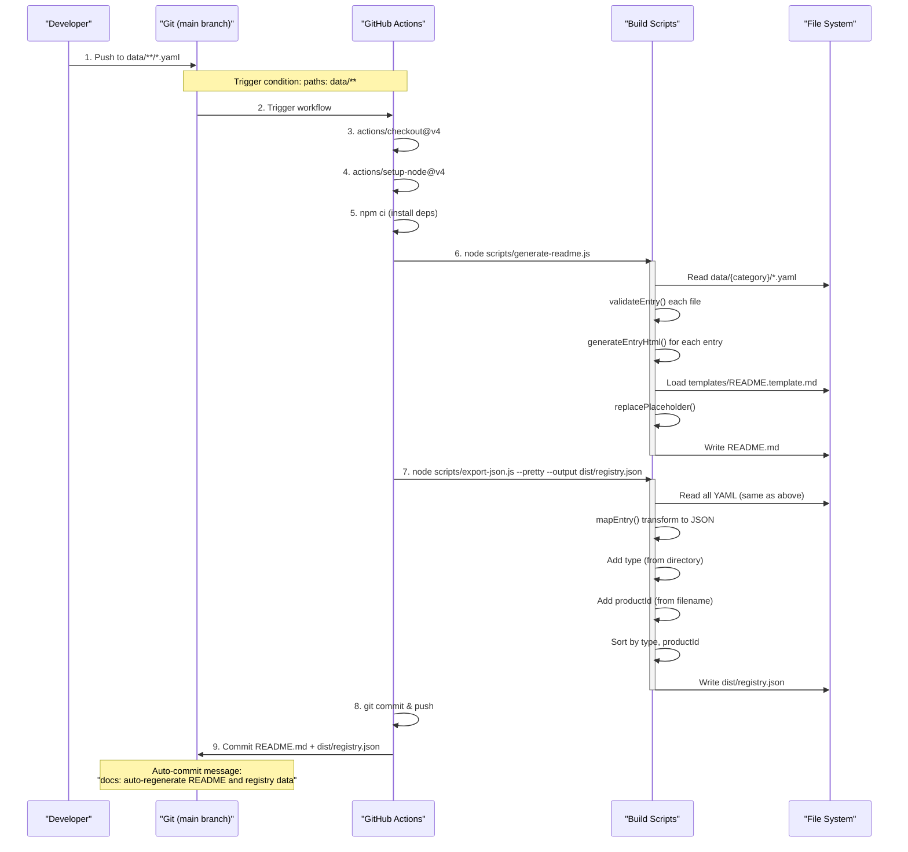

<!-- source: DeepWiki mcp.deepwiki.com · repo awesome-opencode/awesome-opencode · page 2 Architecture · fetched 2026-10-30 -->

# Architecture

<details>
<summary>Relevant source files</summary>

The following files were used as context for generating this wiki page:

- [.github/workflows/generate-readme.yml](.github/workflows/generate-readme.yml)
- [data/schema.json](data/schema.json)
- [dist/registry.json](dist/registry.json)
- [docs/schema-design.md](docs/schema-design.md)
- [scripts/export-json.js](scripts/export-json.js)
- [scripts/generate-readme.js](scripts/generate-readme.js)
- [scripts/utils/template.js](scripts/utils/template.js)

</details>


## Purpose and Scope

This document describes the high-level architecture of the awesome-opencode repository, explaining how YAML data files, build scripts, validation systems, and generated artifacts work together to maintain a curated catalog of OpenCode extensions. The architecture follows a **data-driven, convention-over-configuration** approach where YAML files serve as the single source of truth, and all documentation artifacts are automatically generated.

For detailed information about the data model and schema validation rules, see [Data Model](#3). For specifics on the build pipeline and generation scripts, see [Build System](#5). For the file and folder organization, see [Directory Structure](#2.1).

## Design Principles

The repository architecture is built on three core principles:

| Principle | Implementation | Benefit |
|-----------|---------------|---------|
| **Generated Artifacts** | `README.md` and `dist/registry.json` are never manually edited | Ensures consistency between data and documentation |
| **Convention Over Configuration** | Type derived from directory, `productId` from filename | Reduces boilerplate and prevents configuration drift |
| **Validation at Build Time** | Schema validation via JSON Schema and business rules | Catches errors before merge, maintains data quality |

The entire system operates as a **compile-time transformation pipeline**: source YAML files are validated and transformed into human-readable (`README.md`) and machine-readable (`dist/registry.json`) outputs through automated build scripts triggered by GitHub Actions.

Sources: [docs/schema-design.md:9-18](), [.github/workflows/generate-readme.yml:49-58]()

## System Component Architecture



**System Component Architecture**

This diagram shows the complete data flow from source YAML files through validation and transformation to generated outputs. The build process is stateless and deterministic: given the same input YAML files, it always produces identical outputs.

Sources: [scripts/export-json.js:75-107](), [scripts/generate-readme.js:32-77](), [.github/workflows/generate-readme.yml:44-66]()

## Core Components

### Data Layer (`data/` directory)

The data layer contains YAML files organized by extension type. Each category maps to a specific extension type:

| Directory | Type Value | Purpose |
|-----------|-----------|---------|
| `data/plugins/` | `"plugins"` | JavaScript/TypeScript modules that extend OpenCode [docs/schema-design.md:48-50]() |
| `data/themes/` | `"themes"` | Color schemes and visual themes [docs/schema-design.md:61-63]() |
| `data/agents/` | `"agents"` | AI agents and subagents [docs/schema-design.md:74-76]() |
| `data/projects/` | `"projects"` | Tools, GUIs, integrations, and utilities [docs/schema-design.md:88-90]() |
| `data/resources/` | `"resources"` | Guides, templates, and configurations [docs/schema-design.md:98-100]() |
| `data/forks/` | `"forks"` | Modified builds of OpenCode [docs/schema-design.md:115-117]() |

The **type derivation convention** eliminates the need to store type in YAML: `scripts/export-json.js` reads the directory path and assigns the `type` automatically [scripts/export-json.js:42-63](). Similarly, the **productId** is derived from the filename (without `.yaml` extension) [scripts/export-json.js:25-33](), ensuring unique identifiers without manual configuration.

Sources: [docs/schema-design.md:19-35](), [scripts/export-json.js:25-33](), [scripts/export-json.js:42-63]()

### Build Scripts (`scripts/` directory)

Two primary generation scripts transform YAML data into outputs:

**1. `scripts/generate-readme.js`** - Creates human-readable documentation
- Reads YAML files using `readYamlDir()` [scripts/generate-readme.js:11]()
- Validates each entry via `validateEntry()` [scripts/generate-readme.js:52]()
- Loads the template via `readTemplate()` [scripts/generate-readme.js:88]()
- Generates HTML snippets for each entry with collapsible `<details>` sections [scripts/utils/template.js:34-69]()
- Injects content into template placeholders like `{{PLUGINS}}` [scripts/generate-readme.js:123]()
- Writes the final `README.md` [scripts/generate-readme.js:128]()

**2. `scripts/export-json.js`** - Creates machine-readable catalog
- Iterates categories defined in `CATEGORIES` array [scripts/export-json.js:14]()
- Calls `mapEntry()` function [scripts/export-json.js:42-63]() to transform YAML to JSON
- Adds derived fields: `type` from directory, `productId` from filename [scripts/export-json.js:49-50]()
- Sorts by `type` then `productId` [scripts/export-json.js:122-128]()
- Outputs to `dist/registry.json` [scripts/export-json.js:144]()

Sources: [scripts/generate-readme.js:1-154](), [scripts/export-json.js:1-159](), [scripts/utils/template.js:1-85]()

### Validation System

Three-tier validation ensures data quality before generation:



**Validation Pipeline**

The validation system processes each YAML file through three progressive checks. Files that fail any tier are excluded from generation with descriptive error messages [scripts/generate-readme.js:56-61](). Tier 2 and 3 are enforced by the JSON schema in `data/schema.json` [data/schema.json:1-63]().

Sources: [scripts/generate-readme.js:49-61](), [scripts/export-json.js:92-97](), [data/schema.json:1-63]()

### Template System

The template system uses placeholder replacement for README generation:

**Template Structure** (`templates/README.template.md`)
- Contains static header content (badges, description, navigation)
- Includes placeholder markers like `{{PLUGINS}}`, `{{THEMES}}`, etc. [scripts/generate-readme.js:19-25]()
- Maintains consistent formatting across regenerations

**Generation Process** (`scripts/generate-readme.js`)
1. Parse all YAML files by category [scripts/generate-readme.js:99-118]()
2. For each category, generate HTML using `generateEntryHtml()` [scripts/utils/template.js:34-69]()
3. Create GitHub star badges via `badgen.net` [scripts/utils/template.js:55-57]()
4. Replace template placeholders with generated content [scripts/generate-readme.js:123]()
5. Write complete file to `README.md` [scripts/utils/template.js:75-78]()

The README is **never manually edited** - all changes must be made to source YAML files or the template [scripts/generate-readme.js:4-7]().

Sources: [scripts/generate-readme.js:82-144](), [scripts/utils/template.js:12-85]()

## Data Flow Architecture



**Complete Build Pipeline Sequence**

This sequence diagram shows the exact execution flow when changes are pushed to the `data/` directory. The workflow is idempotent: running it multiple times with the same input produces no additional commits due to the `git diff --quiet` check [.github/workflows/generate-readme.yml:52-55]().

Sources: [.github/workflows/generate-readme.yml:1-70](), [scripts/generate-readme.js:82-144](), [scripts/export-json.js:109-153]()

## Convention-Driven Field Derivation

The architecture minimizes explicit configuration through convention-based field derivation:

### Type Derivation

Type is **never stored in YAML files**. Instead, `scripts/export-json.js` derives it from the directory structure [scripts/export-json.js:42-63]():

```javascript
function mapEntry(entry, category) {
  const output = {
    productId,
    type: category, // 'plugins', 'themes', 'agents', etc.
    // ...
  };
}
```

### ProductId Derivation

The `productId` field is derived from the filename [scripts/export-json.js:25-33]():

```javascript
function buildProductId(entry) {
  if (entry._fileName) {
    return entry._fileName; // filename without .yaml extension
  }
  // ...
}
```

### Default Value Assignment

Optional fields receive defaults during JSON export [scripts/export-json.js:35-40]():

```javascript
function sanitizeArray(value, fallback) {
  if (Array.isArray(value) && value.length > 0) {
    return value;
  }
  return fallback;
}
```

**Default Values:**
| Field | Default | Assignment Location |
|-------|---------|-------------------|
| `scope` | `["global"]` | [scripts/export-json.js:55]() |
| `tags` | `[]` | [scripts/export-json.js:56]() |

Sources: [scripts/export-json.js:25-63]()

## Output Artifacts

The build system produces two artifacts, each optimized for different consumers:

### README.md - Human-Facing Documentation

**Purpose:** Primary discovery interface for GitHub visitors  
**Format:** Markdown with embedded HTML (`<details>` elements) [scripts/utils/template.js:61-69]()  
**Key Features:**
- GitHub star badges via `badgen.net` [scripts/utils/template.js:55-56]()
- Collapsible entry details [scripts/utils/template.js:61-68]()

**Generation Command:** `node scripts/generate-readme.js` [.github/workflows/generate-readme.yml:49]()

### dist/registry.json - Machine-Readable Catalog

**Purpose:** Structured data for downstream platforms  
**Format:** JSON array of entry objects [dist/registry.json:1-13]()  
**Structure Example:**
```json
{
  "productId": "agentic",
  "type": "agents",
  "displayName": "Agentic",
  "repoUrl": "https://github.com/Cluster444/agentic",
  "tagline": "Modular AI agents",
  "description": "Modular AI agents and commands for structured software development with opencode.",
  "scope": ["global"],
  "tags": []
}
```

**Generation Command:** `node scripts/export-json.js --pretty --output dist/registry.json` [.github/workflows/generate-readme.yml:50]()

Sources: [dist/registry.json:1-126](), [scripts/export-json.js:42-63](), [scripts/utils/template.js:34-69]()

## CI/CD Integration

The GitHub Actions workflow ensures outputs stay synchronized with source data:

**Workflow Triggers** [.github/workflows/generate-readme.yml:3-9]()
- Push to `main` branch
- Changes to `data/**` directory
- Manual trigger via `workflow_dispatch`

**Execution Steps** [.github/workflows/generate-readme.yml:44-66]()
1. **Fetch & Reset:** Ensures generation happens on the latest `main` branch.
2. **Generate README:** `node scripts/generate-readme.js`
3. **Generate registry JSON:** `node scripts/export-json.js --pretty --output dist/registry.json`
4. **Commit changes:** Automatically commits and pushes `README.md` and `dist/registry.json` if they have changed.

The workflow has `contents: write` permission [.github/workflows/generate-readme.yml:11-12]() to push commits back to the repository.

Sources: [.github/workflows/generate-readme.yml:1-70]()

---

