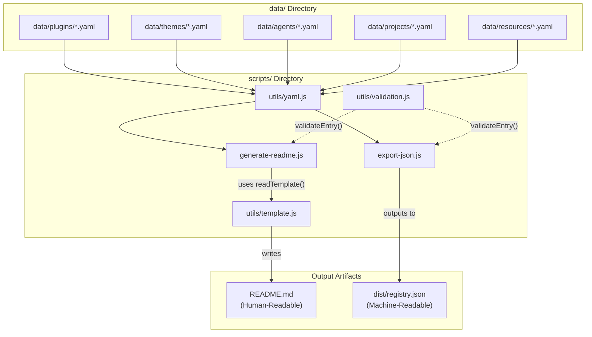
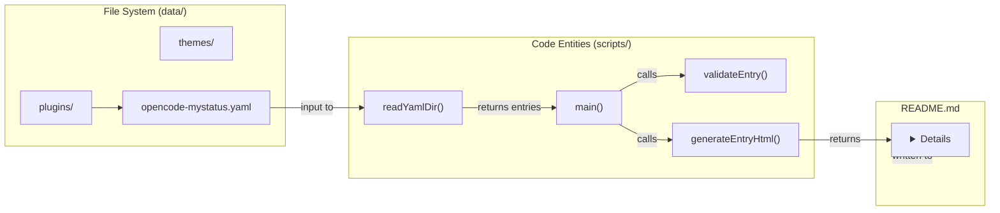

<!-- source: DeepWiki mcp.deepwiki.com · repo awesome-opencode/awesome-opencode · page 2.1 Directory Structure · fetched 2026-10-30 -->

# Directory Structure

<details>
<summary>Relevant source files</summary>

The following files were used as context for generating this wiki page:

- [.github/workflows/generate-readme.yml](.github/workflows/generate-readme.yml)
- [README.md](README.md)
- [data/agents/gem-team.yaml](data/agents/gem-team.yaml)
- [data/plugins/opencode-mystatus.yaml](data/plugins/opencode-mystatus.yaml)
- [data/resources/akephalos.yaml](data/resources/akephalos.yaml)
- [scripts/generate-readme.js](scripts/generate-readme.js)
- [scripts/utils/template.js](scripts/utils/template.js)

</details>


This document describes the file and folder organization of the `awesome-opencode` repository. It covers the root-level layout, the data layer where YAML entries are stored, the build system directories, and where generated artifacts are written.

For information about the YAML schema and field definitions, see **3. Data Model**. For details on how YAML files are processed into outputs, see **5. Build System**.

---

## Purpose and Scope

The `awesome-opencode` repository follows a **convention-over-configuration** architecture where directory placement determines extension type. The repository separates source data (`data/`), build scripts (`scripts/`), templates (`templates/`), documentation (`docs/`), and generated artifacts (`README.md`, `dist/`).

---

## Root Directory Layout

The repository is organized into distinct top-level directories, each serving a specific purpose in the data-driven documentation system:

```
awesome-opencode/
├── .github/                 # CI/CD workflows and PR templates
├── data/                    # Source of truth: YAML entries
├── dist/                    # Machine-readable registry output
├── docs/                    # Schema and contribution documentation
├── scripts/                 # Build automation and validation
├── templates/               # README generation templates
├── README.md                # Generated human-readable catalog
└── package.json             # Project dependencies and build scripts
```

**Sources:** [.github/workflows/generate-readme.yml:7-8](), [scripts/generate-readme.js:33-34](), [scripts/utils/template.js:13-15](), [scripts/utils/template.js:75-78]()

---

## Data Layer Organization

### Category Directories

The `data/` directory contains YAML files organized by extension type. The directory structure defines the `type` field for each entry through **type derivation**:

```
data/
├── plugins/           # JavaScript/TypeScript modules (type: "plugins")
│   └── *.yaml
├── themes/            # Visual customization configs (type: "themes")
│   └── *.yaml
├── agents/            # AI agent configs and skills (type: "agents")
│   └── *.yaml
├── projects/          # Standalone applications (type: "projects")
│   └── *.yaml
├── resources/         # Guides, MCP servers, tools (type: "resources")
│   └── *.yaml
└── examples/          # Reference templates (not processed)
```

### Type Derivation Mapping

The build system in `scripts/generate-readme.js` processes these directories in a specific order to populate the final catalog.

| Directory Path | Category Key | Purpose |
|----------------|--------------|---------|
| `data/plugins/` | `plugins` | Extend OpenCode functionality with JS/TS modules [scripts/generate-readme.js:16-20]() |
| `data/themes/` | `themes` | Visual customization via JSON configs [scripts/generate-readme.js:16-21]() |
| `data/agents/` | `agents` | AI agent configurations and SKILL.md files [scripts/generate-readme.js:16-22]() |
| `data/projects/` | `projects` | Standalone applications and tools [scripts/generate-readme.js:16-23]() |
| `data/resources/` | `resources` | MCP servers, guides, configs, CLI tools [scripts/generate-readme.js:16-24]() |

**Sources:** [scripts/generate-readme.js:15-25](), [scripts/generate-readme.js:32-47]()

---

## YAML Entry File Naming

YAML files in category directories follow kebab-case naming conventions. While the `name` field provides the display title, the build system uses the file location and structure to validate and categorize the entry.

Example YAML entry structure from `data/plugins/opencode-mystatus.yaml`:

```yaml
name: opencode-mystatus
repo: https://github.com/vbgate/opencode-mystatus
tagline: Check AI subscription quotas
description: Check all your AI subscription quotas in one command...
```

**Sources:** [data/plugins/opencode-mystatus.yaml:1-4](), [data/resources/akephalos.yaml:1-7]()

---

## Data Flow: Directory to Generated Artifacts



**Diagram: Data Directory to Build Outputs**

The diagram shows how source YAML files are parsed and processed by the main build scripts. `generate-readme.js` uses `utils/template.js` to inject HTML blocks into the README template.

**Sources:** [scripts/generate-readme.js:10-14](), [scripts/generate-readme.js:82-133](), [scripts/utils/template.js:12-27](), [.github/workflows/generate-readme.yml:49-50]()

---

## Build System Directories

### scripts/ Directory

Contains Node.js build scripts and validation utilities:

| Script | Purpose |
|--------|---------|
| `generate-readme.js` | Main orchestrator that reads all categories, validates entries, and generates the final `README.md`. [scripts/generate-readme.js:3-7]() |
| `export-json.js` | Generates the machine-readable `dist/registry.json` file. [.github/workflows/generate-readme.yml:50]() |
| `utils/template.js` | Contains `generateEntryHtml()` which converts YAML objects into the `<details>` HTML blocks used in the README. [scripts/utils/template.js:34-69]() |
| `utils/validation.js` | Logic for checking entries against schema and formatting errors. [scripts/generate-readme.js:12]() |
| `utils/yaml.js` | Helper to read and parse YAML files from a directory. [scripts/generate-readme.js:11]() |

**Sources:** [scripts/generate-readme.js:1-14](), [scripts/utils/template.js:1-85](), [.github/workflows/generate-readme.yml:49-50]()

### templates/ Directory

Contains Markdown templates used by the build system:

```
templates/
└── README.template.md    # Base template containing {{CATEGORY}} placeholders
```

The `readTemplate()` function specifically looks for this file to begin the generation process.

**Sources:** [scripts/utils/template.js:12-15](), [scripts/generate-readme.js:85-92]()

---

## CI/CD and GitHub Configuration

### .github/ Directory Structure

```
.github/
└── workflows/
    ├── generate-readme.yml     # Auto-regenerates README and JSON on data merges to main
    └── validate-pr.yml         # Validates YAML changes on Pull Requests
```

The `generate-readme.yml` workflow triggers on pushes to `main` that modify files in `data/**`. It performs a clean checkout, installs dependencies via `npm ci`, and runs the generation scripts.

**Sources:** [.github/workflows/generate-readme.yml:3-8](), [.github/workflows/generate-readme.yml:34-50]()

---

## Output Artifacts Location

### Generated Files

| File | Generator | Purpose |
|------|-----------|---------|
| `README.md` | `generate-readme.js` | Human-readable catalog for GitHub visitors, featuring expandable details and star badges. [scripts/utils/template.js:49-68]() |
| `dist/registry.json` | `export-json.js` | Machine-readable catalog for downstream tools and the OpenCode client. [.github/workflows/generate-readme.yml:50]() |

The generation process is idempotent; if the scripts produce no changes compared to the existing files, the CI workflow exits without committing.

**Sources:** [.github/workflows/generate-readme.yml:52-55](), [scripts/utils/template.js:75-78]()

---

## Directory Structure to Code Entity Mapping



**Diagram: File System to Code Execution Mapping**

This diagram illustrates how the `generate-readme.js` script interacts with the directory structure. The `main()` function iterates through `CATEGORIES`, calling `readYamlDir()` for each folder, validating the content, and finally assembling the HTML via `generateEntryHtml()`.

**Sources:** [scripts/generate-readme.js:32-77](), [scripts/generate-readme.js:82-118](), [scripts/utils/template.js:34-69]()

---

## Summary Table: Directory Purposes

| Directory | Mutability | Purpose |
|-----------|------------|---------|
| `data/` | Manual | **Source of truth**: YAML entries edited by contributors. |
| `scripts/` | Manual | **Logic**: Build automation, template rendering, and validation. |
| `dist/` | Generated | **Distribution**: Machine-readable `registry.json`. |
| `templates/` | Manual | **Layout**: The base `README.template.md` with placeholders. |
| `.github/` | Manual | **Automation**: Workflows for CI/CD and PR validation. |

**Sources:** [scripts/generate-readme.js:15-25](), [scripts/utils/template.js:13-15](), [.github/workflows/generate-readme.yml:7-8]()

---

