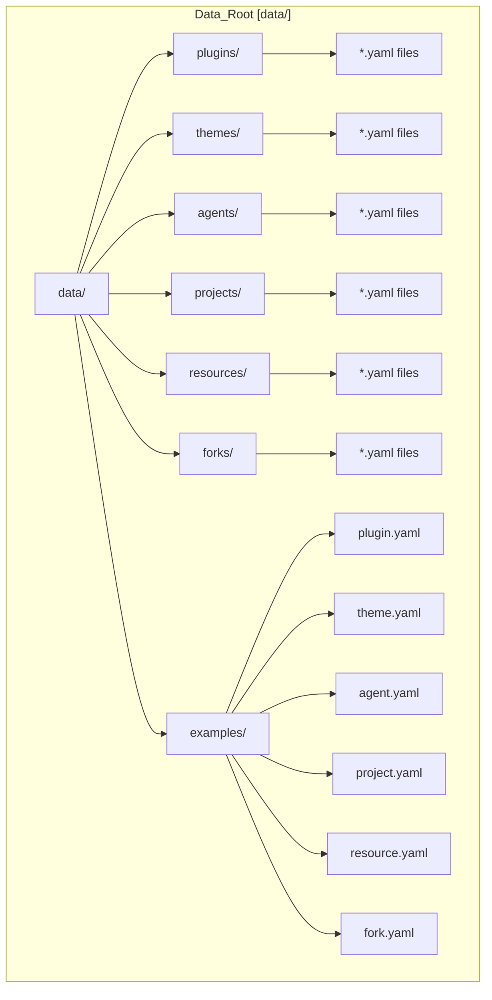
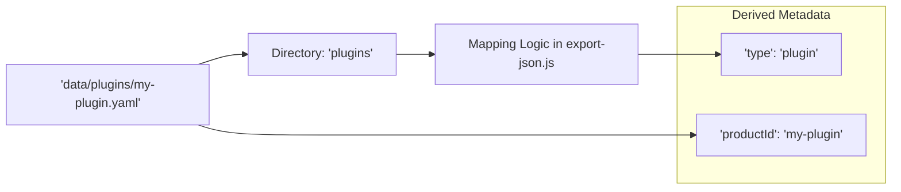
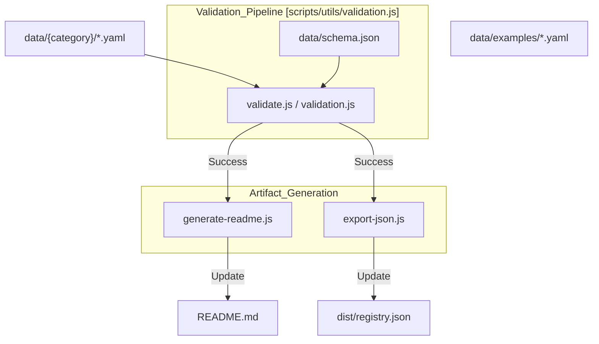

<!-- source: DeepWiki mcp.deepwiki.com · repo awesome-opencode/awesome-opencode · page 2.2 Data Layer · fetched 2026-10-30 -->

# Data Layer

<details>
<summary>Relevant source files</summary>

The following files were used as context for generating this wiki page:

- [data/examples/agent.yaml](data/examples/agent.yaml)
- [data/examples/fork.yaml](data/examples/fork.yaml)
- [data/examples/plugin.yaml](data/examples/plugin.yaml)
- [data/examples/project.yaml](data/examples/project.yaml)
- [data/examples/resource.yaml](data/examples/resource.yaml)
- [data/examples/theme.yaml](data/examples/theme.yaml)
- [data/schema.json](data/schema.json)
- [docs/schema-design.md](docs/schema-design.md)

</details>


The Data Layer is the single source of truth for all extension entries in the `awesome-opencode` repository. It consists of YAML files organized into category-specific directories under `data/`, where each file represents one cataloged extension, tool, or resource [docs/schema-design.md:9](). The type of each entry is derived from its directory location rather than being stored within the file itself [docs/schema-design.md:17]().

This document covers the organization, structure, and conventions of the data layer.

---

## Directory Structure

The data layer follows a strict directory hierarchy where category determines entry type. All extension data files reside under the `data/` directory, organized into subdirectories by category [docs/schema-design.md:21-40]().

### Data Directory Layout

```
data/
├── plugins/          # JavaScript/TypeScript modules that extend OpenCode
│   └── *.yaml
├── themes/           # Visual customization JSON configurations
│   └── *.yaml
├── agents/           # AI agent configurations and SKILL.md files
│   └── *.yaml
├── projects/         # Standalone applications and tools
│   └── *.yaml
├── resources/        # Guides, MCP servers, tools, commands
│   └── *.yaml
├── forks/            # Modified builds of OpenCode
│   └── *.yaml
├── examples/         # Template files showing all possible fields
│   ├── plugin.yaml
│   ├── theme.yaml
│   ├── agent.yaml
│   ├── project.yaml
│   ├── resource.yaml
│   └── fork.yaml
└── schema.json       # JSON Schema specification for validation
```

**Sources:** [docs/schema-design.md:21-40](), [data/examples/plugin.yaml:3](), [data/schema.json:1-64]()

### Directory Structure Diagram



**Sources:** [docs/schema-design.md:21-40](), [data/examples/plugin.yaml:1-3](), [data/examples/agent.yaml:1-4]()

---

## Category-Based Organization

Each category directory serves a specific purpose in the OpenCode ecosystem. The category determines not only the type of entry but also its intended use case and installation pattern [docs/schema-design.md:44-46]().

### Category Definitions

| Directory | Type Value | Purpose | Installation Target |
|-----------|-----------|---------|-------------------|
| `data/plugins/` | `plugin` | JS/TS modules extending OpenCode | `~/.config/opencode/plugin/` |
| `data/themes/` | `theme` | JSON files for visual customization | `~/.config/opencode/themes/` |
| `data/agents/` | `agent` | AI agent configs and skills | `~/.config/opencode/agent/` |
| `data/projects/` | `project` | Standalone applications | Varies by project |
| `data/resources/` | `resource` | Guides, MCP servers, tools | Varies (e.g., `npm -g`) |
| `data/forks/` | `fork` | Modified OpenCode builds | Replaces binary |

**Sources:** [docs/schema-design.md:48-123](), [docs/schema-design.md:130-157](), [data/examples/plugin.yaml:25-26](), [data/examples/agent.yaml:26-27](), [data/examples/theme.yaml:23](), [data/examples/fork.yaml:24]()

### Category Purposes

#### Plugins (`data/plugins/`)
Plugins are JavaScript or TypeScript modules loaded by OpenCode to extend core functionality [docs/schema-design.md:48-50]().
- **Scope:** Can be `global` or `project` specific [data/examples/plugin.yaml:24-26]().
- **Example:** [data/examples/plugin.yaml:1-81]()

#### Themes (`data/themes/`)
Themes define color schemes and syntax highlighting for the OpenCode editor interface [docs/schema-design.md:61-63]().
- **Scope:** Typically `global` only [data/examples/theme.yaml:22-23]().
- **Example:** [data/examples/theme.yaml:1-59]()

#### Agents (`data/agents/`)
Agents include both AI agent configurations (system prompts) and reusable skill instruction sets in `SKILL.md` format [docs/schema-design.md:74-80]().
- **Scope:** `global` or `project` [data/examples/agent.yaml:25-27]().
- **Example:** [data/examples/agent.yaml:1-89]()

#### Projects (`data/projects/`)
Projects are standalone applications, utilities, and tools built for or with OpenCode, rather than extensions to it [docs/schema-design.md:88-90]().
- **Example:** [data/examples/project.yaml:1-72]()

#### Resources (`data/resources/`)
Resources encompass guides, configurations, and MCP (Model Context Protocol) servers [docs/schema-design.md:98-107]().
- **Example:** [data/examples/resource.yaml:1-80]()

#### Forks (`data/forks/`)
Forks are modified builds of OpenCode itself. Unlike other types, they replace the entire installation [docs/schema-design.md:115-117]().
- **Example:** [data/examples/fork.yaml:1-89]()

---

## Type Derivation System

A key architectural principle of the data layer is **type derivation from directory location** [docs/schema-design.md:17](). The `type` field is never stored in YAML files; instead, it is computed from the file's directory path during the build process.

### Type Derivation Mechanism



**Sources:** [docs/schema-design.md:17](), [docs/schema-design.md:21-38]()

### ProductId Derivation
The `productId` is derived from the filename (without extension). For example, `data/plugins/my-plugin.yaml` results in a `productId` of `my-plugin`.

**Sources:** [docs/schema-design.md:17](), [docs/schema-design.md:24-25]()

---

## YAML File Structure

Each YAML file in the data layer must conform to the repository's JSON schema [data/schema.json:1-64]().

### Required Fields
Every entry must include these four fields [data/schema.json:61]():

| Field | Description | Constraints |
|-------|-------------|-------------|
| `name` | Human-readable display name | [data/schema.json:8-12]() |
| `repo` | URL to the source repository | Must be URI [data/schema.json:13-17]() |
| `tagline` | Short summary | Max 120 chars [data/schema.json:18-23]() |
| `description` | Detailed explanation | [data/schema.json:24-28]() |

**Sources:** [docs/schema-design.md:199-210](), [data/schema.json:61]()

### Optional Fields
| Field | Purpose | Constraints |
|-------|---------|-------------|
| `scope` | Where the entry can be installed | `global` or `project` [data/schema.json:29-38]() |
| `tags` | Filtering and discoverability | Array of strings [data/schema.json:39-45]() |
| `min_version` | Minimum OpenCode version | Semver format [data/schema.json:46-50]() |
| `homepage` | External documentation URL | URI [data/schema.json:51-55]() |
| `installation` | Markdown instructions | String [data/schema.json:56-59]() |

**Sources:** [docs/schema-design.md:212-225](), [data/schema.json:7-60]()

---

## Examples Directory

The `data/examples/` directory contains reference templates demonstrating all available fields for each entry type [docs/schema-design.md:36-37](). These serve as the primary guide for new contributors.

| Template | File Path | Key Features Shown |
|----------|-----------|--------------------|
| **Plugin** | [data/examples/plugin.yaml]() | Global/Project scope, config JSON |
| **Theme** | [data/examples/theme.yaml]() | Color scheme files, `opencode.json` theme key |
| **Agent** | [data/examples/agent.yaml]() | `SKILL.md` installation, system prompts |
| **Project** | [data/examples/project.yaml]() | Docker usage, standalone prerequisites |
| **Resource** | [data/examples/resource.yaml]() | MCP server configuration, env variables |
| **Fork** | [data/examples/fork.yaml]() | Build from source, binary replacement |

---

## Data Flow and Single Source of Truth

The repository enforces a strict policy where YAML files in `data/` are the only source of truth [docs/schema-design.md:9](). All other representations are generated artifacts.

### Build and Validation Flow



**Sources:** [docs/schema-design.md:9](), [data/schema.json:1-64]()

### Read-Only Principle
- **README.md:** Automatically regenerated from YAML files; manual edits will be overwritten.
- **dist/registry.json:** Machine-readable export used by external tools, generated during the build process to include derived fields like `type` and `productId`.

**Sources:** [docs/schema-design.md:9-17]()

---

