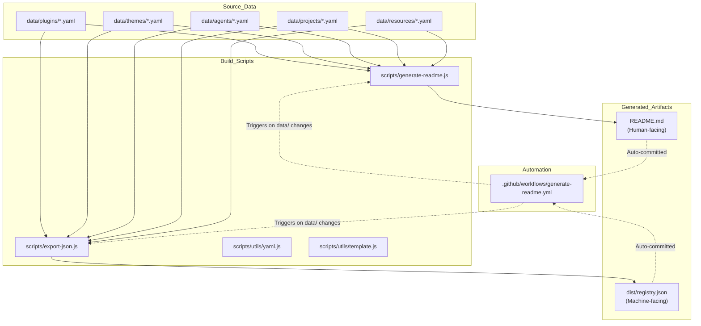
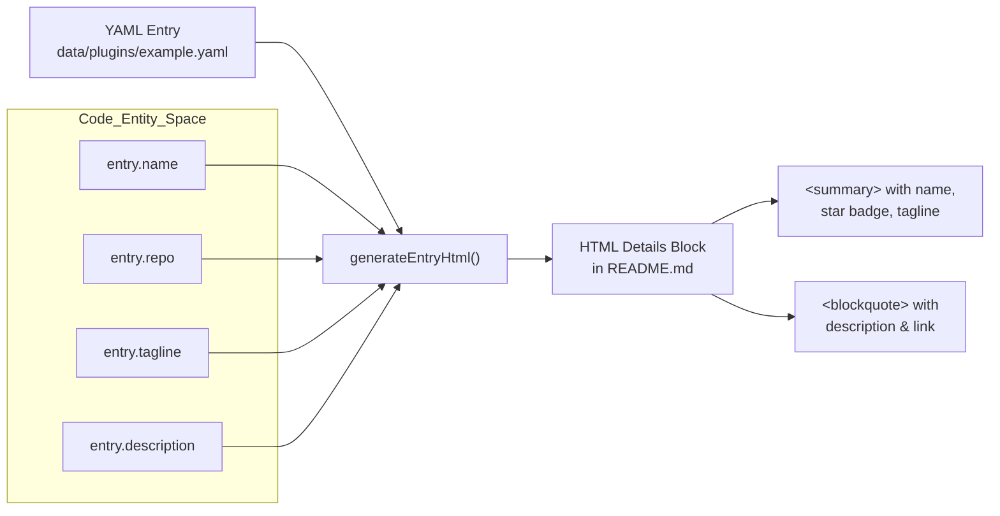
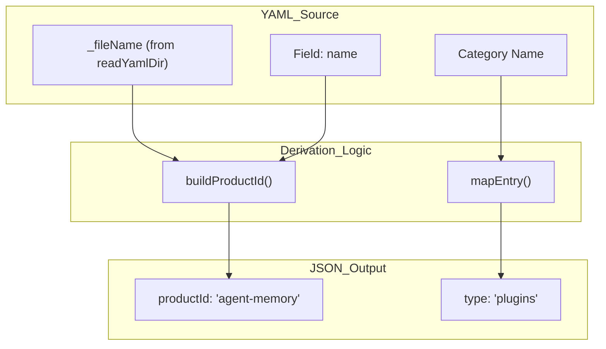
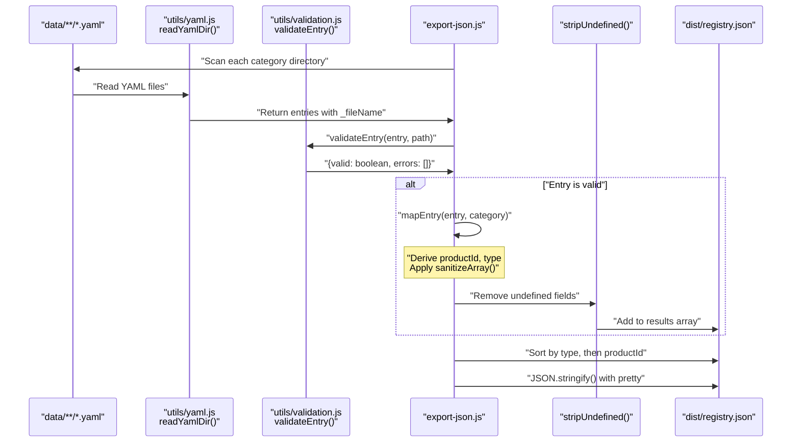

<!-- source: DeepWiki mcp.deepwiki.com · repo awesome-opencode/awesome-opencode · page 2.3 Generated Artifacts · fetched 2026-10-30 -->

# Generated Artifacts

Relevant source files

The following files were used as context for generating this wiki page:

- [.github/workflows/generate-readme.yml](.github/workflows/generate-readme.yml)
- [dist/registry.json](dist/registry.json)
- [scripts/export-json.js](scripts/export-json.js)
- [scripts/generate-readme.js](scripts/generate-readme.js)
- [scripts/utils/template.js](scripts/utils/template.js)

This document describes the two primary output artifacts produced by the awesome-opencode repository: `README.md` and `dist/registry.json`. These files are **generated artifacts that must never be manually edited**. Both are automatically produced from YAML source files in the `data/` directory by build scripts and GitHub Actions workflows.

---

## Overview

The repository maintains two parallel output formats serving different consumption patterns:

| Artifact | Target Audience | Format | Primary Use Case |
|----------|----------------|--------|------------------|
| `README.md` | Humans | Markdown with HTML | GitHub browsing, discovery, documentation |
| `dist/registry.json` | Machines | JSON | API consumption, downstream tools, CLIs |

Both artifacts are derived from the same source of truth—YAML files in the `data/` directory—ensuring consistency between human and machine interfaces.

### Data Flow Diagram

**Sources:** [dist/registry.json:1-13](), [.github/workflows/generate-readme.yml:1-46](), [scripts/generate-readme.js:15-25](), [scripts/export-json.js:14-15]()

---

## README.md Structure

The `README.md` file serves as the primary human-facing documentation. It is viewed on GitHub and provides rich, formatted content with badges, collapsible sections, and GitHub star counts.

### Content Organization

The README is generated by injecting HTML blocks into a template. The categories follow a specific order defined in the build script [scripts/generate-readme.js:16]().

| Section | Placeholder | Content Type |
|---------|-------------|--------------|
| Plugins | `{{PLUGINS}}` | Collapsible plugin entries |
| Themes | `{{THEMES}}` | Collapsible theme entries |
| Agents | `{{AGENTS}}` | Collapsible agent entries |
| Projects | `{{PROJECTS}}` | Collapsible project entries |
| Resources | `{{RESOURCES}}` | Collapsible resource entries |

Each entry is rendered as a `
` element using the `generateEntryHtml` function [scripts/utils/template.js:34-69]().

### HTML Entry Mapping

**Sources:** [scripts/utils/template.js:34-69](), [scripts/generate-readme.js:15-25]()

### Generation Process

The README generation is handled by `scripts/generate-readme.js`, which:
1. Loads the template via `readTemplate()` [scripts/utils/template.js:12-15]().
2. Iterates through `CATEGORIES` [scripts/generate-readme.js:16]().
3. Reads and validates YAML files from the corresponding `data/` subdirectory [scripts/generate-readme.js:32-61]().
4. Sorts entries alphabetically by name [scripts/generate-readme.js:64-68]().
5. Replaces placeholders (e.g., `{{PLUGINS}}`) with joined HTML parts [scripts/generate-readme.js:122-124]().
6. Writes the final content to the root `README.md` [scripts/utils/template.js:75-78]().

---

## registry.json Structure

The `dist/registry.json` file provides a machine-readable catalog in a flat JSON array format. It is consumed by downstream tools that need programmatic access to the registry data.

### JSON Schema and Field Mapping

The `mapEntry` function in `scripts/export-json.js` transforms raw YAML data into the standardized registry format [scripts/export-json.js:42-63]().

| Field | Type | Source | Description |
|-------|------|--------|-------------|
| `productId` | string | Derived | Kebab-case identifier from filename or name |
| `type` | string | Derived | Category from directory path (e.g., "plugins") |
| `displayName` | string | YAML `name` | Human-readable name |
| `repoUrl` | string | YAML `repo` | Repository URL |
| `tagline` | string | YAML `tagline` | Short description |
| `description` | string | YAML `description` | Full description |
| `scope` | string[] | YAML `scope` | Array of scopes (defaults to `["global"]`) |
| `tags` | string[] | YAML `tags` | Array of tags (defaults to `[]`) |
| `homepageUrl` | string? | YAML `homepage` | Optional homepage URL |
| `installation` | string? | YAML `installation` | Optional install instructions |
| `minVersion` | string? | YAML `min_version` | Optional minimum version |

**Sources:** [scripts/export-json.js:48-60](), [dist/registry.json:1-13]()

### Derived Fields

Two critical fields are **derived during export** rather than stored in YAML:

#### productId Derivation
The `productId` is derived using the `buildProductId()` function. It prioritizes the `_fileName` (kebab-case filename) provided by the YAML utility [scripts/export-json.js:25-33]().

#### type Derivation
The `type` field is derived from the directory path where the YAML file is located during the `loadEntries()` loop [scripts/export-json.js:79-107]().

---

## Generation Pipeline

### Build Scripts Flow

The `export-json.js` script processes data through several utility functions to ensure a clean, sorted output.

**Sources:** [scripts/export-json.js:75-107](), [scripts/export-json.js:122-128](), [scripts/export-json.js:65-73]()

### GitHub Actions Automation

The generation is automated via the `Auto-Generate README` workflow [/.github/workflows/generate-readme.yml:1]().

1. **Trigger**: Push to `main` branch affecting the `data/` directory [/.github/workflows/generate-readme.yml:4-8]().
2. **Setup**: Uses Node.js 20 and installs dependencies via `npm ci` [/.github/workflows/generate-readme.yml:29-35]().
3. **Execution**:
    - Runs `node scripts/generate-readme.js` [/.github/workflows/generate-readme.yml:49]().
    - Runs `node scripts/export-json.js --pretty --output dist/registry.json` [/.github/workflows/generate-readme.yml:50]().
4. **Persistence**: The workflow uses a retry loop to fetch the latest `main`, regenerate the artifacts, and push the changes back to the repository [/.github/workflows/generate-readme.yml:44-66]().

---

## Key Principles

### Single Source of Truth
The YAML files in `data/` are the only files that should be manually edited. Any manual changes to `README.md` or `dist/registry.json` will be overwritten by the CI/CD pipeline [/.github/workflows/generate-readme.yml:52-60]().

### Sorting Consistency
- **README.md**: Entries are sorted alphabetically by name (case-insensitive) within each category [scripts/generate-readme.js:64-68]().
- **registry.json**: Entries are sorted primarily by `type` and secondarily by `productId` [scripts/export-json.js:122-128]().

### Undefined Field Handling
To maintain a clean JSON output, the `stripUndefined` function removes any keys with `undefined` values before they are added to the final registry array [scripts/export-json.js:65-73](). This prevents the JSON from being cluttered with empty optional fields.

**Sources:** [scripts/export-json.js:122-128](), [scripts/generate-readme.js:64-68](), [scripts/export-json.js:65-73]()

---

