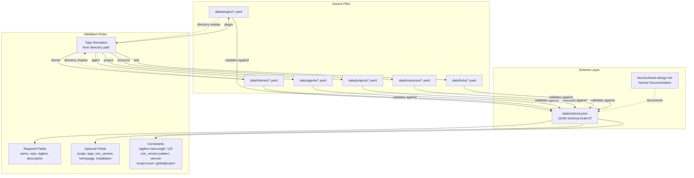
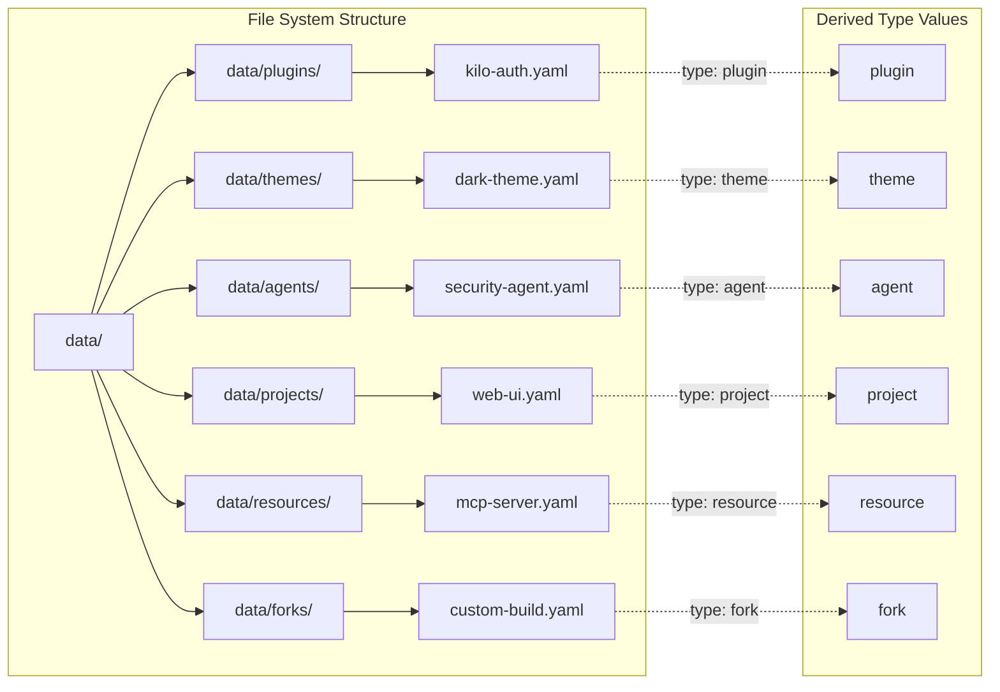
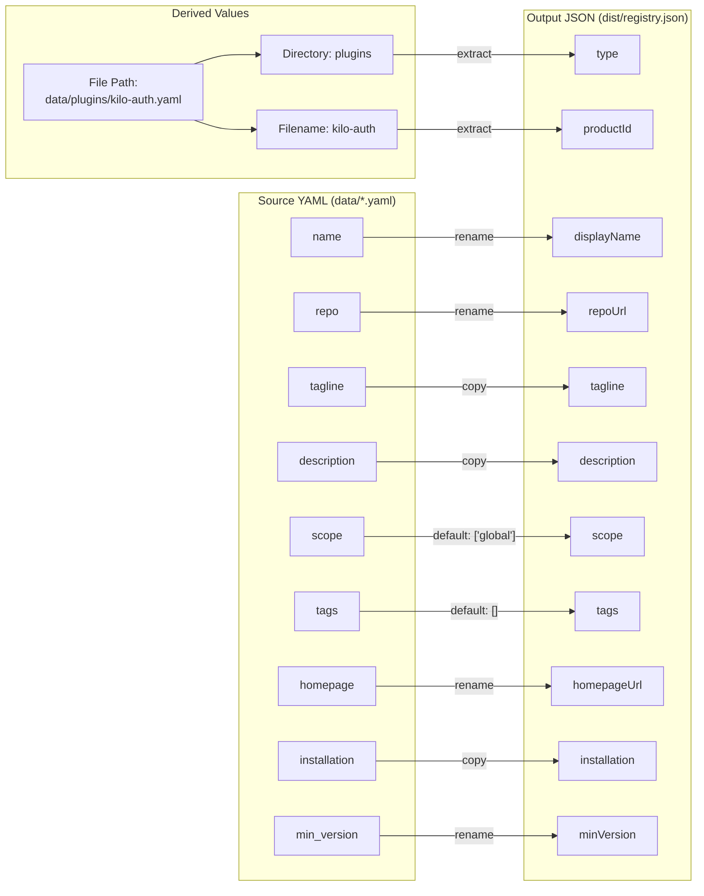

<!-- source: DeepWiki mcp.deepwiki.com · repo awesome-opencode/awesome-opencode · page 3 Data Model · fetched 2026-10-30 -->

# Data Model

Relevant source files

The following files were used as context for generating this wiki page:

- [data/plugins/kilo-auth.yaml](data/plugins/kilo-auth.yaml)
- [data/schema.json](data/schema.json)
- [docs/schema-design.md](docs/schema-design.md)

This document defines the data model used throughout the awesome-opencode repository. It covers the YAML schema structure, field definitions, validation rules, and type derivation conventions. The data model serves as the contract between contributors who create YAML entries and downstream systems that consume the registry.

For information about how this schema is validated during the build process, see [Validation System](#5.3). For details about the structure of generated output artifacts, see [Data Layer](#2.2).

---

## Schema Architecture

The data model uses a two-tier validation system: a JSON Schema specification ([data/schema.json:1-63]()) defines structural constraints, while additional business rules are enforced programmatically during build time.

**Diagram: Schema Validation Architecture**

Sources: [docs/schema-design.md:1-63](), [data/schema.json:1-63]()

For more details on the validation pipeline, see [Schema System](#3.1).

---

## Required Fields

All YAML entries must contain four required fields. These fields are enforced by the JSON Schema at [data/schema.json:61]().

| Field | Type | Constraint | Description |
|-------|------|------------|-------------|
| `name` | `string` | `minLength: 1` | Display name of the extension or project |
| `repo` | `string` | `format: uri` | HTTPS repository URL (e.g., `https://github.com/user/repo`) |
| `tagline` | `string` | `minLength: 1` `maxLength: 120` | Short summary displayed in collapsed view |
| `description` | `string` | `minLength: 1` | Full description, may be multi-line markdown |

The `name` field ([data/schema.json:8-11]()) represents the human-readable display name. The `tagline` field ([data/schema.json:18-22]()) has a strict 120-character limit enforced at the schema level.

For details on all standard fields, see [Common Fields](#3.2).

Sources: [data/schema.json:7-27](), [data/schema.json:61](), [docs/schema-design.md:199-238]()

---

## Optional Fields

Five optional fields provide enhanced metadata and installation guidance. When omitted, sensible defaults are applied by the build system.

| Field | Type | Default | Constraint | Description |
|-------|------|---------|------------|-------------|
| `scope` | `array` | `["global"]` | items: `"global"` or `"project"` | Installation scope (user-wide vs project-specific) |
| `tags` | `array` | `[]` | items: `string` | Freeform tags for filtering and discovery |
| `min_version` | `string` | (none) | pattern: `^[0-9]+\.[0-9]+\.[0-9]+` | Minimum OpenCode version required (semver) |
| `homepage` | `string` | (none) | format: `uri` | Documentation URL if different from `repo` |
| `installation` | `string` | (none) | (none) | Detailed installation instructions in markdown |

The `scope` field ([data/schema.json:29-38]()) determines if an extension is installed to `~/.config/opencode/` (global) or `.opencode/` (project). If omitted, the build system defaults to `["global"]` ([docs/schema-design.md:210]()).

For details on how these fields are used, see [Common Fields](#3.2).

Sources: [data/schema.json:29-59](), [docs/schema-design.md:209-217]()

---

## Type Derivation System

The extension type and unique identifier are **not stored in YAML files**. Instead, they are derived from the directory path and filename. This convention-over-configuration approach ensures consistency and prevents type mismatches.

**Diagram: Directory-to-Type Mapping**

### Key Derivations

*   **Type**: Extracted from the parent directory name (e.g., `data/plugins/` implies `type: plugin`).
*   **Product ID**: Extracted from the filename without extension (e.g., `kilo-auth.yaml` implies `productId: kilo-auth`).

For more details on the derivation logic, see [Type Derivation](#3.3).

Sources: [docs/schema-design.md:17](), [docs/schema-design.md:218-230](), [data/plugins/kilo-auth.yaml:1-4]()

---

## Downstream Field Mapping

The YAML data model is transformed into a machine-readable JSON format for consumption by downstream platforms. This mapping adds derived fields and renames fields for API consistency.

**Diagram: YAML to JSON Transformation**

### Transformation Table

| YAML Field | JSON Field | Transformation |
|------------|------------|----------------|
| `name` | `displayName` | Rename |
| `repo` | `repoUrl` | Rename |
| (directory) | `type` | Derive |
| (filename) | `productId` | Derive |
| `homepage` | `homepageUrl` | Rename |
| `min_version` | `minVersion` | Rename |

Sources: [docs/schema-design.md:17](), [data/schema.json:1-63]()

---

## Example Files

Complete example files demonstrating all fields are maintained in the `data/examples/` directory. These serve as the primary reference for contributors.

| Entry Type | Example File Path |
|------------|-------------------|
| Plugin | `data/examples/plugin.yaml` |
| Theme | `data/examples/theme.yaml` |
| Agent | `data/examples/agent.yaml` |
| Project | `data/examples/project.yaml` |
| Resource | `data/examples/resource.yaml` |
| Fork | `data/examples/fork.yaml` |

Sources: [docs/schema-design.md:19-40]()

---

