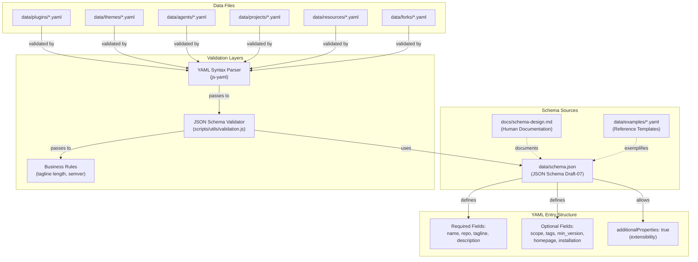
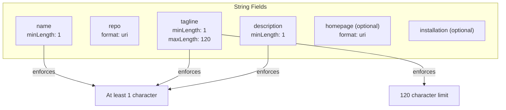
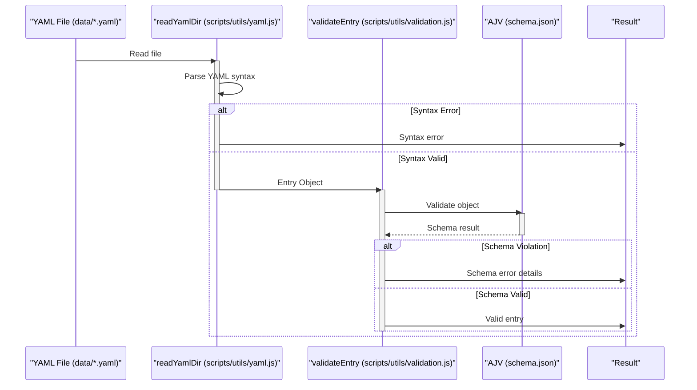

<!-- source: DeepWiki mcp.deepwiki.com · repo awesome-opencode/awesome-opencode · page 3.1 Schema System · fetched 2026-10-30 -->

# Schema System

<details>
<summary>Relevant source files</summary>

The following files were used as context for generating this wiki page:

- [.github/PULL_REQUEST_TEMPLATE.md](.github/PULL_REQUEST_TEMPLATE.md)
- [contributing.md](contributing.md)
- [data/schema.json](data/schema.json)
- [docs/schema-design.md](docs/schema-design.md)

</details>


This document describes the JSON Schema validation system used to ensure data integrity across all YAML entries in the awesome-opencode registry. The schema defines required and optional fields, data type constraints, validation rules, and default values.

## Overview

The schema system enforces data quality through a centralized JSON Schema specification located at [data/schema.json:1-64](). This schema validates all YAML entries during both contribution submission (via GitHub Actions) and artifact generation. The validation system operates on a strict required-field policy with extensible optional fields.

**Sources:** [docs/schema-design.md:7-18](), [data/schema.json:1-7]()

## Schema Architecture

The schema system follows a convention-over-configuration design where type information is derived from file location rather than stored in YAML files.

### Schema Definition Structure



**Sources:** [data/schema.json:1-7](), [docs/schema-design.md:19-40](), [docs/schema-design.md:195-230]()

### Schema Specification Details

The schema uses JSON Schema Draft-07 specification with the following metadata:

| Property | Value |
|----------|-------|
| `$schema` | `http://json-schema.org/draft-07/schema#` |
| `$id` | `https://github.com/awesome-opencode/awesome-opencode/data/schema.json` |
| `title` | "Awesome Opencode Entry" |
| `type` | `object` |
| `additionalProperties` | `true` (allows extension fields) |

The `additionalProperties: true` setting enables forward compatibility by allowing unrecognized fields to pass validation, supporting future schema enhancements without breaking existing entries [data/schema.json:62]().

**Sources:** [data/schema.json:1-7](), [data/schema.json:62]()

## Required Fields

The schema enforces exactly four required fields. All YAML entries must contain these fields to pass validation.

### Required Field Definitions

| Field | Type | Constraint | Description |
|-------|------|------------|-------------|
| `name` | `string` | `minLength: 1` | Display name shown in UI and documentation |
| `repo` | `string` | `format: uri` | Repository URL (must be valid URI) |
| `tagline` | `string` | `minLength: 1`<br/>`maxLength: 120` | Punchy summary for collapsed views |
| `description` | `string` | `minLength: 1` | Full description (may be multi-line) |

**Sources:** [data/schema.json:7-28](), [data/schema.json:61](), [docs/schema-design.md:199-206]()

### Minimal Valid Entry

The smallest valid YAML entry contains only the four required fields:

```yaml
name: My Extension
repo: https://github.com/user/my-extension
tagline: A brief description of what this does
description: A longer explanation of the extension.
```

**Sources:** [docs/schema-design.md:231-238](), [contributing.md:27-32]()

## Optional Fields

The schema defines five optional fields that provide enhanced metadata for discoverability and installation guidance.

### Optional Field Definitions

| Field | Type | Constraints | Default | Description |
|-------|------|-------------|---------|-------------|
| `scope` | `array` of `string` | `enum: ["global", "project"]`<br/>`minItems: 1`<br/>`uniqueItems: true` | `["global"]` | Installation locations |
| `tags` | `array` of `string` | No constraints | `[]` | Categorization tags |
| `min_version` | `string` | `pattern: "^[0-9]+\\.[0-9]+\\.[0-9]+"` | Not set | Minimum OpenCode version (semver) |
| `homepage` | `string` | `format: uri` | Not set | Documentation URL |
| `installation` | `string` | No constraints | Not set | Installation instructions (markdown) |

**Sources:** [data/schema.json:29-59](), [docs/schema-design.md:208-216]()

### Scope Field Enumeration

The `scope` field uses an enumerated type with two possible values: `global` and `project` [data/schema.json:33-33](). These correspond to different configuration directories in the OpenCode environment, such as `~/.config/opencode/` for global and `.opencode/` for project-level [docs/schema-design.md:130-157]().

The schema enforces `uniqueItems: true`, preventing duplicate scope values like `["global", "global"]` [data/schema.json:36-36]().

**Sources:** [data/schema.json:29-38](), [docs/schema-design.md:126-192]()

### Version Pattern Validation

The `min_version` field enforces semantic versioning format through a regular expression pattern: `^[0-9]+\\.[0-9]+\\.[0-9]+` [data/schema.json:48-48]().

**Sources:** [data/schema.json:46-50]()

## Data Type Constraints

The schema enforces strict type checking for all fields. JSON Schema Draft-07 primitive types are used throughout.

### String Length Constraints



The 120-character limit on `tagline` is critical: it ensures taglines display properly in collapsed table views and one-line summaries [data/schema.json:21-21]().

**Sources:** [data/schema.json:8-11](), [data/schema.json:18-23](), [data/schema.json:24-28]()

## Validation Process

The validation system operates in three sequential layers, each with distinct responsibilities.

### Three-Tier Validation Flow



**Sources:** [docs/schema-design.md:195-230](), [contributing.md:53-59]()

### Validation Enforcement Pipeline

Validation is enforced through several entry points:

1.  **Local Development**: Contributors can run validation scripts manually.
2.  **CI (validate-pr.yml)**: Every pull request targeting the `data/` directory triggers a validation run to ensure only valid entries are merged [contributing.md:55-55]().
3.  **Build (generate-readme.yml)**: The build pipeline validates all entries before generating `README.md` and `dist/registry.json`.

**Sources:** [contributing.md:53-59](), [.github/PULL_REQUEST_TEMPLATE.md:15-23]()

## Data Flow and Transformation

During the export process, scripts transform the source YAML into the machine-readable `dist/registry.json`.

### ProductId and Type Derivation

The system derives key fields during export rather than requiring them in source YAML:

*   **productId**: Derived from the YAML filename (kebab-case) [contributing.md:23-23]().
*   **type**: Derived from the parent directory name (e.g., `plugins`, `themes`, `agents`) [docs/schema-design.md:17-17](), [docs/schema-design.md:19-40]().

### Default Value Application

Several fields have implicit default values applied if omitted:

| Field | Default When Omitted | Logic |
|-------|---------------------|-------|
| `scope` | `["global"]` | Default specified in schema [data/schema.json:37-37]() |
| `tags` | `[]` | Empty array if not provided |

**Sources:** [data/schema.json:29-45](), [docs/schema-design.md:17-17]()

## Schema Extensibility

The schema uses `additionalProperties: true` to support forward compatibility and custom fields [data/schema.json:62](). This design allows contributors to include experimental or platform-specific fields without schema modifications. The validation system will not reject entries with unrecognized fields, supporting the principle of being "Downstream Ready" [docs/schema-design.md:14-16]().

**Sources:** [data/schema.json:62](), [docs/schema-design.md:11-18]()

---

