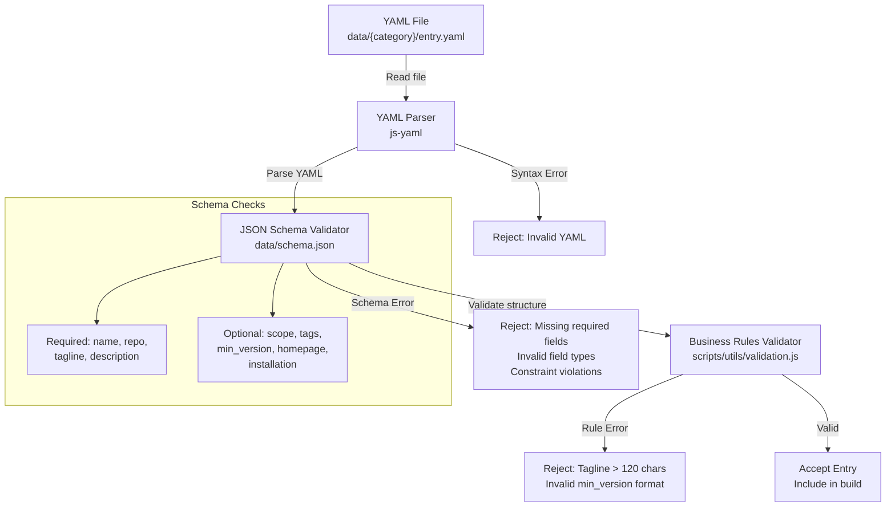
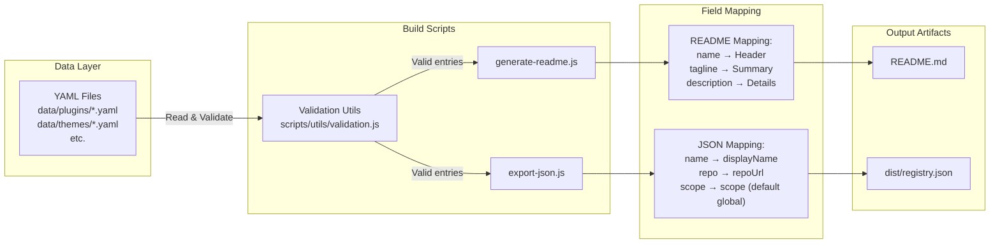

<!-- source: DeepWiki mcp.deepwiki.com · repo awesome-opencode/awesome-opencode · page 3.2 Common Fields · fetched 2026-10-30 -->

# Common Fields

<details>
<summary>Relevant source files</summary>

The following files were used as context for generating this wiki page:

- [data/examples/plugin.yaml](data/examples/plugin.yaml)
- [data/schema.json](data/schema.json)
- [docs/schema-design.md](docs/schema-design.md)

</details>


This document defines the YAML fields that are shared across all entry types in the awesome-opencode registry. Every entry, regardless of whether it is a plugin, theme, agent, project, resource, or fork, uses the same base schema with four required fields and five optional fields. For information about how entry type is determined from directory location, see [Type Derivation](#3.3). For the underlying JSON Schema validation system, see [Schema System](#3.1).

---

## Required Fields

All entries in the registry must define four required fields. These fields provide the minimum metadata necessary for catalog display and downstream consumption.

| Field | Type | Constraint | Purpose |
|-------|------|------------|---------|
| `name` | string | minLength: 1 | Display name shown in README and downstream platforms |
| `repo` | string | URI format | HTTPS repository URL (typically GitHub) |
| `tagline` | string | 1-120 chars | Short summary shown in collapsed view |
| `description` | string | minLength: 1 | Full description shown when expanded |

### Field: `name`

The display name for the extension. This is the human-readable identifier shown in all UI contexts.

**Schema Definition:** [data/schema.json:8-12]()

**Example:**
```yaml
name: Example Plugin
```

**Validation:**
- Must be non-empty string [data/schema.json:10]()
- No maximum length enforced
- May contain any Unicode characters

**Usage:**
- Mapped to `displayName` field in `registry.json` export
- Displayed as heading in `README.md` sections
- Used in search and discovery interfaces

### Field: `repo`

The HTTPS URL to the extension's source repository.

**Schema Definition:** [data/schema.json:13-17]()

**Example:**
```yaml
repo: https://github.com/example/opencode-example-plugin
```

**Validation:**
- Must be valid URI format [data/schema.json:15]()
- Should use HTTPS protocol
- Typically points to GitHub, GitLab, or similar platforms

**Usage:**
- Mapped to `repoUrl` field in `registry.json` export
- Linked from `README.md` for source code access
- Used by validation scripts to verify repository accessibility

### Field: `tagline`

A short, punchy summary limited to 120 characters. This field is displayed in collapsed views and list contexts where space is limited.

**Schema Definition:** [data/schema.json:18-23]()

**Example:**
```yaml
tagline: A brief description of what this plugin does (max 120 chars)
```

**Validation:**
- Minimum length: 1 character [data/schema.json:20]()
- Maximum length: 120 characters [data/schema.json:21]()
- Enforced by JSON Schema `maxLength` in [data/schema.json:21]()

**Usage:**
- Displayed in collapsed README sections
- Shown in search result previews
- Preserved as `tagline` field in `registry.json`

### Field: `description`

The full description of the extension. May be multi-line and contain detailed information about features, use cases, and benefits.

**Schema Definition:** [data/schema.json:24-28]()

**Example:**
```yaml
description: A longer description explaining the plugin in detail.
  - Can be multiple lines and include
  - Feature highlights
  - Use cases
  - Key benefits
```

**Validation:**
- Minimum length: 1 character [data/schema.json:26]()
- No maximum length
- Supports YAML multi-line syntax

**Usage:**
- Displayed in expanded README sections
- Preserved as `description` field in `registry.json`
- May contain Markdown formatting

**Sources:** [docs/schema-design.md:199-207](), [data/schema.json:8-28](), [data/examples/plugin.yaml:9-16]()

---

## Optional Fields

Five optional fields provide enhanced metadata for filtering, version requirements, and installation guidance. All optional fields have sensible defaults when omitted.

| Field | Type | Default | Purpose |
|-------|------|---------|---------|
| `scope` | array[string] | `["global"]` | Installation location(s): global, project, or both |
| `tags` | array[string] | `[]` | Keywords for filtering and discovery |
| `min_version` | string | undefined | Minimum OpenCode version (semver format) |
| `homepage` | string | undefined | Documentation URL if different from repo |
| `installation` | string | undefined | Detailed installation instructions (Markdown) |

### Field: `scope`

Defines where the extension can be installed: globally (`~/.config/opencode/`), project-level (`.opencode/`), or both.

**Schema Definition:** [data/schema.json:29-38]()

**Example:**
```yaml
scope:
  - global
  - project
```

**Validation:**
- Must be array of strings [data/schema.json:30]()
- Valid values: `"global"`, `"project"` (enum enforced at [data/schema.json:33]())
- Minimum 1 item, unique items required [data/schema.json:35-36]()
- Defaults to `["global"]` when omitted [data/schema.json:37]()

**Installation Paths:**

| Scope Value | Installation Path |
|-------------|-------------------|
| `global` | `~/.config/opencode/` (user-wide) [docs/schema-design.md:132-142]() |
| `project` | `.opencode/` (repository-specific) [docs/schema-design.md:146-156]() |

### Field: `tags`

Array of keyword strings for filtering and categorization. Used by discovery platforms and search interfaces.

**Schema Definition:** [data/schema.json:39-45]()

**Example:**
```yaml
tags:
  - productivity
  - ai
  - authentication
```

**Validation:**
- Must be array of strings [data/schema.json:40-42]()
- Defaults to `[]` when omitted

**Usage:**
- Enables tag-based filtering in discovery platforms
- Preserved as `tags` array in `registry.json`
- Displayed as badges in `README.md`

### Field: `min_version`

Specifies the minimum OpenCode version required to use the extension. Must follow semantic versioning format.

**Schema Definition:** [data/schema.json:46-50]()

**Example:**
```yaml
min_version: "1.0.0"
```

**Validation:**
- Must match semver pattern: `^[0-9]+\.[0-9]+\.[0-9]+` [data/schema.json:48]()
- Enforced by JSON Schema regex at [data/schema.json:48]()

**Usage:**
- Displayed as version requirement in `README.md`
- Used by package managers to check compatibility

### Field: `homepage`

URL to documentation or landing page if different from the repository URL.

**Schema Definition:** [data/schema.json:51-55]()

**Example:**
```yaml
homepage: https://example.com/docs/opencode-dashboard
```

**Validation:**
- Must be valid URI format [data/schema.json:53]()

**Usage:**
- Linked as "Documentation" in `README.md`
- Mapped to `homepageUrl` field in `registry.json`

### Field: `installation`

Detailed installation instructions in Markdown format. Supports multi-line YAML strings.

**Schema Definition:** [data/schema.json:56-59]()

**Example:**
```yaml
installation: |
  ## Prerequisites
  - OpenCode 1.0.0 or later
  - Node.js 18+

  ## Installation
  ```bash
  npm install
  ```
```

**Usage:**
- Displayed in expanded README sections
- Preserved as `installation` field in `registry.json`

**Sources:** [docs/schema-design.md:209-217](), [data/schema.json:29-59](), [data/examples/plugin.yaml:22-81]()

---

## Field Validation Pipeline

The following diagram shows how fields are validated through multiple layers before being accepted into the registry.

**Diagram: Field Validation Flow**



**Sources:** [docs/schema-design.md:195-217](), [data/schema.json:1-63]()

---

## Field Processing in Build System

This diagram shows how common fields flow from YAML sources through the build pipeline to generate `README.md` and `registry.json` outputs.

**Diagram: Field Processing Flow**



**Sources:** [docs/schema-design.md:195-217](), [data/schema.json:1-63]()

---

## Field Defaults and Derived Values

Some fields have default values when omitted, while others are derived from file location during the build process.

| Field | Default Value | Derivation Logic |
|-------|---------------|------------------|
| `scope` | `["global"]` | If omitted, defaults to global scope only [data/schema.json:37]() |
| `tags` | `[]` | If omitted, empty array |
| `type` | (derived) | Derived from directory path [docs/schema-design.md:17]() |
| `productId` | (derived) | Derived from filename (without extension) |

### Type Derivation

The `type` field is **not** stored in YAML files. It is derived from the directory path during the build process.

**Mapping:**

| Directory Path | Derived Type |
|----------------|--------------|
| `data/plugins/` | `plugin` |
| `data/themes/` | `theme` |
| `data/agents/` | `agent` |
| `data/projects/` | `project` |
| `data/resources/` | `resource` |
| `data/forks/` | `fork` |

**Sources:** [docs/schema-design.md:17-37](), [docs/schema-design.md:19-40]()

---

## Complete Field Reference

| Field | Required | Type | Constraints | Default | Schema Location |
|-------|----------|------|-------------|---------|-----------------|
| `name` | Yes | string | minLength: 1 | N/A | [data/schema.json:8-12]() |
| `repo` | Yes | string | URI format | N/A | [data/schema.json:13-17]() |
| `tagline` | Yes | string | 1-120 chars | N/A | [data/schema.json:18-23]() |
| `description` | Yes | string | minLength: 1 | N/A | [data/schema.json:24-28]() |
| `scope` | No | array[string] | enum: ["global", "project"] | `["global"]` | [data/schema.json:29-38]() |
| `tags` | No | array[string] | none | `[]` | [data/schema.json:39-45]() |
| `min_version` | No | string | semver pattern | undefined | [data/schema.json:46-50]() |
| `homepage` | No | string | URI format | undefined | [data/schema.json:51-55]() |
| `installation` | No | string | none | undefined | [data/schema.json:56-59]() |

**Sources:** [docs/schema-design.md:195-217](), [data/schema.json:1-63](), [data/examples/plugin.yaml:1-81]()

---

