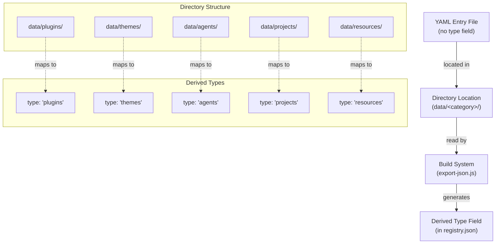
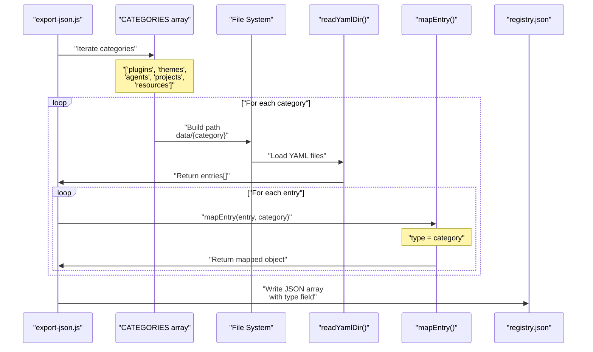
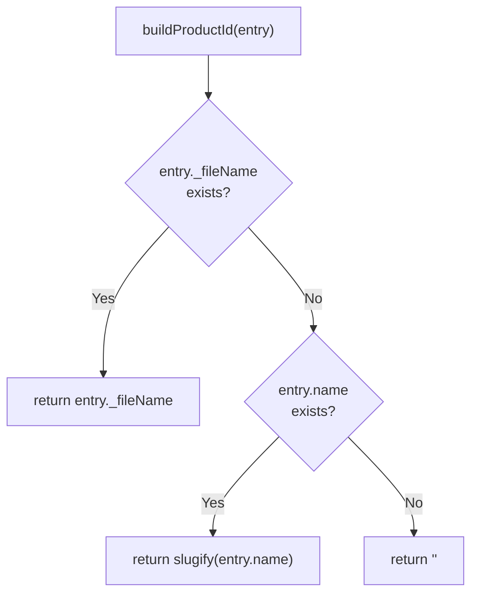
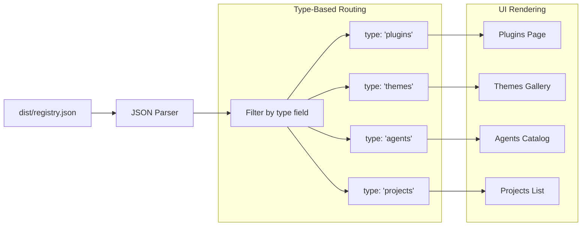

<!-- source: DeepWiki mcp.deepwiki.com · repo awesome-opencode/awesome-opencode · page 3.3 Type Derivation · fetched 2026-10-30 -->

# Type Derivation

Relevant source files

The following files were used as context for generating this wiki page:

- [data/schema.json](data/schema.json)
- [dist/registry.json](dist/registry.json)
- [docs/schema-design.md](docs/schema-design.md)
- [scripts/export-json.js](scripts/export-json.js)

This document explains how the awesome-opencode repository derives the `type` field for registry entries from their directory location rather than storing it explicitly in YAML files. This convention-over-configuration approach ensures consistency and reduces duplication.

For information about the common fields stored within YAML files, see [Common Fields](#3.2). For details on how the schema validation system works, see [Schema System](#3.1).

---

## Purpose and Scope

The awesome-opencode repository uses a **directory-based type system** where the category of an extension (plugin, theme, agent, project, resource, or fork) is determined by which directory its YAML file resides in, not by a field within the file itself. This document covers:

- The directory-to-type mapping conventions
- How type derivation is implemented in build scripts
- The relationship between type derivation and `productId` generation
- How derived types are exposed to downstream consumers

This approach enforces a clear organizational structure and prevents inconsistencies between directory location and declared type.

**Sources:** [docs/schema-design.md:17-18](), [docs/schema-design.md:218-230]()

---

## Convention Over Configuration

The repository follows the principle that **location defines type**. Contributors cannot specify a `type` field in their YAML entries—the system derives it automatically from the file path.

### Design Rationale

| Benefit | Description |
|---------|-------------|
| **Single Source of Truth** | Directory structure is the authoritative type indicator |
| **Prevents Mismatches** | No risk of YAML declaring `type: plugin` while living in `data/themes/` |
| **Simpler Contributions** | Contributors don't need to remember to set a type field |
| **Clearer Organization** | File system structure visually represents the catalog structure |
| **Enforced Consistency** | Build scripts can validate that entries are in the correct category |

### Type System Diagram

**Sources:** [docs/schema-design.md:15-18](), [docs/schema-design.md:218-230]()

---

## Directory-to-Type Mapping

The build system uses a fixed mapping between directory names and type values. This mapping is hardcoded in the build scripts and documented in the schema design.

### Canonical Mapping Table

| Directory Path | Derived Type | Entry Category |
|----------------|--------------|----------------|
| `data/plugins/` | `plugins` | JavaScript/TypeScript modules extending OpenCode |
| `data/themes/` | `themes` | JSON configurations for visual customization |
| `data/agents/` | `agents` | AI agent configurations and SKILL.md files |
| `data/projects/` | `projects` | Standalone applications and tools |
| `data/resources/` | `resources` | MCP servers, guides, configs, and commands |
| `data/forks/` | `forks` | Modified builds of OpenCode itself |

### Examples

| File Path | Derived Type |
|-----------|--------------|
| `data/plugins/envsitter-guard.yaml` | `plugins` |
| `data/themes/ayu-dark.yaml` | `themes` |
| `data/agents/opencode-redstone.yaml` | `agents` |
| `data/projects/open-agent.yaml` | `projects` |
| `data/resources/debug-log-to-text-file.yaml` | `resources` |

**Sources:** [docs/schema-design.md:218-230](), [scripts/export-json.js:14]()

---

## Implementation in Build System

The type derivation logic is implemented in the `export-json.js` script, which processes YAML files and generates the `dist/registry.json` output.

### Build Process Flow

### Code Implementation

The `CATEGORIES` constant defines the recognized directory names:

[scripts/export-json.js:14]()

The main loop in `loadEntries()` iterates through each category directory using `readYamlDir`:

[scripts/export-json.js:79-104]()

The `mapEntry()` function receives the category as a parameter and assigns it as the `type` field in the generated object:

[scripts/export-json.js:42-63]()

**Sources:** [scripts/export-json.js:14](), [scripts/export-json.js:42-63](), [scripts/export-json.js:79-104]()

---

## ProductId Derivation

In addition to type derivation, the build system also derives a `productId` field from the filename. This is a related concept that follows the same convention-over-configuration philosophy.

### Filename-to-ProductId Mapping

The `productId` is generated by taking the filename (without the `.yaml` extension) and using it directly as the identifier. If the filename is missing, the system falls back to slugifying the entry name.

### BuildProductId Function Flow

The implementation in `export-json.js`:

[scripts/export-json.js:25-33]()

### Example Derivations

| File Path | `_fileName` | Entry Name | Derived `productId` |
|-----------|-------------|------------|---------------------|
| `data/plugins/envsitter-guard.yaml` | `envsitter-guard` | Envsitter Guard | `envsitter-guard` |
| `data/agents/opencode-redstone.yaml` | `opencode-redstone` | Redstone | `opencode-redstone` |
| `data/themes/ayu-dark.yaml` | `ayu-dark` | Ayu Dark | `ayu-dark` |

The `_fileName` metadata is populated by the `readYamlDir` utility (imported from `scripts/utils/yaml`) when reading files from disk.

**Sources:** [scripts/export-json.js:25-33](), [scripts/export-json.js:43-44](), [scripts/export-json.js:11-11]()

---

## Generated Output Structure

The combination of type derivation and `productId` generation creates the final registry entry structure that downstream consumers receive in `dist/registry.json`.

### Field Source Mapping

| Field | Source | Derivation Method |
|-------|--------|-------------------|
| `productId` | Filename | Direct use of filename without extension via `buildProductId` |
| `type` | Directory path | Category name passed to `mapEntry` |
| `displayName` | YAML `name` | Direct mapping from `entry.name` |
| `repoUrl` | YAML `repo` | Direct mapping from `entry.repo` |
| `tagline` | YAML `tagline` | Direct mapping from `entry.tagline` |
| `description` | YAML `description` | Direct mapping from `entry.description` |
| `scope` | YAML `scope` | Default to `["global"]` if missing via `sanitizeArray` |
| `tags` | YAML `tags` | Default to `[]` if missing via `sanitizeArray` |

### Real-World Examples from Registry

From [dist/registry.json:195-205]():
The `envsitter-guard` entry has `type: "plugins"` derived from `data/plugins/`.

From [dist/registry.json:1129-1139]():
The `ayu-dark` entry has `type: "themes"` derived from `data/themes/`.

**Sources:** [dist/registry.json:195-205](), [dist/registry.json:1129-1139](), [scripts/export-json.js:48-62]()

---

## Downstream Consumption

The derived `type` and `productId` fields are critical for downstream platforms like opencode.cafe that consume the registry data.

### Field Usage in Downstream Systems

| System | Uses `type` For | Uses `productId` For |
|--------|----------------|---------------------|
| **opencode.cafe** | Category filtering, UI grouping | Unique identifier, URL routing |
| **CLI Tools** | Installation target detection | Package identification |
| **Search Engines** | Faceted search categories | Unique document IDs |

### Type-Based Routing Example

**Sources:** [docs/schema-design.md:336-378](), [dist/registry.json:1-1152]()

---

## Validation and Error Handling

While type is not stored in YAML files, the build system validates that entries are properly categorized by verifying they are in recognized category directories.

### Category Validation

The build script only processes directories listed in the `CATEGORIES` constant. If a YAML file exists in an unrecognized directory, it is ignored during the loop in `loadEntries()`.

[scripts/export-json.js:79-90]()

### ProductId Validation

The `mapEntry()` function verifies that a valid `productId` can be generated. If the `productId` is empty, the entry is excluded from the output to ensure registry integrity:

[scripts/export-json.js:42-46]()

### Error Reporting

Invalid entries (those failing schema validation via `validateEntry`) are collected and reported during the build process:

[scripts/export-json.js:130-135]()

**Sources:** [scripts/export-json.js:42-46](), [scripts/export-json.js:79-90](), [scripts/export-json.js:130-135]()

---

