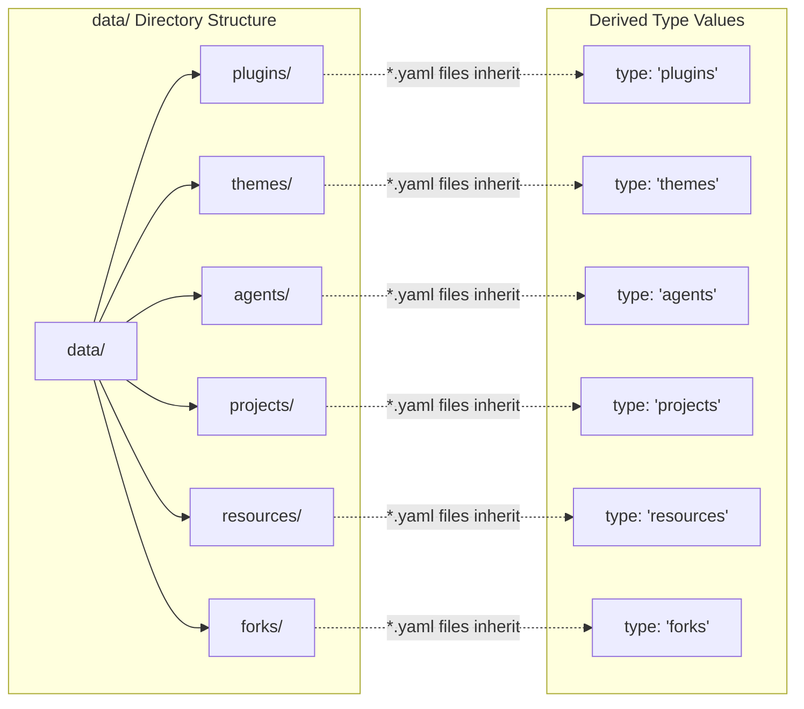
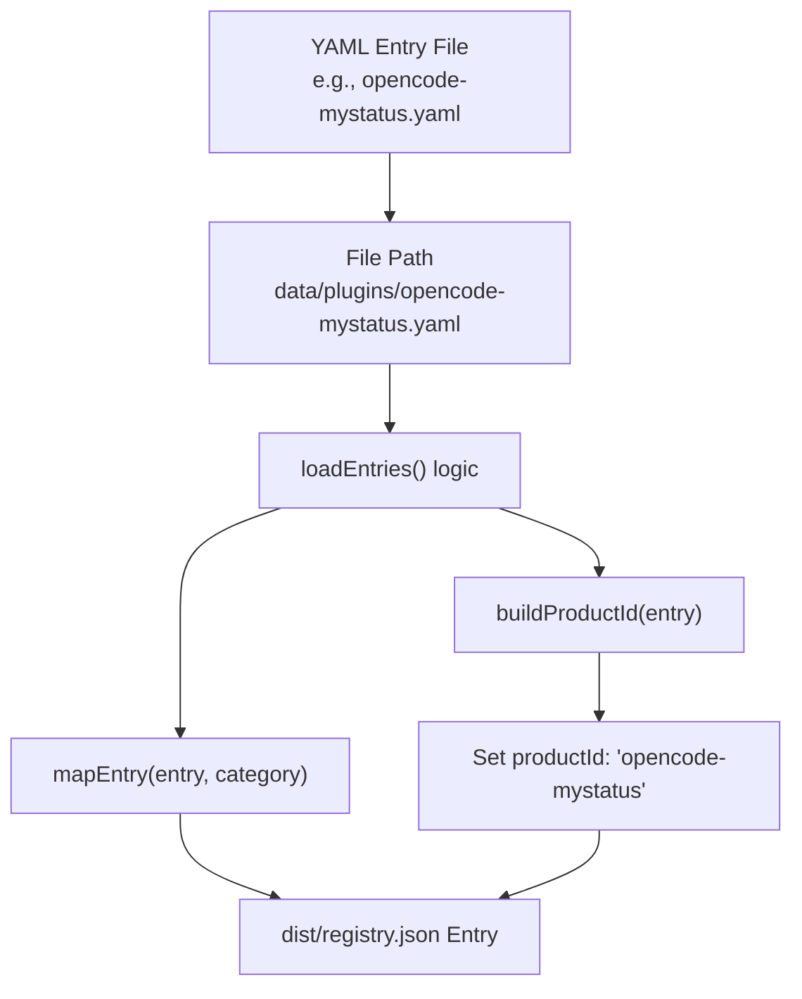

<!-- source: DeepWiki mcp.deepwiki.com · repo awesome-opencode/awesome-opencode · page 4 Entry Types · fetched 2026-10-30 -->

# Entry Types

<details>
<summary>Relevant source files</summary>

The following files were used as context for generating this wiki page:

- [README.md](README.md)
- [data/agents/gem-team.yaml](data/agents/gem-team.yaml)
- [data/plugins/opencode-mystatus.yaml](data/plugins/opencode-mystatus.yaml)
- [data/resources/akephalos.yaml](data/resources/akephalos.yaml)
- [dist/registry.json](dist/registry.json)
- [scripts/export-json.js](scripts/export-json.js)

</details>


This document provides an overview of the six entry types in the awesome-opencode registry and explains how they are categorized within the OpenCode ecosystem. Each entry type serves a distinct purpose in extending, customizing, or enhancing OpenCode.

For detailed information about the data model and schema validation for these entry types, see [Data Model](#3). For specifics on how each type is structured and validated, see the individual child pages: [Plugins](#4.1), [Themes](#4.2), [Agents](#4.3), [Projects](#4.4), [Resources](#4.5), and [Forks](#4.6).

## Overview

The awesome-opencode registry categorizes extensions into six distinct types based on their function and installation method. Unlike traditional schema-based systems, the **type is not stored in YAML files** but is instead **derived from the directory location** where the entry is stored. This convention-over-configuration approach ensures consistency and reduces redundancy.

**Type Derivation by Directory**



Sources: [scripts/export-json.js:14-14](), [scripts/export-json.js:42-50]()

## Entry Type Categories

### 1. Plugins
JavaScript or TypeScript modules that extend OpenCode's core functionality through the plugin system. Plugins are installed via npm packages or as local `.js`/`.ts` files in the plugin directory.

**Key Characteristics:**
- **Directory:** `data/plugins/`
- **Purpose:** Add new commands, tools, authentication providers, or UI components.
- **Example:** `opencode-mystatus` provides subscription quota checking [data/plugins/opencode-mystatus.yaml:1-5]().

For details, see [Plugins](#4.1).

### 2. Themes
JSON configuration files that customize the visual appearance of the OpenCode terminal interface, including color schemes and syntax highlighting.

**Key Characteristics:**
- **Directory:** `data/themes/`
- **Current Catalog:** Includes `ayu-dark`, `lavi`, `moonlight`, `poimandres`, `charcoal`, `opencode-light-themes`, and `opencode-vscode-themes`.

For details, see [Themes](#4.2).

### 3. Agents
AI agent configurations and reusable skill instruction sets that define specialized agent behavior, available tools, and task-specific instructions.

**Key Characteristics:**
- **Directory:** `data/agents/`
- **Purpose:** Specialized coding assistants, security reviewers, or documentation generators.
- **Example:** `gem-team` is a self-learning multi-agent orchestration harness [data/agents/gem-team.yaml:1-5]().

For details, see [Agents](#4.3).

### 4. Projects
Standalone applications, utilities, and tools built for or with OpenCode. These are complete software projects rather than extensions to the OpenCode binary itself.

**Key Characteristics:**
- **Directory:** `data/projects/`
- **Examples:** Web interfaces, session management tools, and proxy servers.

For details, see [Projects](#4.4).

### 5. Resources
Guides, configurations, MCP (Model Context Protocol) servers, and tools that enhance OpenCode without being installable plugins.

**Key Characteristics:**
- **Directory:** `data/resources/`
- **Example:** `Akephalos` provides a local-first markdown passport for portable context [data/resources/akephalos.yaml:1-15]().

For details, see [Resources](#4.5).

### 6. Forks
Modified builds of the OpenCode binary itself, featuring custom patches or enterprise features while maintaining core compatibility.

**Key Characteristics:**
- **Directory:** `data/forks/`
- **Difference:** Unlike plugins, forks replace the entire OpenCode installation.

For details, see [Forks](#4.6).

## Type System Implementation

The type derivation mechanism is implemented in the build scripts that process YAML files into generated artifacts.

**Entry Processing Flow**



Sources: [scripts/export-json.js:25-33](), [scripts/export-json.js:42-63](), [scripts/export-json.js:75-107]()

The script `scripts/export-json.js` iterates through categories defined in the `CATEGORIES` array [scripts/export-json.js:14-14](). It calls `mapEntry` which assigns the `type` field based on the directory name being processed [scripts/export-json.js:42-50](). The `productId` is derived from the filename via `buildProductId` [scripts/export-json.js:25-33]().

## Entry Type Comparison

The following table summarizes the key differences between entry types as represented in the registry:

| Type | Directory | `productId` Source | `type` Value in Registry |
|------|-----------|--------------------|-------------------------|
| `plugin` | `data/plugins/` | Filename | `plugins` |
| `theme` | `data/themes/` | Filename | `themes` |
| `agent` | `data/agents/` | Filename | `agents` |
| `project` | `data/projects/` | Filename | `projects` |
| `resource` | `data/resources/` | Filename | `resources` |

Sources: [scripts/export-json.js:14-14](), [scripts/export-json.js:42-63]()

## Scope Attribute

While `type` is derived from directory location, the `scope` field in YAML files indicates where an entry can be installed. If not provided, it is sanitized to default to `['global']` during export [scripts/export-json.js:55-55]().

- **`global`**: System-wide installation.
- **`project`**: Local project-specific installation.

## Registry Representation

When YAML entries are processed into the machine-readable registry format (`dist/registry.json`), the `type` and `productId` fields are added based on file location.

**Example Transformation:**

Input file: `data/plugins/opencode-mystatus.yaml` [data/plugins/opencode-mystatus.yaml:1-5]()
```yaml
name: opencode-mystatus
repo: https://github.com/vbgate/opencode-mystatus
tagline: Check AI subscription quotas
description: Check all your AI subscription quotas in one command...
```

Output in `dist/registry.json`:
```json
{
  "productId": "opencode-mystatus",
  "type": "plugins",
  "displayName": "opencode-mystatus",
  "repoUrl": "https://github.com/vbgate/opencode-mystatus",
  "tagline": "Check AI subscription quotas",
  "description": "Check all your AI subscription quotas in one command...",
  "scope": ["global"],
  "tags": []
}
```

Sources: [scripts/export-json.js:42-63](), [dist/registry.json:174-187]()

---

