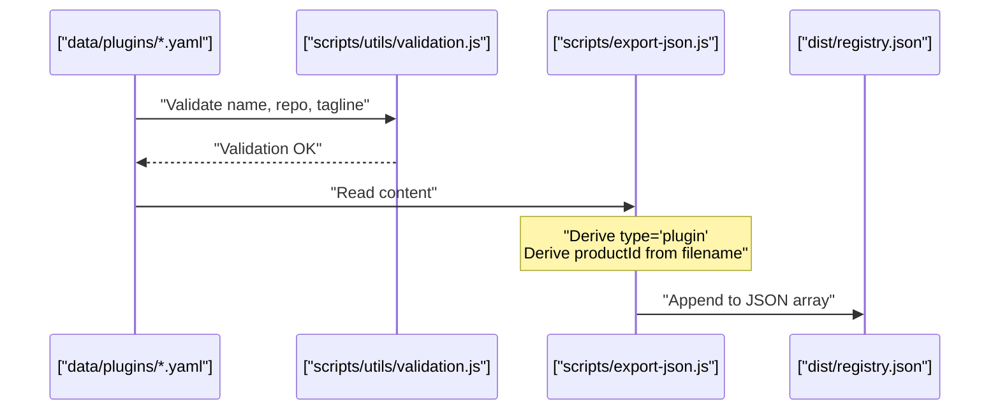

<!-- source: DeepWiki mcp.deepwiki.com · repo awesome-opencode/awesome-opencode · page 4.1 Plugins · fetched 2026-10-30 -->

# Plugins

<details>
<summary>Relevant source files</summary>

The following files were used as context for generating this wiki page:

- [data/plugins/ejentum-mcp.yaml](data/plugins/ejentum-mcp.yaml)
- [data/plugins/envsitter-guard.yaml](data/plugins/envsitter-guard.yaml)
- [data/plugins/flowdeck.yaml](data/plugins/flowdeck.yaml)
- [data/plugins/hiai-opencode.yaml](data/plugins/hiai-opencode.yaml)
- [data/plugins/opencode-plugin-otel.yaml](data/plugins/opencode-plugin-otel.yaml)
- [data/plugins/orgx-opencode-plugin.yaml](data/plugins/orgx-opencode-plugin.yaml)
- [data/plugins/pocket-universe.yaml](data/plugins/pocket-universe.yaml)
- [data/projects/open-agent.yaml](data/projects/open-agent.yaml)

</details>


## Purpose and Scope

This document defines plugin entries within the `awesome-opencode` registry. Plugins are JavaScript or TypeScript modules that extend OpenCode's core functionality through installable packages or local files. This page covers the plugin YAML schema, installation locations, type derivation, and showcases representative examples from the catalog.

For information about other extension types (themes, agents, projects, resources, forks), see [Entry Types](#4). For the overall data model and validation rules, see [Data Model](#3).

**Sources:** [data/plugins/pocket-universe.yaml:1-4](), [data/plugins/envsitter-guard.yaml:1-4]()

---

## What Constitutes a Plugin

Plugins are distinguished from other entry types by their technical implementation and installation method. A plugin must be:

1. **Executable code**: JavaScript (`.js`) or TypeScript (`.ts`) module.
2. **Extends core functionality**: Hooks into OpenCode's system (e.g., adding providers, intercepting plans, or managing telemetry).
3. **Installable**: Via npm package, `curl` scripts, or local file reference.
4. **Not a standalone application**: Unlike projects, plugins are dependencies that run within the OpenCode environment.

### Plugin vs. Other Types

| Type | Implementation | Installation | Examples |
|------|---------------|--------------|----------|
| `plugin` | JS/TS module | npm, curl, or local file | `envsitter-guard`, `flowdeck` |
| `theme` | JSON configuration | JSON file in themes directory | `ayu-dark`, `lavi` |
| `agent` | Configuration + SKILL.md | Directory with agent files | `gem-team`, `nerv` |
| `project` | Standalone application | Independent installation | `open-agent`, `universal-llm-proxy` |

**Sources:** [data/plugins/envsitter-guard.yaml:1-4](), [data/plugins/flowdeck.yaml:32-41](), [data/projects/open-agent.yaml:1-4]()

---

## Plugin Entry Schema

### Schema Overview

```mermaid
graph TB
    ["YAML Plugin File (data/plugins/*.yaml)"] --> ["Required Fields"]
    ["YAML Plugin File (data/plugins/*.yaml)"] -.-> ["Optional Fields"]
    
    subgraph "Required Fields"
        ["name (string)"]
        ["repo (string, HTTPS URL)"]
        ["tagline (string, max 120 chars)"]
        ["description (string, multi-line)"]
    end
    
    subgraph "Optional Fields"
        ["scope (array, default: [global])"]
        ["tags (array of strings)"]
        ["min_version (string, semver)"]
        ["homepage (string, URL)"]
        ["installation (string, markdown)"]
    end
```

**Sources:** [data/plugins/orgx-opencode-plugin.yaml:1-13](), [data/plugins/flowdeck.yaml:1-31]()

### Required Fields

All plugin entries must include these four fields:

| Field | Type | Constraints | Purpose |
|-------|------|-------------|---------|
| `name` | string | Human-readable | Display name in README.md and registry.json |
| `repo` | string | HTTPS URL format | Repository URL (GitHub/GitLab/etc) |
| `tagline` | string | Max 120 characters | Short summary for list views |
| `description` | string | Multi-line allowed | Detailed explanation of functionality |

**Example entry (`data/plugins/envsitter-guard.yaml`):**

```yaml
name: Envsitter Guard
repo: https://github.com/boxpositron/envsitter-guard
tagline: Prevent .env leaks
description: OpenCode plugin that prevents agents/tools from reading or editing sensitive .env* files...
```

**Sources:** [data/plugins/envsitter-guard.yaml:1-4]()

---

## Installation Scopes and Locations

The `scope` field determines where a plugin can be installed. This field is **optional** and defaults to `["global"]` if omitted.

### Installation Paths

| Scope | Path | Configuration File |
|-------|------|--------------------|
| **Global** | `~/.config/opencode/plugin/` | `~/.config/opencode/opencode.json` |
| **Project** | `<project>/.opencode/plugin/` | `<project>/opencode.json` |

**Sources:** [data/plugins/orgx-opencode-plugin.yaml:5-6](), [data/plugins/flowdeck.yaml:19-20]()

---

## Type Derivation and Registry Mapping

Plugin types and unique identifiers are derived from the file system structure rather than being explicitly defined in the YAML.

### Bridge: Natural Language to Code Entity Space

The following diagram shows how a physical file in the repository is mapped to a machine-readable entry in `dist/registry.json`.

```mermaid
graph LR
    subgraph "File System (Source)"
        ["data/plugins/flowdeck.yaml"]
        ["data/plugins/"]
    end

    subgraph "Code Entity (Registry Object)"
        ["Registry Entry Object"]
        ["productId: 'flowdeck'"]
        ["type: 'plugin'"]
        ["displayName: 'FlowDeck'"]
    end

    ["data/plugins/flowdeck.yaml"] -->|"Filename (minus .yaml)"| ["productId: 'flowdeck'"]
    ["data/plugins/"] -->|"Parent Directory Name"| ["type: 'plugin'"]
    ["data/plugins/flowdeck.yaml"] -->|"YAML 'name' field"| ["displayName: 'FlowDeck'"]
    ["productId: 'flowdeck'"] & ["type: 'plugin'"] & ["displayName: 'FlowDeck'"] --> ["Registry Entry Object"]
```

**Sources:** [data/plugins/flowdeck.yaml:1-1]()

---

## Notable Plugin Examples

The catalog contains numerous entries ranging from security to complex multi-agent orchestration.

### 1. Orchestration & Workflows
*   **FlowDeck**: A comprehensive multi-agent orchestration layer. It coordinates 25 specialist agents (architect, planner, risk-analyst, etc.) through a four-phase cycle: discuss, plan, execute, review. It features persistent state in `.planning/STATE.md` and AI safety layers. [data/plugins/flowdeck.yaml:1-18]()
*   **Pocket Universe**: Extends the native subagent paradigm to provide closed-loop, resilient, async agents that block main thread execution to prevent "fire and forget" orphans. [data/plugins/pocket-universe.yaml:1-4]()
*   **hiai-opencode**: A unified plugin shipping a canonical 12-agent model (Bob, Coder, Guard, etc.) with bundled skills and a multi-layer continuation system called `ralph-loop`. [data/plugins/hiai-opencode.yaml:1-4]()

### 2. Security & Safety
*   **Envsitter Guard**: Prevents agents/tools from reading or editing sensitive `.env*` files, allowing only safe inspection of keys via deterministic fingerprints without exposing values. [data/plugins/envsitter-guard.yaml:1-4]()

### 3. Monitoring & Control Planes
*   **opencode-plugin-otel**: Exports metrics, logs, and traces via OTLP/gRPC to OpenTelemetry-compatible backends (Datadog, Honeycomb, etc.), mirroring Claude Code monitoring signals. [data/plugins/opencode-plugin-otel.yaml:1-4]()
*   **OrgX OpenCode Plugin**: Connects sessions to the OrgX execution control plane for task dispatch, execution receipts, and audit-first reconciliation via Work Graph events. [data/plugins/orgx-opencode-plugin.yaml:1-4]()

### 4. Agent Tools (MCP)
*   **Ejentum**: An MCP server providing reasoning, code execution, anti-deception, and memory tools that agents ingest as structured prompts. [data/plugins/ejentum-mcp.yaml:1-4]()

---

## Data Flow: From YAML to Registry

The build system processes plugin files to generate the final registry used by consumers.



**Sources:** [data/plugins/flowdeck.yaml:1-31](), [data/plugins/envsitter-guard.yaml:1-4]()

---

