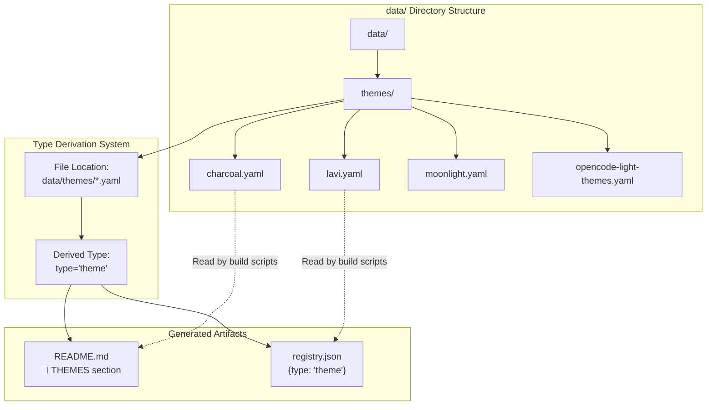
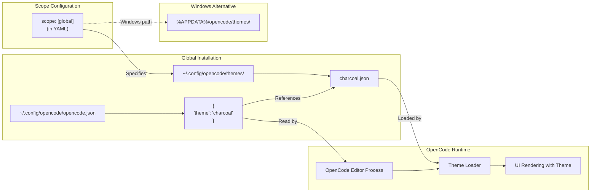
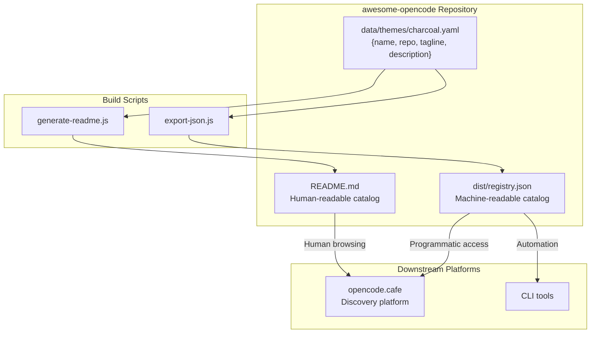

<!-- source: DeepWiki mcp.deepwiki.com · repo awesome-opencode/awesome-opencode · page 4.2 Themes · fetched 2026-10-30 -->

# Themes

Relevant source files

The following files were used as context for generating this wiki page:

- [data/themes/charcoal.yaml](data/themes/charcoal.yaml)
- [data/themes/lavi.yaml](data/themes/lavi.yaml)
- [data/themes/moonlight.yaml](data/themes/moonlight.yaml)
- [data/themes/opencode-light-themes.yaml](data/themes/opencode-light-themes.yaml)

This document describes the **theme** entry type in the awesome-opencode registry. Themes are visual customization configurations that modify the appearance of the OpenCode editor through color schemes and styling rules. 

For information about other extension types, see:
- Plugins ([4.1]()) - JavaScript/TypeScript modules that extend functionality
- Agents ([4.3]()) - AI agent configurations with specialized skills
- Projects ([4.4]()) - Standalone applications and tools
- Resources ([4.5]()) - Guides, MCP servers, and configurations

---

## Theme Definition

Themes in the OpenCode ecosystem are **JSON configuration files** that define color schemes and visual styling for the editor interface. The awesome-opencode registry catalogs these themes as YAML entries stored in `data/themes/*.yaml`, which describe the theme metadata and installation instructions.

**Key Distinction**: The YAML file is not the theme itself—it is a registry entry that points to the actual theme JSON file. The YAML entry provides discoverability and installation guidance, while the JSON file contains the actual color definitions and styling rules.

**Sources**: [data/examples/theme.yaml:1-59]()

---

## Theme Entry Location and Type Derivation

### Theme Registry Data Flow

Title: Theme Entry Processing

**Type Derivation**: The extension type `theme` is never stored in the YAML files themselves. Instead, it is automatically derived from the directory path `data/themes/` during the build process. This convention-over-configuration approach enforces consistency across the registry.

**Sources**: [data/examples/theme.yaml:3-3](), [data/themes/lavi.yaml:1-4](), [data/themes/moonlight.yaml:1-4](), [data/themes/charcoal.yaml:1-4]()

---

## YAML Schema for Theme Entries

Theme entries follow the common schema with four required fields and several optional fields for enhanced discoverability.

### Required Fields

| Field | Type | Constraints | Description |
|-------|------|-------------|-------------|
| `name` | string | - | Human-readable display name |
| `repo` | string | HTTPS format | Repository URL (e.g., `https://github.com/user/repo`) |
| `tagline` | string | Max 120 chars | Short punchy summary for list views |
| `description` | string | Multi-line allowed | Full description of the theme's appearance and features |

### Optional Fields

| Field | Type | Default | Theme-Specific Notes |
|-------|------|---------|---------------------|
| `scope` | array | `[global]` | Themes are typically **global-only** as they affect all projects |
| `tags` | array | `[]` | Example tags: `dark`, `light`, `grayscale`, `syntax-highlighting` |
| `min_version` | string | - | Minimum OpenCode version (semver format) |
| `homepage` | string | - | Documentation URL if different from repository |
| `installation` | string | - | Markdown installation instructions |

**Sources**: [data/examples/theme.yaml:6-34](), [data/themes/charcoal.yaml:1-7]()

---

## Theme Scope and Installation Paths

Title: Theme Application Architecture

**Global Scope**: Themes are almost exclusively installed with `scope: [global]` because they affect the visual appearance of the editor across all projects. The global scope maps to:
- **Unix/Linux/macOS**: `~/.config/opencode/themes/`
- **Windows**: `%APPDATA%/opencode/themes/`

**Configuration Reference**: After installing the theme JSON file, users must update their `opencode.json` configuration to reference the theme by name (filename without `.json` extension).

**Sources**: [data/examples/theme.yaml:20-58](), [data/themes/charcoal.yaml:5-7]()

---

## Notable Theme Examples

### Grayscale Aesthetic: Charcoal
`Charcoal` is a specialized pure grayscale theme. It uses a near-black background (`#0d0d0d`) and 56 specific color keys to ensure no hues are present in the UI.

**Sources**: [data/themes/charcoal.yaml:1-10]()

### Collection: OpenCode Light Themes
This entry represents a curated collection rather than a single theme. It includes 21 light themes converted from popular VS Code equivalents, including:
- Atom One Light (scaefy-light)
- Solarized Light
- GitHub Light
- Milkshake variants

**Sources**: [data/themes/opencode-light-themes.yaml:1-5]()

### Soft Dark: Lavi
`Lavi` provides a soft dark aesthetic with rich purple tones. It is part of a larger cross-platform colorscheme family supporting tools like Neovim and various terminal emulators.

**Sources**: [data/themes/lavi.yaml:1-5]()

---

## Registry Catalog Summary

The registry provides a diverse range of visual options:

| Name | Repository | Tagline |
|------|------------|---------|
| **Charcoal** | `VyomJain6904/charcoal-theme` | Deep-black grayscale theme for OpenCode — no hues, all shades of gray |
| **Lavi** | `b0o/lavi/tree/main/contrib/opencode` | A soft and sweet colorscheme for Opencode and 15+ other apps |
| **Moonlight** | `brunogabriel/opencode-moonlight-theme` | A moonlight color theme for OpenCode based on the popular moonlight-vscode-theme. |
| **OpenCode Light Themes** | `fatihtoprakk/opencode-light-themes` | A curated collection of 21 light color themes for OpenCode |

**Sources**: [data/themes/charcoal.yaml:1-3](), [data/themes/lavi.yaml:1-3](), [data/themes/moonlight.yaml:1-3](), [data/themes/opencode-light-themes.yaml:1-3]()

---

## Downstream Consumption

Title: Data Transformation Pipeline

### Field Mapping for Themes

| awesome-opencode YAML | registry.json | Notes |
|-----------------------|---------------|-------|
| `name` | `displayName` | Display name for UI |
| `repo` | `repoUrl` | Repository URL |
| `tagline` | `tagline` | Short summary (max 120 chars) |
| (directory: `themes/`) | `type` | Always `"theme"` (derived) |
| (filename: `charcoal.yaml`) | `productId` | Always `"charcoal"` (derived) |

**Sources**: [data/examples/theme.yaml:1-15](), [data/themes/charcoal.yaml:1-3]()

---

## Contributing a Theme Entry

To add a new theme to the registry:

1. **Fork** the awesome-opencode repository.
2. **Create** a new YAML file in `data/themes/your-theme-name.yaml`.
3. **Use** the template from `data/examples/theme.yaml` as a starting point.
4. **Ensure** the filename is kebab-case (e.g., `opencode-light-themes.yaml`).
5. **Submit** a pull request.

**Sources**: [data/examples/theme.yaml:1-59](), [data/themes/opencode-light-themes.yaml:1-1]()

---

