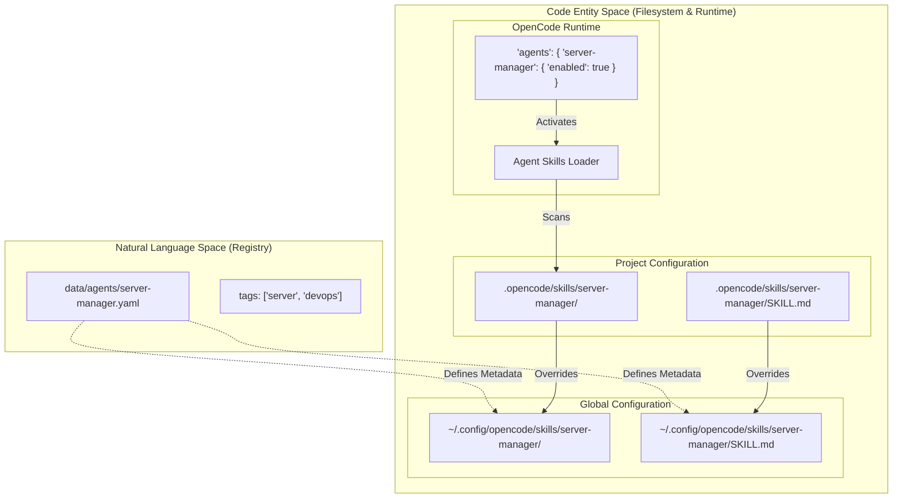
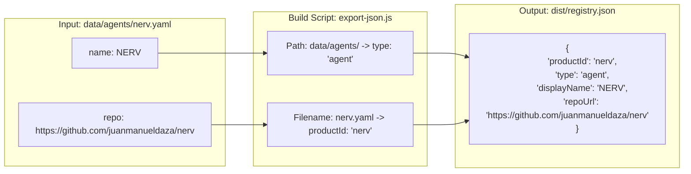

<!-- source: DeepWiki mcp.deepwiki.com · repo awesome-opencode/awesome-opencode · page 4.3 Agents · fetched 2026-10-30 -->

# Agents

<details>
<summary>Relevant source files</summary>

The following files were used as context for generating this wiki page:

- [README.md](README.md)
- [data/agents/deliberation.yaml](data/agents/deliberation.yaml)
- [data/agents/gem-team.yaml](data/agents/gem-team.yaml)
- [data/agents/nerv.yaml](data/agents/nerv.yaml)
- [data/agents/python-agent.yaml](data/agents/python-agent.yaml)
- [data/agents/server-manager.yaml](data/agents/server-manager.yaml)
- [data/plugins/opencode-arise.yaml](data/plugins/opencode-arise.yaml)
- [data/plugins/opencode-mystatus.yaml](data/plugins/opencode-mystatus.yaml)
- [data/resources/akephalos.yaml](data/resources/akephalos.yaml)

</details>


This document defines agent entries in the awesome-opencode registry: custom AI agent configurations and reusable skill instruction sets that extend OpenCode's capabilities for specialized tasks. Agents differ from plugins in that they define AI behavior and instructions rather than executable code modules.

---

## Agent Extension Types

The `agent` category encompasses artifacts that enhance AI agent behavior in OpenCode:

1.  **Agent Configurations**: JSON files defining agent behavior, system prompts, available tools, and task-specific instructions. These configure how an AI agent approaches particular problem domains [data/examples/agent.yaml:13-17]().
2.  **Skills**: Reusable instruction sets distributed as `SKILL.md` markdown files. Skills define specific capabilities that agents can invoke, similar to function definitions in code [data/examples/agent.yaml:61-68]().
3.  **Orchestration Harnesses**: Specialized agents that manage subagents for complex workflows like Spec-Driven Development (SDD) or automated verification [data/agents/gem-team.yaml:3-4]().

### Agent Architecture and Data Flow

The following diagram bridges the Natural Language Space (YAML definitions) to the Code Entity Space (filesystem paths and configuration keys used by the OpenCode runtime).

**Title: Agent Configuration and Skill Resolution**

**Sources:** [data/examples/agent.yaml:45-85](), [data/agents/server-manager.yaml:14-18]()

---

## Installation Locations and Scope

Agents support both global and project-level installation. The `scope` field in agent YAML entries indicates supported installation patterns [data/agents/server-manager.yaml:5-7]().

| Location | Path | Scope | Purpose |
|----------|------|-------|---------|
| Global agent | `~/.config/opencode/skills/<name>/` | `global` | User-wide agent configurations [data/agents/server-manager.yaml:16]() |
| Project agent | `.opencode/skills/<name>/` | `project` | Repository-specific agents [data/agents/server-manager.yaml:18]() |
| Global skill | `~/.config/opencode/skill/<name>/SKILL.md` | `global` | Reusable skills across projects [data/examples/agent.yaml:61-68]() |

---

## Data Model

Agent entries follow the common YAML schema. The `type` field is derived from the directory location (`data/agents/`) during the build process.

### Required Fields
| Field | Type | Description |
|-------|------|-------------|
| `name` | string | Human-readable display name [data/agents/server-manager.yaml:1]() |
| `repo` | string | Repository containing agent configuration [data/agents/server-manager.yaml:2]() |
| `tagline` | string | Brief summary for discovery [data/agents/server-manager.yaml:3]() |
| `description` | string | Detailed explanation of capabilities [data/agents/server-manager.yaml:4]() |

**Sources:** [data/agents/server-manager.yaml:1-4]()

---

## Featured Agents in the Catalog

The following agents represent the diversity of specialized AI configurations available:

### Orchestration and Infrastructure
*   **NERV**: Invisible engineering infrastructure providing Spec-Driven Development pipelines, A2A task delegation, and persistent semantic memory (MAGI) [data/agents/nerv.yaml:1-4]().
*   **Gem Team**: A self-learning multi-agent orchestration harness focused on automated verification and spec-driven development [data/agents/gem-team.yaml:1-4]().
*   **Deliberation**: A multi-model expert system that uses MCP to get second opinions or fixes from GPT, Gemini, Grok, or OpenRouter via specialized subagents like "Architect" and "Security Analyst" [data/agents/deliberation.yaml:1-10]().

### Specialized Toolkits
*   **Server Manager**: Provides non-blocking background management for local dev servers (Node.js, Python, Go, etc.) with JSON state persistence and HTTP health checks [data/agents/server-manager.yaml:1-4]().
*   **Python Expert Agent**: A toolkit featuring a primary custom agent with intelligent skill loading and specialized subagents for code review, testing, and exploration [data/agents/python-agent.yaml:1-4]().

**Title: Registry to Registry.json Transformation**

**Sources:** [data/agents/nerv.yaml:1-2]()

---

## Agent Configuration and Skills Format

### Agent Configuration (`agent.json`)
The runtime behavior is defined in a JSON file. While the registry tracks metadata, the OpenCode environment uses the following structure to manage agent identity and tool access:

```json
{
  "agents": {
    "python-expert": {
      "enabled": true,
      "systemPrompt": "You are a senior Python engineer...",
      "availableTools": ["python_repl", "pylint"]
    }
  }
}
```
**Sources:** [data/examples/agent.yaml:71-80](), [data/agents/python-agent.yaml:4]()

### Skills Format (`SKILL.md`)
Skills are markdown files containing structured instructions that allow agents to perform complex tasks. These are discovered dynamically by the agent runtime from the project or user directories [data/agents/server-manager.yaml:14-18]().

**Sources:** [data/agents/nerv.yaml:1-5](), [data/agents/gem-team.yaml:1-5](), [data/agents/deliberation.yaml:1-10](), [data/agents/python-agent.yaml:1-4](), [data/agents/server-manager.yaml:1-20]()

---

