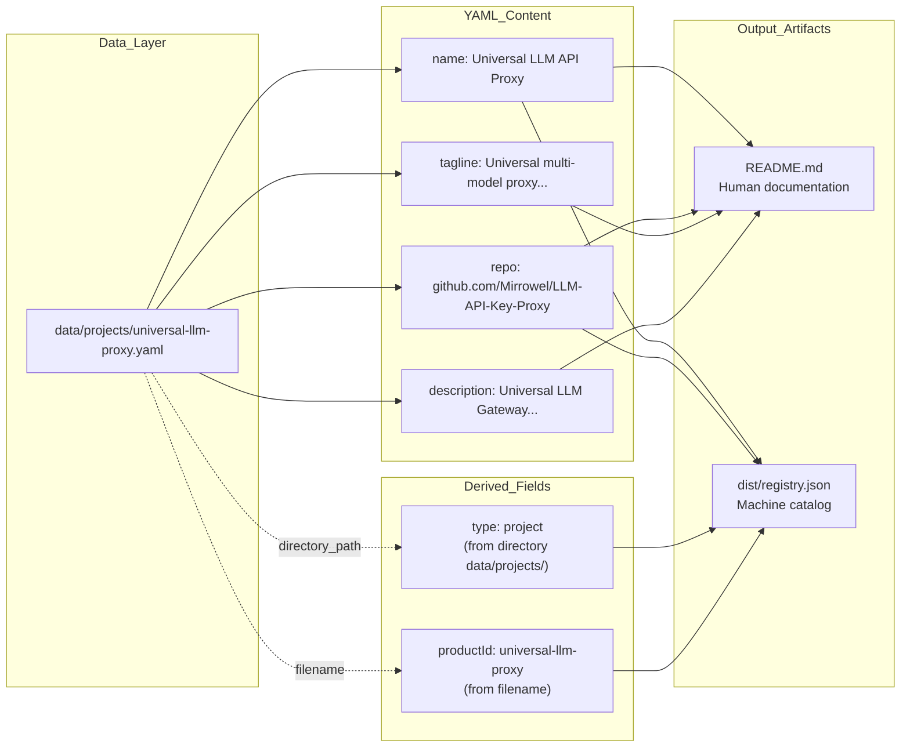
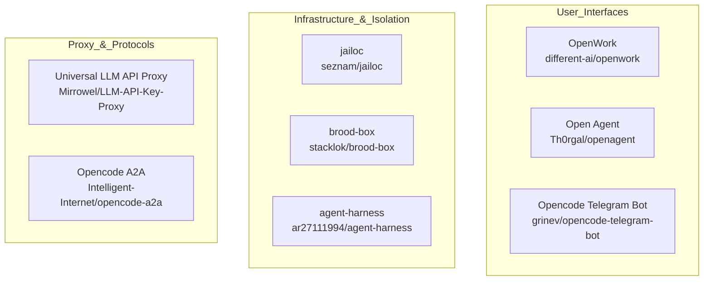
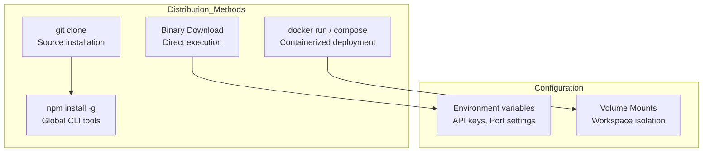
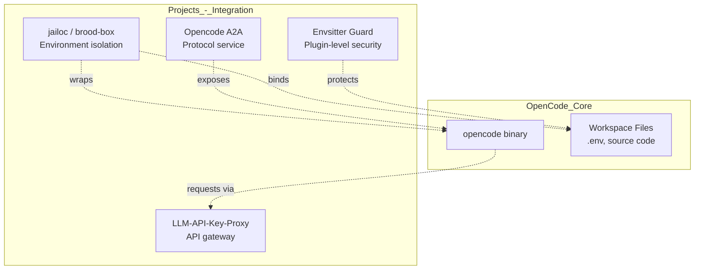

<!-- source: DeepWiki mcp.deepwiki.com · repo awesome-opencode/awesome-opencode · page 4.4 Projects · fetched 2026-10-30 -->

# Projects

<details>
<summary>Relevant source files</summary>

The following files were used as context for generating this wiki page:

- [data/plugins/envsitter-guard.yaml](data/plugins/envsitter-guard.yaml)
- [data/projects/agent-harness.yaml](data/projects/agent-harness.yaml)
- [data/projects/brood-box.yaml](data/projects/brood-box.yaml)
- [data/projects/jailoc.yaml](data/projects/jailoc.yaml)
- [data/projects/open-agent.yaml](data/projects/open-agent.yaml)
- [data/projects/opencode-a2a.yaml](data/projects/opencode-a2a.yaml)
- [data/projects/universal-llm-proxy.yaml](data/projects/universal-llm-proxy.yaml)

</details>


This document defines the **Projects** entry type within the awesome-opencode registry. Projects are standalone applications and utilities built for or with OpenCode, distinguishing them from extensions that integrate into OpenCode's runtime. For information about extensions that run inside OpenCode, see [Plugins](#4.1). For supplementary materials like guides and MCP servers, see [Resources](#4.5).

**Sources:** [data/examples/project.yaml:1-72]()

---

## Definition and Characteristics

Projects are complete, standalone applications that interact with OpenCode or serve the OpenCode ecosystem. They are **not** extensions that load into OpenCode's runtime, but independent programs that run as separate processes.

### Core Characteristics

| Characteristic | Description |
|---------------|-------------|
| **Independence** | Run as separate processes, not loaded into OpenCode runtime |
| **Completeness** | Fully functional applications with their own installation and deployment |
| **Integration** | May interact with OpenCode via API, filesystem, or process communication |
| **Distribution** | Often distributed as npm packages, Docker images, or standalone binaries |

Projects differ from other entry types:
- **vs. Plugins**: Plugins extend OpenCode's internal functionality; projects are external applications.
- **vs. Resources**: Resources are configurations or guides; projects are executable applications.
- **vs. Forks**: Forks modify OpenCode itself; projects complement OpenCode.

**Sources:** [data/examples/project.yaml:1-5]()

---

## Schema Structure

Project entries follow the common YAML schema with four required fields and optional metadata. The `type` field is derived from directory location (`data/projects/`) rather than stored in the YAML.

### Required Fields

[data/examples/project.yaml:10-20]() defines the mandatory fields for every project entry:

```yaml
name: Example OpenCode Dashboard
repo: https://github.com/example/opencode-dashboard
tagline: Web-based dashboard for monitoring OpenCode sessions
description: A standalone web application for monitoring and managing
  OpenCode sessions across multiple projects.
```

### Optional Fields

Additional metadata can be provided to assist with discovery and installation [data/examples/project.yaml:28-71]():

```yaml
# Scope is often not applicable for standalone projects
# Include only if the project has global vs project-specific installation modes

tags:
  - dashboard
  - monitoring
  - web-ui
  - analytics

min_version: "1.0.0"

homepage: https://example.com/opencode-dashboard

installation: |
  ## Prerequisites
  - Node.js 18+
  - OpenCode 1.0.0 or later

  ## Installation
  ```bash
  git clone https://github.com/example/opencode-dashboard
  cd opencode-dashboard
  npm install
  npm start
  ```
```

**Sources:** [data/examples/project.yaml:10-71]()

---

## YAML to Filesystem Mapping



**Diagram: YAML Entry to Generated Artifacts**

This diagram shows how a project entry in `data/projects/*.yaml` is processed. The `type` and `productId` fields are derived from the filesystem location.

**Sources:** [data/examples/project.yaml:1-72](), [data/projects/universal-llm-proxy.yaml:1-4]()

---

## Project Categories

The catalog contains projects spanning multiple functional categories. Each category serves distinct use cases in the OpenCode ecosystem.



**Diagram: Project Categories in the Catalog**

This diagram organizes projects by functional category, using repository names as identifiers to bridge natural language descriptions to actual code repositories.

**Sources:** [data/projects/universal-llm-proxy.yaml:1-13](), [data/projects/open-agent.yaml:1-4](), [data/projects/jailoc.yaml:1-8](), [data/projects/brood-box.yaml:1-4](), [data/projects/agent-harness.yaml:1-11](), [data/projects/opencode-a2a.yaml:1-4]()

---

## Featured Projects

### Infrastructure and Sandboxing

Projects that provide secure, isolated environments for running OpenCode agents.

| Project | Repository | Purpose |
|---------|-----------|---------|
| **jailoc** | [seznam/jailoc]() | CLI tool wrapping agents in Docker Compose with bind-mount isolation and host allowlisting [data/projects/jailoc.yaml:1-8](). |
| **brood-box** | [stacklok/brood-box]() | Runs agents inside hardware-isolated microVMs with snapshot isolation and egress control [data/projects/brood-box.yaml:1-4](). |
| **Open Agent** | [Th0rgal/openagent]() | Self-hosted control plane using `systemd-nspawn` workspaces and multi-platform dashboards [data/projects/open-agent.yaml:1-4](). |

### Protocols and Interoperability

Projects that extend how OpenCode communicates with other systems or agents.

| Project | Repository | Purpose |
|---------|-----------|---------|
| **Opencode A2A** | [Intelligent-Internet/opencode-a2a]() | Full A2A Protocol implementation exposing OpenCode as a standardized Agent-to-Agent service [data/projects/opencode-a2a.yaml:1-4](). |
| **Universal LLM API Proxy** | [Mirrowel/LLM-API-Key-Proxy]() | Gateway providing OpenAI/Anthropic-compatible endpoints with intelligent load-balancing [data/projects/universal-llm-proxy.yaml:1-4](). |
| **agent-harness** | [ar27111994/agent-harness]() | Node.js CLI for staging and activating reusable AI-agent assets into developer workspaces [data/projects/agent-harness.yaml:1-11](). |

**Sources:** [data/projects/universal-llm-proxy.yaml:1-4](), [data/projects/open-agent.yaml:1-4](), [data/projects/jailoc.yaml:1-8](), [data/projects/brood-box.yaml:1-4](), [data/projects/agent-harness.yaml:1-11](), [data/projects/opencode-a2a.yaml:1-4]()

---

## Installation Patterns

Projects exhibit diverse installation patterns compared to plugins. The `installation` field provides detailed setup instructions [data/examples/project.yaml:38-71]().



**Diagram: Project Installation Patterns**

**Sources:** [data/examples/project.yaml:38-71](), [data/projects/jailoc.yaml:5-8](), [data/projects/agent-harness.yaml:11]()

---

## Integration with OpenCode Ecosystem



**Diagram: Project Integration Points with OpenCode**

Projects integrate with OpenCode through various mechanisms: environment wrapping (isolation), network proxying (gateways), or protocol exposure (A2A). Note that while `Envsitter Guard` is a plugin, it is often used alongside projects like `jailoc` to provide defense-in-depth.

**Sources:** [data/projects/universal-llm-proxy.yaml:1-4](), [data/projects/jailoc.yaml:1-8](), [data/projects/opencode-a2a.yaml:1-4](), [data/plugins/envsitter-guard.yaml:1-4]()

---

## Entry Creation Guidelines

When creating a project entry in `data/projects/`:

1. **File Naming**: Use kebab-case matching the project name (e.g., `universal-llm-proxy.yaml`).
2. **Repository URL**: Use HTTPS format [data/examples/project.yaml:11]().
3. **Tagline**: Provide a concise summary [data/examples/project.yaml:12]().
4. **Description**: Use multi-line strings for features and context [data/examples/project.yaml:13-20]().
5. **Scope**: Often not relevant for standalone projects; include only if the project can be installed globally vs per-project [data/examples/project.yaml:25-26]().

**Sources:** [data/examples/project.yaml:1-72]()

---

