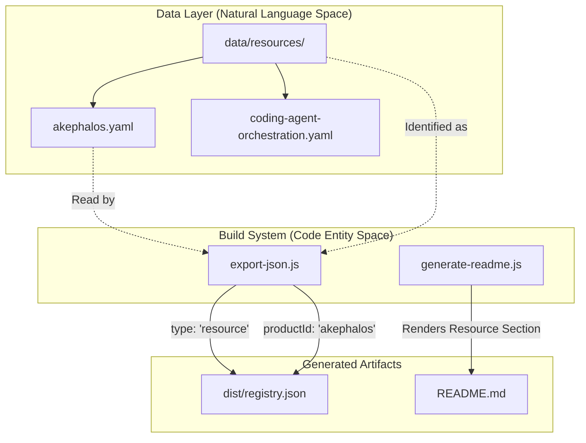
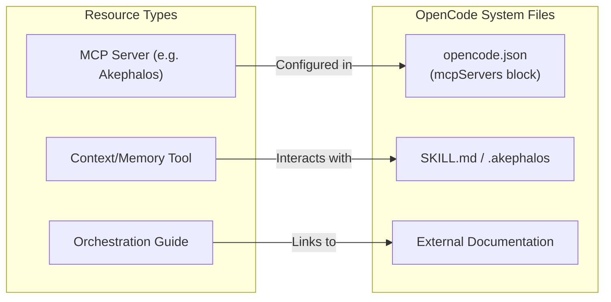

<!-- source: DeepWiki mcp.deepwiki.com · repo awesome-opencode/awesome-opencode · page 4.5 Resources · fetched 2026-10-30 -->

# Resources

Relevant source files

The following files were used as context for generating this wiki page:

- [README.md](README.md)
- [data/agents/gem-team.yaml](data/agents/gem-team.yaml)
- [data/plugins/opencode-mystatus.yaml](data/plugins/opencode-mystatus.yaml)
- [data/resources/akephalos.yaml](data/resources/akephalos.yaml)
- [data/resources/coding-agent-orchestration.yaml](data/resources/coding-agent-orchestration.yaml)

Resources are guides, configurations, MCP servers, tools, and commands that enhance the OpenCode experience without being installable plugins. Unlike plugins which are JavaScript/TypeScript modules, or projects which are standalone applications, resources serve as supporting materials, server implementations, and configuration templates that integrate with OpenCode through various mechanisms.

**Sources:** [data/resources/akephalos.yaml:1-5](), [data/resources/coding-agent-orchestration.yaml:1-4]()

---

## Resource Categories

Resources in the `awesome-opencode` catalog fall into distinct categories, each with different integration patterns and use cases:

| Category | Description | Integration Method | Example |
|----------|-------------|-------------------|---------|
| **MCP Servers** | Model Context Protocol servers providing external capabilities | Added to `mcpServers` config block | [data/resources/akephalos.yaml:11-13]() |
| **Orchestration Guides** | Methodologies for managing multi-agent workflows | Reference documentation | [data/resources/coding-agent-orchestration.yaml:3-4]() |
| **Context Management** | Tools for carrying agent state and memory across sessions | File-based protocols | [data/resources/akephalos.yaml:4-7]() |

**Sources:** [data/resources/akephalos.yaml:1-15](), [data/resources/coding-agent-orchestration.yaml:1-4]()

---

## Directory Structure and Type Derivation

Resources are stored in the `data/resources/` directory. Like all entry types in this repository, the `type` is derived from the directory location rather than being explicitly defined in the YAML file.

**Diagram: Mapping Resource YAML Files to Code-Generated Metadata**

The `productId` is automatically derived from the filename (e.g., `akephalos.yaml` becomes `akephalos`).

**Sources:** [data/resources/akephalos.yaml:1-3](), [data/resources/coding-agent-orchestration.yaml:1-3]()

---

## YAML Schema for Resources

Resources use a standardized schema structure. The following fields are commonly utilized for resource entries:

### Required Fields

| Field | Type | Description |
|-------|------|-------------|
| `name` | string | Human-readable display name |
| `repo` | string | Repository or source URL |
| `tagline` | string | Short summary (max 120 chars) |
| `description` | string | Detailed explanation of the resource |

### Optional Fields

| Field | Type | Purpose |
|-------|------|---------|
| `scope` | array | Where it can be installed (`global` or `project`) |
| `tags` | array | Keywords for filtering (e.g., `mcp-server`, `memory`, `context`) |

**Sources:** [data/resources/akephalos.yaml:1-15](), [data/resources/coding-agent-orchestration.yaml:1-4]()

---

## Configuration Integration Patterns

Resources integrate with OpenCode through various configuration mechanisms. The diagram below illustrates how different resource types map to system configuration files.

**Diagram: Resource Integration with OpenCode Configuration**

**Sources:** [data/resources/akephalos.yaml:4-13](), [data/resources/coding-agent-orchestration.yaml:4-4]()

---

## Current Resource Catalog

The repository documents the following notable resources:

### 1. Akephalos
A local-first, markdown-based passport for portable agent context and memory. It enables MCP-capable coding-agent workflows to inspect and carry context across tools and machines without hosted sync.
- **Scope:** Project
- **Tags:** `mcp-server`, `memory`, `context`, `local-first`, `markdown`
- **Source:** [data/resources/akephalos.yaml:1-15]()

### 2. Coding Agent Orchestration
An opinionated handbook arguing for treating AI coding tools as a composable, multi-agent system. It provides practical setup guides for implementing this mindset using OpenCode's CLI and configuration system.
- **Tagline:** OpenCode Setup Guide / Orchestration
- **Source:** [data/resources/coding-agent-orchestration.yaml:1-4]()

### 3. Kickstart OpenCode
*(Referenced in catalog)* A tool for bootstrapping OpenCode environments with pre-configured settings and plugins.

---

## Scope Behavior

The `scope` field determines the applicability of a resource. For instance, **Akephalos** is scoped specifically to `project` [data/resources/akephalos.yaml:9](), meaning it is intended to be used within the context of a specific repository or workspace rather than as a global system-wide utility.

**Sources:** [data/resources/akephalos.yaml:8-9]()

---

