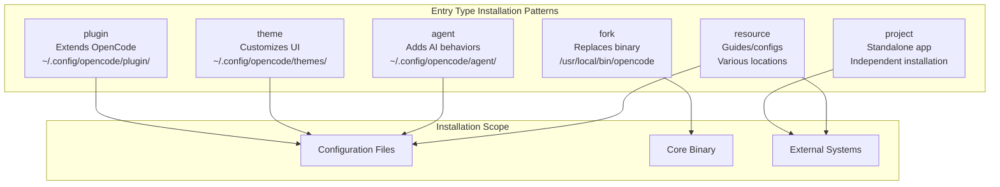
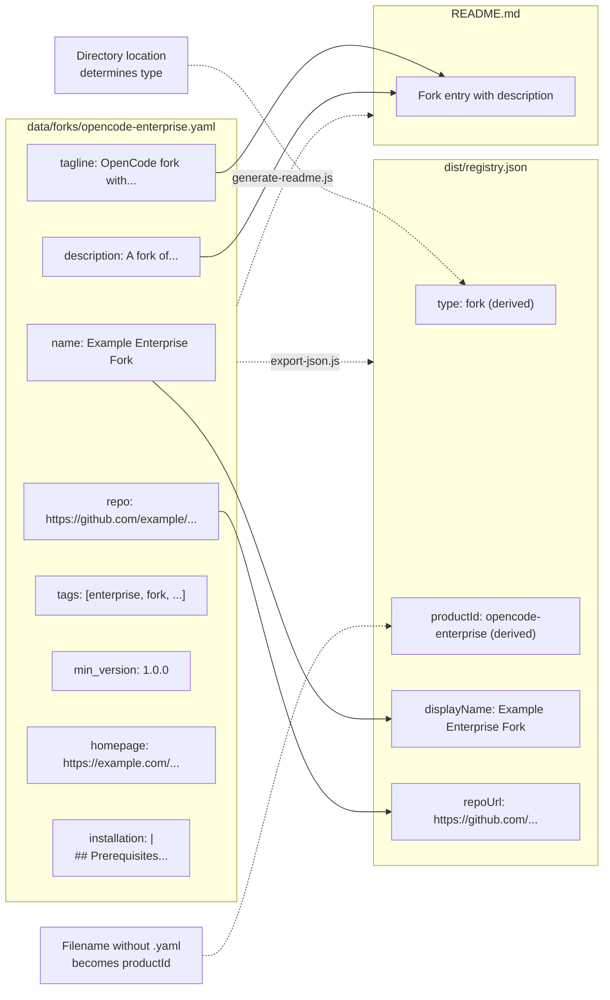
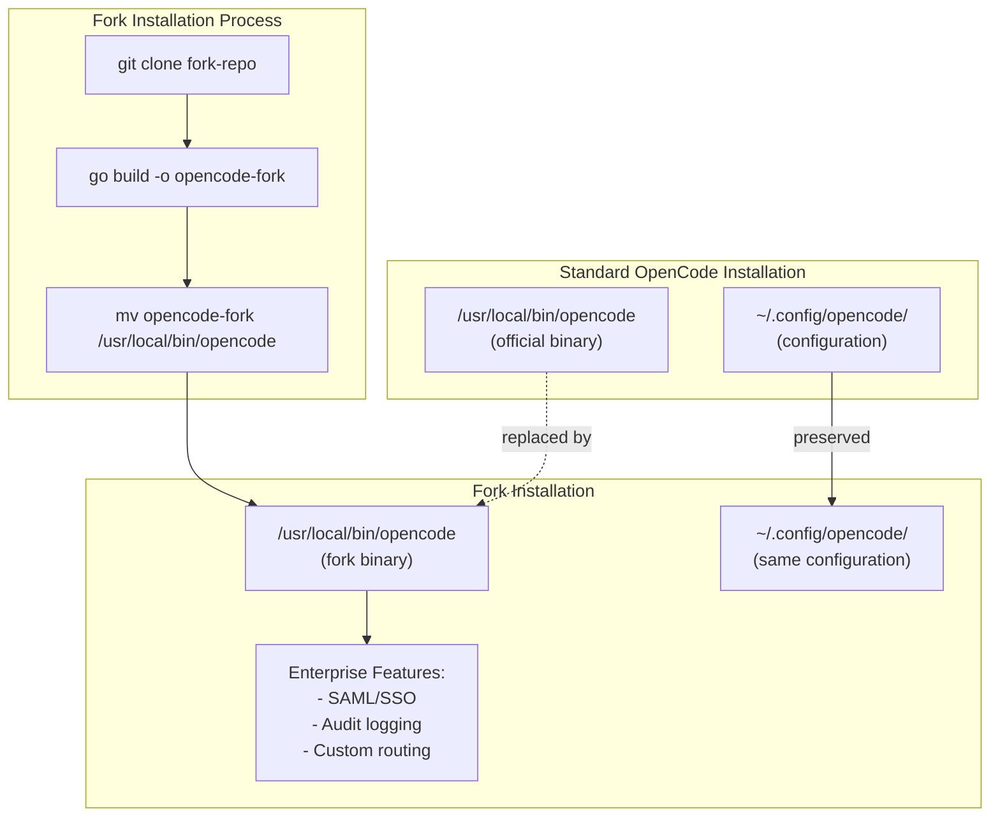

<!-- source: DeepWiki mcp.deepwiki.com · repo awesome-opencode/awesome-opencode · page 4.6 Forks · fetched 2026-10-30 -->

# Forks

<details>
<summary>Relevant source files</summary>

The following files were used as context for generating this wiki page:

- [data/examples/fork.yaml](data/examples/fork.yaml)
- [data/schema.json](data/schema.json)
- [docs/schema-design.md](docs/schema-design.md)

</details>


## Purpose and Scope

This document defines **fork entries** in the awesome-opencode registry. Forks are modified builds of OpenCode itself that include custom features, enterprise patches, or experimental functionality while maintaining core compatibility. Unlike plugins or themes that extend OpenCode, forks replace the entire OpenCode binary.

For information about other entry types that extend rather than replace OpenCode, see:
- Plugins ([4.1]()) - JavaScript/TypeScript modules that extend functionality
- Themes ([4.2]()) - Visual customization configurations
- Projects ([4.4]()) - Standalone applications built for or with OpenCode

---

## Definition

Forks are complete replacements of the OpenCode executable with modified source code. They are distributed as:

- **Source repositories** requiring compilation from a modified OpenCode codebase [data/examples/fork.yaml:41-52]()
- **Pre-built binaries** packaged for specific platforms [data/examples/fork.yaml:81-81]()
- **Container images** for Docker-based deployments [data/examples/fork.yaml:54-61]()

Forks maintain compatibility with the OpenCode plugin ecosystem and configuration format while adding or modifying core functionality.

**Sources:** [docs/schema-design.md:115-123](), [data/examples/fork.yaml:1-89]()

---

## Entry Types Comparison

The following diagram illustrates how forks differ from other entry types in terms of installation scope and system impact:

**Diagram: Entry Type System Impact**


**Sources:** [docs/schema-design.md:44-123](), [data/examples/fork.yaml:1-89]()

---

## Data Model

Fork entries are stored as YAML files in the `data/forks/` directory [docs/schema-design.md:34-35](). The type `fork` is derived from the directory location rather than being explicitly stored in the YAML [docs/schema-design.md:17-17]().

### Required Fields

| Field | Type | Description | Constraints |
|-------|------|-------------|-------------|
| `name` | string | Display name of the fork | [data/schema.json:8-12]() |
| `repo` | string | Repository URL | [data/schema.json:13-17]() |
| `tagline` | string | Brief description | Max 120 chars [data/schema.json:18-23]() |
| `description` | string | Full description | [data/schema.json:24-28]() |

### Optional Fields

| Field | Type | Description |
|-------|------|-------------|
| `tags` | array | Keywords for discoverability [data/schema.json:39-45]() |
| `min_version` | string | Min OpenCode version (semver) [data/schema.json:46-50]() |
| `homepage` | string | Documentation URL [data/schema.json:51-55]() |
| `installation` | string | Markdown instructions [data/schema.json:56-59]() |

### Excluded Fields

The `scope` field is **not used** for forks because they replace the entire OpenCode installation rather than being installed at project or global scope [data/examples/fork.yaml:24-24]().

**Sources:** [docs/schema-design.md:196-230](), [data/examples/fork.yaml:6-23](), [data/schema.json:1-64]()

---

## YAML Structure Diagram

This diagram shows how fork YAML files map to the data model and registry output:

**Diagram: Fork Data Flow**


**Sources:** [docs/schema-design.md:220-230](), [docs/schema-design.md:17-17]()

---

## Installation Characteristics

### Binary Replacement Model

Forks operate fundamentally differently from other extension types. The following diagram illustrates the installation replacement model:

**Diagram: Fork Replacement Lifecycle**


### Key Characteristics

1. **Complete Replacement**: Forks replace the standard binary (e.g., `/usr/local/bin/opencode`) [data/examples/fork.yaml:51-51]().
2. **Configuration Compatibility**: Forks typically maintain compatibility with `~/.config/opencode/opencode.json` [data/examples/fork.yaml:63-78]().
3. **Plugin Compatibility**: Most forks preserve the ability to use standard plugins.
4. **No Scope Field**: The `scope` field is explicitly omitted in fork definitions [data/examples/fork.yaml:24-24]().

**Sources:** [data/examples/fork.yaml:24-25](), [data/examples/fork.yaml:36-88]()

---

## Example Use Cases

### Enterprise Deployments
Forks commonly add enterprise-specific features:
- **SAML/SSO Authentication**: Integration with corporate identity providers [data/examples/fork.yaml:15-15]().
- **Audit Logging**: Compliance tracking for regulated industries [data/examples/fork.yaml:16-16]().
- **Air-gapped Support**: Operation without internet connectivity [data/examples/fork.yaml:18-18]().
- **Custom Model Routing**: Internal model endpoints [data/examples/fork.yaml:17-17]().

### Experimental Features
- **Bleeding-edge Features**: Unreleased functionality from upstream.
- **Performance Optimizations**: Experimental speedups.
- **Alternative Architectures**: Different implementation approaches.

**Sources:** [docs/schema-design.md:115-123](), [data/examples/fork.yaml:9-18]()

---

## Installation Template Structure

Fork entries should include detailed installation instructions in the `installation` field [data/examples/fork.yaml:36-88]().

### Standard Sections

```markdown
## Prerequisites
- Build tools (e.g., Go 1.21+)
- Deployment environments (e.g., Docker)

## Installation from Source
Steps for cloning, building, and moving the binary.

## Docker Installation
Pulling images and setting up aliases.

## Configuration
Example JSON blocks for `opencode.json`.

## Files Modified
List of system paths affected.

## Reverting to Standard OpenCode
Instructions to restore the official build.
```

**Sources:** [data/examples/fork.yaml:36-88]()

---

## File Organization

Fork entries follow the standard directory structure:

```
awesome-opencode/
├── data/
│   └── forks/
│       ├── opencode-enterprise.yaml
│       └── *.yaml
└── data/examples/
    └── fork.yaml
```

### Naming Conventions

- **Directory**: All fork entries must be placed in `data/forks/` [docs/schema-design.md:34-35]().
- **Filename**: Kebab-case YAML files (e.g., `opencode-enterprise.yaml`).
- **Product ID**: Derived from filename without `.yaml` extension.
- **Type Derivation**: The `type: fork` is automatically derived from the directory location [docs/schema-design.md:17-17]().

**Sources:** [docs/schema-design.md:19-41](), [docs/schema-design.md:220-230]()

---

## Validation Rules

Fork entries must satisfy the following validation rules:

### Schema Validation

| Rule | Requirement | Source |
|------|-------------|--------|
| **Required Fields** | `name`, `repo`, `tagline`, `description` | [data/schema.json:61-61]() |
| **Tagline Length** | Maximum 120 characters | [data/schema.json:21-21]() |
| **Repository URL** | Must be valid URI format | [data/schema.json:15-15]() |
| **Semver Format** | `min_version` pattern `^[0-9]+\.[0-9]+\.[0-9]+` | [data/schema.json:48-48]() |
| **No Scope Field** | `scope` field should be avoided for forks | [data/examples/fork.yaml:24-24]() |

**Sources:** [data/schema.json:1-64](), [data/examples/fork.yaml:24-24]()

---

