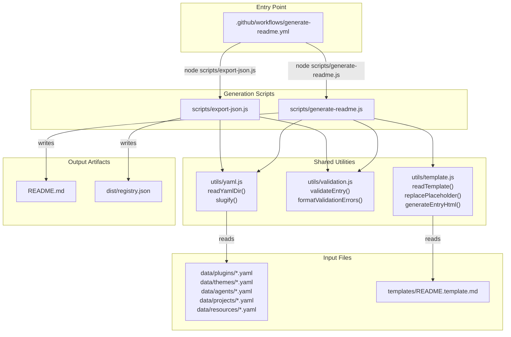
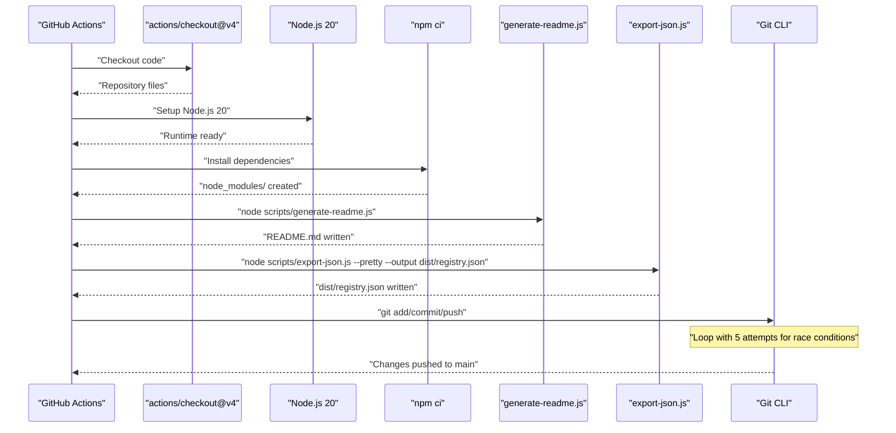
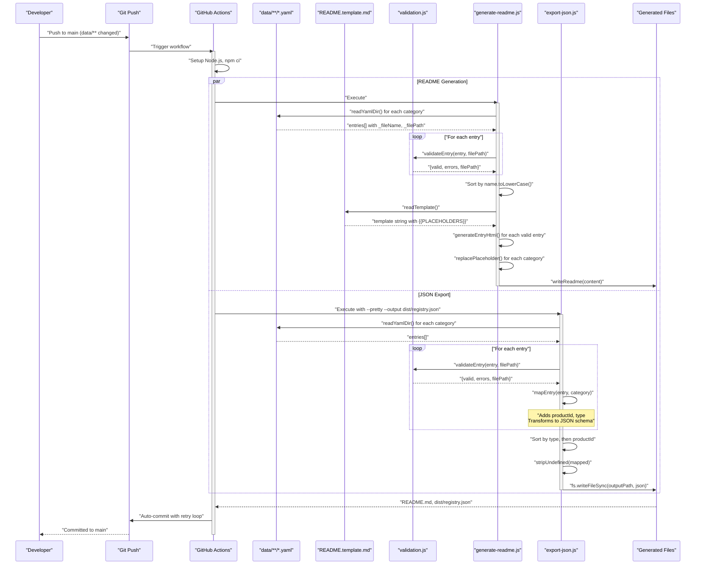

<!-- source: DeepWiki mcp.deepwiki.com · repo awesome-opencode/awesome-opencode · page 5 Build System · fetched 2026-10-30 -->

# Build System

<details>
<summary>Relevant source files</summary>

The following files were used as context for generating this wiki page:

- [.github/workflows/generate-readme.yml](.github/workflows/generate-readme.yml)
- [dist/registry.json](dist/registry.json)
- [scripts/export-json.js](scripts/export-json.js)
- [scripts/generate-readme.js](scripts/generate-readme.js)
- [scripts/utils/template.js](scripts/utils/template.js)

</details>


The Build System is an automated pipeline that transforms YAML data files from the `data/` directory into two generated artifacts: `README.md` (human-readable documentation) and `dist/registry.json` (machine-readable catalog). This system ensures that all documentation remains synchronized with source data through validation, template processing, and automatic regeneration via GitHub Actions. For details on the data model that the build system processes, see [Data Model](#3). For information on specific validation rules, see [Validation System](#5.3).

---

## Architecture Overview

The build system consists of two parallel generation pipelines that share common validation and YAML parsing utilities. Both pipelines are triggered automatically when changes to `data/**` are pushed to the main branch.

**Build System Component Architecture**



**Sources:** [.github/workflows/generate-readme.yml:1-70](), [scripts/generate-readme.js:1-155](), [scripts/export-json.js:1-159](), [scripts/utils/template.js:1-86]()

---

## README Generation Pipeline

The `generate-readme.js` script processes YAML files through a template-based rendering system to produce `README.md`. For details, see [README Generation](#5.1).

### Processing Flow

The script defines a fixed category order and placeholder mapping:

```javascript
const CATEGORIES = ['plugins', 'themes', 'agents', 'projects', 'resources'];

const CATEGORY_PLACEHOLDERS = {
  plugins: 'PLUGINS',
  themes: 'THEMES',
  agents: 'AGENTS',
  projects: 'PROJECTS',
  resources: 'RESOURCES'
};
```

For each category, the `generateCategorySection()` function [scripts/generate-readme.js:32-77]():

1. Reads all YAML files from `data/{category}/`
2. Validates each entry via `validateEntry()`
3. Sorts valid entries alphabetically by `name` field
4. Generates HTML using `generateEntryHtml()`
5. Returns concatenated HTML string

### HTML Generation

The `generateEntryHtml()` function [scripts/utils/template.js:34-69]() produces collapsible `<details>` elements with dynamic content:

| Component | Logic |
|-----------|-------|
| **Link Text** | "View Repository" for standard repos, "View Gist" for `gist.github.com`, "View Discussion" for `/discussions/` paths |
| **Star Badge** | GitHub star badge generated for non-gist, non-discussion repos using regex: `/github\.com\/(?!gist\.)([^\/]+)\/([^\/]+)/` |
| **Summary Line** | `<b>{name}</b>  - <i>{tagline}</i>` |
| **Description** | Full description text with repository link |

### Template Replacement

The `replacePlaceholder()` function [scripts/utils/template.js:24-27]() uses regex to substitute category content:

```javascript
function replacePlaceholder(template, placeholder, content) {
  const pattern = new RegExp(`\\{\\{${placeholder}\\}\\}`, 'g');
  return template.replace(pattern, content);
}
```

Each `{{PLUGINS}}`, `{{THEMES}}`, etc. placeholder in `templates/README.template.md` is replaced with the generated HTML for that category.

**Sources:** [scripts/generate-readme.js:1-155](), [scripts/utils/template.js:1-86]()

---

## Registry Export Pipeline

The `export-json.js` script produces a flat JSON array with derived fields for machine consumption. For details, see [Registry Export](#5.2).

### Data Transformation

**Field Mapping**

| YAML Field | JSON Field | Transformation |
|------------|------------|----------------|
| `name` | `displayName` | Direct copy |
| `repo` | `repoUrl` | Direct copy |
| `tagline` | `tagline` | Direct copy |
| `description` | `description` | Direct copy |
| `scope` | `scope` | Array, defaults to `["global"]` if missing |
| `tags` | `tags` | Array, defaults to `[]` if missing |
| `homepage` | `homepageUrl` | Optional field |
| `installation` | `installation` | Optional field |
| `min_version` | `minVersion` | Optional field |

**Derived Fields**

The `mapEntry()` function [scripts/export-json.js:42-63]() adds two computed fields:

1. **`type`**: Category name (`plugins`, `themes`, `agents`, `projects`, `resources`)
2. **`productId`**: Generated by `buildProductId()` [scripts/export-json.js:25-33]():
   - Uses `entry._fileName` if available (filename without extension)
   - Falls back to `slugify(entry.name)`
   - Empty string if neither exists

### Sorting and Output

Entries are sorted by [scripts/export-json.js:122-128]():

```javascript
results.sort((a, b) => {
  const typeCompare = a.type.localeCompare(b.type);
  if (typeCompare !== 0) {
    return typeCompare;
  }
  return a.productId.localeCompare(b.productId);
});
```

This produces a deterministic order: agents, plugins, projects, resources, themes (alphabetically), with entries within each type sorted by `productId`.

The `--pretty` flag enables formatted JSON output with 2-space indentation [scripts/export-json.js:137]().

**Sources:** [scripts/export-json.js:1-159]()

---

## Validation System

Both generation pipelines use shared validation logic from `utils/validation.js`. For detailed validation rules and business logic, see [Validation System](#5.3).

### Validation Interface

The `validateEntry()` function returns a structured result:

```javascript
{
  valid: boolean,
  errors: string[],
  filePath: string
}
```

Invalid entries are:
- Logged to console via `formatValidationErrors()` [scripts/generate-readme.js:57-59]()
- Excluded from output artifacts [scripts/generate-readme.js:54-61]()
- Cause non-zero exit code [scripts/generate-readme.js:149]()

### Error Handling

Both scripts track validation errors separately:

| Script | Error Tracking | Exit Behavior |
|--------|---------------|---------------|
| `generate-readme.js` | Collects errors per category, concatenates to `allErrors[]` | Exit code 1 if any errors exist |
| `export-json.js` | Accumulates errors in `errors[]` array | Exit code 1 if any errors exist |

**Sources:** [scripts/generate-readme.js:50-61](), [scripts/export-json.js:92-96](), [scripts/export-json.js:150-152]()

---

## GitHub Actions Workflows

The repository uses GitHub Actions to automate validation and regeneration. For details, see [GitHub Actions Workflows](#5.4).

### Regeneration Workflow

The `.github/workflows/generate-readme.yml` workflow automates the build process on pushes to the main branch.

**Trigger Configuration**

```yaml
on:
  push:
    branches:
      - main
    paths:
      - 'data/**'
  workflow_dispatch:
```

The workflow triggers on:
1. Push to `main` branch with changes in `data/**` paths
2. Manual dispatch via GitHub UI

**Build Steps**



**Commit Configuration**

The workflow uses a custom shell loop [.github/workflows/generate-readme.yml:44-66]() to handle potential race conditions when pushing regenerated artifacts back to `main`:

- **Files committed**: `README.md dist/registry.json`
- **Commit message**: `"docs: auto-regenerate README and registry data"`
- **Author**: `github-actions[bot]`

**Sources:** [.github/workflows/generate-readme.yml:1-70]()

---

## Build Process Flow

**Complete Build Pipeline**



**Sources:** [.github/workflows/generate-readme.yml:1-70](), [scripts/generate-readme.js:82-144](), [scripts/export-json.js:109-153]()

---

