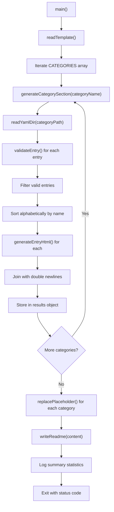
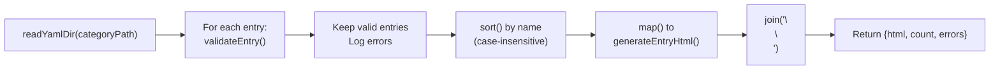
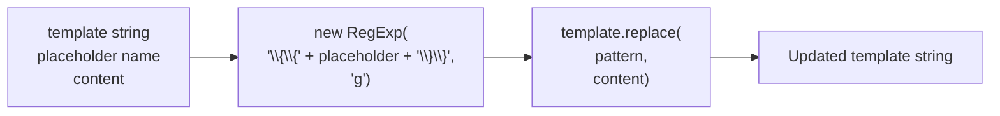

<!-- source: DeepWiki mcp.deepwiki.com · repo awesome-opencode/awesome-opencode · page 5.1 README Generation · fetched 2026-10-30 -->

# README Generation

<details>
<summary>Relevant source files</summary>

The following files were used as context for generating this wiki page:

- [.github/workflows/generate-readme.yml](.github/workflows/generate-readme.yml)
- [data/plugins/smart-voice-notify.yaml](data/plugins/smart-voice-notify.yaml)
- [scripts/generate-readme.js](scripts/generate-readme.js)
- [scripts/utils/template.js](scripts/utils/template.js)
- [templates/README.template.md](templates/README.template.md)

</details>


This document describes the automated README.md generation system that processes YAML data files and template files to produce the repository's main documentation artifact. For information about registry.json generation, see [Registry Export](#5.2). For validation rules applied during generation, see [Validation System](#5.3).

## Purpose and Scope

The README generation system transforms structured YAML data from `data/` directories into a human-readable markdown document with collapsible sections, GitHub star badges, and formatted entries. The script [scripts/generate-readme.js:1-155]() orchestrates the entire generation process, reading entries from five categories, validating them, sorting alphabetically, generating HTML snippets, and injecting them into a template file.

The generated README.md serves as the primary human interface for discovering OpenCode extensions and is optimized for browsing on GitHub with visual elements like star badges and collapsible `<details>` sections.

---

## Generation Pipeline

The README generation process follows a sequential pipeline that reads YAML data, validates entries, generates HTML, and writes the final output.

### Pipeline Flow: From Data to Document



**Sources:** [scripts/generate-readme.js:82-144]()

---

## Category Processing

The generation system processes five categories in a defined order, mapping each to a template placeholder.

### Category Configuration

The script defines two key constants that control category processing:

| Category | Placeholder | Directory Path | Description |
|----------|-------------|----------------|-------------|
| `plugins` | `{{PLUGINS}}` | `data/plugins/` | JavaScript/TypeScript extensions |
| `themes` | `{{THEMES}}` | `data/themes/` | Visual customization configs |
| `agents` | `{{AGENTS}}` | `data/agents/` | AI agent configurations |
| `projects` | `{{PROJECTS}}` | `data/projects/` | Standalone tools and applications |
| `resources` | `{{RESOURCES}}` | `data/resources/` | Guides, MCP servers, configs |

**Sources:** [scripts/generate-readme.js:16-25]()

### Processing Flow per Category

Each category undergoes identical processing steps within the `generateCategorySection()` function:



The function returns an object containing:
- `html`: Generated HTML string for all valid entries.
- `count`: Number of valid entries processed.
- `errors`: Array of validation error messages.

**Sources:** [scripts/generate-readme.js:32-77]()

---

## Template System

The template system uses a simple placeholder replacement mechanism to inject generated content into a predefined structure.

### Template Structure

The template file [templates/README.template.md:1-126]() contains:
- Fixed header with logo, title, and badges.
- Navigation links to category sections.
- Official repositories table.
- Category sections with placeholder markers (e.g., `{{PLUGINS}}`).
- Footer with contribution instructions.

**Sources:** [templates/README.template.md:51-59]()

### Placeholder Replacement Mechanism

The `replacePlaceholder()` function performs string replacement using regular expressions:



The function constructs a regex pattern `\{\{PLACEHOLDER\}\}` with the global flag to replace all occurrences of the placeholder with the generated HTML content.

**Sources:** [scripts/utils/template.js:24-27]()

---

## Entry HTML Generation

Each YAML entry is converted to an HTML `<details>` element. For example, a file like [data/plugins/smart-voice-notify.yaml:1-5]() is parsed into an object and passed to `generateEntryHtml()`.

### HTML Structure

The `generateEntryHtml()` function produces the following structure for each entry:

```html
<details>
  <summary><b>Entry Name</b>  - <i>Tagline</i></summary>
  <blockquote>
    Description text
    <br><br>
    <a href="repo-url">🔗 <b>Link Text</b></a>
  </blockquote>
</details>
```

**Sources:** [scripts/utils/template.js:34-69]()

### Repository Link and Badge Logic

The system dynamically adjusts the link text and adds metadata badges based on the `repo` URL field.

```mermaid
flowchart TD
    "Entry YAML" --> "generateEntryHtml(entry)"
    "generateEntryHtml(entry)" --> "linkText Logic"
    "generateEntryHtml(entry)" --> "starBadge Logic"

    subgraph "linkText Logic"
    "repo.includes('gist.github.com')" -->|"Yes"| "View Gist"
    "repo.includes('/discussions/')" -->|"Yes"| "View Discussion"
    "Other" -->|"Default"| "View Repository"
    end

    subgraph "starBadge Logic"
    "repoMatch && !isGist && !isDiscussion" -->|"Match"| "Badgen GitHub Star URL"
    "Else" -->|"Skip"| "No Badge"
    end
```

**Sources:** [scripts/utils/template.js:35-57]()

### Star Badge Generation

For standard GitHub repositories (not gists or discussions), the function extracts the owner and repository name to construct a Badgen badge URL:

```javascript
const repoMatch = entry.repo.match(/github\.com\/(?!gist\.)([^\/]+)\/([^\/]+)/);
if (repoMatch && !isGist && !isDiscussion) {
  const owner = repoMatch[1];
  const repo = repoMatch[2].replace(/\.git$/, '').replace(/\/$/, '');
  const starBadge = `https://badgen.net/github/stars/${owner}/${repo}`;
  summaryContent += ` `;
}
```

**Sources:** [scripts/utils/template.js:46-57]()

---

## Validation and Filtering

The generation process integrates with the validation system to ensure only valid entries appear in the final README.

### Validation Integration

For each entry in a category, the script calls `validateEntry()` and filters based on the result:

```mermaid
flowchart TD
    "YAML Entry" --> "validateEntry(entry, path)"
    "validateEntry(entry, path)" --> "result.valid"
    "result.valid" -->|"true"| "validEntries.push(entry)"
    "result.valid" -->|"false"| "formatValidationErrors(result)"
    "formatValidationErrors(result)" --> "console.error(errorMsg)"
```

Invalid entries are logged but do not appear in the generated README. The error messages are accumulated and reported in the final summary.

**Sources:** [scripts/generate-readme.js:50-61]()

---

## File I/O Operations

The generation system reads from and writes to specific file paths in the repository.

### Execution Context

```mermaid
flowchart LR
    "YAML Data" -->|"readYamlDir()"| "scripts/generate-readme.js"
    "templates/README.template.md" -->|"readTemplate()"| "scripts/generate-readme.js"
    "scripts/generate-readme.js" -->|"writeReadme()"| "README.md (Root)"
```

**Sources:** [scripts/utils/template.js:12-15](), [scripts/utils/template.js:75-78](), [scripts/generate-readme.js:39]()

### Main Execution and Error Handling

The main function orchestrates the entire generation process with comprehensive error handling and status reporting. The exit code reflects validation errors:
- Exit code `0`: Success with no validation errors.
- Exit code `1`: Success with validation errors (to fail CI), or a fatal error (e.g., template missing).

**Sources:** [scripts/generate-readme.js:147-154]()

### Summary Statistics

After successful generation, the script logs a summary of the generation process, including the total count of valid entries and any skipped entries due to validation failures.

**Sources:** [scripts/generate-readme.js:135-141]()

---

## Automation via GitHub Actions

The README is automatically regenerated whenever changes are pushed to the `data/` directory on the `main` branch.

### Workflow Configuration

The workflow [ .github/workflows/generate-readme.yml:1-70]() ensures the README.md and registry.json remain in sync with the source YAML files.

| Step | Command | Description |
|------|---------|-------------|
| Generate README | `node scripts/generate-readme.js` | Updates the main markdown file |
| Generate Registry | `node scripts/export-json.js --pretty --output dist/registry.json` | Updates machine-readable data |
| Commit & Push | `git push origin HEAD:main` | Persists changes to the repository |

**Sources:** [.github/workflows/generate-readme.yml:49-60]()

---

