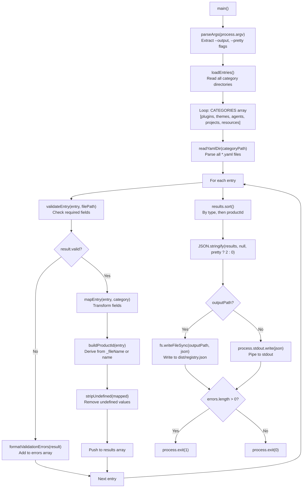
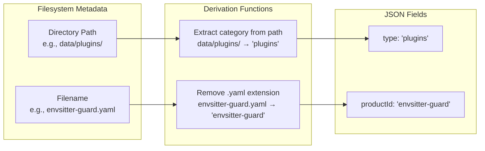
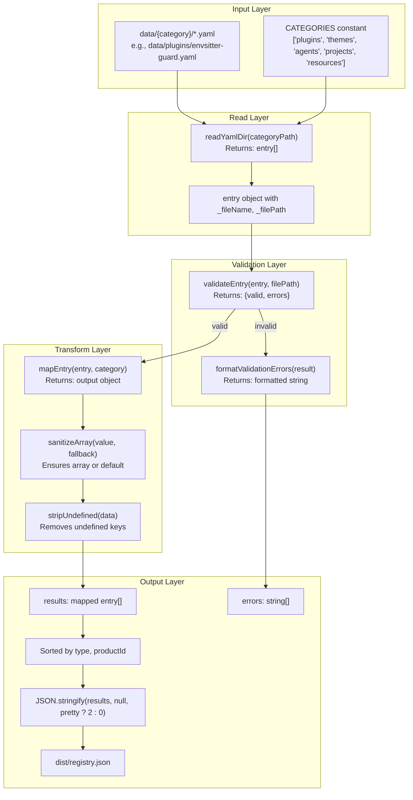

<!-- source: DeepWiki mcp.deepwiki.com · repo awesome-opencode/awesome-opencode · page 5.2 Registry Export · fetched 2026-10-30 -->

# Registry Export

<details>
<summary>Relevant source files</summary>

The following files were used as context for generating this wiki page:

- [dist/registry.json](dist/registry.json)
- [scripts/export-json.js](scripts/export-json.js)

</details>


This document describes the registry export system, which transforms YAML data files into a machine-readable JSON catalog. The export process generates `dist/registry.json`, a structured artifact consumed by downstream platforms like opencode.cafe and automated tooling.

For information about README generation, see [README Generation](#5.1). For validation rules applied during export, see [Validation System](#5.3). For the automated workflow that triggers this process, see [GitHub Actions Workflows](#5.4).

---

## Overview

The registry export system is implemented in [scripts/export-json.js:1-159](). It reads all YAML files from category directories defined in the `CATEGORIES` constant [scripts/export-json.js:14](), validates each entry, transforms field names to match downstream platform conventions, and outputs a sorted JSON array. Two critical fields—`type` and `productId`—are derived during export rather than stored in YAML files.

The export process enforces the principle that YAML files are the source of truth, while JSON artifacts are generated outputs that should never be manually edited.

**Sources:** [scripts/export-json.js:1-14](), [scripts/export-json.js:155-158]()

---

## Export Process Flow

The following diagram illustrates the complete export pipeline, showing how YAML files are processed through validation, transformation, and serialization stages:

**Export Pipeline with Function Calls**



**Sources:** [scripts/export-json.js:109-158](), [scripts/export-json.js:75-107]()

---

## Field Transformation

The export process performs two types of field transformations: **field renaming** (mapping YAML keys to JSON keys) and **field derivation** (computing new fields from context).

### Field Mapping Table

| YAML Field | JSON Field | Transformation | Default |
|------------|------------|----------------|---------|
| `name` | `displayName` | Direct copy | (required) |
| `repo` | `repoUrl` | Direct copy | (required) |
| `tagline` | `tagline` | Direct copy | (required) |
| `description` | `description` | Direct copy | (required) |
| (directory) | `type` | Derived from category path | N/A |
| `_fileName` | `productId` | Derived from filename (kebab-case) | N/A |
| `scope` | `scope` | Array sanitization | `['global']` |
| `tags` | `tags` | Array sanitization | `[]` |
| `homepage` | `homepageUrl` | Direct copy | undefined |
| `installation` | `installation` | Direct copy | undefined |
| `min_version` | `minVersion` | Direct copy | undefined |

**Sources:** [scripts/export-json.js:42-63]()

### Derived Fields

The following diagram shows how `type` and `productId` are derived from filesystem metadata rather than YAML content:

**Field Derivation Logic**



The `buildProductId()` function implements this derivation, prioritizing the `_fileName` metadata injected during YAML reading [scripts/export-json.js:25-33](). If `_fileName` is missing, it falls back to `slugify(entry.name)` [scripts/export-json.js:29-31]().

**Sources:** [scripts/export-json.js:25-33](), [scripts/export-json.js:43-50]()

---

## Data Flow Architecture

This diagram bridges natural language concepts to actual code entities, showing how data flows through the export pipeline:

**Entry Processing Data Flow**



**Sources:** [scripts/export-json.js:75-107](), [scripts/export-json.js:42-73]()

---

## Array Sanitization

The `sanitizeArray()` function ensures that array fields always have valid defaults. This prevents downstream consumers from encountering undefined arrays [scripts/export-json.js:35-40]().

**Application:**
- `scope`: defaults to `['global']` if undefined or empty [scripts/export-json.js:55]()
- `tags`: defaults to `[]` if undefined or empty [scripts/export-json.js:56]()

**Sources:** [scripts/export-json.js:35-40](), [scripts/export-json.js:55-56]()

---

## Validation Integration

The export process integrates with the validation system to ensure only valid entries are exported. Invalid entries are logged as errors but do not block the export of valid entries [scripts/export-json.js:92-103]().

If any errors occur during processing, the script logs them using the `log` helper and exits with status code 1 after writing the output [scripts/export-json.js:130-152](), ensuring CI/CD pipelines can detect validation failures.

**Sources:** [scripts/export-json.js:92-103](), [scripts/export-json.js:130-135](), [scripts/export-json.js:150-152]()

---

## Output Sorting

Entries in `dist/registry.json` are sorted to ensure deterministic output and improve downstream consumption [scripts/export-json.js:122-128]().

**Sort Order:**
1. Primary: `type` field (alphabetically: agents, plugins, projects, resources, themes) [scripts/export-json.js:123-126]()
2. Secondary: `productId` field (alphabetically within each type) [scripts/export-json.js:127]()

This ensures that entries in [dist/registry.json:1-121]() appear in a predictable order, making diffs meaningful and searches efficient.

**Sources:** [scripts/export-json.js:122-128]()

---

## CLI Usage

The export script accepts command-line arguments for controlling output format and destination [scripts/export-json.js:16-23]().

### Command-Line Arguments

| Argument | Description | Example |
|----------|-------------|---------|
| `--output <path>` | Write JSON to file instead of stdout | `--output dist/registry.json` |
| `--pretty` | Format JSON with 2-space indentation | `--pretty` |

### Usage Examples

```bash
# Write formatted JSON to file
node scripts/export-json.js --pretty --output dist/registry.json

# Pipe to stdout (unformatted)
node scripts/export-json.js > output.json
```

The `parseArgs()` function extracts these flags from `process.argv` [scripts/export-json.js:16-23]().

**Sources:** [scripts/export-json.js:16-23](), [scripts/export-json.js:1-7]()

---

## Undefined Field Removal

The `stripUndefined()` function removes keys with undefined values from the output object [scripts/export-json.js:65-73](). This keeps the JSON clean and prevents downstream consumers from receiving explicit `null` or `undefined` values.

**Sources:** [scripts/export-json.js:65-73](), [scripts/export-json.js:101]()

---

## Output Structure

The final `dist/registry.json` file is a flat array of entry objects. Each object represents one extension with all fields flattened at the top level [dist/registry.json:1-13]():

```json
[
  {
    "productId": "agentic",
    "type": "agents",
    "displayName": "Agentic",
    "repoUrl": "https://github.com/Cluster444/agentic",
    "tagline": "Modular AI agents",
    "description": "Modular AI agents and commands for structured software development with opencode.",
    "scope": [
      "global"
    ],
    "tags": []
  }
]
```

Optional fields (`homepageUrl`, `installation`, `minVersion`) are omitted when undefined [scripts/export-json.js:65-73]().

**Sources:** [dist/registry.json:1-13](), [scripts/export-json.js:48-60]()

---

